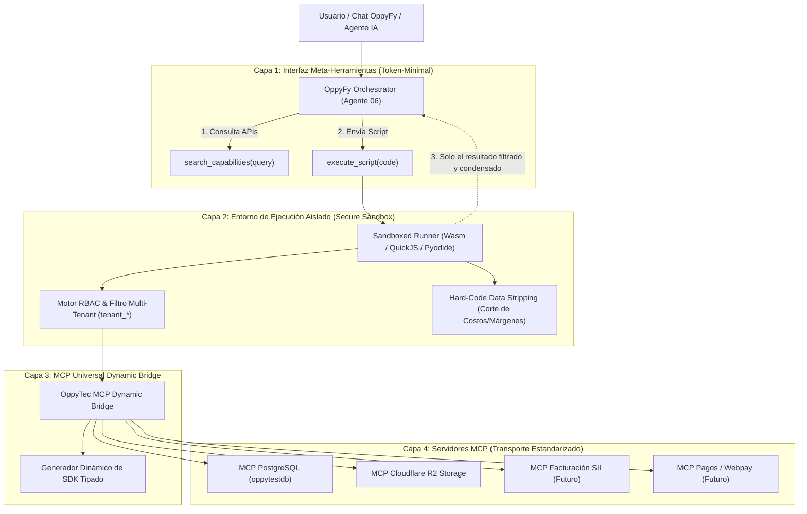
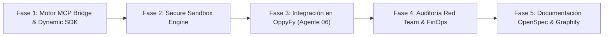

# PLAN MAESTRO: Arquitectura "Code Mode sobre MCP" para OppyFy y Ecosistema de Herramientas OppyTec V2.0

> **Estado:** Propuesta de Arquitectura y Plan Maestro de Implementación  
> **Filosofía Rectora:** *"MCP como estándar de conexión y transporte de servicios; Code Mode como la interfaz de orquestación y ejecución para el modelo."*  
> **Módulos Afectados:** `oppytec-backend/src/modules/oppy_ai/`, `oppytec-backend/src/core/mcp_bridge/`, `scripts/harness.py`  
> **Agentes Responsables:** `01-orchestrator-pm`, `02-software-architect`, `04-backend-senior-dev`, `06-ai-oppyfy-and-jev-engineer`, `10-cybersecurity-redteam-auditor`  

---

## 1. Visión y Diagnóstico Estratégico

### 1.1 El Cuello de Botella del MCP Tradicional (*Tool Calling 1.0*)
En la aproximación estándar de MCP (Model Context Protocol):
1. **Saturación del Contexto (*Context Bloat*):** Cada servidor MCP expone múltiples herramientas con esquemas JSON extensos. Conforme OppyTec integre bases de datos, pasarelas de pago, facturación electrónica (SII), mensajería (WhatsApp/Twilio) y almacenamiento (Cloudflare R2), el prompt del sistema se saturaría con cientos de miles de tokens solo para describir las herramientas.
2. **Latencia y Costo por Ping-Pong de Inferencia:** Tareas compuestas ("Calcula los 5 productos con mayor merma del restaurante X en el último mes y compáralos con el costo teórico") requieren 4 a 6 viajes redondos:
   - *Viaje 1:* LLM llama a herramienta A $\rightarrow$ Recibe 500 filas de historial.
   - *Viaje 2:* LLM procesa 500 filas en contexto $\rightarrow$ Llama a herramienta B.
   - *Viaje 3:* LLM calcula totales $\rightarrow$ Genera respuesta.
   - **Resultado:** Desperdicio de decenas de miles de tokens por turno, latencia acumulada inaceptable (> 12 segundos) y riesgo de *Context Rot* (alucinación por saturación).

### 1.2 La Solución: Code Mode (Ejecución Programática en Sandbox)
El modelo no recibe 50 herramientas JSON individuales. Recibe **2 herramientas universales**:
1. `search_capabilities(query)`: Búsqueda semántica en el catálogo de APIs/SDKs expuestos (< 150 tokens).
2. `execute_script(code)`: Entorno de ejecución cerrado donde el modelo escribe código (TypeScript o Python) que invoca localmente el SDK de los MCPs conectados, realiza bucles, filtrados y cálculos matemáticos en memoria del sandbox, y devuelve **únicamente el resultado sintetizado**.

---

## 2. Diagrama de Arquitectura de 4 Capas



---

## 3. Pilares Técnicos de la Implementación

### Pilar 1: Descubrimiento Universal y Autogeneración de SDK (*Zero-Prompt Overhead*)
* **Protocolo de Ingesta:** Al iniciar el backend de OppyTec, el `mcp_bridge` lee la configuración (`mcp_config.json`).
* **Introspección Automática:** Realiza una llamada `tools/list` a cada servidor MCP conectado (ej. PostgreSQL, R2, etc.).
* **Generación de SDK Tipado en Memoria:** Convierte las herramientas MCP en un módulo o namespace tipado.
* **Catálogo Compacto:** El modelo solo consulta `search_capabilities("ventas banquetes")` y recibe las firmas de función relevantes bajo demanda.

### Pilar 2: Sandbox Aislado y Seguridad Multi-Tenant
* **Aislamiento Físico y de Red:** El código generado por el LLM se ejecuta en un motor seguro cerrado (sin acceso a red no autorizada, sin acceso al filesystem del host).
* **Inyección de Contexto Tenant Inmutable:** El cliente MCP inyectado dentro del sandbox está prefijado con el esquema activo del usuario (`tenant_<tenant_id>`). El script del modelo **nunca puede ver ni consultar otros tenants**.
* **Hard-Code Data Stripping:** Si el rol del usuario no tiene el permiso `finanzas.costos.ver`, el puente intercepta las respuestas del MCP dentro del sandbox y elimina físicamente las columnas financieras antes de que el script las procese.
* **Límites de Ejecución (Watchdog):**
  - Timeout máximo: $3.000\text{ ms}$.
  - Memoria máxima: $64\text{ MB}$.
  - Instrucciones máximas: $1.000.000$ operaciones para evitar bucles infinitos.

### Pilar 3: Agregación en Memoria (*Token Reduction Real*)
* **Ejemplo Práctico:**
  ```javascript
  const orders = await oppy.postgres.query(
    "SELECT id, total_amount, status FROM orders WHERE created_at >= NOW() - INTERVAL '30 days'"
  );
  const total = orders
    .filter(o => o.status === 'COMPLETED')
    .reduce((acc, o) => acc + Number(o.total_amount), 0);

  return { total_completed_orders: orders.length, revenue: total };
  ```
* **Impacto en Tokens:**
  - Sin Code Mode: 1.000 órdenes transmitidas en JSON al LLM $\rightarrow \sim 45.000$ tokens.
  - Con Code Mode: 1 script enviado ($120$ tokens) $\rightarrow$ retorno JSON con 2 campos ($15$ tokens). **Ahorro del 99.7%**.

---

## 4. Plan de Implementación por Fases (DAG Multi-Agente)



### Fase 1: Motor MCP Dynamic Bridge & Generador de Tipos
* **Agentes:** `02-software-architect` y `04-backend-senior-dev`.
* **Entregables:**
  - `src/core/mcp_bridge/manager.py`: Administrador del ciclo de vida de servidores MCP (stdio/SSE).
  - Introspección reactiva de herramientas vía `tools/list` hacia definiciones tipadas.
  - Índice semántico ligero para `search_capabilities()`.

### Fase 2: Motor de Sandbox Aislado y Guardias Multi-Tenant
* **Agentes:** `04-backend-senior-dev` y `10-cybersecurity-redteam-auditor`.
* **Entregables:**
  - `src/core/sandbox/runner.py`: Ejecutor seguro en memoria (con timeout, memoria acotada y sin acceso al OS).
  - Middleware de inyección de permisos RBAC de 3 niveles y esquema `tenant_*`.
  - Mecanismo de *Hard-Code Data Stripping*.

### Fase 3: Integración Nativa en OppyFy (Agente 06)
* **Agentes:** `06-ai-oppyfy-and-jev-engineer`.
* **Entregables:**
  - Registro de las meta-herramientas `search_capabilities` y `execute_script` en el enrutador JEV de OppyFy.
  - Actualización del prompt de sistema de OppyFy para instruir la generación de scripts de orquestación.
  - Soporte de streaming del resultado del script al frontend de `/oppyfy`.

### Fase 4: Auditoría Ofensiva Red Team (Kali) y Métricas FinOps
* **Agentes:** `10-cybersecurity-redteam-auditor` y `09-qa-parity-and-test-engineer`.
* **Entregables:**
  - 10 pruebas de penetración contra el sandbox: intentos de escape de entorno, escape multi-tenant (`tenant_b`), consumo abusivo de CPU/RAM (bombas fork/bucles infinitos), exfiltración de credenciales.
  - Telemetría en `public.llm_request_logs`: medición de tokens ahorrados por consulta ejecutada vía Code Mode vs estimación tradicional.

### Fase 5: Gobernanza, OpenSpec Bipartito y Graphify
* **Agentes:** `12-tech-writer-openspec-archify`.
* **Entregables:**
  - Especificación en `specs/engineering-code/mcp-code-mode-bridge.spec.md`.
  - Documentación en `specs/business-domain/oppyfy-operational-intelligence.business.spec.md`.
  - Sincronización AST completa con `python scripts/harness.py sync-graph`.

---

## 5. Regla de Oro para Futuros MCPs en OppyTec
Para garantizar que **cualquier MCP futuro** aproveche automáticamente Code Mode sin requerir re-ingeniería:

> **Protocolo Universal de Adopción MCP:**
> 1. Se registra el nuevo servidor MCP en `mcp_config.json` (ej: `@modelcontextprotocol/server-cloudflare-r2`).
> 2. El `mcp_bridge` lo detecta en el arranque, consulta su catálogo de herramientas y compila sus firmas en el SDK interno del Sandbox.
> 3. El Agente 06 (OppyFy) y el escuadrón tienen acceso inmediato a través de `search_capabilities()` y `execute_script()`, sin aumentar el consumo de tokens base del sistema.
