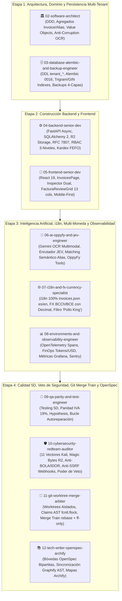
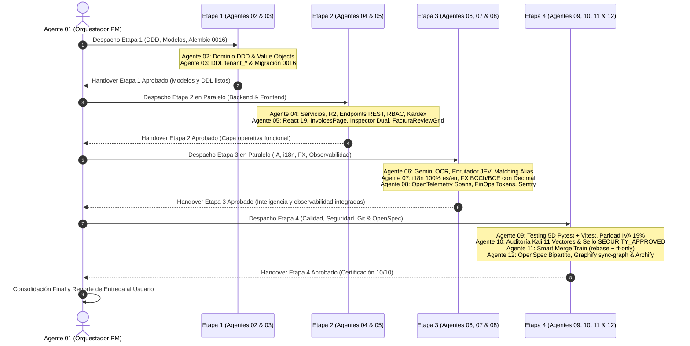

# 📋 PLAN MAESTRO DE CONTROL Y EJECUCIÓN: MÓDULO DE FACTURAS, INGESTA INTELIGENTE DTE, ALIAS DE PROVEEDORES Y CONCILIACIÓN CONTABLE (`/contabilidad/facturas`)

> **Regla de Gobernanza:** Este documento es el tablero de control de ejecución estricto del Módulo de Facturas y Contabilidad de OppyTec v2.0.  
> Cada fase y paso debe ser **100% corroborado y aprobado** antes de pasar al siguiente.  
> **Solo cuando se finalicen todos los pasos**, este documento podrá ser archivado o marcado como completado, no antes.  
> **Fuentes de Verdad Históricas (100% Solo Lectura):**  
> - `OppyTec-Legacy/OppyTec_Backend/src/invoices/models.py` (Modelos SQLAlchemy de facturas, ítems, flags de auditoría y tokens IA)  
> - `OppyTec-Legacy/OppyTec_Backend/src/invoices/router.py` (Endpoints históricos de upload, OCR, filtros, auditoría, bulk actions, SII y webhooks)  
> - `OppyTec-Legacy/OppyTec_Backend/src/invoices/schemas.py` (Schemas Pydantic históricos de extracción de facturas y respuesta)  
> - `OppyTec-Legacy/OppyTec_Backend/src/invoices/services.py` (Lógica de procesamiento multimodal Gemini OCR, parsing de PDF/imágenes y WebSockets)  
> - `OppyTec-Legacy/OppyTec_Backend/src/inventory/services/invoice_catalog_import_service.py` (Algoritmo de desacoplamiento de empaque mayorista, resolución de proveedores por RUT limpio, matching semántico de alias y actualización de stock en bodegas)  
> - `OppyTec-Legacy/OppyTec_Backend/alembic/versions/0024_add_invoices_and_reports.py` y `e1ff280a2a40_add_advanced_invoice_fields.py` (Esquemas DDL históricos de facturas, webhooks y campos avanzados)  
> - `OppyTec-Legacy/OppyTec_Backend/openspec/specs/business/invoices/procesamiento-facturas-ia.md` (OpenSpec histórico del ciclo de vida de facturas, auditoría tributaria y reglas de empaque)  
> - `OppyTec-Legacy/OppyTec_Frontend/src/pages/facturas/index.tsx` (Vista principal con tabs Dashboard, Facturas y Pipeline)  
> - `OppyTec-Legacy/OppyTec_Frontend/src/pages/facturas/InvoiceDetail.tsx` (Inspector dual en pantalla dividida: visor de archivo original + editor de ítems)  
> - `OppyTec-Legacy/OppyTec_Frontend/src/pages/facturas/useFacturas.ts` y `facturasApi.ts` (Hooks y capa cliente HTTP)  
> - `OppyTec-Legacy/OppyTec_Frontend/src/pages/facturas/components/DashboardTab.tsx` (Métricas de facturación y control FinOps de tokens Gemini)  
> - `OppyTec-Legacy/OppyTec_Frontend/src/pages/facturas/components/InvoicesTab.tsx`, `InvoiceTable.tsx`, `InvoiceFilters.tsx`, `InvoiceUploader.tsx`, `InvoicePreview.tsx`, `InvoiceStatusBadge.tsx` (Componentes visuales de grilla, filtros, preview y carga)  
> - `OppyTec-Legacy/OppyTec_Frontend/src/pages/Gestion/components/FacturaImportModal/FacturaImportModal.tsx`, `FacturaReviewGrid.tsx`, `FacturaSupplierBanner.tsx`, `UnidadMedidaCombobox.tsx` (Grilla interactiva de 13 columnas para revisión de empaque, conversión a stock real y registro de alias)  
> **Destinos de Construcción en OppyTec v2.0:**  
> - Frontend: `oppytec-frontend/src/features/invoices/` (`InvoicesPage.tsx`, `InvoiceDetailPage.tsx`, `components/`, `dialogs/`, `hooks/`, `types.ts`, `api/`)  
> - Backend: `oppytec-backend/src/modules/invoices/` (DDD: `domain/`, `application/`, `infrastructure/`, `presentation/`)  
> - Alembic: `oppytec-backend/alembic/versions/0016_tenant_invoices_dte_and_supplier_aliases.py` (down_revision: `0015_tenant_actividades_triada_enriquecida`)  

---

## 🏛️ Gobernanza del DAG Canónico de 12 Agentes (Etapas 1 a 4)

El desarrollo del Módulo de Facturas y Contabilidad se rige obligatoriamente por el **DAG Canónico de 12 Agentes** establecido en la Regla 9 de `AGENTS.md`.  
**Exclusión del Agente 13:** El Agente 13 (`13-browser-e2e-playwright`) opera desacoplado en la Etapa 5 bajo demanda para certificación E2E en navegador real y no bloquea el desarrollo ni la integración continua del pipeline principal (Etapas 1 a 4).  
Los 12 agentes núcleo participan bajo el principio de cadena de montaje, actuando como **Constructores Activos** en su dimensión o como **Certificadores de Impacto Cero (*Sign-off Auditors*)**:

### Matriz de Responsabilidades y Entregables por Agente

| ID | Agente | Rol en este Módulo | Tareas Específicas y Criterios de Aceptación |
|---|---|---|---|
| **01** | `01-orchestrator-pm` | Director del DAG | Supervisa el flujo entre etapas, valida handovers, gestiona claims atómicos y emite la consolidación final sin editar código de negocio directamente. |
| **02** | `02-software-architect` | Constructor Activo (Etapa 1) | Modela las entidades de dominio DDD (`Invoice`, `InvoiceLineItem`, `SupplierProductAlias`, `PriceDriftLog`), define Value Objects (`TaxId`, `DTEType`, `InvoiceStatus`, `MoneyAmount`, `PackagingFactor`), valida paridad matemática Legacy y define el Anti-Corruption Layer con OCR Gemini. |
| **03** | `03-database-alembic` | Constructor Activo (Etapa 1) | Genera la migración correlativa lineal Alembic `0016_tenant_invoices_dte_and_supplier_aliases.py` sobre esquemas dinámicos `tenant_*`, diseña índices B-Tree y Trigram GIN para búsqueda difusa de nombres/aliases y garantiza compatibilidad con respaldos cifrados `.sql.zst.age`. |
| **04** | `04-backend-senior-dev` | Constructor Activo (Etapa 2) | Implementa servicios de aplicación (`InvoiceService`, `InvoiceIngestionService`, `SupplierAliasService`, `PriceDriftService`, `DTEExportService`), adaptadores Cloudflare R2 aislados por tenant, enrutador FastAPI con respuestas RFC 7807, RBAC de 3 niveles y eventos WebSocket Pub/Sub. |
| **05** | `05-frontend-senior-dev` | Constructor Activo (Etapa 2) | Construye `/contabilidad/facturas` (`InvoicesPage.tsx` con tabs Dashboard, Facturas y Pipeline) y `/contabilidad/facturas/:id` (`InvoiceDetailPage.tsx` con visor interactivo PDF/imagen a la izquierda y `FacturaReviewGrid` a la derecha con 13 columnas y sticky headers), ADN Visual Legacy (3 temas) y Mobile-First. |
| **06** | `06-ai-oppyfy-and-jev` | Constructor Activo (Etapa 3) | Desarrolla el pipeline multimodal Gemini OCR con parsing estructurado de empaque (`packaging_description`, `content_per_package`, `base_unit`), enrutador JEV para clasificación automática de documentos, motor de matching semántico de aliases y herramientas OppyFy para auditoría de facturas. |
| **07** | `07-i18n-and-fx` | Constructor Activo (Etapa 3) | Garantiza 0 textos hardcodeados, crea `invoices.json` en paridad 1:1 (`es`/`en`), aplica la regla inviolable de marcas protegidas ("Pollo King", "Savory"), y gestiona conversión Multi-Moneda FX con tasas oficiales de Banco Central de Chile y BCE usando aritmética exacta con `Decimal`. |
| **08** | `08-environments-observability` | Constructor Activo (Etapa 3) | Instrumenta trazas distribuidas OpenTelemetry (`invoices.upload`, `invoices.gemini_extraction`, `invoices.confirm_stock`), métricas Prometheus/Grafana de costos FinOps (`gemini_tokens_used`, `gemini_cost_usd`), logs estructurados JSON con `tenant_id` y captura en Sentry sin PII. |
| **09** | `09-qa-parity-and-test` | Constructor Activo (Etapa 4) | Desarrolla la Suite de Testing 5D: pruebas unitarias de modelos y servicios en Pytest, paridad matemática de IVA 19% y neto, property-based testing con `Hypothesis` para descalces de redondeo, tests Vitest de componentes UI y activa el bucle de autoreparación ante fallas. |
| **10** | `10-cybersecurity-redteam` | Constructor Activo / Veto (Etapa 4) | Audita los 11 vectores Kali: valida Magic Bytes en R2 con `FileMagicGuard`, previene BOLA/IDOR en la descarga y consulta de facturas entre tenants, previene SSRF en webhooks con DNS resolver seguro y bloqueo de IPs privadas (RFC 1918 / cloud metadata), y emite el dictamen final `SECURITY_APPROVED`. |
| **11** | `11-git-worktree-merge` | Constructor Activo (Etapa 4) | Administra los Git Worktrees por agente/etapa, arbitra la contención de archivos compartidos mediante `claims_registry.json` con `fcntl.flock`, y ejecuta el Smart Merge Train con `git rebase` y `--ff-only`. |
| **12** | `12-tech-writer-openspec` | Constructor Activo (Etapa 4) | Crea y sincroniza las dos bóvedas de OpenSpec (`specs/business-domain/invoices.business.spec.md` y `specs/engineering-code/invoices.code.spec.md`), ejecuta la sincronización del Grafo AST (`python scripts/harness.py sync-graph`), actualiza el Atlas interactivo de Archify y redacta la bitácora humana. |

---

## 📊 Estado General del Proyecto

- [x] **Fase 1:** Arquitectura de Dominio DDD, Esquemas PostgreSQL `tenant_*` y Migración Correlativa Lineal Alembic `0016` (Modelos SQLAlchemy 2.0 Async, Value Objects inmutables, tablas `invoices`, `invoice_line_items`, `supplier_product_aliases`, `invoice_price_drift_logs`, `invoice_webhooks`, DDL con índices Trigram GIN)
- [x] **Fase 2:** Pipeline Multimodal Gemini OCR, Clasificación JEV y Telemetría FinOps (Extracción de campos estructurados, desglose de empaque mayorista, cálculo de confianza `confidence_score`, detección de flags tributarias y registro de tokens/costos USD)
- [x] **Fase 3:** Servicios de Negocio Backend: Ingesta Automática a Inventario, Algoritmo de Alias y Radar de Price Drift (Desacoplamiento de empaque a stock físico de cocina, ingreso a Bodega con Kardex FEFO, memoria de aprendizaje bidireccional de aliases y alertas de sobreprecio vs último costo)
- [x] **Fase 4:** Endpoints API REST RFC 7807, Adaptadores Cloudflare R2, Exportación SII DTE y WebSockets Zero-Polling (Endpoints con ProblemDetails, aislamiento de archivos en R2 `invoices/{tenant_id}/`, generador oficial SII Chile Compras/Ventas, exportadores ERP y notificaciones Redis Pub/Sub)
- [x] **Fase 5:** Frontend Feature Core: Contratos TypeScript, Hooks Reactivos TanStack Query v5 y Estado Local (Types exhaustivos, cliente API `invoicesApi.ts`, hooks `useInvoices`, `useInvoiceDetail`, `useInvoiceUpload`, `useRealtimeSync` con cero polling)
- [x] **Fase 6:** Vista Principal `/contabilidad/facturas` (`InvoicesPage.tsx`): Dashboard FinOps, Grilla de Documentos con Filtros Avanzados y Pipeline de Webhooks (Métricas de facturas y costos IA, toolbar de acciones masivas, filtros por estado/categoría/proveedor, y configuración de webhooks)
- [x] **Fase 7:** Inspector Dual de Detalle `/contabilidad/facturas/:id` (`InvoiceDetailPage.tsx`) y Grilla de Revisión (`FacturaReviewGrid.tsx`) (Pantalla dividida con visor PDF/imagen interactivo con zoom/rotación, grilla de 13 columnas con sticky headers, desacoplamiento empaque-cocina, combobox de unidades y selector de bodega)
- [x] **Fase 8:** Capas Cruzadas: i18n 100% `es`/`en`, Multi-Moneda FX con `Decimal`, Observabilidad OpenTelemetry, Testing 5D, Veto de Seguridad Kali y Sincronización Graphify/Archify/OpenSpec

---

## 🔍 Detalle y Criterios de Aceptación por Fase

---

### [x] FASE 1: Arquitectura de Dominio DDD, Esquemas PostgreSQL `tenant_*` y Migración Alembic 0016

#### 1.1 Modelado de Dominio DDD y Contratos Puros (`oppytec-backend/src/modules/invoices/domain/`)
- [x] Creación de Value Objects inmutables con validación en constructor:
  - `TaxId`: Validación de RUT chileno (módulo 11) con limpieza automática de puntos y guiones (`clean_tax_id`), con soporte para identificadores fiscales extranjeros.
  - `DTEType`: Enumeración estricta (`FACTURA_ELECTRONICA_33`, `FACTURA_EXENTA_34`, `GUIA_DESPACHO_52`, `BOLETA_ELECTRONICA_39`, `NOTA_CREDITO_61`, `NOTA_DEBITO_56`).
  - `InvoiceStatus`: Ciclo de vida inmutable (`UPLOADED`, `ANALYZING`, `ANALYZED`, `READY_FOR_REVIEW`, `CONFIRMED_STOCK`, `ERROR`, `REJECTED`).
  - `ConfidenceScore`: Float encapsulado entre $0.0000$ y $1.0000$ con umbrales semafóricos ($< 0.60$ requiere revisión obligatoria).
  - `PackagingFactor`: Multiplicador numérico positivo strictly $> 0$ (ej: $18.0\text{ kg/caja}$) con unidad de empaque y unidad canónica base de cocina.
  - `MoneyAmount`: Valor monetario estricto con `Decimal` de 4 decimales y código ISO de moneda.
- [x] Agregado Raíz `Invoice`:
  - Invariante de cuadre contable:
    $$\text{Total Bruto} = \text{Total Neto} + \text{Total IVA} + \text{Impuestos Específicos} - \text{Retenciones}$$
    Si la diferencia absoluta $|\text{Total} - (\text{Neto} + \text{IVA})| > 1\text{ CLP}$, se genera automáticamente una bandera `AuditFlag.TAX_MISMATCH`.
  - Método `confirm_and_ingest_stock(bodega_id, mapping_decisions, current_user_id)`: transiciona a `CONFIRMED_STOCK` y emite eventos de dominio `InvoiceStockConfirmedDomainEvent`.
- [x] Entidad `SupplierProductAlias`:
  - Relación bidireccional: `(tenant_id, supplier_id, alias_factura_normalized) -> producto_id`.
  - Soporte de sinónimos múltiples normalizados en minúsculas sin acentos ni caracteres especiales.
- [x] Entidad `PriceDriftLog`:
  - Registro de variación de precios unitarios:
    $$\Delta\% = \frac{\text{Costo Unitario Nuevo} - \text{Último Costo}}{\text{Último Costo}} \times 100$$
    Si $|\Delta\%| \ge 10\%$, se emite una alerta `PriceDriftAlert` de severidad `WARNING` o `CRITICAL` ($> 25\%$).

#### 1.2 Modelos de Persistencia SQLAlchemy 2.0 Async (`oppytec-backend/src/modules/invoices/infrastructure/models.py`)
- [x] Todos los modelos heredan estrictamente de `TenantBase` (residen en esquemas dinámicos `tenant_*` aislados por cliente).
- [x] Definición de tablas con tipos nativos de PostgreSQL y columnas de auditoría:
  - `invoices`:
    - `id`: UUID PK con `gen_random_uuid()`.
    - `user_id`: Integer FK a `public.users(id)`.
    - `filename`: String(500) no nulo.
    - `file_path`: Text (clave del objeto en Cloudflare R2: `invoices/{tenant_id}/{id}.{ext}`).
    - `file_type`: String(20) (`pdf`, `png`, `jpeg`).
    - `file_hash_sha256`: String(64) no nulo con índice único para deduplicación física de archivos.
    - `vendor_name`: String(500) nullable.
    - `vendor_tax_id`: String(50) nullable con índice B-Tree.
    - `vendor_fiscal_address`: Text nullable.
    - `vendor_country`: String(10) default `'CL'`.
    - `invoice_number`: String(100) nullable con índice compuesto `(vendor_tax_id, invoice_number)` para evitar facturas duplicadas.
    - `dte_type`: String(50) default `'FACTURA_ELECTRONICA_33'`.
    - `invoice_date`: Date nullable.
    - `due_date`: Date nullable.
    - `net_amount`: `Numeric(16, 4)` default `0.0000`.
    - `tax_amount`: `Numeric(16, 4)` default `0.0000` (IVA 19%).
    - `total_amount`: `Numeric(16, 4)` default `0.0000`.
    - `currency`: String(10) default `'CLP'`.
    - `transaction_type`: String(20) default `'expense'`.
    - `status`: String(50) default `'UPLOADED'` con índice B-Tree.
    - `confidence_score`: `Numeric(5, 4)` default `0.0000`.
    - `audit_flags`: JSONB default `'[]'::jsonb`.
    - `gemini_tokens_used`: Integer default `0`.
    - `gemini_cost_usd`: `Numeric(12, 6)` default `0.000000`.
    - `gemini_model_used`: String(100) nullable.
    - `gemini_processing_time_ms`: Integer nullable.
    - `is_confirmed_to_inventory`: Boolean default `False`.
    - `confirmed_at`: DateTime(timezone=True) nullable.
    - `confirmed_by_user_id`: Integer nullable.
    - `confirmed_bodega_id`: UUID nullable FK a `tenant_*.bodegas(id)`.
    - `created_at`, `updated_at`: DateTime con zona horaria UTC.
  - `invoice_line_items`:
    - `id`: UUID PK.
    - `invoice_id`: UUID FK a `invoices(id)` con `ON DELETE CASCADE`.
    - `line_number`: Integer no nulo.
    - `raw_description`: Text no nulo.
    - `sku_vendor`: String(100) nullable.
    - `quantity`: `Numeric(14, 4)` no nulo.
    - `unit_name`: String(50) default `'unidad'`.
    - `unit_price_net`: `Numeric(16, 4)` no nulo.
    - `tax_rate`: `Numeric(5, 2)` default `19.00`.
    - `total_net`: `Numeric(16, 4)` no nulo.
    - `packaging_description`: Text nullable.
    - `packaging_factor`: `Numeric(14, 4)` default `1.0000`.
    - `kitchen_base_unit`: String(50) default `'unidad'`.
    - `real_kitchen_stock`: `Numeric(14, 4)` no nulo.
    - `real_unit_cost`: `Numeric(16, 4)` no nulo.
    - `matched_product_id`: UUID nullable FK a `tenant_*.productos(id)`.
    - `match_status`: String(30) default `'unmatched'` (`exact_alias`, `suggested`, `unmatched`).
    - `created_at`: DateTime UTC.
  - `supplier_product_aliases`:
    - `id`: UUID PK.
    - `supplier_id`: UUID nullable FK a `tenant_*.proveedores(id)`.
    - `supplier_tax_id_normalized`: String(50) nullable con índice.
    - `alias_raw`: Text no nulo.
    - `alias_normalized`: Text no nulo con índice Trigram GIN para búsqueda difusa (`similarity`).
    - `producto_id`: UUID FK a `tenant_*.productos(id)` con `ON DELETE CASCADE`.
    - `default_packaging_factor`: `Numeric(14, 4)` default `1.0000`.
    - `default_kitchen_unit`: String(50) default `'unidad'`.
    - `times_used`: Integer default `1`.
    - `last_matched_at`: DateTime UTC.
    - `created_at`: DateTime UTC.
  - `invoice_price_drift_logs`:
    - `id`: UUID PK.
    - `invoice_id`: UUID FK a `invoices(id)`.
    - `producto_id`: UUID FK a `tenant_*.productos(id)`.
    - `supplier_id`: UUID nullable FK a `tenant_*.proveedores(id)`.
    - `previous_unit_cost`: `Numeric(16, 4)` no nulo.
    - `new_unit_cost`: `Numeric(16, 4)` no nulo.
    - `drift_percentage`: `Numeric(8, 4)` no nulo.
    - `severity`: String(20) no nulo (`INFO`, `WARNING`, `CRITICAL`).
    - `created_at`: DateTime UTC.
  - `invoice_webhooks`:
    - `id`: UUID PK.
    - `url`: Text no nulo.
    - `description`: Text nullable.
    - `secret_token`: String(255) no nulo para firma HMAC-SHA256 del payload.
    - `events`: JSONB default `'["invoice.processed", "invoice.stock_confirmed"]'::jsonb`.
    - `is_active`: Boolean default `True`.
    - `created_at`: DateTime UTC.

#### 1.3 Migración Correlativa Lineal Alembic `0016`
- [x] Ubicación: `oppytec-backend/alembic/versions/0016_tenant_invoices_dte_and_supplier_aliases.py`.
- [x] Metadatos estrictos:
  - `revision = '0016_tenant_invoices_dte_and_supplier_aliases'`
  - `down_revision = '0015_tenant_actividades_triada_enriquecida'`
- [x] Lógica `upgrade()` iterativa para todos los esquemas `tenant_*` dinámicos + verificación de extensiones `pg_trgm` en esquema público.
- [x] Índices de rendimiento obligatorios:
  - `CREATE INDEX idx_invoices_vendor_tax ON {tenant_slug}.invoices(vendor_tax_id);`
  - `CREATE INDEX idx_invoices_date ON {tenant_slug}.invoices(invoice_date DESC);`
  - `CREATE INDEX idx_invoices_status ON {tenant_slug}.invoices(status);`
  - `CREATE INDEX idx_invoices_sha256 ON {tenant_slug}.invoices(file_hash_sha256);`
  - `CREATE INDEX idx_aliases_trgm ON {tenant_slug}.supplier_product_aliases USING gin (alias_normalized gin_trgm_ops);`
- [x] Lógica `downgrade()` limpia y simétrica con eliminación de tablas y tipos.

---

### [x] FASE 2: Pipeline Multimodal Gemini OCR, Clasificación JEV y Telemetría FinOps

#### 2.1 Enrutador Cognitivo JEV (Sistema 1) para Documentos Contables
- [x] Clasificación ultrarrápida del documento previo a inferencia pesada:
  - Detección de formato nativo (PDF vectorial vs PDF escaneado vs Imagen PNG/JPEG).
  - Si el PDF tiene texto embebido extraíble, se ejecuta pre-parseo local de encabezados DTE (`R.U.T.`, `FACTURA ELECTRÓNICA N°`) ahorrando hasta un $70\%$ de tokens LLM.
  - Determinación de cuota y saldo de créditos OppyFy/Gemini del tenant antes de despachar la petición (`QuotaGuard`).

#### 2.2 Servicio de Extracción Multimodal con Gemini 2.5 (`GeminiInvoiceProcessor`)
- [x] Conversión de PDF multipágina a imágenes de alta resolución (300 DPI) usando renderizado seguro en memoria sin persistir en disco efímero.
- [x] Micro-prompt estructurado con esquema Pydantic estricto para respuesta en JSON puro (`response_mime_type="application/json"`):
  - Extracción de emisor: `vendor_name`, `vendor_tax_id`, `vendor_fiscal_address`, `vendor_country`.
  - Extracción de receptor: `client_name`, `client_tax_id`.
  - Extracción de cabecera: `invoice_number`, `invoice_date`, `due_date`, `dte_type`.
  - Extracción de montos: `net_amount`, `tax_amount`, `specific_taxes`, `total_amount`, `currency`.
  - Extracción de ítems con **desglose mayorista y empaque**:
    - `description`: Texto literal de la factura.
    - `quantity`: Cantidad facturada formal.
    - `unit`: Unidad de facturación (`caja`, `bolsa`, `kg`, etc.).
    - `unit_price`: Precio unitario neto facturado.
    - `tax_rate`: Tasa impositiva (default 19.0 para Chile).
    - `packaging_description`: Desglose del bulto (ej: `"3 piezas de ~6 kg (18 kg total)"`).
    - `content_per_package`: Factor multiplicador numérico a la unidad base de cocina (ej: `18.0`).
    - `base_unit`: Unidad canónica gastronómica (`kg`, `g`, `L`, `ml`, `unidad`).
- [x] Fallback resiliente con expresiones regulares para empaques si el LLM asignó factor `1.0`:
  - `r'\(~?(\d+(?:[.,]\d+)?)\s*kg\)'` $\rightarrow$ factor en kg.
  - `r'(?:caja|pieza|industrial|bolsa|saco|malla|bidon)[^0-9]*(\d+(?:[.,]\d+)?)\s*kg'` $\rightarrow$ factor en kg.

#### 2.3 Cálculo de Confianza y Reglas de Auditoría Tributaria (`AuditFlags`)
- [x] Cálculo determinista de `confidence_score` ponderado:
  - Coincidencia RUT receptor con el RUT oficial del tenant: $+0.30$.
  - Cuadre matemático exacto de $(\text{Neto} + \text{IVA} = \text{Total})$: $+0.30$.
  - Extracción válida de fecha y folio: $+0.20$.
  - Al menos una línea de detalle extraída con precio y cantidad válidos: $+0.20$.
- [x] Generación automática de `audit_flags`:
  - `TAX_MISMATCH`: Diferencia de más de \$1 entre suma de ítems/IVA y total del documento.
  - `RECEIVER_RUT_MISMATCH`: El RUT del receptor en la factura no coincide con la entidad legal activa del tenant.
  - `UNKNOWN_SUPPLIER`: El emisor no existe previamente en el catálogo de proveedores.
  - `PRICE_DRIFT_DETECTED`: Variación superior al $10\%$ en comparación con compras previas.
  - `DUPLICATE_INVOICE_WARNING`: Folio y RUT emisor ya registrados en el tenant.

#### 2.4 Telemetría FinOps y Registro de Costos de Tokens
- [x] Registro milimétrico en cada transacción:
  - `gemini_tokens_used`: Suma de prompt tokens + candidate tokens reportados por la API.
  - `gemini_cost_usd`: Cálculo de costo con `Decimal(12, 6)` basado en la lista de precios oficial del modelo.
  - `gemini_processing_time_ms`: Tiempo de latencia del ciclo de inferencia.
- [x] Impacto en la billetera de créditos OppyFy del tenant (`deduct_tenant_credits`).

---

### [x] FASE 3: Servicios de Negocio Backend: Ingesta Automática a Inventario, Algoritmo de Alias y Radar de Price Drift

#### 3.1 Motor de Resolución de Proveedores (`_resolve_supplier`)
- [x] Búsqueda por RUT normalizado:
  - Eliminación de puntos, espacios y guiones: `clean_tax_id(raw_rut)`.
  - Comparación insensible a mayúsculas/minúsculas contra `tenant_*.proveedores.rut`.
- [x] Si no coincide por RUT, búsqueda por similitud de texto sobre `razon_social` o `nombre_fantasia` (umbral $\ge 0.85$).
- [x] Retorno estructurado con indicador `is_registered: bool`, `supplier_id`, `razon_social`, `rut`, y condiciones de crédito configuradas.

#### 3.2 Motor de Matching Semántico de Productos y Alias (`_resolve_product_and_alias`)
- [x] Nivel 1 (`exact_alias`):
  - Búsqueda en `supplier_product_aliases` por `(supplier_id, alias_normalized)`.
  - Si coincide, asigna inmediatamente el `producto_id`, `matched_factor_conversion` y `matched_unidad` asociados. Confianza: $100\%$.
- [x] Nivel 2 (`exact_sku` o `exact_name`):
  - Búsqueda en `tenant_*.productos` por `sku` exacto o coincidencia literal del nombre del producto. Confianza: $95\%$.
- [x] Nivel 3 (`suggested` vía Trigram/Levenshtein Similarity):
  - Consulta mediante operador `%` de PostgreSQL `pg_trgm` con similitud $\ge 0.50$:
    $$\text{similarity}(\text{alias\_normalized}, \text{p.nombre\_completo}) \ge 0.50$$
  - Selecciona la mejor coincidencia del catálogo sugiriendo el producto y su categoría.
- [x] Nivel 4 (`unmatched`):
  - Si la puntuación máxima es $< 0.50$, la fila se marca como `unmatched` sugiriendo la acción `create_new` con la categoría gastronómica más probable.

#### 3.3 Confirmación Transaccional e Ingesta a Inventario (`confirm_invoice_stock_ingestion`)
- [x] Operación ACID bajo Unit of Work:
  1. Si el usuario seleccionó crear un producto nuevo:
     - Alta en `tenant_*.productos` con `costo_unitario = costo_unitario_inventario`, `factor_conversion = factor_empaque`, `unidad_envase`, y `iva_porcentaje`.
  2. Si el usuario seleccionó producto existente:
     - Actualización de `costo_unitario_ultimo` en el producto.
     - Si el producto carecía de factor de empaque, se registra el factor detectado.
  3. Ingreso de stock físico real a bodega:
     - Cálculo:
       $$\text{Stock Físico Real} = \text{Cantidad Facturada} \times \text{Factor de Empaque}$$
     - Creación de asiento en `tenant_*.kardex_movements`:
       - `tipo_movimiento = 'INGRESO_FACTURA'`
       - `cantidad = Stock Físico Real`
       - `costo_unitario = Costo Unitario Inventario`
       - `documento_referencia = f"Factura #{invoice_number} - {vendor_name}"`
       - `factura_id = invoice.id`
       - `lote_fefo`: Creación automática del lote con fecha de vencimiento extraída o calculada por shelf-life de la categoría.
     - Incremento del saldo en `tenant_*.producto_bodegas.stock_actual`.
  4. Memorización del Alias de Proveedor:
     - Si el flag `remember_alias` está activo, inserción o actualización (`upsert`) en `supplier_product_aliases` incrementando `times_used` y guardando el factor de conversión predeterminado.
  5. Registro en el Radar de Price Drift:
     - Si existía un costo previo $> 0$, cálculo de la variación porcentual.
     - Si $|\Delta\%| \ge 10\%$, inserción en `invoice_price_drift_logs`.
  6. Actualización del documento:
     - Marcar `invoices.is_confirmed_to_inventory = True`, `status = 'CONFIRMED_STOCK'`, `confirmed_at = now()`, `confirmed_bodega_id = bodega_id`.
  7. Emisión de eventos WebSocket a través de Redis Pub/Sub:
     - `invoices.changed`
     - `inventory.changed`
     - `kardex.changed`

---

### [x] FASE 4: Endpoints API REST RFC 7807, Adaptadores Cloudflare R2, Exportación SII DTE y WebSockets Zero-Polling

#### 4.1 Adaptadores Cloudflare R2 para Almacenamiento Aislado de Facturas
- [x] Carga de archivos protegida por aislamiento de tenant:
  - Clave en el bucket R2: `invoices/{tenant_id}/{invoice_id}.{pdf|png|jpg}`.
  - Verificación estricta de encabezados y Magic Bytes antes de subir a R2 (`FileMagicGuard`).
  - Generación de URLs presignadas con tiempo de vida restringido ($\le 15$ minutos) para visualización en el frontend.
  - Control de cuota de almacenamiento del tenant (bloqueo HTTP 403 si el tenant excedió su cupo en MB).

#### 4.2 Endpoints REST RFC 7807 (`oppytec-backend/src/modules/invoices/presentation/router.py`)
- [x] Prefix: `/api/v1/invoices` con tags `["Invoices", "Accounting"]`.
- [x] Todos los errores devuelven `ProblemDetails` normalizado según RFC 7807 con código de error legible en máquina (`title`, `detail`, `status`, `invalid_params`).
- [x] Matriz de Endpoints con Guardias RBAC de 3 Niveles:
  - `GET /api/v1/invoices`: Listado paginado con filtros de fecha, estado, emisor, tipo DTE y ordenamiento. Guard: `invoices.invoices.read`.
  - `POST /api/v1/invoices/upload`: Carga de uno o múltiples archivos (PDF/imagen) vía `multipart/form-data`, almacenamiento en R2 y despacho de análisis OCR. Guard: `invoices.invoices.upload`.
  - `GET /api/v1/invoices/{id}`: Detalle de factura con ítems, flags de auditoría, proveedor resuelto y URL presignada del archivo. Guard: `invoices.invoices.read`.
  - `POST /api/v1/invoices/{id}/process`: Re-procesamiento con IA (Gemini). Guard: `invoices.invoices.edit`.
  - `PUT /api/v1/invoices/{id}`: Actualización de metadatos o edición manual de ítems. Guard: `invoices.invoices.edit`.
  - `POST /api/v1/invoices/{id}/confirm-stock`: Confirmación e ingesta al inventario (Kardex, Bodega, Alias). Guard: `invoices.invoices.confirm_stock`.
  - `DELETE /api/v1/invoices/{id}`: Soft-delete de factura (bloqueado si el stock ya fue confirmado). Guard: `invoices.invoices.delete`.
  - `POST /api/v1/invoices/bulk-process`: Procesamiento masivo de facturas pendientes. Guard: `invoices.invoices.upload`.
  - `POST /api/v1/invoices/bulk-delete`: Eliminación masiva. Guard: `invoices.invoices.delete`.
  - `GET /api/v1/invoices/stats`: Métricas consolidadas del panel (totales, procesadas, pendientes, tokens y costos USD acumulados). Guard: `invoices.invoices.read`.
  - `GET /api/v1/invoices/price-drift`: Reporte analítico de variación de precios de insumos. Guard: `invoices.invoices.read`.
  - `POST /api/v1/invoices/export`: Exportación multiformato (CSV, Excel, QuickBooks, Xero, Odoo). Guard: `invoices.invoices.export`.
  - `GET /api/v1/invoices/export/sii/compras`: Generación del archivo oficial de Registro de Compras del SII Chile. Guard: `invoices.invoices.export`.
  - `GET /api/v1/invoices/export/sii/ventas`: Generación del archivo oficial de Registro de Ventas del SII Chile. Guard: `invoices.invoices.export`.
  - `GET /api/v1/invoices/webhooks`: Listado de webhooks salientes. Guard: `invoices.webhooks.manage`.
  - `POST /api/v1/invoices/webhooks`: Registro de webhook saliente. Guard: `invoices.webhooks.manage`.
  - `DELETE /api/v1/invoices/webhooks/{id}`: Baja de webhook. Guard: `invoices.webhooks.manage`.
  - `POST /api/v1/invoices/push-webhook`: Envío manual de facturas a webhooks configurados. Guard: `invoices.webhooks.manage`.

#### 4.3 Formatos Oficiales de Exportación SII Chile y ERPs
- [x] Exportador SII Compras (`sii_compras`):
  - Columnas canónicas SII: `Tipo Doc`, `Folio`, `RUT Proveedor`, `Razón Social`, `Fecha Docto`, `Monto Exento`, `Monto Neto`, `Monto IVA Recuperable`, `Monto Total`.
  - Formato CSV delimitado por punto y coma `;` con codificación ANSI/ISO-8859-1 para importación directa en el portal del SII.
- [x] Exportadores ERP:
  - QuickBooks Bills (formato CSV con columnas mapeadas a cuentas contables de gastos).
  - Xero Invoices / Bills.
  - Odoo Account Moves JSON/CSV.

#### 4.4 Túnel WebSocket Zero-Polling (`/api/v1/ws/realtime`)
- [x] Emisión de mensajes enriquecidos vía Redis Pub/Sub:
  - `invoice.analyzing`: progreso de lectura OCR con porcentaje estimado.
  - `invoice.analyzed`: extracción completada con `confidence_score` e ítems.
  - `invoice.stock_confirmed`: stock ingresado a bodega y Kardex actualizado.
  - `invoice.price_drift_alert`: detección de alza crítica de precio de insumo.
- [x] Invalida quirúrgicamente las query keys en TanStack Query v5:
  - `["invoices"]`
  - `["invoice_detail", id]`
  - `["invoice_stats"]`
  - `["inventory"]`
  - `["kardex"]`
  - `["price_drift"]`

---

### [x] FASE 5: Frontend Feature Core: Tipos TypeScript, Hooks Reactivos TanStack Query v5 y Estado Local

#### 5.1 Contratos TypeScript en `oppytec-frontend/src/features/invoices/types.ts`
- [x] Definición exhaustiva de interfaces y tipos:
  - `InvoiceStatus = 'UPLOADED' | 'ANALYZING' | 'ANALYZED' | 'READY_FOR_REVIEW' | 'CONFIRMED_STOCK' | 'ERROR' | 'REJECTED'`.
  - `DTEType = 'FACTURA_ELECTRONICA_33' | 'FACTURA_EXENTA_34' | 'GUIA_DESPACHO_52' | 'BOLETA_ELECTRONICA_39' | 'NOTA_CREDITO_61' | 'NOTA_DEBITO_56'`.
  - `InvoiceLineItem`:
    - `id`: string (UUID).
    - `raw_description`: string.
    - `quantity`: number.
    - `unit_name`: string.
    - `unit_price_net`: number.
    - `tax_rate`: number.
    - `total_net`: number.
    - `packaging_description`?: string;
    - `factor_empaque`: number;
    - `kitchen_base_unit`: string;
    - `total_stock_fisico`: number;
    - `costo_unitario_inventario`: number;
    - `match_status`: `'exact_alias' | 'suggested' | 'unmatched'`;
    - `matched_product_id`: string | null;
    - `matched_product_name`: string | null;
    - `matched_product_sku`: string | null;
    - `suggested_categoria_id`: string | null;
    - `product_action`: `'use_existing' | 'create_new'`;
    - `nombre_negocio`: string;
    - `categoria_id`: string;
    - `bodega_id`: string;
    - `remember_alias`: boolean;
  - `Invoice`:
    - `id`: string.
    - `filename`: string.
    - `file_url`: string;
    - `file_type`: string;
    - `vendor_name`: string | null;
    - `vendor_tax_id`: string | null;
    - `invoice_number`: string | null;
    - `dte_type`: DTEType;
    - `invoice_date`: string | null;
    - `due_date`: string | null;
    - `net_amount`: number;
    - `tax_amount`: number;
    - `total_amount`: number;
    - `currency`: string;
    - `status`: InvoiceStatus;
    - `confidence_score`: number;
    - `audit_flags`: Array<{ code: string; message: string; severity: 'low' | 'medium' | 'high' }>;
    - `gemini_tokens_used`: number;
    - `gemini_cost_usd`: number;
    - `is_confirmed_to_inventory`: boolean;
    - `confirmed_bodega_id`?: string | null;
    - `items`: InvoiceLineItem[];
    - `created_at`: string;
  - `InvoiceStats`:
    - `total_invoices`: number;
    - `pending_review`: number;
    - `confirmed_stock`: number;
    - `total_net_clp`: number;
    - `total_tax_clp`: number;
    - `total_amount_clp`: number;
    - `total_tokens_used`: number;
    - `total_cost_usd`: number;
    - `avg_confidence_score`: number;
  - `PriceDriftItem`:
    - `producto_id`: string;
    - `producto_nombre`: string;
    - `proveedor_nombre`: string;
    - `costo_anterior`: number;
    - `costo_nuevo`: number;
    - `variacion_pct`: number;
    - `fecha`: string;
    - `severidad`: 'info' | 'warning' | 'critical';

#### 5.2 Capa Cliente API (`oppytec-frontend/src/features/invoices/api/invoicesApi.ts`)
- [x] Implementación de métodos sobre `httpClient` tipado:
  - `list(params: InvoiceFilterParams): Promise<PaginatedResponse<Invoice>>`
  - `getById(id: string): Promise<Invoice>`
  - `upload(files: File[], onProgress?: (pct: number) => void): Promise<{ uploaded: number; invoices: Invoice[] }>`
  - `process(id: string): Promise<Invoice>`
  - `update(id: string, payload: Partial<Invoice>): Promise<Invoice>`
  - `confirmStock(id: string, payload: ConfirmStockPayload): Promise<{ success: boolean; movements_created: number }>`
  - `remove(id: string): Promise<void>`
  - `bulkProcess(ids: string[]): Promise<{ processed: number }>`
  - `bulkDelete(ids: string[]): Promise<{ deleted: number }>`
  - `getStats(): Promise<InvoiceStats>`
  - `getPriceDrift(): Promise<PriceDriftItem[]>`
  - `exportInvoices(ids: string[], format: 'csv' | 'excel' | 'quickbooks' | 'xero' | 'odoo' | 'sii_compras' | 'sii_ventas'): Promise<Blob>`
  - `listWebhooks(): Promise<InvoiceWebhook[]>`
  - `createWebhook(webhook: Partial<InvoiceWebhook>): Promise<InvoiceWebhook>`
  - `deleteWebhook(id: string): Promise<void>`

#### 5.3 Hooks Reactivos con TanStack Query v5
- [x] `useInvoices(filters)`: Listado con paginación, filtros reactivos y suscripción a WebSockets.
- [x] `useInvoiceDetail(id)`: Consulta detallada de una factura con caché y refresco reactivo.
- [x] `useInvoiceUpload()`: Mutación de subida de archivos con barra de progreso y toast feedback.
- [x] `useConfirmStock()`: Mutación optimista para confirmación e ingreso a bodega.
- [x] `useInvoiceStats()`: Consulta periódica / invalidada por WebSockets de estadísticas y costos FinOps.
- [x] `usePriceDrift()`: Consulta de variaciones de costos con umbrales configurables.

---

### [x] FASE 6: Vista Principal `/contabilidad/facturas` (`InvoicesPage.tsx`): Dashboard FinOps, Grilla y Pipeline

#### 6.1 Encabezado y Navegación por Pestañas
- [x] `SectionHeader` centrado (#3b82f6 / #6366f1) con título internacionalizado `t('invoices.title')` y subtítulo descriptivo.
- [x] Selector de área y holding visible en el toolbar.
- [x] Barra de pestañas animada con Framer Motion:
  1. `DashboardTab`: Métricas de control contable, estado de conciliación y costos de tokens.
  2. `InvoicesTab`: Grilla principal de facturas, filtros, buscador y acciones por lote.
  3. `PipelineTab`: Configuración de webhooks salientes, historial de envíos e integraciones ERP.

#### 6.2 Pestaña 1: `DashboardTab.tsx` (Métricas & FinOps)
- [x] Tarjetas KPI superiores:
  - Facturas Pendientes de Revisión (con indicador pulsante si hay documentos con `confidence_score < 0.60`).
  - Total Neto Facturado del Mes (con formato monetario activo vía `<MoneyBadge />`).
  - IVA Débito/Crédito Fiscal del Período.
  - Total Facturas Ingestadas a Inventario (tasa de conversión a stock).
- [x] Panel FinOps de Inteligencia Artificial:
  - Total Tokens Gemini Consumidos en el período.
  - Gasto acumulado en USD (`gemini_cost_usd`) con desglose de costo promedio por factura ($\sim \$0.003\text{ USD/doc}$).
  - Gráfico de barras de facturas procesadas por día.
- [x] Radar de Variación de Precios (Price Drift Widget):
  - Top 5 de insumos con mayores aumentos porcentuales en el mes con badge de advertencia.

#### 6.3 Pestaña 2: `InvoicesTab.tsx` (Grilla Principal y Filtros)
- [x] `InvoiceUploader.tsx`:
  - Zona drag-and-drop con soporte para múltiples archivos (PDF, PNG, JPG).
  - Indicador de tamaño máximo ($20\text{ MB}$) y validación de extensiones en el cliente.
  - Barra de progreso interactiva con feedback visual por documento.
- [x] `InvoiceFilters.tsx`:
  - Campo de búsqueda por texto libre (RUT, proveedor, número de folio).
  - Selector de estado (`Todos`, `Pendiente Revisión`, `Ingresado a Inventario`, `Analizando`, `Error`).
  - Selector de rango de fechas (selector rápido: Hoy, Últimos 7 días, Este mes, Personalizado).
  - Selector de tipo DTE (`Factura Electrónica`, `Factura Exenta`, `Guía de Despacho`, etc.).
- [x] `InvoiceTable.tsx`:
  - Checkbox para selección individual y masiva.
  - Columnas: Folio, Tipo DTE, Proveedor (con RUT y badge si está registrado en el catálogo), Fecha Emisión, Total Neto, IVA, Total Bruto, Confianza (score semafórico con pill visual), Estado, Inventario (Badge si ya fue ingresado a bodega), Acciones.
  - Menú de acciones por fila: Ver/Editar Inspector Dual, Re-procesar con IA, Ingresar a Inventario, Descargar Archivo Original, Eliminar.
- [x] `BulkActionsBar.tsx`:
  - Barra flotante contextual al seleccionar una o más facturas:
    - Procesar con IA masivamente.
    - Exportar selección a formatos ERP (`ExportDropdown.tsx` con opciones CSV, Excel, QuickBooks, Xero, Odoo, SII Compras).
    - Reenviar a Webhook ERP.
    - Eliminar selección con diálogo de confirmación.

#### 6.4 Pestaña 3: `PipelineTab.tsx` (Webhooks e Integraciones)
- [x] Listado de webhooks activos con URL de destino, eventos suscritos y estado.
- [x] Modal para registrar nuevo webhook con URL y descripción.
- [x] Botón de prueba de conexión ("Test Ping") con envío de payload simulado.
- [x] Registro de entregas recientes con código HTTP de respuesta y tiempo de respuesta en ms.

---

### [x] FASE 7: Inspector Dual de Detalle `/contabilidad/facturas/:id` (`InvoiceDetailPage.tsx`) y Grilla de Revisión (`FacturaReviewGrid.tsx`)

#### 7.1 Arquitectura del Inspector Dual en Pantalla Dividida
- [x] Vista responsiva en 2 paneles (50% / 50% en pantallas desktop $\ge 1280\text{px}$, apilado con tabs en dispositivos móviles/tablets):
  - **Panel Izquierdo (`InvoicePreview.tsx`):**
    - Visor embebido interactivo para archivos PDF (usando visor nativo PDF.js) e imágenes de alta definición.
    - Controles de visor: Zoom in/out, rotación $90^\circ$, ajuste a pantalla, selector de página en PDFs multipágina y descarga del archivo original.
  - **Panel Derecho (Formulario de Cabecera + `FacturaReviewGrid.tsx`):**
    - Banner de Proveedor (`FacturaSupplierBanner.tsx`): Alerta visual si el proveedor no está registrado, con botón rápido "Vincular / Crear Proveedor en Catálogo".
    - Resumen de montos de cabecera: Folio, Fecha, Moneda, Neto, IVA, Total.
    - Alertas de auditoría (`AuditWarnings.tsx`): Lista de banderas semafóricas (descalces de IVA, RUT receptor discordante, sobreprecios).
    - Botones de acción principales: "Guardar Cambios", "Re-analizar con IA", "Confirmar e Ingresar a Inventario" (con spinner de carga y feedback).

#### 7.2 Grilla de Revisión de 13 Columnas (`FacturaReviewGrid.tsx`)
- [x] Columna 1 (`#`): Contador numérico de fila.
- [x] Columna 2 (`Ítem Factura / Proveedor`): Columna congelada (`sticky left-[48px] bg-background`):
  - Nombre literal de la factura en negrita.
  - Pill descriptivo de empaque detectado: `📦 {detalle_empaque}` (ej: `📦 3 piezas de ~6 kg (18 kg total)`).
  - Subtexto con cantidad facturada, unidad original y tasa de IVA.
- [x] Columna 3 (`Estado Match`): Badge semafórico interactivo:
  - `exact_alias` (Verde esmeralda): Coincidencia exacta con alias memorizado previamente.
  - `suggested` (Azul/Índigo): Sugerencia por similitud semántica.
  - `unmatched` (Ámbar/Rojo): Sin coincidencia en catálogo (sugiere crear nuevo).
- [x] Columna 4 (`Producto Negocio / Catálogo`):
  - Toggle o selector entre `Usar Existente` o `Crear Nuevo`.
  - Selector searchable conectado al catálogo maestro con SKU y categoría.
- [x] Columna 5 (`Categoría`): Selector de categoría operativa con icono visual (`CategoryIcon`).
- [x] Columna 6 (`Bodega Destino`): Selector directo de bodega de destino por ítem (permite distribuir insumos entre Bodega Central, Cocina Fría, Bar, etc.).
- [x] Columna 7 (`Cant. Facturada`): Cantidad formal del documento (editable).
- [x] Columna 8 (`Precio Factura`): Precio unitario neto facturado (editable con recálculo automático).
- [x] Columna 9 (`Total Neto`): Total neto de la línea ($\text{Cantidad} \times \text{Precio Neto}$).
- [x] Columna 10 (`Stock Real Bodega`):
  - Input numérico reactivo que por defecto aplica:
    $$\text{Stock Físico} = \text{Cant. Facturada} \times \text{Factor de Empaque}$$
  - Permite edición manual para ajustes directos de balanza física en recepción.
- [x] Columna 11 (`Unidad Inventario`):
  - Combobox searchable (`UnidadMedidaCombobox.tsx`) con unidades gastronómicas (`kg`, `g`, `L`, `ml`, `unidad`, `atado`, `porción`).
- [x] Columna 12 (`Costo Real / Unid.`):
  - Badge visualmente destacado (`bg-emerald-500/15 text-emerald-400 font-mono font-semibold`):
    $$\text{Costo Real Cocina} = \frac{\text{Total Neto Factura}}{\text{Stock Real Bodega}}$$
  - Si el producto ya tenía un costo previo, muestra un pill comparativo de variación (ej: `▲ +4.2%` o `▼ -1.8%`).
- [x] Columna 13 (`Recordar Alias`):
  - Checkbox interactivo `remember_alias`: Al guardar, asocia permanentemente el nombre de la factura al producto seleccionado en la tabla de aliases.

#### 7.3 Modal / Flujo de Confirmación de Ingesta
- [x] Diálogo de confirmación previa que resume:
  - Total de productos a ingresar al inventario.
  - Total de stock físico en unidades canónicas (kg, L, unidades).
  - Bodegas de destino seleccionadas.
  - Nuevos productos que se crearán en el catálogo.
  - Nuevos aliases que se guardarán para aprendizaje futuro.
- [x] Ejecución transaccional e invalidación inmediata de estados con notificación toast y redirección opcional al Kardex.

---

### [x] FASE 8: Capas Cruzadas, i18n, FX, Observabilidad, Testing 5D, Veto de Seguridad Kali y Sincronización Graphify/Archify/OpenSpec

#### 8.1 Cobertura de Internacionalización (i18n 100% `es`/`en` y 0 Textos Hardcodeados)
- [x] Archivos de localización:
  - `oppytec-frontend/src/shared/i18n/locales/es/invoices.json`
  - `oppytec-frontend/src/shared/i18n/locales/en/invoices.json`
- [x] Cobertura completa de namespaces:
  - Títulos, tabs (`dashboard`, `invoices`, `pipeline`), filtros, estados, acciones por lote.
  - Tabla de facturas: cabeceras de columnas, badges de confianza, badges de estado.
  - Inspector dual: visor de documento, controles de zoom/rotación, banners de proveedor, alertas de auditoría.
  - Grilla de revisión: títulos de las 13 columnas, placeholders, opciones de match, combobox de unidades.
  - Webhooks: configuración, campos, estados y mensajes de error.
- [x] **Filtro Inviolable de Marcas Propias y Nombres ("Pollo King"):**
  - Protección estricta de nombres de proveedores, marcas de alimentos y razones sociales (no deben ser traducidas ni alteradas por el motor i18n).
- [x] Verificación de 0 cadenas fijas en JSX o atributos accesibles (`aria-label`, `placeholder`, `title`).

#### 8.2 Soporte Multi-Moneda FX con Precisión `Decimal`
- [x] Backend: Todos los cálculos de importes, IVA, retenciones y costos reales unitarios realizados estrictamente con `Decimal` (prohibido `float`).
- [x] Frontend: Integración con `<MoneyBadge />` y `useCurrencyFormatter`.
- [x] Conversión dinámica de divisas extranjeras (USD, EUR, UF) a moneda base del tenant usando el servicio de tasas oficiales del Banco Central de Chile / BCE con guardias anti-anomalía ($> 8\%$).

#### 8.3 Instrumentación de Observabilidad (OpenTelemetry, Grafana, Sentry)
- [x] Trazas distribuidas OpenTelemetry con spans contextualizados:
  - `invoices.upload_file`: tiempo de recepción y hashing SHA-256.
  - `invoices.r2_storage`: latencia de subida y presigned URLs.
  - `invoices.gemini_extraction`: latencia de inferencia y extracción de tokens.
  - `invoices.confirm_stock_kardex`: tiempo de persistencia transaccional y rebaje a bodegas.
- [x] Métricas Prometheus/Grafana:
  - `invoices_processed_total`: contador por tenant, estado y tipo DTE.
  - `invoices_gemini_tokens_total`: contador de tokens consumidos.
  - `invoices_gemini_cost_usd_total`: métrica acumulada de costos FinOps.
  - `invoices_price_drift_alerts_total`: contador de alertas de sobreprecio emitidas.
- [x] Manejo de excepciones en Sentry/GlitchTip con sanitización automática de PII (RUTs y datos bancarios enmascarados).

#### 8.4 Suite de Pruebas Automatizadas 5D
- [x] **Backend (Pytest):**
  - `tests/unit/modules/test_invoices_domain_and_models.py`: Validación de Value Objects (`TaxId`, `MoneyAmount`, `PackagingFactor`), invariantes contables de agregado `Invoice` y DDL.
  - `tests/unit/modules/test_invoices_services.py`: `InvoiceService`, `InvoiceIngestionService`, resolución de proveedores por RUT limpio, algoritmo de matching de aliases (niveles 1 a 4) y radar de price drift.
  - `tests/integration/test_invoices_api_and_r2.py`: Endpoints REST RFC 7807, upload multipart, confirmación a Kardex y generación de DTE SII compras/ventas.
  - `tests/unit/modules/test_invoices_hypothesis.py`: Property-based testing con `Hypothesis` para variaciones numéricas de IVA 19%, factores de empaque y divisiones de stock sin pérdida de céntimos.
- [x] **Frontend (Vitest):**
  - `InvoicesPage.test.tsx`: Renderizado del dashboard, cambio de pestañas, carga de archivos y tabla de documentos.
  - `InvoiceDetailPage.test.tsx`: Inspector dual, renderizado de preview y edición de campos de cabecera.
  - `FacturaReviewGrid.test.tsx`: Cálculo reactivo de las 13 columnas, aplicación de factor de empaque, selección de bodega y toggle de alias.
  - `InvoicesI18nAndFx.test.tsx`: Paridad 1:1 en traducciones `es`/`en` y formateo de moneda sin hardcoding.

#### 8.5 Auditoría de Ciberseguridad Ofensiva Red Team de 11 Vectores (Agente 10)
- [x] Vector 1: Validación estricta de Magic Bytes en subida de facturas con `FileMagicGuard` (bloqueo incondicional de scripts PHP, ejecutables ELF/PE, HTML o SVG malicioso camuflado como `.pdf` o `.png`).
- [x] Vector 2: Prevención rigurosa de BOLA/IDOR (verificación en cada endpoint de que el `invoice_id`, archivo en R2 y bodegas pertenezcan al `tenant_id` autenticado en la sesión).
- [x] Vector 3: Prevención de SSRF en Webhooks salientes: validación estricta de la URL de destino mediante resolución DNS segura, bloqueando IPs privadas (RFC 1918: `10.0.0.0/8`, `172.16.0.0/12`, `192.168.0.0/16`), localhost (`127.0.0.1`, `::1`) y endpoints de metadatos cloud (`169.254.169.254`).
- [x] Vector 4: Sanitización XSS en visualización de ítems y nombres de proveedores con `xss_sanitizer`.
- [x] Vector 5: Firma criptográfica HMAC-SHA256 en webhooks de salida con cabecera `X-OppyTec-Signature`.
- [x] Emisión del dictamen formal `SECURITY_APPROVED` con firma del Agente 10 (o ejercicio de su poder de veto si se detecta cualquier vulnerabilidad).

#### 8.6 Montaje en Enrutador SPA y Verificación de Compilación
- [x] Rutas registradas en `oppytec-frontend/src/app/router.tsx`:
  - `/contabilidad/facturas` $\rightarrow$ `InvoicesPage`
  - `/contabilidad/facturas/:id` $\rightarrow$ `InvoiceDetailPage`
- [x] Verificación de compilación: `pnpm run typecheck` (`tsc --noEmit`) con 0 errores y `pnpm test` con 100% de tests en verde.
- [x] Respeto absoluto a la prohibición de `npm`/`yarn` (uso exclusivo de `pnpm`).

#### 8.7 Sincronización del Grafo AST, Bóvedas OpenSpec y Archify Atlas
- [x] Sincronización de Grafo ejecutada mediante `python scripts/harness.py sync-graph`.
- [x] Creación y sincronización de Bóvedas OpenSpec bipartitas:
  - `specs/business-domain/invoices.business.spec.md`
  - `specs/engineering-code/invoices.code.spec.md`
- [x] Actualización de mapas interactivos en Archify Atlas (`docs/architecture/atlas/`).
- [x] Registro de bitácora humana en `docs/bitacora/diario-escuadron/` y actualización del MOC general en `docs/bitacora/00-MAPA-SEGUNDO-CEREBRO.md`.

---

## 🎯 Protocolo de Ejecución y Traspaso entre Agentes (Handovers)

| Etapa | Agentes Convocados | Fase a Cargo | Entregables Principales |
| :---: | :--- | :--- | :--- |
| **Etapa 1** | `02-software-architect` & `03-database-alembic-and-backup-engineer` | **FASE 1** | Entidades DDD, Value Objects, DDL `tenant_*`, Migración Alembic `0016_tenant_invoices_dte_and_supplier_aliases.py`, Índices Trigram GIN. |
| **Etapa 2** | `04-backend-senior-dev` & `05-frontend-senior-dev` | **FASE 3, 4, 5, 6, 7** | Backend: Servicios de Ingesta, Kardex FEFO, Endpoints RFC 7807, Adaptadores R2, Exportación SII DTE, WebSockets. Frontend: `InvoicesPage`, `InvoiceDetailPage`, `FacturaReviewGrid` 13 columnas, Inspector Dual, 3 Temas visuales. |
| **Etapa 3** | `06-ai-oppyfy-and-jev-engineer`, `07-i18n-and-fx-currency-specialist` & `08-environments-and-observability-engineer` | **FASE 2, 8** | Agente 06: Gemini OCR multimodal, Enrutador JEV, algoritmo de alias, herramientas OppyFy. Agente 07: `invoices.json` (`es`/`en`), FX BCCh/BCE con `Decimal`, regla "Pollo King". Agente 08: OpenTelemetry Spans, telemetría FinOps tokens/costos, Sentry sin PII. |
| **Etapa 4** | `09-qa-parity-and-test-engineer`, `10-cybersecurity-redteam-auditor`, `11-git-worktree-merge-arbiter` & `12-tech-writer-openspec-archify` | **FASE 8** | Agente 09: Testing 5D (Pytest + Vitest + Hypothesis). Agente 10: Auditoría Kali 11 vectores, Magic Bytes R2, Anti-BOLA, Anti-SSRF Webhooks, Sello `SECURITY_APPROVED`. Agente 11: Worktrees, claims AST, Smart Merge Train. Agente 12: Bóvedas OpenSpec, sync Graphify, Atlas Archify, Bitácora. |

---

## 🔒 Criterios de Calidad Inviolables

1. **Cero Hardcoding (SecretStr / Variables de Entorno):** Ni un solo secreto, endpoint o credencial en código plano.
2. **Cero Floats en Dinero (`Decimal` Estricto):** Todo cálculo financiero (Neto, IVA, Total, Costo Unitario, Factores) se realiza con `Decimal` en backend y aritmética entera / formateo exacto en frontend.
3. **Cero `npm` / `yarn` (Exclusivo `pnpm`):** Toda gestión de paquetes, compilación y pruebas en frontend debe ejecutarse obligatoriamente con `pnpm`.
4. **Paridad Matemática con Legacy:**
   - Cálculo del IVA: $\text{IVA} = \text{round}(\text{Neto} \times 0.19)$.
   - Cuadre contable: $|\text{Total} - (\text{Neto} + \text{IVA})| \le 1\text{ CLP}$.
   - Desacoplamiento de empaque a stock de cocina: $\text{Stock Real} = \text{Cantidad Facturada} \times \text{Factor de Empaque}$.
   - Costo unitario para recetas: $\text{Costo Unitario} = \frac{\text{Total Neto}}{\text{Stock Real}}$.
5. **Gobernanza Estricta de Graphify:**
   - Consulta pre-ejecución con `python scripts/harness.py nav "<símbolo>"`.
   - Sincronización post-ejecución obligatoria con `python scripts/harness.py sync-graph`.
6. **100% de Pruebas en Verde:** Ninguna etapa se considera terminada si existe un solo test fallido en Pytest o Vitest.
7. **Poder de Veto de Seguridad:** El Agente 10 posee poder de veto incondicional si se detecta cualquier brecha de Magic Bytes, BOLA/IDOR o SSRF en webhooks.
