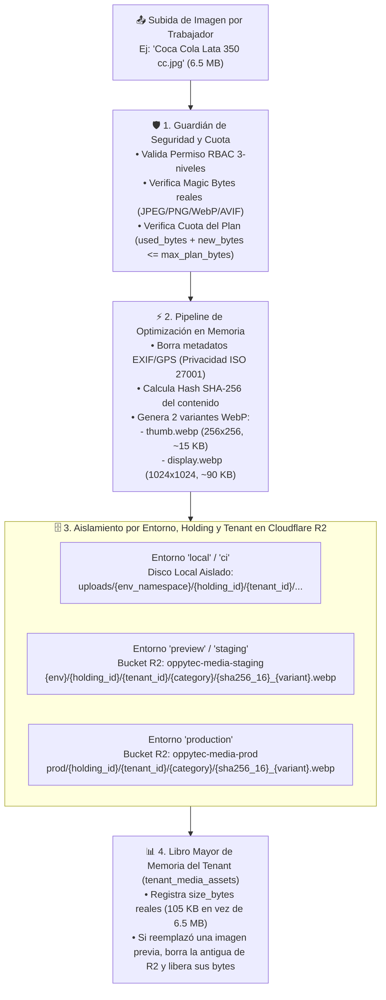

# Estrategia Maestra de Almacenamiento de Imágenes y Archivos en Cloudflare R2: Aislamiento por Tenant/Entorno, Optimización WebP y Cuotas de Memoria por Plan (Versión 001)

> **Documento:** `estrategia_almacenamiento_imagenes_r2_y_cuotas_001.md`  
> **Versión:** 001 (Especificación Normativa de Almacenamiento Multi-Tenant en Cloudflare R2, Prevención de Colisiones, Compresión WebP en 2 Capas, Deduplicación SHA-256 y Gestor de Memoria por Plan Contratado)  
> **Base Normativa:**  
> - `MASTER-AGENTIC-ENGINEERING-FRAMEWORK.md`  
> - `propuesta_arquitectura_tree_001.md`  
> - `.agent/estrategias/estrategia_migraciones_alembic_001.md`  
> - `.agent/estrategias/estrategia_rbac_y_auditoria_001.md`  
> - `.agent/estrategias/estrategia_testing_calidad_y_seguridad_001.md`  
> - `.agent/estrategias/estrategia_entornos_y_despliegue_001.md`  
> - `.agent/estrategias/estrategia_orquestacion_git_worktrees_y_smart_merge_001.md`  
> - `.agent/estrategias/estrategia_visualizacion_y_auditoria_archify_001.md`  
> - `.agent/estrategias/estrategia_openspec_negocio_vs_codigo_001.md`  
> - `.agent/estrategias/estrategia_asistente_ai_oppyfy_rag_y_creditos_001.md`  
> - `.agent/estrategias/estrategia_motor_decisiones_jev_system1_001.md`  
> - `.agent/estrategias/estrategia_internacionalizacion_i18n_multilenguaje_001.md`  
> - `.agent/estrategias/estrategia_multimoneda_fx_precios_y_cobros_001.md`  
> - `.agent/estrategias/estrategia_observabilidad_monitoreo_y_analitica_001.md`  
> **Propósito:** Definir la arquitectura para la carga, optimización, entrega rápida y control de memoria de imágenes y archivos en **Cloudflare R2**, garantizando aislamiento absoluto entre `Tenants` y `Environments` (cero colisiones aunque dos clientes suban *"Coca Cola Lata 350 cc"*), limpieza automática de archivos reemplazados y un **Gestor de Cuota de Memoria (`MB/GB`) ligado al Plan contratado**.  
> **Fecha:** Octubre 2026  

---

## 1. Diagnóstico de `OppyTec-Legacy` (`src/storage/r2.py` y `router.py`)

Al auditar el manejo de imágenes en `OppyTec-Legacy/OppyTec_Backend/src/storage/`, se detectaron **6 vulnerabilidades y defectos de diseño** que corregimos de raíz en OppyTec v2.0:

1. **Colisión de imágenes entre Tenants en almacenamiento local:** En `_save_product_image_local` (`r2.py` línea 101), los archivos se guardaban como `src/static/images/products/prod_{producto_id}.{ext}` sin incluir el `tenant_id`. Si el Restaurante A y el Restaurante B tenían un producto con `id = 15`, al subir su foto el Restaurante B sobrescribía la imagen del Restaurante A.
2. **Mezcla de Entornos y Tenants en Avatares y Uploads:** `upload_avatar_bytes_to_r2` guardaba todo en una ruta plana `avatars/{filename}` dentro de un único bucket hardcodeado `"oppytec-public"`, mezclando `development`, `staging` y `production`.
3. **Hardcoding de Dominios y Buckets:** En `r2.py` estaban quemados en código tanto `"oppytec-public"` como la URL `"https://pub-693986afee154b369b5ca2b96d341053.r2.dev"`.
4. **Endpoint `/storage/upload` abierto sin autenticación ni Magic Bytes:** En `src/storage/router.py`, cualquier persona externa podía subir archivos sin JWT, validando únicamente el string `file.content_type` (fácilmente falsificable) y asignando permisos inseguros `0o777`.
5. **Acumulación infinita de archivos huérfanos ("Archivos Zombis"):** Cuando un cliente cambiaba la imagen de un producto o receta por una nueva, la imagen anterior jamás se eliminaba de R2.
6. **Ausencia de Cuota de Memoria por Plan:** Un cliente con el plan más básico podía subir miles de imágenes de 10 MB sin ningún límite ni contabilización de espacio.

---

## 2. Arquitectura de Aislamiento Físico y Lógico en Cloudflare R2 (Cero Colisiones)

Para que dos clientes distintos que suben una imagen para `"Coca Cola Lata 350 cc"` (o dos entornos distintos como `staging` y `production`) **jamás se mezclen ni colisionen**, establecemos una jerarquía de **2 niveles de aislamiento**:



### 2.1 Estructura Canónica de la Llave de Objeto (`Object Key`)
Todo archivo almacenado en Cloudflare R2 (o en el sistema de archivos local durante desarrollo) sigue obligatoriamente este formato determinista:

```plaintext
{environment}/{holding_id}/{tenant_id}/{category}/{sha256_prefix_16}_{variant}.webp
```

**Ejemplo real de por qué es 100% libre de conflictos:**
- **Cliente 1 (`Restaurante Pacífico`, `tenant_id = t_aaa1`)** sube foto para *"Coca Cola Lata 350 cc"*:
  - `prod/h_1111/t_aaa1/catalog_products/9f8e7d6c5b4a3210_thumb.webp`
  - `prod/h_1111/t_aaa1/catalog_products/9f8e7d6c5b4a3210_display.webp`
- **Cliente 2 (`Hotel Miramar`, `tenant_id = t_bbb2`)** sube foto para su propio *"Coca Cola Lata 350 cc"*:
  - `prod/h_2222/t_bbb2/catalog_products/9f8e7d6c5b4a3210_thumb.webp`
  - `prod/h_2222/t_bbb2/catalog_products/9f8e7d6c5b4a3210_display.webp`
- Cada archivo vive estrictamente dentro del prefijo `{environment}/{holding_id}/{tenant_id}/`. Ninguna operación de un Tenant puede leer, sobrescribir ni borrar objetos fuera de su propio prefijo.

---

## 3. Pipeline de Optimización de Velocidad (`WebP` en 2 Capas + CDN Inmutable)

Para que la plataforma cargue instantáneamente en cualquier dispositivo y consuma el mínimo espacio posible:

1. **Inspección Binaria Estricta (`Magic Bytes`) y Limpieza EXIF:**
   - Se leen los primeros bytes reales del archivo (`\xff\xd8\xff` JPEG, `\x89PNG` PNG, `RIFF....WEBP` WebP). Se prohíben archivos `.svg` subidos por usuarios (por riesgo de XSS embebido) y cualquier binario ejecutable.
   - Se eliminan todas las cabeceras `EXIF` (coordenadas GPS, modelo de cámara, serie del teléfono) antes de guardar.
2. **Generación Automática de 2 Variantes `.webp` (`Pillow` / `libvips` en Worker Async):**
   - **`_thumb.webp` (`256 x 256 px`, calidad `80`, peso típico `12–18 KB`):** Se carga en listados de productos, grillas de venta POS, selectores de inventario y tarjetas móviles. Permite mostrar 100 productos en pantalla descargando apenas `~1.5 MB` en total.
   - **`_display.webp` (`1024 x 1024 px` máx., calidad `85`, peso típico `70–110 KB`):** Se carga bajo demanda (`loading="lazy"`) únicamente cuando el usuario abre el detalle de un producto, la ficha técnica de una receta o el visor de buffet.
3. **Caché de Borde Inmutable en Cloudflare CDN vs. Archivos Privados Firmados:**
   - **Activos Visuales del Catálogo (`catalog_products`, `recipes`, `avatars`, `buffet_crops`, `logos`):** Se sirven con cabecera `Cache-Control: public, max-age=31536000, immutable`. Como el nombre del objeto contiene los primeros 16 caracteres del `SHA-256` de la imagen, si el cliente cambia la foto de la *"Coca Cola"*, el hash cambia automáticamente y el navegador muestra la foto nueva en `0 ms` sin problemas de caché antiguo.
   - **Documentos y Facturas Confidenciales (`invoices`, `supplier_contracts`, `oppyfy_private_docs`):** Se almacenan bajo prefijo privado sin acceso público directo; el backend entrega una **URL Firmada Temporal (`Presigned URL` con `TTL = 300 segundos`)** únicamente tras verificar el permiso RBAC de 3 niveles del usuario.

---

## 4. Gestor de Cuota de Memoria por Plan Contratado (`Storage Quota Engine`)

Para evitar que un cliente suba imágenes infinitas sin control y vincular el uso de memoria directamente a su plan comercial:

### 4.1 Configuración de Cuotas en `public.system_plans` (100% Editable por el SuperUser)
- En `public.system_plans`, el `SuperUser` de OppyTec define y edita libremente la capacidad de almacenamiento incluida en cada plan:
  - `max_storage_mb: int` (ej. *Plan Inicial* = `500 MB`, *Plan Profesional* = `2.048 MB (2 GB)`, *Plan Holding/Enterprise* = `10.240 MB (10 GB)`).
- Además, en `public.tenants` y `public.holdings` existe el campo opcional **`custom_storage_mb_override: int | None`** editable por el `SuperUser` para ampliar la memoria a un cliente específico cuando contrate espacio adicional.

### 4.2 Libro Mayor de Archivos del Tenant (`tenant_media_assets`) y Descuento Atómico
Dentro de cada esquema `tenant_*`, la tabla `tenant_media_assets` lleva el control exacto byte por byte:
- Columnas: `id` (`UUID`), `sha256_hash` (`VARCHAR(64)` Indexed), `category`, `thumb_object_key`, `display_object_key`, `original_filename`, **`total_size_bytes` (`BIGINT`)**, `reference_count` (`INTEGER`), `uploaded_by_user_id`, `created_at`.
- **Validación Transaccional Pre-Subida (`SELECT ... FOR UPDATE`):**
  1. Cuando el usuario sube una imagen, el pipeline la comprime a `.webp` y calcula su peso real optimizado (`new_total_bytes = len(thumb_bytes) + len(display_bytes)`).
  2. El servicio bloquea el contador de cuota del Tenant y verifica:
     $$\text{current\_used\_bytes} + \text{new\_total\_bytes} \le \text{effective\_max\_storage\_bytes}$$
  3. Si supera el límite del plan, rechaza la operación con `HTTP 413 Payload Too Large / Quota Exceeded` (`i18n_key: "storage:errors.plan_quota_exceeded"`).

### 4.3 Deduplicación Inteligente Intra-Tenant y Recolección de Basura Instantánea
1. **Deduplicación por `SHA-256` dentro del mismo Tenant:**
   - Si un mismo restaurante asigna la misma foto de *"Coca Cola Lata 350 cc"* a 4 productos o combos distintos dentro de su propio catálogo, el motor detecta que `sha256_hash` ya existe en `tenant_media_assets` de ese Tenant: reutiliza las URLs existentes, incrementa `reference_count` y **no vuelve a descontar bytes adicionales de la cuota de su plan**.
2. **Liberación Inmediata de Memoria al Reemplazar o Eliminar:**
   - Cuando el cliente cambia la foto de un producto por otra o elimina un registro/imagen, `reference_count` disminuye en `1`.
   - Si `reference_count == 0`, el adaptador elimina físicamente `thumb_object_key` y `display_object_key` de Cloudflare R2 y **libera en el acto esos `bytes` de la memoria ocupada del cliente**, garantizando **cero archivos huérfanos en R2**.

---

## 5. Vistas de Gestión de Memoria (Para el Propietario y para el SuperUser de OppyTec)

### 5.1 Panel "Memoria de Imágenes y Archivos" para el Propietario (`features/catalog/` / `Configuración`)
- Muestra un indicador visual claro de capacidad:
  `📦 Memoria ocupada: 142,5 MB de 500 MB (28,5%) — Espacio disponible: 357,5 MB`
- Desglosa el uso por categoría (*Imágenes de Productos*, *Fotos de Recetas*, *Buffet y Eventos*, *Facturas Digitalizadas*, *Documentos de OppyFy*).
- Permite al Propietario **ver y eliminar imágenes sin uso o pesadas** para liberar memoria en su plan cuando lo desee.

### 5.2 Monitor Global de Almacenamiento R2 en `platform-admin` (SuperUser OppyTec)
- Integrado en el panel administrativo de OppyTec (con el filtro por `Environment`: `production` | `staging` | `preview` | `local`):
  - Muestra cuántos `MB / GB` y cuántos objetos está ocupando cada Holding y cada Tenant en Cloudflare R2.
  - Alerta sobre clientes que están por llegar al `90%` de la cuota de su plan (oportunidad comercial de *upselling* de plan o paquete de almacenamiento).
  - Permite al SuperUser editar el límite `max_storage_mb` de cualquier plan o el `custom_storage_mb_override` de cualquier cliente en un clic.

---

## 6. Artefactos a Construir en el Proyecto (Nombres y Ubicaciones)

| # | Artefacto | Ruta Exacta en el Proyecto | Propósito |
|---|---|---|---|
| **1** | **ADR de Almacenamiento R2 y Cuotas** | `docs/adr/ADR-017-multi-tenant-r2-media-storage-webp-and-plan-quotas.md` | Congela la jerarquía de llaves `{env}/{holding}/{tenant}/...`, la compresión WebP dual, la deduplicación SHA-256 y la cuota por plan. |
| **2** | **Specs Bipartitos (OpenSpec)** | `specs/business-domain/media-storage-and-quotas.business.spec.md` + `specs/engineering-code/media-storage-and-quotas.code.spec.md` | Guía para el cliente sobre cómo gestionar su memoria de imágenes (`business`) y contrato técnico de R2, Magic Bytes y cuotas (`code`). |
| **3** | **Regla Agéntica Inmutable** | `.agent/rules/18-media-storage-r2-and-quota-governance.md` | Prohíbe guardar archivos sin prefijo `{env}/{holding_id}/{tenant_id}`, exige compresión WebP, limpieza de huérfanos y validación de cuota del plan. |
| **4** | **Skill de Almacenamiento R2** | `.agent/skills/r2_media_storage/SKILL.md` | Patrones asíncronos (`aioboto3` / `httpx`), generación de thumbnails WebP y URLs firmadas para facturas privadas. |
| **5** | **Adaptadores y Pipeline de Imágenes** | `oppytec-backend/src/adapters/storage/` (`protocol.py`, `r2_storage.py`, `local_storage.py`, `image_optimizer.py`) | Compresión a `thumb.webp` + `display.webp`, borrado de EXIF y subida/borrado asíncrono en R2 o disco local por namespace. |
| **6** | **Servicio de Cuota de Almacenamiento** | `oppytec-backend/src/modules/tenancy/application/storage_quota_service.py` | Controla `max_storage_mb`, deduplicación por `SHA-256` y liberación inmediata de bytes al borrar/reemplazar imágenes. |
| **7** | **Quality Gate de Aislamiento y Cuotas R2** | `oppytec-backend/tests/architecture/test_media_storage_isolation_and_quotas.py` | Verifica que dos Tenants con el mismo nombre de archivo nunca colisionen, que se rechacen subidas al superar `max_storage_mb` y que al reemplazar una imagen se borre la anterior y se liberen sus bytes. |
