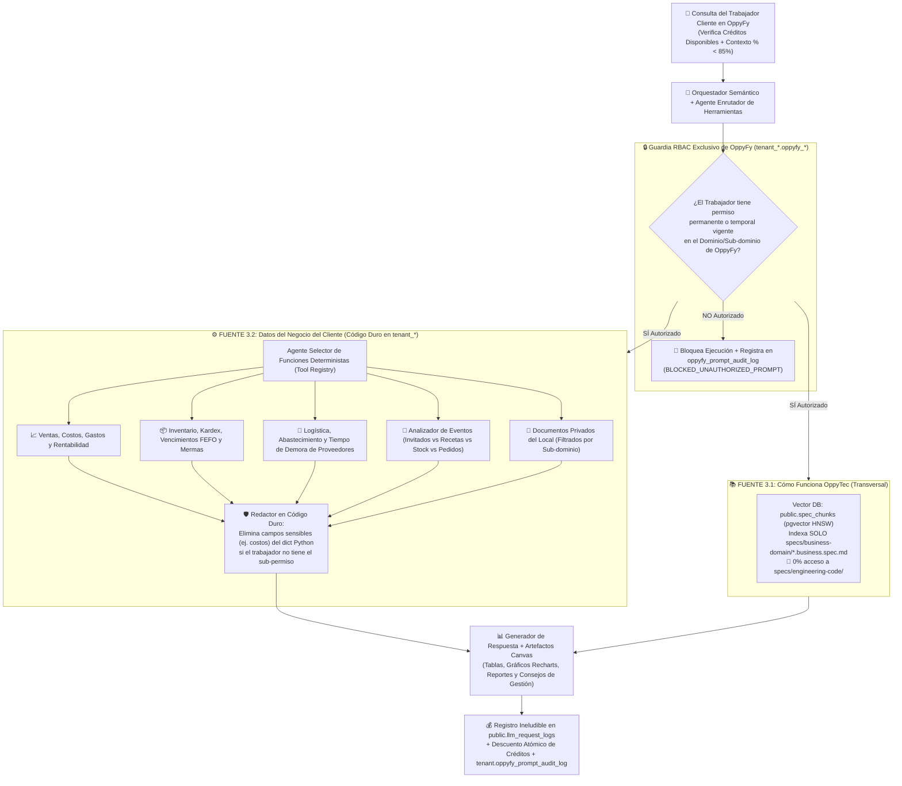

# Estrategia Maestra de `OppyFy`: Asistente IA Multi-Agente, RBAC Especializado Editable, Economía de Créditos y FinOps (Versión 001)

> **Documento:** `estrategia_asistente_ai_oppyfy_rag_y_creditos_001.md`  
> **Versión:** 001 (Especificación Normativa del Asistente Inteligente `OppyFy`, RAG Seguro, Agente Enrutador de Herramientas, RBAC Propio con Dominios Editables, Billetera de Créditos Acumulables y Telemetría Financiera `llm_request_log`)  
> **Base Normativa:**  
> - `MASTER-AGENTIC-ENGINEERING-FRAMEWORK.md`  
> - `propuesta_arquitectura_tree_001.md`  
> - `.agent/estrategias/estrategia_migraciones_alembic_001.md`  
> - `.agent/estrategias/estrategia_rbac_y_auditoria_001.md`  
> - `.agent/estrategias/estrategia_testing_calidad_y_seguridad_001.md`  
> - `.agent/estrategias/estrategia_entornos_y_despliegue_001.md`  
> - `.agent/estrategias/estrategia_orquestacion_git_worktrees_y_smart_merge_001.md`  
> - `.agent/estrategias/estrategia_visualizacion_y_auditoria_archify_001.md`  
> - `.agent/estrategias/estrategia_openspec_negocio_vs_codigo_001.md`  
> **Propósito:** Definir la arquitectura técnica, de seguridad y de negocio de **`OppyFy`** (evolución de `OppyBot` en Legacy), garantizando cero fuga de arquitectura interna, consultas operativas en código duro sobre la base de datos del cliente, un panel RBAC exclusivo con dominios/sub-dominios editables por cada cliente, paquetes de créditos independientes sin caducidad y acumulables, medidor de porcentaje de contexto anti-alucinación y auditoría financiera estricta en `llm_request_log`.  
> **Fecha:** Octubre 2026  

---

## 1. Identidad de Marca Configurable (`OppyFy` Desacoplado del Código)

1. **Nombre Comercial Actual:** El asistente para los clientes se denomina **`OppyFy`** (reemplazando el nombre antiguo `OppyBot`).
2. **Desacoplamiento Total para Cambios Futuros:**
   - Como el nombre comercial puede cambiar en el futuro, **está prohibido quemar el string `"OppyFy"` en nombres de tablas SQL, rutas de carpetas o lógica dura**.
   - A nivel de código e infraestructura, el módulo se denomina de forma neutra **`oppy_ai`** (`src/modules/oppy_ai/`), y el nombre comercial visible se inyecta desde `settings.AI_ASSISTANT_BRAND_NAME` (por defecto `"OppyFy"`) y `public.system_settings`.
   - Cambiar esa única variable actualiza instantáneamente el nombre del asistente en el Frontend, en los prompts del sistema, en los reportes PDF/Canvas y en las notificaciones sin tocar una sola migración ni renombrar archivos.

---

## 2. Arquitectura del Cerebro Dual de `OppyFy` y Muro de Fuego de Seguridad

`OppyFy` cumple **dos misiones** claramente diferenciadas para los clientes, operando bajo un **Muro de Fuego Infranqueable** que le prohíbe acceder o entregar información sobre la ingeniería o arquitectura interna de OppyTec:



### 2.1 Fuente 3.1: Conocimiento Transversal del Funcionamiento de OppyTec (Cero Fuga de Ingeniería)
- **Fuente Única:** Alimentada exclusivamente por la **Bóveda 1 (`specs/business-domain/*.business.spec.md`)** definida en `.agent/estrategias/estrategia_openspec_negocio_vs_codigo_001.md`, sincronizada por hash `SHA-256` en `public.spec_chunks` con índice vectorial **HNSW (`pgvector`)** y caché semántica de dos niveles (L1 Redis + L2 `pgvector`).
- **Transversalidad:** Es idéntica para todos los clientes porque explica cómo usar las pantallas, wizards, fórmulas conceptuales y flujos de OppyTec.
- **Garantía del Punto 7 (Prohibición Estricta de Entregar Ingeniería/Arquitectura):**
  1. Los archivos de `specs/engineering-code/` y `docs/adr/` **jamás se indexan** en `public.spec_chunks`.
  2. El system prompt inmutable de `OppyFy` y el clasificador de salida rechazan cualquier intento de *Prompt Injection* que busque indagar sobre código fuente, bases de datos, esquemas internos o arquitectura de OppyTec.

### 2.2 Fuente 3.2: Inteligencia Operativa del Negocio del Cliente (Agente Enrutador con `JEV Sistema 1` + Patrón Minimalista de Tokens `Pi` + Funciones en Código Duro)
Cuando el cliente pregunta sobre la realidad de su propio negocio:
1. El **Agente Enrutador de Herramientas (*Tool-Router Agent*) impulsado por `JEV (Sistema 1)`** (ver `.agent/estrategias/estrategia_motor_decisiones_jev_system1_001.md`) clasifica en milisegundos el dominio RBAC del cliente (`Jev.choice`), valida seguridad (`Jev.boolean`) y selecciona qué funciones deterministas en Python (`src/modules/oppy_ai/application/operational_tools/`) debe invocar sobre el esquema `tenant_<slug>` activo.
2. **Construcción de Contexto Minimalista Estilo `Pi` (Ahorro de 60–80% en Tokens de Entrada):** Siguiendo el patrón de bajo consumo de tokens de entrada por defecto de **`Pi`** (ver `.agent/estrategias/estrategia_internacionalizacion_i18n_multilenguaje_001.md`), `OppyFy` jamás inyecta los 50 esquemas SQL ni las 30 definiciones de herramientas en el prompt; construye un prompt quirúrgico que contiene únicamente el JSON devuelto por la función seleccionada + el idioma activo del selector de banderas (`es` o `en` + idiomas futuros):

| Categoría Analítica | Funciones en Código Duro que Invoca el Agente Detrás de `OppyFy` | Qué Resuelve y Qué Consejos Entrega al Cliente |
|---|---|---|
| **1. Factibilidad de Eventos y Banquetes** | `analyze_event_supply_feasibility(event_id, guest_count, menu_ids)` | Multiplica invitados por los escandallos de las recetas/combos del evento, descuenta el stock real en bodegas (excluyendo lotes que vencen antes de la fecha del evento), detecta qué insumos faltan, consulta el **tiempo de demora (*lead time*)** de cada proveedor y avisa si hay que pedir hoy para llegar a tiempo al evento. |
| **2. Inventario, Bodegas y Logística** | `get_stock_health_and_reorder_alerts()`, `get_expiring_batches_fefo()`, `analyze_warehouse_transfer_efficiency()` | Detecta productos bajo el stock mínimo o crítico, lotes próximos a caducar sugeridos para consumo prioritario (FEFO) y cuellos de botella entre bodegas/áreas operativas. |
| **3. Abastecimiento y Proveedores** | `evaluate_supplier_lead_times_and_price_drift()`, `build_optimal_purchase_order_draft()` | Analiza cuánto tarda cada proveedor en entregar, detecta alzas de precios en facturas recientes, compara proveedores alternativos y sugiere pedidos óptimos según presupuesto. |
| **4. Ventas, Costos, Gastos y Eficiencia** | `get_sales_and_food_cost_variance()`, `analyze_waste_and_merma_impact()`, `get_operational_efficiency_kpis()` | Cruza ventas reales vs costo teórico de recetas vs mermas declaradas, identifica por qué subió el *Food Cost*, evalúa gastos operativos y propone mejoras concretas de margen. |
| **5. Constructor de Tablas, Gráficos y Reportes** | `render_canvas_table()`, `render_canvas_chart()`, `export_executive_report()` | Genera estructuras tipadas para el **Split-View Canvas** en React (tablas comparativas ordenables, gráficos de barras/líneas/torta en Recharts e informes ejecutivos listos para descargar). |

---

### 2.3 Arquitectura de las 3 Capas de RAG y Memoria Evolutiva de `OppyFy` (+ Caché L1/L2)

Para que `OppyFy` combine respuestas instantáneas, datos vivos sin desfase y memoria a largo plazo del ritmo del restaurante sin saturar la ventana de contexto, su motor de recuperación opera en **3 Capas Complementarias**:

```plaintext
┌────────────────────────────────────────────────────────────────────────────────────────┐
│                    ARQUITECTURA DE 3 CAPAS DE RAG Y MEMORIA EN OPPYFY                  │
├────────────────────────────────────────────────────────────────────────────────────────┤
│  CAPA 1: MEMORIA CONVERSACIONAL DE CORTO PLAZO (Hilo Activo + Medidor de Contexto %)   │
│  • Ventana deslizante de los turnos recientes del hilo activo (`ai_chat_threads`).      │
│  • Gobernada por el Semáforo de Porcentaje de Contexto (Verde <65%, Ámbar, Rojo >85%). │
│  • Extracción y consolidación asíncrona de hechos aprendidos tras inactividad.         │
├────────────────────────────────────────────────────────────────────────────────────────┤
│  CAPA 2: MEMORIA DE TRABAJO & DATOS VIVOS EN TIEMPO REAL (0s Desfase - Código Duro)    │
│  • Enrutada en milisegundos por JEV (Sistema 1) hacia funciones Python deterministas.  │
│  • Consulta directa al esquema `tenant_*`: Stock actual, Kardex, FEFO, Recetas,        │
│    Ventas, Costos, Demoras de Proveedores y Factibilidad de Eventos.                   │
│  • REGLA ESTRICTA: Prohibido cachear respuestas de Capa 2 (siempre datos en vivo).     │
├────────────────────────────────────────────────────────────────────────────────────────┤
│  CAPA 3: CONOCIMIENTO Y MEMORIA VECTORIAL DE LARGO PLAZO (`pgvector` HNSW < 1ms)       │
│  Dividida en 3 Sub-Bóvedas Vectoriales Físicamente Aisladas:                           │
│   ├─ 3A. Sabiduría Oficial de OppyTec (`public.spec_chunks`):                          │
│   │      Indexa SOLO `specs/business-domain/*.business.spec.md` (0% código interno),   │
│   │      sincronizada incrementalmente por hash SHA-256 (`public.spec_sync_metadata`). │
│   ├─ 3B. Documentos Privados del Negocio (`tenant_documents` + `document_chunks`):     │
│   │      Manuales, reglamentos y contratos subidos por el cliente, filtrados por el    │
│   │      Dominio/Sub-dominio editable del RBAC de `OppyFy` del trabajador.             │
│   └─ 3C. Ritmo Macro y Memoria Evolutiva del Local (`tenant_ai_memories` - Patrón Mem0)│
│          Hábitos de proveedores, estacionalidad, metas de Food Cost (`oppy_directives`)│
│          y reglas propias del restaurante con afinidad por especialista                │
│          (`general`, `chef`, `stock`, `supply`, `manager`), deduplicación y TTL.       │
└────────────────────────────────────────────────────────────────────────────────────────┘
```

#### Acelerador de Caché Semántica en Dos Niveles (`Two-Tier Caching: L1 Redis + L2 pgvector`):
1. **Nivel L1 (Redis en RAM — `< 1 ms`, `TTL = 48h`):** Almacena respuestas a preguntas conceptuales indexadas por `ai_cache:{tenant_schema}:{language}:{agent_type}:{prompt_hash}`.
2. **Nivel L2 (`pgvector` `ai_semantic_cache` con índice HNSW — `< 5 ms`):** Evalúa la distancia de coseno ($\text{distancia} \le 0.08 \implies \text{similitud} \ge 92\%$). Si otro usuario hace la misma pregunta conceptual sobre el uso de OppyTec con distintas palabras, devuelve la respuesta validada promoviéndola a L1 con **costo `0` de tokens**.
3. **Guardrail de Exclusión de Datos Vivos (`is_cacheable_query` evaluado por `JEV`):** Cualquier consulta que involucre la **Capa 2 (datos transaccionales vivos del negocio: stock actual, vencimientos, ventas, facturas o eventos)** tiene **estrictamente prohibido usar caché**, garantizando que el cliente jamás reciba un saldo de inventario desactualizado.

---

## 3. Panel RBAC Especializado y Exclusivo de `OppyFy` (Dominios Editables por Cliente + Plug-and-Play de Módulos)

Para que el Propietario tenga **claridad, tranquilidad y control absoluto** sobre qué información de su negocio puede consultar cada trabajador dentro de `OppyFy`, se implementa un **Panel de Gobernanza y RBAC Exclusivo de `OppyFy`**, independiente del RBAC general de pantallas del ERP.

### 3.1 Árbol de Dominios y Sub-dominios 100% Editable por cada Cliente
Cada negocio tiene necesidades particulares. Por ello, dentro de cada esquema `tenant_*`, existen las tablas **`oppyfy_domains`** y **`oppyfy_subdomains`**:
1. **Plantilla Inicial Editable:** Al crearse el Tenant, nace con dominios base sugeridos (*Ayuda de Plataforma*, *Inventario y Bodegas*, *Recetas y Cocina*, *Abastecimiento y Eventos*, *Finanzas y Rentabilidad*, *Reportes y Gráficos*), pero **el Propietario puede editarlos libremente**.
2. **Creación Libre por el Cliente:** El Propietario puede crear **todos los Dominios y Sub-dominios personalizados que desee** (ej. Dominio: *"Operación Eventos VIP"* $\to$ Sub-dominio: *"Bar y Coctelería"* o *"Costos de Banquetería"*) y elegir mediante casillas qué **Capacidades de Consulta (funciones en código duro)** y qué **Documentos Privados del Local (`tenant_documents`)** pertenecen a cada sub-dominio.
3. **Auto-Integración de Nuevos Módulos Futuros (*Plug-and-Play*):**
   - Cada capacidad de consulta en el código de OppyTec está vinculada a su `module_slug` en `public.app_modules`.
   - Cuando en el futuro se construya un módulo nuevo en OppyTec (ej. `accounting`, `hr_payroll`, `hotel_rooms`) y el cliente lo contrate en su plan (`public.tenant_modules`), sus capacidades para `OppyFy` **aparecen automáticamente en el Panel RBAC de `OppyFy` del cliente**.
   - Por **Principio de Mínimo Privilegio**, todo módulo nuevo contratado nace habilitado **únicamente para el Propietario**, quien desde ese instante puede editar su dominio/sub-dominio y asignarlo a los roles o trabajadores que estime conveniente.

### 3.2 Delegación Jerárquica, Permisos Temporales con Caducidad y Redacción en Código Duro
1. **Delegación por Rango (`hierarchy_rank`):**
   - El Propietario (`Rank 0`) tiene acceso total a todos los dominios de `OppyFy` cuyos módulos estén contratados en su plan, y puede delegar en un rol inferior (ej. `admin` `Rank 10`) la facultad de administrar los permisos y créditos de `OppyFy` de los trabajadores de menor rango (`Rank > 10`), sin que nadie pueda otorgar un acceso de `OppyFy` que él mismo no posea.
2. **Permisos Temporales en `OppyFy` que Caducan Automáticamente (`oppyfy_permission_grants`):**
   - Independientemente del rol habitual de un trabajador (ej. un `supervisor` o un `cajero`), el Propietario o un superior autorizado puede otorgarle un **permiso temporal en `OppyFy`** para una tarea específica con **triple control de caducidad**:
     - **Por Fecha y Hora (`expires_at: TIMESTAMPTZ`):** Ej. *"Acceso al sub-dominio 'Factibilidad de Eventos y Costos' válido solo hoy de 15:00 a 19:00"*.
     - **Por Cantidad Máxima de Consultas (`max_prompts: int`):** Ej. *"Válido por máximo 5 consultas a OppyFy"*.
     - **Por Tope de Créditos Temporales (`temp_credit_ceiling: Decimal`):** Ej. *"Puede gastar hasta 200 créditos en esta tarea"*.
     - Una vez cumplida cualquiera de las condiciones, el permiso se desactiva automáticamente en el acto.
3. **Redacción Física en Código Duro (*Hard-Code Data Stripping*):**
   - Si un trabajador tiene permiso en `OppyFy` para consultar el stock de un sub-dominio (`can_query_stock = True`), pero **NO** tiene el permiso de ver costos financieros (`can_view_costs = False`), la función en Python **elimina las llaves `costo_unitario`, `precio_compra` y `margen` del diccionario de datos antes de pasarlo al LLM**. Así es imposible que `OppyFy` filtre un dato sensible ni por error ni por *Prompt Injection*.

---

## 4. Economía de Paquetes de Créditos: Independientes del Plan, Acumulables y Sin Caducidad

1. **Venta Independiente de Cualquier Plan (*Add-On Top-Up Packs*):**
   - El uso de `OppyFy` es un servicio adicional que se comercializa mediante **Paquetes de Créditos** independientes del plan base del cliente.
   - El cliente puede comprar paquetes de créditos en **cualquier momento** que lo necesite.
2. **Créditos 100% Acumulables y Sin Caducidad:**
   - **Política de Acumulación (*Stackable Balance*):** Si a un cliente le quedan `1.000 créditos` disponibles de una compra anterior y adquiere un nuevo paquete de `10.000 créditos`, ambos saldos **se suman inmediatamente**, quedando su billetera en **`11.000 créditos` disponibles**:
     $$\text{Saldo Disponible Nuevo} = \text{Saldo Remanente Actual} + \text{Créditos del Paquete Comprado}$$
   - **Sin Caducidad Mensual:** Los créditos comprados por el cliente **no vencen a los 30 días**; permanecen disponibles en su billetera hasta que su equipo los consuma.
3. **Distribución y Control de Créditos por Trabajador (`oppyfy_worker_credit_wallets`):**
   - El Propietario administra su bolsa total de créditos (ej. `11.000`) y decide libremente:
     - **Quién puede usar `OppyFy`** (interruptor `is_oppyfy_enabled` por trabajador).
     - **Cuántos créditos puede ocupar cada trabajador** (asignándole un cupo individual de créditos o permitiéndole consumir de la bolsa con un límite máximo asignado por el Propietario).

---

## 5. Indicador de Porcentaje de Contexto (`Context % Health Meter`) Anti-Alucinación

Para evitar que una conversación demasiado larga degrade la atención del modelo (*Context Rot / Lost in the Middle*), provoque alucinaciones y encarezca innecesariamente el consumo de tokens por turno:

1. **Cálculo en Tiempo Real en cada Turno (`context_usage_percent`):**
   - En cada respuesta de `OppyFy`, el backend calcula el porcentaje de tokens acumulados en el hilo actual respecto al **Límite Seguro de Precisión (`MAX_SAFE_THREAD_TOKENS`)** y lo envía al Frontend.
2. **Semáforo Visual en la Cabecera del Chat de `OppyFy`:**
   - 🟢 **`0% – 65%` (Óptimo):** Barra verde. Máxima precisión cognitiva.
   - 🟡 **`66% – 85%` (Advertencia Preventiva):** Barra ámbar con aviso: *"El contexto de esta conversación va en 75%. Para evitar errores o alucinaciones y optimizar tus créditos, te sugerimos iniciar pronto un nuevo hilo"*.
   - 🔴 **`86% – 100%` (Límite Seguro Alcanzado — Traspaso Asistido):**
     - Cuando el hilo llega al umbral crítico, el sistema detiene la adición de mensajes crudos a ese hilo para impedir que `OppyFy` alucine.
     - Muestra el botón **"Continuar en Hilo Fresco con Resumen Inteligente"**: crea automáticamente un hilo nuevo al `5%` de contexto inyectando únicamente una síntesis estructurada y verificada de los datos clave del hilo anterior.

---

## 6. Doble Sistema de Auditoría y Monitoreo Financiero (`llm_request_log`)

### 6.1 Vista de Auditoría de `OppyFy` para el Propietario del Negocio (`tenant_*`)
En su Panel de Gobernanza de `OppyFy`, el Propietario cuenta con dos registros inmutables (*Append-Only*) para tomar decisiones de negocio y supervisar a su personal:
1. **Registro de Prompts y Uso por Trabajador (`oppyfy_prompt_audit_log`):**
   - Muestra exactamente: **qué trabajador** usó `OppyFy`, **fecha y hora exacta**, **el texto íntegro del prompt que preguntó**, **qué dominio/sub-dominio y funciones consultó**, **cuántos créditos consumió** y si la consulta fue **Autorizada (`ALLOWED`)** o un **Intento Bloqueado (`BLOCKED_UNAUTHORIZED_PROMPT`)** por intentar preguntar algo fuera de sus permisos.
2. **Registro de quién otorgó permisos o créditos en `OppyFy` (`oppyfy_rbac_audit_log`):**
   - Muestra quién habilitó `OppyFy` a un trabajador, quién le asignó o restó créditos y quién le otorgó un permiso temporal (con su motivo obligatorio y fecha de expiración).

---

### 6.2 Registro Estricto en `public.llm_request_logs` y las 2 Vistas Administrativas de OppyTec (`public`)
> [!CRITICAL]
> **REGLA SIN EXCEPCIÓN PARA TODA LLAMADA A MODELOS DE IA:**  
> Está estrictamente prohibido en todo el código de OppyTec v2.0 realizar una llamada a cualquier modelo LLM, modelo de Embeddings o servicio de Audio (TTS/STT) sin que pase por el wrapper central `MeteredAIService`, el cual registra **obligatoriamente** cada transacción en `public.llm_request_logs` (y `public.audio_request_logs`) identificando el `holding_id` y `tenant_id`.

#### Estructura de `public.llm_request_logs` (con precisión financiera `Decimal` / `NUMERIC`):
- `id` (`BIGSERIAL` PK), `created_at` (`TIMESTAMPTZ`, Indexed).
- **Identificación estricta del Gasto:** `holding_id` (`UUID`, Indexed), `tenant_id` (`UUID`, Indexed), `tenant_schema` (`VARCHAR(100)`, Indexed), `user_id` (`INTEGER`), `thread_id` (`UUID`).
- **Trazabilidad Técnica:** `caller_feature` (`oppyfy_chat`, `oppyfy_tool_router`, `invoice_ocr`, `excel_import`, `spec_embedding`), `model_name` (ej. `gemini-2.5-flash`, `gemini-2.5-pro`), `request_duration_ms`, `api_success`, `error_message`.
- **Métricas Exactas de Tokens y Dinero (`NUMERIC`, cero `float`):**
  - `input_tokens` (`INTEGER`), `cached_tokens` (`INTEGER`), `output_tokens` (`INTEGER`), `total_tokens` (`INTEGER`).
  - `provider_cost_usd` (`NUMERIC(14, 6)` — costo real en dólares cobrado por el proveedor del modelo según `public.ai_model_configs`).
  - `provider_cost_clp` (`NUMERIC(14, 2)` — costo real convertido a moneda local).
  - `credits_deducted` (`NUMERIC(12, 2)` — créditos descontados de la billetera del cliente).

#### Las 2 Vistas Clave en el Panel Administrativo de OppyTec (`features/platform-admin/`):
1. **Vista 1 — Monitor Financiero Global de Modelos y Simulador de Tarifas (*AI FinOps & Pricing Console*):**
   - Muestra el consumo total de tokens (`input`, `cached`, `output`), el número de llamadas y **cuánto dinero real (`USD` y `CLP`) está gastando OppyTec** desglosado por cada modelo de IA y servicio de audio.
   - Compara el **Gasto Real del Proveedor** contra los **Ingresos por Paquetes de Créditos Vendidos**, mostrando el margen bruto exacto y permitiendo configurar los precios por millón de tokens (`ai_model_configs`), la tasa `tokens_per_credit` y el precio de venta de los paquetes de créditos para saber siempre con exactitud matemática cuánto cobrar.
2. **Vista 2 — Monitor de Consumo y Costos por Holding / Tenant (*Tenant AI Cost Explorer*):**
   - Identifica con precisión quirúrgica **cuánto está consumiendo y cuánto dinero le cuesta a OppyTec cada Holding y cada Tenant**, desglosado por módulo (`OppyFy Chat`, `Lectura de Facturas`, `Voz`), por periodo de tiempo y por estado de su bolsa de créditos (`Comprados`, `Consumidos`, `Restantes`).

---

## 7. Artefactos a Construir en el Proyecto (Nombres y Ubicaciones)

| # | Artefacto | Ruta Exacta en el Proyecto | Propósito |
|---|---|---|---|
| **1** | **ADR de `OppyFy` y FinOps IA** | `docs/adr/ADR-012-oppyfy-dual-rag-custom-rbac-and-credit-ledger.md` | Congela el diseño de marca configurable (`OppyFy`), el muro de fuego contra ingeniería interna, los créditos acumulables sin caducidad y el registro estricto en `llm_request_logs`. |
| **2** | **Spec de Negocio (`OppyFy`)** | `specs/business-domain/oppy-ai-and-voice.business.spec.md` | Explica a los clientes cómo usar `OppyFy`, cómo funcionan los paquetes de créditos acumulables, cómo crear Dominios/Sub-dominios en el RBAC de `OppyFy` y cómo auditar los prompts de sus trabajadores. |
| **3** | **Spec de Código (`OppyFy`)** | `specs/engineering-code/oppy-ai-and-voice.code.spec.md` | Contrato técnico del `Tool-Router`, funciones en código duro, redacción de campos sensibles, medidor de `% de contexto`, billetera atómica y `public.llm_request_logs`. |
| **4** | **Regla Agéntica Inmutable** | `.agent/rules/13-oppyfy-ai-governance-and-telemetry.md` | Prohíbe llamadas al LLM fuera de `MeteredAIService`, prohíbe indexar `engineering-code/` en el RAG de clientes y exige validación RBAC de `OppyFy` en cada herramienta operativa. |
| **5** | **Módulo Backend `oppy_ai`** | `oppytec-backend/src/modules/oppy_ai/` | Implementa el orquestador, el catálogo de herramientas en código duro, el RBAC editable de `OppyFy`, la billetera de créditos y la telemetría financiera. |
| **6** | **Quality Gate de Telemetría y Seguridad IA** | `oppytec-backend/tests/architecture/test_oppyfy_telemetry_and_isolation.py` | Verifica por AST que ningún módulo llame al SDK de Gemini/OpenAI saltándose `llm_request_logs`, que ninguna herramienta de `OppyFy` carezca de guard RBAC y que el chunker RAG solo lea `specs/business-domain/`. |
