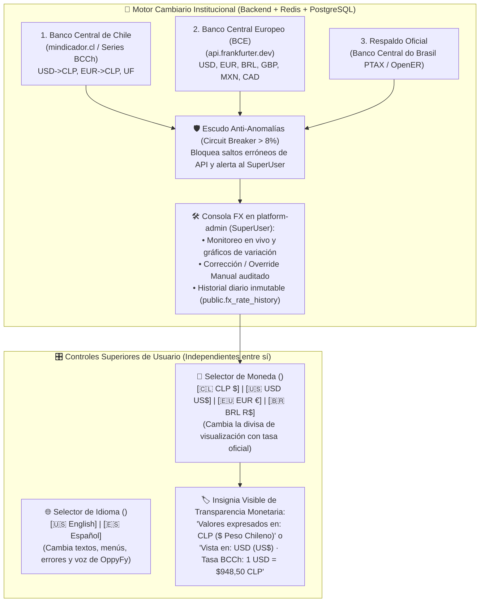

# Estrategia Maestra de Multi-Moneda, Conversor Oficial de Bancos Centrales (FX), Trazabilidad y Gestión de Precios (Versión 001)

> **Documento:** `estrategia_multimoneda_fx_precios_y_cobros_001.md`  
> **Versión:** 001 (Especificación Normativa del Motor Cambiario Institucional, Selector de Moneda Independiente del Idioma, Consola Admin de Monitoreo/Corrección de Tasas, Historial de Variación y Gestión de Precios)  
> **Base Normativa:**  
> - `MASTER-AGENTIC-ENGINEERING-FRAMEWORK.md`  
> - `propuesta_arquitectura_tree_001.md`  
> - `.agent/estrategias/estrategia_migraciones_alembic_001.md`  
> - `.agent/estrategias/estrategia_rbac_y_auditoria_001.md`  
> - `.agent/estrategias/estrategia_testing_calidad_y_seguridad_001.md`  
> - `.agent/estrategias/estrategia_entornos_y_despliegue_001.md`  
> - `.agent/estrategias/estrategia_orquestacion_git_worktrees_y_smart_merge_001.md`  
> - `.agent/estrategias/estrategia_visualizacion_y_auditoria_archify_001.md`  
> - `.agent/estrategias/estrategia_openspec_negocio_vs_codigo_001.md`  
> - `.agent/estrategias/estrategia_asistente_ai_oppyfy_rag_y_creditos_001.md`  
> - `.agent/estrategias/estrategia_motor_decisiones_jev_system1_001.md`  
> - `.agent/estrategias/estrategia_internacionalizacion_i18n_multilenguaje_001.md`  
> **Propósito:** Definir la arquitectura del motor Multi-Moneda (`CLP`, `USD`, `EUR`, `BRL`, `UF` y extensible), alimentado por APIs gratuitas y 100% oficiales de Bancos Centrales, con un **Selector de Moneda independiente del Selector de Idioma**, un panel administrativo en OppyTec para monitorear, auditar la variación histórica y corregir tasas manualmente, y herramientas de gestión de precios para OppyTec y para los clientes.  
> **Fecha:** Octubre 2026  

---

## 1. Visión General: Independencia entre Idioma (`i18n`) y Moneda (`FX`)

En OppyTec v2.0, el **Idioma de la Interfaz** y la **Moneda de Visualización** son dos dimensiones independientes que trabajan en total armonía en la barra superior (`Navbar`):

### Ejemplos Reales de Combinación para el Usuario:
- **Caso A:** Un chef o gerente angloparlante que trabaja en un restaurante en Chile selecciona **Idioma: `[🇺🇸 English]`** y **Moneda: `[🇨🇱 CLP $]`** $\to$ Lee toda la aplicación en inglés (*"Unit Cost"*, *"Warehouses"*), pero ve los montos en **Pesos Chilenos (`$12.500 CLP`)** tal como vienen en las facturas locales.
- **Caso B:** Un inversionista o socio del Holding selecciona **Idioma: `[🇺🇸 English]`** (o `[🇪🇸 Español]`) y **Moneda: `[🇺🇸 USD US$]`** (o `[🇪🇺 EUR €]`) $\to$ Ve todos los reportes, costos, ventas y dashboards convertidos en tiempo real a dólares o euros con un indicador explícito de qué tasa oficial se está aplicando.

---

## 2. Fuentes de Datos Oficiales, Confiables y Gratuitas (Bancos Centrales)

Para garantizar credibilidad financiera total a costo `$0` de licencias de API, el servicio `FXSyncService` (`oppytec-backend/src/core/fx/providers.py`) consume tres fuentes institucionales con *failover* automático:

| Prioridad | Fuente Institucional | Endpoint / Protocolo Gratuito | Monedas que Alimenta | Ventaja Técnica |
|---|---|---|---|---|
| **Primaria 1 (Chile / CLP / UF)** | **Banco Central de Chile** (vía `mindicador.cl/api` y series públicas BCCh) | `GET https://mindicador.cl/api` (JSON público sin API key) | `CLP`, `USD -> CLP` (Dólar Observado), `EUR -> CLP`, `UF` | Fuente oficial tributaria y contable en Chile. |
| **Primaria 2 (Global / EUR / USD / BRL)** | **Banco Central Europeo (BCE / ECB)** (vía `api.frankfurter.dev`) | `GET https://api.frankfurter.dev/v1/latest?base=USD` (Open-source, sin límite ni API key) | `USD`, `EUR`, `BRL` (Real Brasileño), `GBP`, `MXN`, `CAD`, `CHF`, `JPY` | Datos oficiales directos del Banco Central Europeo, latencia `< 80ms`. |
| **Secundaria / Fallback** | **Banco Central do Brasil (PTAX)** / `open.er-api.com` | API pública de tasas de referencia | Respaldo cruzado para `BRL`, `USD`, `EUR`, `CLP`, `ARS`, `PEN`, `COP` | Alta disponibilidad si alguna fuente primaria entra en mantenimiento. |

### 2.1 Triangulación Matemática con `Decimal(18, 8)` (Cero `float`)
- Todas las tasas se almacenan y cruzan utilizando exclusivamente `decimal.Decimal` en Python y `NUMERIC(18, 8)` en PostgreSQL.
- A partir de las tasas oficiales pivote (`USD`, `EUR`, `CLP`), el motor pre-calcula la matriz completa de conversión directa e inversa (`CLP <-> USD`, `CLP <-> EUR`, `CLP <-> BRL`, `USD <-> EUR`, `USD <-> BRL`, `EUR <-> BRL`) y la publica en caché de Redis (`TTL = 4 horas`, actualizándose programadamente cada 6 horas o al instante cuando el SuperUser lo ordena).

---

## 3. Consola de Monitoreo, Corrección Manual y Trazabilidad en `platform-admin` (SuperUser OppyTec)

En el panel administrativo de OppyTec (`features/platform-admin/`), el `SuperUser` cuenta con el **Centro de Control Cambiario y de Monedas (`FX & Currency Console`)**:

### 3.1 Monitoreo en Vivo y Estado de Fuentes (`public.fx_current_rates`)
Muestra para cada par de monedas:
- **Tasa Vigente Activa** (ej. `1 USD = 948.50000000 CLP`, `1 EUR = 1.032,40000000 CLP`, `1 USD = 5.62000000 BRL`).
- **Fuente de Origen:** `BCCH_OFFICIAL`, `ECB_FRANKFURTER`, `BCB_FALLBACK` o **`MANUAL_SUPERUSER_OVERRIDE`**.
- **Indicadores de Variación:** Cambio porcentual respecto a ayer (`24h %`), hace `7 días %` y hace `30 días %`.
- **Estado de Salud de la API:** Última sincronización exitosa y botón **"Sincronizar con Bancos Centrales Ahora"**.

### 3.2 Corrección Manual / Override Seguro por el SuperUser
Si el SuperUser detecta que un valor externo no es correcto o desea fijar manualmente el valor de una moneda:
1. Puede editar el valor de cualquier tasa y activar el modo **`Override Manual`**:
   - **Temporal:** Fija el valor manual por $N$ horas/días y luego retoma la sincronización automática.
   - **Permanente hasta liberación:** Mantiene el valor corregido por el SuperUser hasta que él mismo desactive el candado manual.
2. **Auditoría Forense Obligatoria (`public.fx_audit_log`):**
   - Cada corrección manual exige un motivo (`reason`) y guarda de forma inmutable: `actor_user_id` (`SuperUser`), `currency_pair`, `previous_rate`, `previous_source`, `new_manual_rate`, `reason` y `created_at`.

### 3.3 Escudo Anti-Anomalías (*FX Drift Circuit Breaker*)
- Si durante una sincronización automática la API externa devuelve una tasa que varía más de un umbral de seguridad configurable (por defecto **`±8.0%` en 24 horas**) respecto al último valor validado:
  1. El motor **no aplica el cambio automáticamente** para evitar distorsionar precios o cobros por un error de la API externa.
  2. Conserva la última tasa válida, registra una alerta `FX_ANOMALY_QUARANTINED` y muestra un aviso destacado en el panel del SuperUser para que él confirme si la variación es real o la corrija manualmente.

### 3.4 Trazabilidad Histórica de Variaciones (`public.fx_rate_history`)
Cada actualización diaria o manual queda grabada en `public.fx_rate_history`:
- **Gráficos de Evolución en `platform-admin`:** Permite visualizar la curva histórica de `USD`, `EUR`, `BRL`, `CLP` y `UF` en rangos de 7 días, 30 días, 6 meses y 1 año.
- **Exactitud Contable en el Tiempo (*Historical Rate Snapshot*):** Cuando un cliente consulta un reporte financiero del mes pasado o cuando OppyTec audita el costo en `CLP` de un token de IA en `public.llm_request_logs`, el sistema utiliza la tasa que estuvo vigente en esa fecha exacta, evitando reescribir la historia financiera cuando cambia el dólar.

---

## 4. Integridad Contable del Negocio Cliente: Moneda Base vs. Moneda de Visualización

Para que el selector de moneda sea 100% seguro y nunca corrompa la contabilidad de un restaurante u hotel:

1. **Moneda Base Contable del Tenant (`tenants.base_currency`):**
   - Al crearse un Tenant, se define su moneda contable oficial (ej. `CLP` en Chile, `USD` en EE.UU., `EUR` en España, `BRL` en Brasil).
   - Todos los costos unitarios, Kardex (`registro_stock`), recetas, mermas y ventas se guardan en PostgreSQL en esa **`base_currency` con `Decimal`**.
   - Si el restaurante recibe una factura de un proveedor extranjero en otra moneda, se guarda el monto original, la moneda de la factura y el `exchange_rate_applied` de ese día convirtiendo el costo de entrada a la `base_currency`.
2. **Moneda de Visualización en Pantalla (`<CurrencySelector />`):**
   - El usuario puede cambiar en cualquier momento el selector de la barra superior entre `CLP`, `USD`, `EUR`, `BRL` (independientemente de si tiene la bandera de idioma en Inglés o en Español).
   - **Insignia de Contexto Monetario Siempre Visible:**
     - En el `Navbar` y en los encabezados de tablas financieras/catálogo aparece claramente:
       `💱 Moneda activa: CLP ($)` o `💱 Convertido a: USD (US$ · 1 USD = 948,50 CLP)`.
   - **Ingreso de Datos con Conversión Asistida:** Si un usuario tiene la vista en `USD` y está editando el precio de un producto cuyo local tiene moneda base `CLP`, el input numérico le muestra en vivo la conversión exacta que se guardará en la moneda base del local.

---

## 5. Gestión de Precios y Cobros (Para OppyTec y para el Cliente)

### 5.1 Gestión de Precios Comerciales de OppyTec (`platform-admin`)
El SuperUser gestiona los precios de los **Planes (`public.system_plans`)**, **Módulos** y **Paquetes de Créditos de `OppyFy` (`public.ai_credit_packages`)** con dos modalidades por ítem:
1. **Modalidad A — Precio Ancla + Conversión Automática:** Define el precio base en una moneda ancla (ej. `USD` o `CLP`) y el sistema calcula automáticamente el equivalente en `CLP`, `USD`, `EUR` y `BRL` usando la tasa vigente del Banco Central, permitiendo aplicar reglas de redondeo comercial.
2. **Modalidad B — Matriz de Precio Fijo por Moneda:** El SuperUser fija manualmente cuánto cuesta el plan o paquete de créditos en cada moneda (`price_clp`, `price_usd`, `price_eur`, `price_brl`).

### 5.2 Gestión de Precios, Costos y Márgenes para el Cliente (`Propietario`)
Dentro de su negocio (`features/catalog/` y `features/recipes/`), el Propietario cuenta con herramientas para gestionar sus precios:
- **Simulador de Precios de Carta y Márgenes (*Food Cost Targeter*):** Muestra el costo actual calculado de cada receta/producto, alerta si el costo de algún ingrediente subió en las últimas compras y calcula el precio de venta sugerido según el margen objetivo del restaurante, pudiendo visualizarlo en cualquiera de las monedas del selector.
- **Actualización Masiva o Individual Auditada:** Permite ajustar precios por producto, por categoría o por porcentaje, registrando cada cambio de precio en `audit_activity_log` (`before_state` vs `after_state`).

---

## 6. Artefactos a Construir en el Proyecto (Nombres y Ubicaciones)

| # | Artefacto | Ruta Exacta en el Proyecto | Propósito |
|---|---|---|---|
| **1** | **ADR de Multi-Moneda y FX** | `docs/adr/ADR-015-central-bank-fx-engine-and-multi-currency-pricing.md` | Congela el uso de fuentes oficiales (BCCh + BCE), el escudo anti-anomalías, el override manual auditado y la separación `base_currency` vs `display_currency`. |
| **2** | **Specs Bipartitos (OpenSpec)** | `specs/business-domain/multi-currency-and-pricing.business.spec.md` + `specs/engineering-code/multi-currency-and-pricing.code.spec.md` | Guía de uso del selector de moneda y gestión de precios para clientes (`business`) + contratos de tablas `fx_*`, APIs de Bancos Centrales y redondeo `Decimal` (`code`). |
| **3** | **Regla Agéntica Inmutable** | `.agent/rules/16-multi-currency-fx-and-pricing-governance.md` | Prohíbe usar `float` en conversiones de moneda, exige pasar todo monto visual por `<MoneyDisplay />` / `useCurrencyFormatter()` y mostrar siempre la insignia de moneda activa. |
| **4** | **Skill Ejecutable `fx_currency_manager`** | `.agent/skills/fx_currency_manager/SKILL.md` | Patrones de conversión `Decimal`, integración con BCCh/Frankfurter y reglas de formato monetario independiente del idioma. |
| **5** | **Motor Backend Cambiario (`fx`)** | `oppytec-backend/src/core/fx/` (`providers.py`, `fx_service.py`, `anomaly_guard.py`, `models.py`) | Sincronizador con Bancos Centrales, caché Redis, override manual del SuperUser e historial de variaciones. |
| **6** | **Selector y Formateador Frontend** | `oppytec-frontend/src/shared/currency/` (`CurrencyContext.tsx`, `CurrencySelector.tsx`, `MoneyBadge.tsx`, `useCurrencyFormatter.ts`) | Selector de moneda en el `Navbar`, insignia de tasa activa y formateador reactivo de montos. |
| **7** | **Quality Gate Cambiario** | `oppytec-backend/tests/architecture/test_fx_currency_precision_and_governance.py` | Verifica con `Hypothesis` que la triangulación de monedas nunca use `float`, que el circuit breaker detenga saltos `> 8%` y que los overrides manuales generen auditoría. |
