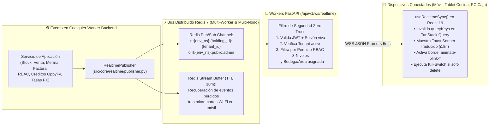

# Estrategia Maestra de Tiempo Real, WebSockets con Redis Pub/Sub, Filtrado RBAC y Sincronización Reactiva Cero-Polling (Versión 001)

> **Documento:** `estrategia_tiempo_real_websockets_y_notificaciones_001.md`  
> **Versión:** 001 (Especificación Normativa de Comunicación Bidireccional en Tiempo Real, Prohibición de Polling HTTP, Bus Distribuido Redis Pub/Sub + Streams, Seguridad Multi-Tenant/RBAC e Integración con TanStack Query v5)  
> **Base Normativa:**  
> - `MASTER-AGENTIC-ENGINEERING-FRAMEWORK.md`  
> - `propuesta_arquitectura_tree_001.md`  
> - Las **16 Estrategias Maestras (`.agent/estrategias/estrategia_*_001.md`)** de OppyTec v2.0.  
> **Propósito:** Eliminar las consultas repetitivas al servidor (*HTTP Polling*) e implantar un único motor de **WebSockets en Tiempo Real (`/api/v1/ws/realtime`)** respaldado por **Redis Pub/Sub y Redis Streams**, con aislamiento físico por `Environment` y `Tenant`, filtrado estricto por permisos **RBAC de 3 niveles** y sincronización instantánea con la caché de **TanStack React Query v5** en todos los dispositivos conectados.  
> **Fecha:** Octubre 2026  

---

## 1. Diagnóstico de los WebSockets en `OppyTec-Legacy`

Al auditar `OppyTec-Legacy/OppyTec_Backend/src/websocket_manager.py`, `src/main.py` (línea 282), `src/invoices/services.py` (línea 1030) y `OppyTec_Frontend/src/hooks/useWebSocket.ts`, se detectaron **5 defectos críticos**:

1. **Endpoint `/ws/notifications` abierto sin autenticación y con fuga al esquema `public`:**
   - En `useWebSocket.ts` el cliente se conectaba a `/ws/notifications` sin pasar token ni esquema, por lo que `main.py` asignaba a todos los restaurantes por defecto `schema: str = "public"`.
2. **Dos gestores de WebSocket duplicados e inconexos:**
   - Existía `ConnectionManager` en `src/websocket_manager.py` (para solicitudes) y otro `WebSocketManager` distinto en `src/invoices/services.py` (para facturas).
3. **Estado en Memoria Local de un Solo Worker (Ruptura en Producción Multi-Worker):**
   - `self.active_connections` era un diccionario en la memoria RAM del proceso local de Python. Al ejecutar Uvicorn con múltiples workers en producción, si un evento ocurría en el Worker 2, los clientes conectados al Worker 1 jamás recibían la notificación.
4. **Ausencia de Filtrado RBAC en los Mensajes Emitidos:**
   - `broadcast_to_tenant` enviaba el JSON a todos los usuarios conectados al esquema sin verificar si cada usuario poseía el permiso `<modulo>.<submodulo>.<funcion>` requerido para ver esa alerta o dato.
5. **Desconexión de `TanStack React Query` y Uso de Polling:**
   - En lugar de invalidar las claves de caché de `TanStack Query`, disparaba eventos DOM manuales (`CustomEvent("solicitudes-updated")`) mientras otras pantallas seguían haciendo polling periódico al servidor.

---

## 2. Arquitectura del Motor de Tiempo Real en OppyTec v2.0 (`Redis Pub/Sub + Streams` + `TanStack Query`)



### 2.1 Prohibición Estricta de *HTTP Polling* (`Zero-Polling Rule`)
- Está **terminantemente prohibido** usar `setInterval(fetch, ...)` o `refetchInterval` en `useQuery` para consultar notificaciones, alertas de stock, estado de procesamiento de facturas/Excel, aprobaciones de mermas o cambios de permisos.
- Toda actualización asíncrona del servidor hacia los clientes viaja exclusivamente por el túnel **`/api/v1/ws/realtime`**.

---

## 3. Seguridad Zero-Trust en el Túnel WebSocket

### 3.1 Handshake Autenticado y Aislamiento Multi-Tenant
1. Al abrir la conexión `wss://.../api/v1/ws/realtime`, el servidor valida:
   - El token JWT vigente y que el usuario no esté en `soft-delete` (`is_deleted == False`).
   - Que el usuario tenga acceso activo al `tenant_id` solicitado en `public.client_user_tenant_access` (o sea un trabajador global de OppyTec en `public`).
2. La conexión queda registrada en el `RealtimeConnectionManager` del worker asociada a `(env_namespace, holding_id, tenant_id, user_id, active_permissions_set, assigned_bodega_ids)`.

### 3.2 Filtrado por Permiso RBAC de 3 Niveles Antes de Enviar por el Socket
Todo evento publicado en el bus interno declara su alcance de seguridad (`RealtimeEventEnvelope`):
```python
class RealtimeEventEnvelope(BaseModel):
    event_id: str                           # ID secuencial de Redis Stream (ej. "1729271000123-0")
    event_type: str                         # ej. "inventory.merma.approval_requested"
    tenant_id: UUID | None                  # None solo para eventos globales de platform-admin
    required_permission: str | None         # ej. "inventory.mermas.approve" (3 niveles)
    target_user_ids: list[int] | None       # Si es una notificación personal o revocación de sesión
    target_bodega_id: int | None            # Si aplica a una bodega/área operativa específica
    invalidate_query_keys: list[list[str]]  # Claves de TanStack Query a refrescar en el cliente
    i18n_toast_key: str | None              # Llave i18n para mostrar notificación Sonner en ES/EN
    i18n_toast_params: dict[str, Any] = {}
    ui_highlight_effect: Literal["blink-green", "blink-orange", "blink-red"] | None = None
```
- **Regla de No-Fuga:** Antes de ejecutar `await websocket.send_json(...)`, el worker comprueba en $O(1)$ que `required_permission in connection.active_permissions_set`. Si un cajero no tiene el permiso `inventory.mermas.approve`, el evento jamás sale hacia su navegador.

---

## 4. Catálogo de Eventos en Tiempo Real e Integración con `TanStack Query v5`

| Dominio | Evento (`event_type`) | Claves de `TanStack Query` que Actualiza Automáticamente | Efecto Inmediato en la Interfaz del Usuario |
|---|---|---|---|
| **1. Inventario, Kardex y Alertas** | `inventory.stock_updated`<br/>`inventory.low_stock_alert`<br/>`inventory.count_progress` | `['stock', tenantId, bodegaId]`<br/>`['alerts', tenantId]`<br/>`['counts', countId]` | Actualiza saldos en todas las pantallas abiertas y aplica `.animate-blink-orange` (bajo mínimo) o `.animate-blink-red` (agotado). |
| **2. Mermas y Solicitudes de Aprobación** | `mermas.approval_requested`<br/>`mermas.approval_resolved` | `['solicitudes', tenantId]`<br/>`['mermas', tenantId]`<br/>`['notifications', userId]` | Actualiza el contador de la campana en el `Navbar` y muestra toast `Sonner` con botón de acción rápida al Supervisor/Propietario. |
| **3. Compras, Facturas IA e Importador Excel** | `invoices.ocr_completed`<br/>`catalog.excel_import_ready`<br/>`purchases.order_status_changed` | `['invoices', tenantId]`<br/>`['catalog', 'staging', jobId]`<br/>`['purchases', tenantId]` | Avanza automáticamente de etapa en el Importador de Excel o ilumina la factura recién procesada con `.animate-blink-green`. |
| **4. Ventas POS, Buffet y Eventos** | `operations.sale_completed`<br/>`buffet.station_replenish_needed` | `['sales', tenantId]`<br/>`['buffet', sessionId]`<br/>`['dashboard', tenantId]` | Sincroniza comandas, estaciones de buffet y KPIs del `HomeDashboard` en vivo entre cocina, barra y caja. |
| **5. RBAC, `Soft-Delete` y Permisos JIT** | `rbac.permissions_updated`<br/>`rbac.session_revoked_soft_delete`<br/>`tenancy.plan_modules_updated` | `['auth', 'permissions', tenantId]` | • Si cambiaron permisos o venció un permiso temporal JIT: recalcula todos los `<Can>` en pantalla en `0 ms`.<br/>• Si el usuario sufrió `soft-delete`: **cierra la sesión en el acto** y redirige a `/login`. |
| **6. `OppyFy` y Billetera de Créditos** | `oppyfy.credits_balance_updated`<br/>`oppyfy.rbac_domains_updated`<br/>`oppyfy.blocked_prompt_alert` | `['oppyfy', 'credits', tenantId]`<br/>`['oppyfy', 'audit', tenantId]` | Actualiza el saldo de créditos en vivo y alerta al Propietario si un trabajador intentó hacer una consulta no autorizada (`BLOCKED_UNAUTHORIZED_PROMPT`). |
| **7. Multi-Moneda FX y Panel Admin OppyTec** | `fx.rates_updated`<br/>`fx.anomaly_quarantined`<br/>`admin.observability_alert` | `['fx', 'rates']`<br/>`['admin', 'observability']`<br/>`['admin', 'finops']` | Actualiza las tasas del `<CurrencySelector />` en vivo y refresca la Consola FX, FinOps (`llm_request_logs`) y el Centro de Observabilidad en `platform-admin`. |

---

## 5. Resiliencia *Mobile-First* en Bodegas y Cocinas (Reconexión + `last_event_id`)

En la operación real de restaurantes y hoteles, un bodeguero o cocinero camina con su celular o tablet por zonas con señal Wi-Fi intermitente (cámaras de frío, subterráneos):
1. **Heartbeat Ligero y Reconexión con *Exponential Backoff + Jitter*:**
   - El cliente mantiene un ping/pong ligero cada `45 segundos`. Si detecta caída de red, reintenta en `1s, 2s, 4s, 8s (+ jitter aleatorio)` sin saturar al servidor.
2. **Recuperación de Eventos Perdidos (`Redis Streams Catch-Up`):**
   - Cada evento lleva su `event_id` secuencial. Cuando el celular recupera conexión, envía `?last_event_id=<id>`: el servidor le entrega desde el *Redis Stream* (`TTL = 10 min`) cualquier notificación que haya ocurrido durante los segundos de desconexión y dispara una revalidación selectiva de sus queries activas.
3. **Degradación Elegante si Cae Redis (Conectado con el Vector 10 de Resiliencia):**
   - Si Redis sufriera una interrupción temporal, `RealtimeConnectionManager` conmuta automáticamente a despacho en memoria local del worker sin desconectar los WebSockets de los usuarios.

---

## 6. Artefactos a Construir en el Proyecto (Nombres y Ubicaciones)

| # | Artefacto | Ruta Exacta en el Proyecto | Propósito |
|---|---|---|---|
| **1** | **ADR de Tiempo Real y WebSockets** | `docs/adr/ADR-021-redis-pubsub-websockets-rbac-filtered-and-zero-polling.md` | Congela el túnel único `/api/v1/ws/realtime`, el bus Redis Pub/Sub + Streams, el filtro RBAC y la prohibición de polling. |
| **2** | **Regla Agéntica Inmutable** | `.agent/rules/22-realtime-websockets-and-zero-polling.md` | Prohíbe el uso de `setInterval`/`refetchInterval` para datos en vivo y exige emitir eventos tipados con invalidación de `queryKeys`. |
| **3** | **Skill de WebSockets y Tiempo Real** | `.agent/skills/realtime_websockets/SKILL.md` | Patrones de `RealtimePublisher` en Backend y `useRealtimeSync` en Frontend. |
| **4** | **Motor Backend de Tiempo Real** | `oppytec-backend/src/core/realtime/` (`manager.py`, `publisher.py`, `schemas.py`, `router.py`) | Gestiona conexiones WebSocket autenticadas, suscripción a Redis Pub/Sub, filtro RBAC de 3 niveles y catch-up por `last_event_id`. |
| **5** | **Motor Frontend de Tiempo Real** | `oppytec-frontend/src/shared/realtime/` (`RealtimeProvider.tsx`, `useRealtimeSync.ts`) | Mantiene la conexión WebSocket resiliente, invalida `queryKeys` en TanStack Query v5, lanza toasts `i18n` y aplica el Kill-Switch en vivo. |
| **6** | **Quality Gate de WebSockets** | `oppytec-backend/tests/architecture/test_websocket_auth_tenant_isolation_and_rbac.py` | Verifica que el WebSocket rechace conexiones sin JWT, que un evento de `tenant_a` jamás llegue a un socket de `tenant_b`, que se filtre por permiso RBAC y que no exista `refetchInterval` de polling en el Frontend. |
