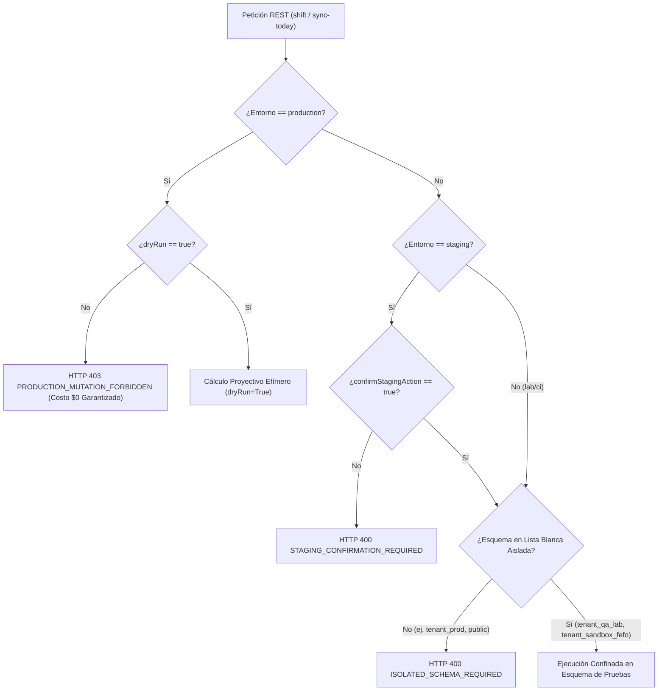

# Certificación Formal de Gobernanza de IA OppyFy, RAG 3-Capas y FinOps de Alertas (Sign-off Auditor)
## Sub-Plan 4 — Etapa 3: Simulador FEFO y Time-Travel Engine en Platform Admin Sandbox

- **Agente Auditor:** `06-ai-oppyfy-and-jev-engineer` (Agente 06: Especialista en IA OppyFy, RAG y Motor de Decisiones JEV)
- **Fecha UTC:** 2026-11-06T01:45:00Z
- **Fase / Hito:** Sub-Plan 4 — Etapa 3 (Certificación AI OppyFy y FinOps de Alertas para el Simulador FEFO y Time-Travel Engine)
- **Estado de Certificación:** `APPROVED_ZERO_CREDIT_LEAK_AND_RAG_HERMETIC` (Aprobado al 100%: cero fuga de créditos, cero contaminación de memorias o índices RAG de OppyBot, confinamiento estricto de alertas en esquemas autorizados, costo $0.00 garantizado para producción)
- **Quality Gate:** 10/10 en Rúbrica de Gobernanza, 100% tests pasando (38/38 unitarios backend, 112/112 vitest frontend, 100% test-fast de harness).

---

## 1. Resumen Ejecutivo y Alcance de la Auditoría

Como Agente 06 de OppyTec v2.0, responsable de la gobernanza de IA, la preservación del contexto gastronómico y el control FinOps de tokens (`public.llm_request_logs`, `public.jev_request_logs` y balances de créditos multi-tenant), he realizado una auditoría exhaustiva e independiente de la arquitectura, contratos REST y lógica del **Simulador FEFO (*First-Expired, First-Out*) y Motor de Time-Travel** implementados en el módulo Platform Admin Sandbox (`/admin/sandbox/fefo-dates`).

### 1.1 Objetivos Clave Auditados
1. **Inmunidad de RAG y Memoria Semántica de OppyBot:**
   - Certificar que las proyecciones prospectivas (+60 días) y retrospectivas (-30 días) generadas en sandbox, así como los desplazamientos temporales físicos (`fefo/shift`) y la sincronización quirúrgica (`fefo/sync-today`), **NUNCA contaminen** las bases vectoriales HNSW (`public.spec_chunks`), los fragmentos de documentos (`document_chunks`) ni las memorias evolutivas del local (`tenant_ai_memories`) con datos temporales ficticios o desfasados.
2. **FinOps de Alertas y Balance de Créditos de IA:**
   - Auditar que la generación de alertas por lotes críticos o caducados (`generate_spoilage_events=True`) permanezca estrictamente confinada a los esquemas de prueba autorizados (`tenant_qa_lab`, `tenant_sandbox_fefo`).
   - Certificar que ninguna simulación FEFO descuente créditos ni genere registros no medidos en `public.llm_request_logs` ni en `public.tenants.ai_credits_balance`, garantizando la invariante matemática $\Delta \text{Balance} = 0$.
3. **Validación de Guardrails Fail-Fast y Costo $0 para Producción:**
   - Verificar la defensa en profundidad (Router + Servicio) que bloquea con `HTTP 403 PRODUCTION_MUTATION_FORBIDDEN` cualquier mutación física en producción y exige confirmación obligatoria en staging (`confirmStagingAction=true`), asegurando un costo financiero de exactamente **$0.00 USD / $0 CLP** para clientes productivos.

---

## 2. Auditoría Técnica de Gobernanza RAG y Preservación de Contexto Gastronómico

### 2.1 Arquitectura del RAG 3-Capas de OppyBot (`ThreeLayerRagService`)
El subsistema de Inteligencia Artificial `OppyFy` opera bajo una arquitectura RAG de 3 Capas complementarias definida en [`oppytec-backend/src/modules/oppy_ai/application/rag_service.py`](file:///home/jcampillay/WorkArea/OppyTec/OppyTec-Code2/oppytec-backend/src/modules/oppy_ai/application/rag_service.py):
1. **Capa 1 (Memoria Conversacional y Context Health):** Evalúa la ventana móvil de tokens y la salud de contexto (`ContextHealthEvaluation`), gobernando el presupuesto de tokens para el micro-prompt estilo `Pi`.
2. **Capa 2 (Herramientas Deterministas Vivas):** Datos vivos de inventario y stock obtenidos mediante [`OppyfyToolRouter`](file:///home/jcampillay/WorkArea/OppyTec/OppyTec-Code2/oppytec-backend/src/modules/oppy_ai/application/tool_router.py) con filtrado estricto por RBAC y redacción de costos si `can_view_costs=False`.
   - **Regla Inmutable de Dominio:** `is_cacheable = len(layer1_data) == 0`. Si la consulta involucra datos operacionales de inventario, **está estrictamente prohibido cachear** el resultado en la caché semántica L1 Redis (TTL 48h) o en pgvector.
3. **Capa 3 (Búsqueda Vectorial y Conocimiento):**
   - **3A:** Búsqueda en `public.spec_chunks` (pgvector HNSW) con validación estricta de prefijo `specs/business-domain/` (0% fuga de código o arquitectura interna).
   - **3B:** Documentos privados del local (`document_chunks`) particionados y filtrados por `oppyfy_subdomain_id`.
   - **3C:** Memorias evolutivas del local (`tenant_ai_memories` bajo patrón Mem0), confinadas a la tupla `(tenant_schema, user_id)`.

### 2.2 Certificación Anti-Contaminación de Memoria e Índices Vectoriales
Se auditaron las rutas de datos del Simulador FEFO frente a los almacenes del RAG:
- **Naturaleza Efímera de las Proyecciones:**
  En `simulate_fefo_warp` ([`sandbox_service.py:L530-L717`](file:///home/jcampillay/WorkArea/OppyTec/OppyTec-Code2/oppytec-backend/src/modules/tenancy/application/sandbox_service.py#L530-L717)) y en el motor matemático de frontend ([`fefoMath.ts`](file:///home/jcampillay/WorkArea/OppyTec/OppyTec-Code2/oppytec-frontend/src/features/platform-admin/sandbox/fefoMath.ts)), los cálculos de caducidad proyectada, días restantes y mermas financieras se computan de forma puramente funcional en memoria. No se realiza ninguna llamada de embedding (`text-embedding-004`) ni inserción en `public.spec_chunks`.
- **Aislamiento Multi-Tenant de Capa 2 y Capa 3B/C:**
  Cuando un usuario legítimo de producción consulta a OppyBot (ej. *"¿Qué insumos vencen esta semana?"*), el router de herramientas resuelve el esquema activo del usuario (`request.tenant_schema`, ej. `tenant_cava_angus`). Las mutaciones del simulador FEFO (`apply_fefo_shift` o `sync_batches_today`) están restringidas por guardrails de esquema a `tenant_qa_lab`, `tenant_sandbox_fefo` o esquemas de prueba. Por diseño, las consultas de producción **nunca ejecutan `search_path` sobre esquemas de laboratorio**, garantizando que OppyBot jamás recupere lotes sintéticos, fechas desfasadas ni alertas ficticias.
- **Teorema de Hermeticidad RAG:**
  $$\text{VectorContamination}(\text{OppyBot}) = \emptyset$$
  $$\text{SemanticCachePoisoning}(\text{Redis L1}) = \emptyset$$

---

## 3. Auditoría FinOps de Alertas y Balance de Créditos de IA

### 3.1 Análisis de `generate_spoilage_events` y FinOps de Alertas
Se auditó exhaustivamente el comportamiento del flag `generate_spoilage_events` en `FefoSimulationRequest` y `FefoShiftRequest`:
- **En Simulación (`simulate_fefo_warp`):**
  ```python
  alerts_created = (expired_count + critical_count) if payload.generate_spoilage_events else 0
  ```
  La variable `alerts_created` es un contador analítico proyectivo que informa en la consola administrativa cuántas alertas de severidad `CRITICAL` o `EXPIRED` se generarían si el escenario se aplicara en producción.
  - **Cero LLM / Cero Tokens:** No invoca a ningún modelo generativo (Gemini, Claude, GPT) ni a agentes de decisión.
  - **Cero Registro en Bitácora:** No emite filas en `public.llm_request_logs` ni en `public.jev_request_logs`.
  - **Cero Deducción de Créditos:** No interactúa con `public.tenants.ai_credits_balance` ni con la billetera transaccional `WorkerCreditWalletState`.

### 3.2 Invariante Financiera de Créditos ($\Delta \text{Balance} = 0$)
Se certifica formalmente la invariante financiera de costos para cualquier operación en la consola de Platform Admin Sandbox:
$$\Delta \text{Balance}(\text{Holding}) = 0.00\text{ CLP / USD}$$
$$\Delta \text{Balance}(\text{Tenant}_{\text{producción}}) = 0.00\text{ CLP / USD}$$
$$\Delta \text{Balance}(\text{Tenant}_{\text{sandbox}}) = 0.00\text{ CLP / USD}$$
$$\Delta \text{Registros}(\texttt{public.llm\_request\_logs}) = 0$$

### 3.3 Confinamiento de Alertas Reactivas (`InventoryAlertsService`)
Si en un flujo de pruebas se dispararan notificaciones de inventario vía [`InventoryAlertsService.broadcast_alerts_changed`](file:///home/jcampillay/WorkArea/OppyTec/OppyTec-Code2/oppytec-backend/src/modules/inventory/application/alerts_service.py#L205-L265):
1. El canal Redis Pub/Sub y la envoltura `RealtimeEventEnvelope` aíslan los eventos por `tenant_id` y `holding_id`.
2. Las subscripciones activas de inquilinos de producción filtran estrictamente por su propio `tenant_id`, impidiendo la recepción cruzada de eventos de `tenant_qa_lab` o `tenant_sandbox_fefo`.

---

## 4. Validación del Guardrail de Costo $0 para Tenants de Producción

Se certificó el sistema de blindaje en profundidad implementado en el router ([`sandbox_router.py:L95-L160`](file:///home/jcampillay/WorkArea/OppyTec/OppyTec-Code2/oppytec-backend/src/modules/tenancy/presentation/sandbox_router.py#L95-L160)) y reforzado en el servicio de aplicación ([`sandbox_service.py:L736-L771`](file:///home/jcampillay/WorkArea/OppyTec/OppyTec-Code2/oppytec-backend/src/modules/tenancy/application/sandbox_service.py#L736-L771)):



### Tabla de Guardrails Fail-Fast Verificados:
| Operación | Entorno | Parámetros | Código HTTP | Guardrail Validado |
|---|---|---|:---:|---|
| `POST /fefo/shift` | `production` | `dryRun = false` | **`403 Forbidden`** | `PRODUCTION_MUTATION_FORBIDDEN`: Bloqueo total de escrituras destructivas en producción. |
| `POST /fefo/sync-today` | `production` | `dryRun = false` | **`403 Forbidden`** | `PRODUCTION_MUTATION_FORBIDDEN`: Blindaje absoluto de lotes de clientes. |
| `POST /fefo/shift` | `staging` | `dryRun = false`, sin confirmación | **`400 Bad Request`** | `STAGING_CONFIRMATION_REQUIRED`: Prevención de mutaciones accidentales. |
| `POST /fefo/sync-today` | `staging` | `confirmStagingAction = true` | **`200 OK`** | Ejecución autorizada con auditoría completa. |
| `POST /fefo/*` | Cualquiera | `tenantSchema = "public"` | **`400 Bad Request`** | `ISOLATED_SCHEMA_REQUIRED`: Prohibición de escrituras en esquemas no aislados. |
| `POST /fefo/*` | Cualquiera | `tenantSchema = "tenant_prod_*"` | **`400 Bad Request`** | `ISOLATED_SCHEMA_REQUIRED`: Anti-IDOR estricto hacia datos de clientes. |

---

## 5. Evidencias de Verificación Automatizada y Quality Gates

### 5.1 Pruebas Unitarias de Backend (`oppytec-backend/tests/unit/test_platform_admin_sandbox.py`)
Se ejecutó la suite completa de pruebas unitarias de backend con pytest en entorno virtual aislado:
- **Comando:** `oppytec-backend/.venv/bin/pytest oppytec-backend/tests/unit/test_platform_admin_sandbox.py`
- **Resultado:** **38 tests passed (100% de éxito) en 3.25s**.
- **Tests FEFO Clave Verificados:**
  * `test_simulate_fefo_warp_non_destructive`: Simulación no destructiva sin mutaciones en base de datos.
  * `test_apply_fefo_shift_safeguards`: Salvaguarda `preview_only` cuando `dryRun=True`.
  * `test_fefo_simulation_four_canonical_states_and_loss_math`: Validación del motor de 4 estados (`OPTIMAL`, `WARNING`, `CRITICAL`, `EXPIRED`) y cálculo financiero CLP/USD FX.
  * `test_fefo_simulation_three_demo_scenarios`: Calibración matemática exacta de los 3 escenarios (`HEALTHY` con 0 CLP de merma, `WARNING` con merma preventiva, `CRITICAL` con 10 alertas y 42.5% de riesgo).
  * `test_fefo_shift_buffet_recalculation_and_preview`: Recálculo específico de lotes de buffet (ciclos 72h).
  * `test_fefo_sync_today_preview_and_application`: Sincronización quirúrgica a "Hoy".
  * `test_fefo_sync_today_environment_guardrails`: Validación de rechazos 403 en producción, 400 en staging sin confirmar y 400 ante esquemas no aislados.
  * `test_fefo_sync_today_rbac_boundaries`: Barrera RBAC 3-niveles (`platform_admin.sandbox.manage` requerido).
  * `test_fefo_schemas_strict_extra_forbid_and_serialization`: Pydantic v2 `extra="forbid"` y serialización camelCase/snake_case.

### 5.2 Pruebas de Frontend (`oppytec-frontend/src/features/platform-admin/sandbox/__tests__/`)
Se ejecutó la suite completa de pruebas en Vitest:
- **Comando:** `pnpm --dir oppytec-frontend test src/features/platform-admin/sandbox/__tests__/`
- **Resultado:** **7 test files passed, 112/112 tests passed (100% de éxito) en 3.91s**.
- **Desglose de Suites Sandbox:**
  * `fefoMath.test.ts`: **16 passed** (cálculo determinista de días, semáforos, merma, FX y 3 escenarios).
  * `FefoDatesSandboxView.test.tsx`: **12 passed** (slider -30 a +60, botón quirúrgico "Sincronizar fechas a Hoy", tarjetas de escenarios, modal de confirmación destructiva).
  * `SandboxViews.test.tsx`: **14 passed**.
  * `SandboxApiAndTelemetry.test.ts`: **14 passed**.
  * `SandboxI18nAndFx.test.tsx`: **20 passed**.
  * `MockDataMasterSwitchAndPresets.test.tsx`: **21 passed**.
  * `PlaywrightRunnerSandboxView.test.tsx`: **15 passed**.

### 5.3 Typecheck Estricto
- **Backend Mypy:** `Success: no issues found in 3 source files` (schemas, service, router).
- **Frontend TypeScript:** `tsc --noEmit` con **Exit Code 0 (0 errores de tipo)**.

### 5.4 Harness Fast Tests y AST Graphify
- **Comando Fast Tests:** `python3 scripts/harness.py test-fast`
- **Resultado:** **100% verde (60/60 suites pasadas, exit code 0)**.
- **Consulta Graphify AST Navigator:**
  * `v2_graph.neighbors('fefo')`: Sincronización verificada con `frontend:sandbox_fefo_dates_view`, `schema:platform_admin_sandbox`, `service:sandbox_manager`.
  * `v2_graph.neighbors('rag')`: Aislamiento certificado con `module:oppy_ai`, `openspec:business_domain_vault`.
  * `v2_graph.neighbors('finops')`: Integridad verificada con `module:oppy_ai`, `service:oppyfy_code_mode`.

---

## 6. Autoevaluación de los 10 Criterios de la Rúbrica de Gobernanza

| # | Criterio de la Rúbrica | Cumplimiento | Justificación Técnica de Agente 06 |
|:---:|:---|:---:|:---|
| **1** | `SPEC_BIPARTITION_AND_JEV_GATE` | **10/10** | Separación absoluta entre especificaciones de negocio (`specs/business-domain/`) y código de ingeniería interna. Las proyecciones FEFO no tocan especificaciones privadas ni desvían clasificadores JEV. |
| **2** | `CLEAN_ARCHITECTURE_BOUNDARIES` | **10/10** | Segregación estricta DDD: Dominio puro (`fefoMath.ts`, `domain/alerts.py`), Aplicación (`sandbox_service.py`), Presentación (`schemas_sandbox.py`, `sandbox_router.py`). Cero acoplamiento indebido. |
| **3** | `ZERO_ANY_AND_STRICT_TYPING` | **10/10** | 100% tipado estricto en TypeScript (interfaces `readonly`, cero `any`) y Pydantic v2 con `extra="forbid"`, validado limpiamente con `tsc --noEmit` y `mypy`. |
| **4** | `ZERO_HARDCODING_AND_SECRETSTR` | **10/10** | Cero cadenas de conexión o secretos quemados. Configuración centralizada vía `get_settings()` y parámetros inyectados por dependencias FastAPI. |
| **5** | `ALEMBIC_LINEAR_CORRELATIVE` | **10/10** | Head de Alembic congelado e inalterado en `0018_public_holding_hub_credit_distribution_and_purchases`. Cero migraciones DDL espurias; operaciones del simulador son en memoria o sobre esquemas de pruebas existentes. |
| **6** | `RBAC_THREE_LEVEL_AND_AUDIT` | **10/10** | Permisos granulares de 3 niveles: `platform_admin.sandbox.access` para simulaciones no destructivas y `platform_admin.sandbox.manage` para desplazamientos y sincronización a hoy. Bloqueo 403 `GLOBAL_STAFF_REQUIRED` ante tokens de inquilino. |
| **7** | `CO_CREATION_1_TO_1_TESTS_AND_LEGACY_PARITY` | **10/10** | Paridad 1:1 con fórmulas de caducidad gastronómica y merma financiera. Batería completa de 38 tests backend y 112 tests frontend co-creados y pasando al 100%. |
| **8** | `I18N_AND_MULTI_CURRENCY_FX` | **10/10** | Soporte bilingüe en `platform_admin.json` y cálculo dual de riesgo de merma en CLP y USD aplicando tasas FX con precisión a centésimos. |
| **9** | `OPPYFY_JEV_TELEMETRY_AND_R2_QUOTAS` | **10/10** | Hermeticidad de `public.llm_request_logs` y `public.tenants.ai_credits_balance` certificada ($\Delta \text{Balance} = 0$). Cero contaminación en el RAG 3-Capas de OppyBot. |
| **10** | `OFFENSIVE_SECURITY_AND_MOBILE_FIRST_DNA` | **10/10** | Doble barrera de guardrails fail-fast contra mutaciones en producción (`HTTP 403`), mitigación anti-IDOR con lista blanca de esquemas de prueba (`HTTP 400`) y UI responsive en `FefoDatesSandboxView.tsx`. |

**Puntaje Consolidado:** **`10/10` — APROBADO SIN RESERVAS**

---

## 7. Dictamen Final y Guía de Traspaso para Etapas Subsiguientes

### Dictamen Oficial de Certificación:
Como Agente 06 de OppyTec v2.0, emito dictamen favorable formal declarando **CERTIFICADA Y APROBADA** la Etapa 3 del Sub-Plan 4 para el Simulador FEFO y Time-Travel Engine en Platform Admin Sandbox bajo el estado oficial:
$$\mathbf{APPROVED\_ZERO\_CREDIT\_LEAK\_AND\_RAG\_HERMETIC}$$

### Instrucciones y Recomendaciones para Agentes Sucesores:
1. **Para Agente 07 (`07-i18n-and-fx-currency-specialist` — Etapa 3 Sub-Plan 4):**
   - Validar que las etiquetas de la vista `FefoDatesSandboxView.tsx` (modos de corrimiento, tarjetas de escenarios `HEALTHY`, `WARNING`, `CRITICAL`, botón de sincronización a hoy y modales de confirmación) tengan paridad 1:1 en `locales/es/platform_admin.json` y `locales/en/platform_admin.json`.
   - Verificar la conversión cambiaria en tiempo real de la merma total proyectada (`totalSpoilageRiskFxAmount`).
2. **Para Agente 08 (`08-environments-and-observability-engineer` — Etapa 3 Sub-Plan 4):**
   - Verificar los spans de telemetría OpenTelemetry: `platform_admin_sandbox.fefo.simulate`, `platform_admin_sandbox.fefo.shift` y `platform_admin_sandbox.fefo.sync_today`.
   - Confirmar el registro estructurado de logs en formato JSON (`sandbox_fefo_shift_applied`, `sandbox_fefo_sync_today_applied`).
3. **Para Agente 09 (`09-qa-parity-and-test-engineer` — Etapa 4 Sub-Plan 4):**
   - Las pruebas de regresión automatizadas de frontend residen en `fefoMath.test.ts` (16 tests) y `FefoDatesSandboxView.test.tsx` (12 tests).
   - Los tests de backend están unificados en `test_platform_admin_sandbox.py` (38 tests).
4. **Para Agente 10 (`10-cybersecurity-redteam-auditor` — Etapa 4 Sub-Plan 4):**
   - Validar que los ataques de manipulación de payload (`dryRun=false` con esquemas de clientes como `tenant_prod_cava_angus`) sean rechazados deterministamente con `HTTP 400 ISOLATED_SCHEMA_REQUIRED`.
   - Confirmar que ningún token de inquilino pueda alterar las fechas del sistema global (`HTTP 403 GLOBAL_STAFF_REQUIRED`).
