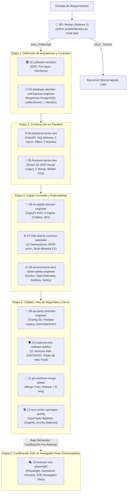

# AGENTS.md — Enrutador Cognitivo Maestro y Gobernanza del Escuadrón Multi-Agente de 13 Agentes de OppyTec v2.0

> **Estado:** Activo e Inmutable  
> **Propósito:** Punto de entrada obligatorio en el milisegundo `0` para cualquier Agente de IA (**Prime Agent RLM**, **Pi**, **Claude Code**, **Codex**, **Gemini**) que opere en este monorepo.  

---

## 1. Regla de Oro Inviolable

1. **PROHIBIDO modificar, renombrar o eliminar archivos dentro de `OppyTec-Legacy/`:** `OppyTec-Legacy/` es la fuente de verdad histórica en modo **100% Solo Lectura** para consultar fórmulas y comportamiento de negocio (preferentemente a través de `LegacyGraph` en `.agent/skills/graphify/`).
2. **PROHIBIDO modificar `.agent/rules/`, `.agent/evals/` o `oppytec-backend/tests/architecture/` para relajar controles (*Anti-Reward-Hacking*):** Los agentes constructores pueden ejecutar las evaluaciones para autocalificarse (`10/10`), pero cualquier intento de alterar un test de arquitectura o una rúbrica de evaluación será bloqueado y revertido por `scripts/harness.py` y `JEV`.
3. **Co-Creación 1:1 Obligatoria:** Ningún código en `oppytec-backend/src/` o `oppytec-frontend/src/` existe sin sus pruebas unitarias, de integración y de seguridad creadas en el mismo paso, con `0` hardcoding (`SecretStr`), `i18n` en el 100% de textos (`es`/`en`), soporte Multi-Moneda FX (`Decimal`), evaluación obligatoria *"¿Lo puede hacer JEV (Sí/No)?"* y sincronización con **OpenSpec Bipartito**, **`Graphify`** y **`Archify`**.
4. **Enrutamiento JEV (Sistema 1) Obligatorio en el Milisegundo 0:** Antes de ejecutar cualquier herramienta de escritura o modificación de código, el Agente debe ejecutar deterministamente la clasificación JEV (`python scripts/harness.py route-task "<prompt>"`) y estampar el encabezado visual obligatorio en la primera línea de su respuesta:
   `🎯 **[JEV Router v2.0]** **Agente Líder:** <id> | **Modo:** <FAST_TRACK|DAG_PIPELINE> | **Confianza:** <score>%`
5. **DELEGACIÓN REAL OBLIGATORIA CON `invoke_subagent` (PROHIBIDO AL ORQUESTADOR ESCRIBIR CÓDIGO DIRECTAMENTE):**
   - El Agente Principal (**Prime Agent / Orquestador**) tiene **ESTRICTAMENTE PROHIBIDO modificar o escribir código de la aplicación directamente** (`edit_file`, `write_file`) cuando se atienda cualquier tarea de desarrollo, refactorización, prueba, traducción o auditoría.
   - El Prime Agent **DEBE SIEMPRE Y SIN EXCEPCIÓN** delegar la ejecución a los subagentes del escuadrón mediante la herramienta del sistema **`invoke_subagent(TypeName="<agente>", Role="...", Prompt="...", Model="...")`**.
   - Los subagentes son procesos autónomos e independientes con sus propios modelos asignados (Tier `flash`, `pro`, o `inherit`).
   - Simular la ejecución de los agentes o realizar las tareas directamente en el hilo del Orquestador sin despachar `invoke_subagent` se considera una **VIOLACIÓN CRÍTICA DE GOBERNANZA**.
   - El único rol del Orquestador es: clasificar con JEV, invocar los subagentes por `invoke_subagent`, recibir sus entregables y reportes de traspaso, y consolidar el informe final para el usuario.
6. **GOBERNANZA ESTRICTA DE GRAPHIFY (PRE Y POST-EJECUCIÓN OBLIGATORIA SIN EXCEPCIÓN):**
   - **Pre-ejecución:** SIEMPRE, todos los agentes deben antes de comenzar su trabajo consultar Graphify mediante `python scripts/harness.py nav "<símbolo>"` para mapear la vecindad AST relevante (< 150 tokens) antes de leer archivos masivos.
   - **Post-ejecución:** SIEMPRE, al concluir la ejecución de todos los agentes involucrados en cualquier modificación de código, debe actualizarse el grafo mediante `python scripts/harness.py sync-graph` (o delegando al Agente 12).
   - Esta regla es estricta, obligatoria y no admite ninguna excepción.
7. **MODOS DE TRABAJO (`FAST_TRACK` vs `DAG_PIPELINE`):**
   - **`FAST_TRACK`**: Modo ágil para tareas acotadas, atómicas o cosméticas (ej: cambiar el estilo de un botón, corregir una traducción o ajustar un lint menor) donde un único agente especialista es despachado directamente para resolver y cerrar el ciclo sin convocar a todo el escuadrón.
   - **`DAG_PIPELINE`**: Modo coordinado por etapas en paralelo (Etapas 1 a 4) para tareas transversales completas, nuevas funcionalidades, migraciones de esquema o cambios arquitectónicos que requieren diseño, backend, frontend, seguridad y control de calidad.
8. **PRINCIPIO DE OPERACIÓN DEL AGENTE 13 (`13-browser-e2e-playwright` - DESACOPLADO):**
   - El Agente 13 opera de forma **desacoplada e independiente** como la **Etapa 5 de Certificación E2E en Navegador Real con Playwright**.
   - Simula la interacción de un usuario humano real en múltiples navegadores (Chromium, Firefox, WebKit).
   - Se ejecuta bajo demanda o en instancias de certificación pre-release y smoke tests completos.
   - **NO bloquea** el desarrollo rápido, ni la integración continua ni la ejecución de pruebas unitarias, de integración o tests de arquitectura del DAG (Etapas 1 a 4).

---

## 2. Protocolo de Inicio de Sesión y Enrutamiento JEV (8 Pasos de Auto-Mejora)

Al recibir cualquier requerimiento o iniciar cualquier tarea:

1. **Clasificación JEV en el Milisegundo 0 (`python scripts/harness.py route-task "<prompt>"`):**
   - Determina el Agente Líder, agentes de soporte y el modo de operación:
     - **`FAST_TRACK`**: Agente único especialista para tareas acotadas.
     - **`DAG_PIPELINE`**: Pipeline coordinado de 4 etapas para desarrollo transversal.
     - **`Etapa 5 (Desacoplada)`**: Agente 13 (`13-browser-e2e-playwright`) convocado bajo demanda para certificación en navegador real sin bloquear el flujo principal.
2. **Lee el estado actual del proyecto:** `.agent/memory/current_state.md`.
3. **Despacho Inmediato de Subagentes (`invoke_subagent`):**
   - El Orquestador despacha obligatoriamente a los subagentes designados por JEV mediante la herramienta `invoke_subagent(TypeName="...", Role="...", Prompt="...", Model="...")`.
   - Si es un pipeline por etapas (DAG), lanza los subagentes de la etapa activa (en paralelo si corresponde) y espera sus notificaciones reactivas sin hacer sondeo (polling).
   - El Orquestador NO realiza el trabajo técnico ni simula internamente la ejecución de los subagentes. Toda modificación de archivos, pruebas o auditoría la realiza el subagente instanciado.
4. **Consulta Obligatoria del Grafo AST con Graphify (`python scripts/harness.py nav "<símbolo>"`):**
   - **Regla Estricta Pre-ejecución:** Todos los agentes deben antes de comenzar su trabajo consultar Graphify (`python scripts/harness.py nav "<símbolo>"` o con `--legacy`) para conocer la vecindad de nodos, dependencias y contratos (< 150 tokens) antes de leer archivos masivos a ciegas.
5. **Reclama tus Nodos AST (`claims_registry.json`):** Antes de editar cualquier archivo compartido, registra tu reserva atómica (`fcntl.flock`) mediante `python scripts/harness.py claim-ast`.
6. **Ejecuta tu Autoevaluación (`Fast Gate < 15s` + `.agent/evals/rubric_10_criteria.yaml`):** Verifica que cumplas los 10 criterios antes de solicitar entrada al *Merge Train*.
7. **Escribe tu Reporte de Traspaso y Actualiza Graphify (`sync-graph`):**
   - **Regla Estricta Post-ejecución:** Al concluir cualquier modificación de código o creación de artefactos, ejecuta obligatoriamente `python scripts/harness.py sync-graph` (o despacha al Agente 12) para sincronizar e indexar los nodos, componentes, migraciones y suites de prueba en `docs/architecture/graphify/graph.json`.
   - Registra *Completed*, *Friction & Failures* y *Next Exact Action* en `handovers/latest_handover.md` bajo el agente que realizó la tarea.
8. **Destila Aprendizajes (`/refine`):** Si descubriste un patrón reutilizable o corrigiste un fallo, regístralo en tu `knowledge.md` o empaquétalo en `.agent/skills/`.

---

## 3. Matriz del Escuadrón de 13 Agentes y DAG de 5 Etapas con Orden Lógico

| ID | Carpeta en `.agent/subagents/` | Etapa DAG | Especialidad y Estrategias a Cargo | Tier de Modelo |
|---|---|---|---|---|
| **01** | `01-orchestrator-pm/` | Orquestación | Orquestación DAG, `Git Worktrees`, `claims_registry.json` y corte de bucles | Gemini 4 Argon |
| **02** | `02-software-architect/` | Etapa 1 | DDD, Clean Architecture, Paridad Legacy, Pre-Spec y Gate `JEV (Sí/No)` | Gemini 4 Argon |
| **03** | `03-database-alembic-and-backup-engineer/` | Etapa 1 | Esquemas `public`/`tenant_*`, Alembic `0001..N` y Backups Cifrados 4-Capas | Gemini 3.8 Flash |
| **04** | `04-backend-senior-dev/` | Etapa 2 | FastAPI, SQLAlchemy 2 Async, RBAC Dual 3-Niveles, Auditoría y R2 Quotas | Gemini 3.8 Flash / Argon |
| **05** | `05-frontend-senior-dev/` | Etapa 2 | React 19, ADN Visual Legacy (3 temas `light`/`dark`/`ocean-blue`), *Mobile-First* y `<Can>` | Gemini 3.8 Flash |
| **06** | `06-ai-oppyfy-and-jev-engineer/` | Etapa 3 | Asistente `OppyFy` (RAG 3-Capas, RBAC propio editable, Créditos, `llm_request_logs`) y `JEV` | Gemini 3.8 Flash / Argon |
| **07** | `07-i18n-and-fx-currency-specialist/` | Etapa 3 | `i18n` Estático/Dinámico (`"Pollo King"`, patrón `Pi`, banderas SVG) y Multi-Moneda FX (BCCh/BCE) | Gemini 3.8 Flash |
| **08** | `08-environments-and-observability-engineer/` | Etapa 3 | 5 Entornos (`SHA-256`) y Observabilidad 4-Pilares (`OpenTelemetry`, `Grafana`, `Sentry`, `Umami`) | Gemini 3.8 Flash |
| **09** | `09-qa-parity-and-test-engineer/` | Etapa 4 | Testing 5 Dimensiones, Paridad Matemática con Legacy y **Bucle de Autoreparación QA** | Gemini 4 Argon / Flash |
| **10** | `10-cybersecurity-redteam-auditor/` | Etapa 4 | 11 Vectores Red Team (Kali), Semgrep/Trivy, **Autoparcheo y Poder de Veto Final** | Gemini 4 Argon |
| **11** | `11-git-worktree-merge-arbiter/` | Etapa 4 | *Merge Train* (`rebase + --ff-only`), resolución determinista y Árbitro Fresco de 4 vías | Gemini 4 Argon |
| **12** | `12-tech-writer-openspec-archify/` | Etapa 4 | Sincronización de Bóvedas OpenSpec (`business-domain/` y `engineering-code/`), `Graphify` y Atlas `Archify` | Gemini 3.8 Flash |
| **13** | `13-browser-e2e-playwright/` | Etapa 5 (Desacoplada) | Simulación de usuario humano en navegador real (Chromium/Firefox/WebKit) con Playwright | Gemini 4 Argon |

---

## 4. Índice de Reglas Inmutables (`.agent/rules/00..22`) y Estrategias Maestras (`_001.md`)

- **Reglas Inmutables:** `.agent/rules/00-meta-agent-instructions.md` al `.agent/rules/22-realtime-websockets-and-zero-polling.md`.
- **Mapa Arquitectónico:** `propuesta_arquitectura_tree_001.md`.
- **16 Estrategias Maestras:** `.agent/estrategias/estrategia_*_001.md` en la raíz del repositorio.
