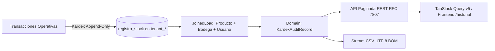

# 📋 PLAN MAESTRO DE CONTROL Y EJECUCIÓN: MÓDULO DE HISTORIAL AUDITABLE, KARDEX INMUTABLE Y TRAZABILIDAD MULTIBODEGA (`/historial`)

> **Regla de Gobernanza:** Este documento es el tablero de control de ejecución estricto del Módulo de Historial y Auditoría de Kardex de OppyTec v2.0.  
> Cada paso debe ser **100% corroborado y aprobado** antes de pasar al siguiente.  
> **Solo cuando se finalicen todos los pasos**, este documento podrá ser archivado o eliminado, no antes.  
> **Fuentes de Verdad Históricas (100% Solo Lectura):**  
> - [`index.tsx`](file:///home/jcampillay/WorkArea/OppyTec/OppyTec-Code2/OppyTec-Legacy/OppyTec_Frontend/src/pages/Historial/index.tsx) (Orquestador principal, `SectionHeader` cian `#06b6d4`, Toolbar unificado con badge inmutable, exportador CSV y paginador)  
> - [`FiltrosHistorial.tsx`](file:///home/jcampillay/WorkArea/OppyTec/OppyTec-Code2/OppyTec-Legacy/OppyTec_Frontend/src/pages/Historial/FiltrosHistorial.tsx) (Filtros multi-criterio: búsqueda predictiva por usuario con debounce/limpieza, selector de producto con deep-linking, tipo de movimiento con badges y rango de fechas con `EnhancedCalendar`)  
> - [`TablaHistorial.tsx`](file:///home/jcampillay/WorkArea/OppyTec/OppyTec-Code2/OppyTec-Legacy/OppyTec_Frontend/src/pages/Historial/TablaHistorial.tsx) (Tabla responsive con timezone America/Santiago, badges semánticos cromáticos, flechas de dirección de traspaso `↑`/`↓`, comparativa before/after en conteos y control RBAC de usuario)  
> - [`types.ts`](file:///home/jcampillay/WorkArea/OppyTec/OppyTec-Code2/OppyTec-Legacy/OppyTec_Frontend/src/pages/Historial/types.ts) & [`useHistorial.ts`](file:///home/jcampillay/WorkArea/OppyTec/OppyTec-Code2/OppyTec-Legacy/OppyTec_Frontend/src/pages/Historial/useHistorial.ts) (Contratos TypeScript, hook reactivo con deep linking URL `?search=`, filtros dinámicos, paginación server-side y cálculo de deltas)  
> - [`history_router.py`](file:///home/jcampillay/WorkArea/OppyTec/OppyTec-Code2/OppyTec-Legacy/OppyTec_Backend/src/inventory/routers/history_router.py) (Endpoints de lectura filtrada, paginada `/inventory/history/paginated` y purga protegida de Propietario)  
> - [`history_service.py`](file:///home/jcampillay/WorkArea/OppyTec/OppyTec-Code2/OppyTec-Legacy/OppyTec_Backend/src/inventory/services/history_service.py) (Carga eager anti-N+1 `joinedload` de producto, bodega, usuario, receta, y proyección de nombres enriquecidos)  
> - [`registro-stock-kardex.md`](file:///home/jcampillay/WorkArea/OppyTec/OppyTec-Code2/OppyTec-Legacy/OppyTec_Backend/openspec/specs/business/inventory/registro-stock-kardex.md) (Especificación de libro mayor inmutable, reglas de signo de balance, catálogo canónico de 12 tipos de movimiento más `AJUSTE_AUDITORIA`, y prevención de deadlocks)  
> **Destinos de Construcción en OppyTec v2.0:**  
> - Frontend: [`oppytec-frontend/src/features/historial/`](file:///home/jcampillay/WorkArea/OppyTec/OppyTec-Code2/oppytec-frontend/src/features/historial/) (`HistorialPage.tsx`, `HistorialToolbar.tsx`, `FiltrosHistorial.tsx`, `TablaHistorial.tsx`, `useHistorial.ts`, `types.ts`, `index.ts`)  
> - Backend: [`oppytec-backend/src/modules/inventory/`](file:///home/jcampillay/WorkArea/OppyTec/OppyTec-Code2/oppytec-backend/src/modules/inventory/) (`presentation/router.py`, `presentation/schemas.py`, `application/inventory_service.py`, `domain/entities.py`, exportación streaming CSV, RBAC 3-niveles y eventos WebSocket realtime)  

---

## 📊 Estado General del Proyecto

- [x] **Fase 1:** Arquitectura de Dominio DDD, Esquemas PostgreSQL tenant_* y Consultas de Auditoría Inmutable — **COMPLETADA**
- [x] **Fase 2:** Motor Backend FastAPI: Endpoints de Consulta Paginada Server-Side, Schemas RFC 7807, RBAC 3-Niveles (`inventory.history.*` / `inventory.kardex.*`) y Streaming CSV — **COMPLETADA**
- [x] **Fase 3:** Frontend Feature Core & Hooks Reactivos (`types.ts`, `useHistorial.ts`, TanStack Query v5 + WebSockets Realtime `inventory.stock.updated`) — **COMPLETADA**
- [x] **Fase 4:** Vista Principal — Historial y Auditoría (`/historial`): Réplica 1:1 de `HistorialPage`, `SectionHeader` centrado (#06b6d4), Toolbar Unificado de Gobernanza y Badge de Inmutabilidad — **COMPLETADA**
- [x] **Fase 5:** Panel de Filtros Multi-Criterio (`FiltrosHistorial.tsx`): Búsqueda Predictiva por Usuario, Selector de Producto con Deep-Linking URL (`?search=`), Tipo de Movimiento y Rango de Fechas Accesible `dd/MM/yyyy` — **COMPLETADA**
- [x] **Fase 6:** Tabla Multidimensional de Trazabilidad (`TablaHistorial.tsx`): Timezone Canónico de Chile/Tenant, Badges Cromáticos por Tipo, Indicadores de Dirección de Transferencias, Visualización Before/After en Conteos y Control de Visibilidad RBAC — **COMPLETADA**
- [x] **Fase 7:** Motor de Exportación y Descarga Segura: Streaming CSV en Backend y Exportador Client-Side Resiliente con Metadatos de Auditoría — **COMPLETADA**
- [x] **Fase 8:** Capas Cruzadas: i18n 100% `es`/`en` (`history.json`), Multi-Moneda FX con `Decimal`, Observabilidad OpenTelemetry, Testing 5D (Pytest + Vitest) y sincronización con Graphify/Archify — **COMPLETADA**

---

## 🔍 Detalle y Criterios de Aceptación por Fase

---

### [x] FASE 1: Arquitectura de Dominio DDD, Esquemas PostgreSQL tenant_* y Consultas de Auditoría Inmutable — ✅ 100% COMPLETADA
- [x] **1.1** Alineación y Mapeo de Persistencia Multi-Tenant en [`models.py`](file:///home/jcampillay/WorkArea/OppyTec/OppyTec-Code2/oppytec-backend/src/modules/inventory/infrastructure/models.py):
  - Verificar que la tabla `registro_stock` (o `kardex_movements`) en el esquema `tenant_*` (gestionada por la migración correlativa [`0004_tenant_inventory_kardex_and_physical_counts.py`](file:///home/jcampillay/WorkArea/OppyTec/OppyTec-Code2/oppytec-backend/alembic/versions/0004_tenant_inventory_kardex_and_physical_counts.py)) contenga todos los atributos auditables exigidos por la spec legacy y las extensiones OppyTec v2.0:
    - `id` (`BigInteger` PK con autoincremento).
    - `bodega_id` (`Integer` FK `bodegas.id` ON DELETE RESTRICT).
    - `producto_id` (`Integer` FK `productos.id` ON DELETE RESTRICT).
    - `usuario_id` (`Integer` FK `public.users.id`).
    - `cantidad` (`Numeric(12, 4)` con regla estricta de signo: positivo `+` para entradas, adiciones y compras; negativo `-` para consumos, mermas y salidas).
    - `tipo_movimiento` (`String(50)` enum canónico de 12 valores: `conteo`, `consumo`, `merma`, `entrada`, `salida`, `compra`, `venta`, `ajuste_positivo`, `ajuste_negativo`, `transferencia`, `reversion`, `redo` + `AJUSTE_AUDITORIA`).
    - `motivo_merma` (`String(64)` nullable enum canónico: `vencimiento`, `daño`, `error`, `caducidad`, `exceso`, `mal_estado`, `otro`).
    - `descripcion_merma` (`String(500)` nullable para notas de auditoría, etiquetas operativas y trazabilidad de traspasos).
    - `lote_codigo` (`String(64)` nullable para trazabilidad FEFO).
    - `fecha_vencimiento_lote` (`Date` nullable).
    - `fecha_recuento` (`Date` not null default `CURRENT_DATE`).
    - `costo_unitario_ppp` (`Numeric(14, 2)` not null default `0.00`).
    - `costo_total_movimiento` (`Numeric(14, 2)` not null default `0.00`).
    - `saldo_resultante` (`Numeric(12, 4)` not null para reconstrucción instantánea del estado histórico).
    - `documento_referencia` (`String(128)` nullable para números de guía, factura o acta de auditoría).
    - `transfer_id` (`Uuid` nullable para enlazar atómicamente la contraparte de salida y de entrada en transferencias inter-bodega).
    - `created_at` (`DateTime(timezone=True)` default `now()`).
  - Índices de consulta de alto rendimiento indispensables para el visor de historial:
    - `ix_registro_stock_bodega_producto`: `(bodega_id, producto_id)`.
    - `ix_registro_stock_created_tipo`: `(created_at DESC, tipo_movimiento)`.
    - `ix_registro_stock_fecha_recuento`: `(fecha_recuento DESC)`.
    - `ix_registro_stock_usuario_created`: `(usuario_id, created_at DESC)`.
    - `ix_registro_stock_transfer_id`: `(transfer_id)`.
- [x] **1.2** Principios de Dominio DDD e Invariantes de Auditoría (`domain/`):
  - Invariante Absoluta: Libro Mayor **Append-Only e Inmutable**. Prohibición de mutaciones directas (`UPDATE`) o eliminaciones físicas (`DELETE`) de registros individuales.
  - Value Objects de Auditoría: `MovementSign` (determinación de signo según tipo de movimiento), `TimezoneConverter` (proyección determinista a huso horario de operaciones `America/Santiago`), y `AuditDelta` (cálculo de estado previo y posterior).
  - Algoritmo de reconstrucción Before/After para movimientos de conteo y conciliación:
    $$\text{saldo\_anterior} = \text{saldo\_resultante} - \text{cantidad}$$
    $$\text{saldo\_posterior} = \text{saldo\_resultante}$$
    Para conteos donde se informa el stock físico cuadrado vs teórico, reflejar claramente la transición $\text{saldo\_anterior} \rightarrow \text{saldo\_posterior}$.
- [x] **1.3** Estrategia Anti-$N+1$ en Consultas de Auditoría:
  - Definir cargadores optimizados con `joinedload` / `selectinload` en SQLAlchemy asíncrono para las relaciones:
    - `registro_stock.producto` (con `nombre`, `unidad_medida`, `costo_unitario`).
    - `registro_stock.bodega` (con `nombre`).
    - `registro_stock.usuario` (con `nombre_visible`, `first_name`, `last_name`, `email`).
    - `registro_stock.transferencia` (cuando `transfer_id` esté presente).



---

### [x] FASE 2: Motor Backend FastAPI: Endpoints Paginados, Schemas RFC 7807, RBAC 3-Niveles y Streaming CSV — ✅ 100% COMPLETADA
- [x] **2.1** Servicio de Aplicación de Historial (`KardexHistoryService` o enriquecimiento en `InventoryService`):
  - Método `get_filtered_history`:
    - Filtros parametrizados: `bodega_id` (`str` UUID o `"all"`), `producto_id` (`str` UUID o `"all"`), `tipo_movimiento` (`str` o `"all"`), `fecha_desde` (`date` opcional), `fecha_hasta` (`date` opcional), `usuario_busqueda` (`str` opcional para coincidencias en nombre o email), `skip` (`int`), `limit` (`int` con cota máxima estricta de 100).
    - Conteo optimizado: `select(func.count()).select_from(subquery_filtrada)` para devolver el `total` real sin instanciar todos los registros.
    - Ordenamiento determinista: `ORDER BY registro_stock.created_at DESC, registro_stock.id DESC`.
    - Proyección de campos enriquecidos: `user_display_name` (con fallback inteligente: `nombre_visible` $\rightarrow$ `first_name + last_name` $\rightarrow$ `username` $\rightarrow$ parte local del `email` $\rightarrow$ `"Sistema"`).
- [x] **2.2** Schemas Pydantic v2 en [`schemas.py`](file:///home/jcampillay/WorkArea/OppyTec/OppyTec-Code2/oppytec-backend/src/modules/inventory/presentation/schemas.py):
  - `KardexHistoryItemResponse`:
    - `id`: `int | str`.
    - `created_at`: `datetime` con timezone ISO 8601.
    - `fecha_recuento`: `date`.
    - `producto_id`: `int | str`.
    - `nombre_producto`: `str`.
    - `unidad_medida`: `str`.
    - `bodega_id`: `int | str`.
    - `nombre_bodega`: `str`.
    - `tipo_movimiento`: `str`.
    - `cantidad`: `Decimal`.
    - `saldo_resultante`: `Decimal`.
    - `costo_unitario_ppp`: `Decimal`.
    - `costo_total_movimiento`: `Decimal`.
    - `lote_codigo`: `str | None`.
    - `fecha_vencimiento_lote`: `date | None`.
    - `actor_user_id`: `int`.
    - `user_display_name`: `str`.
    - `motivo_merma`: `str | None`.
    - `descripcion_merma`: `str | None`.
    - `transfer_id`: `str | None`.
    - `delta_before`: `Decimal | None`.
    - `delta_after`: `Decimal | None`.
  - `PaginatedKardexHistoryResponse`:
    - `total`: `int`.
    - `skip`: `int`.
    - `limit`: `int`.
    - `page`: `int`.
    - `total_pages`: `int`.
    - `items`: `list[KardexHistoryItemResponse]`.
  - Normalización de errores RFC 7807 (`ProblemDetails` para 400 Bad Request, 401 Unauthorized, 403 Forbidden, 422 Unprocessable Entity).
- [x] **2.3** Endpoints REST en [`router.py`](file:///home/jcampillay/WorkArea/OppyTec/OppyTec-Code2/oppytec-backend/src/modules/inventory/presentation/router.py):
  - `GET /api/v1/inventory/history/paginated`:
    - Dependencia RBAC: `RequireTenantPermission("inventory.history.read")`.
    - Query parameters tipados con validación Pydantic: `bodega_id`, `producto_id`, `tipo_movimiento`, `fecha_desde`, `fecha_hasta`, `user_search`, `skip`, `limit`.
    - Control de privacidad: Si el usuario autenticado no posee permiso `inventory.history.view_users`, el campo `user_display_name` se anonimiza automáticamente a `"Operador Autorizado"` protegiendo la identidad del personal base.
  - `GET /api/v1/inventory/history/export-csv`:
    - Dependencia RBAC: `RequireTenantPermission("inventory.history.export")`.
    - Retorna `StreamingResponse(stream_generator, media_type="text/csv")` con cabecera `Content-Disposition: attachment; filename="auditoria_inventario_{fecha}.csv"`.
    - Inclusión obligatoria de UTF-8 BOM (`\uFEFF`) para garantizar compatibilidad con Microsoft Excel.
    - Sanitización de fórmulas contra CSV Injection (anteponer comilla simple `'` si el primer carácter es `=`, `+`, `-`, `@`, `\t` o `\r`).
  - `DELETE /api/v1/inventory/history`:
    - Operación crítica de purga histórica.
    - Restringido exclusivamente al Propietario del tenant (`RequireTenantPermission("inventory.history.purge")` y rol Propietario).
    - Status code: `HTTP_204_NO_CONTENT`. Emisión de evento de auditoría de seguridad crítico en logs y Sentry.
- [x] **2.4** Notificaciones en Tiempo Real (WebSocket Zero-Polling):
  - Reutilización del canal Redis Pub/Sub `/api/v1/ws/realtime`:
    - Al emitirse cualquier movimiento de Kardex (`inventory.stock.updated`), el suscriptor en frontend invalida las queries con clave `["inventory", "history"]` para mantener el visor sincronizado en vivo si hay nuevas transacciones.

---

### [x] FASE 3: Frontend Feature Core & Hooks Reactivos (`types.ts`, `useHistorial.ts`) — ✅ 100% COMPLETADA
- [x] **3.1** Contratos TypeScript de Dominio en [`types.ts`](file:///home/jcampillay/WorkArea/OppyTec/OppyTec-Code2/oppytec-frontend/src/features/historial/types.ts):
  - `TipoMovimiento`: tipo unión `"all" | "conteo" | "consumo" | "merma" | "ajuste" | "transferencia" | "compra" | "entrada" | "salida" | "reversion" | "redo" | "ajuste_auditoria"`.
  - `RegistroMovimiento`:
    ```typescript
    export interface RegistroMovimiento {
      id: string | number;
      producto_id: string | number;
      cantidad: number;
      tipo_movimiento: string;
      motivo_merma: string | null;
      usuario_id: number;
      created_at: string;
      bodega_id: string | number;
      descripcion_merma: string | null;
      lote_codigo?: string | null;
      fecha_vencimiento?: string | null;
      fecha_recuento: string;
      user_display_name?: string;
      nombre_producto?: string;
      nombre_bodega?: string;
      unidad_medida?: string;
      costo_unitario_ppp?: number;
      costo_total_movimiento?: number;
      saldo_resultante?: number;
      transfer_id?: string | null;
      delta_before?: number | null;
      delta_after?: number | null;
    }
    ```
  - `HistorialFilters`: interfaz con `filtroProducto`, `filtroTipo`, `fechaDesde`, `fechaHasta`, `filtroUsuario`.
  - `HistorialPagination`: interfaz con `page`, `setPage`, `total`, `limit`, `totalPages`.
  - `HistorialCatalogProduct`: catálogo para selector con `id`, `nombre`, `unidad`.
- [x] **3.2** Hook de Gestión Reactiva [`useHistorial.ts`](file:///home/jcampillay/WorkArea/OppyTec/OppyTec-Code2/oppytec-frontend/src/features/historial/useHistorial.ts):
  - Integración con TanStack Query v5 (`useQuery`) consumiendo `GET /api/v1/inventory/history/paginated`.
  - Soporte para Deep Linking por URL:
    - Escuchar parámetro `?search=<nombre_producto>` o `?producto_id=<id>`.
    - Si existe, setear automáticamente `filtroProducto` sin recargas adicionales ni pérdida de estado.
  - Persistencia de filtro de búsqueda de usuario mediante `usePersistentSearch("historial_usuario")`.
  - Sincronización reactiva con WebSockets: invalidación selectiva de cache de historial ante eventos `inventory.stock.updated`.
  - Función `computeBeforeAfter(r)`:
    - Si el registro posee `delta_before` y `delta_after` provistos por el backend, utilizarlos directamente.
    - Fallback: si es un movimiento de conteo o ajuste y no vienen pre-calculados, estimar $\text{before} = \text{saldo\_resultante} - \text{cantidad}$ y $\text{after} = \text{saldo\_resultante}$.
  - Funciones utilitarias: `prodName(id)`, `prodUnit(id)`, `tipoLabel(t)`, `clearFilters()`.

---

### [x] FASE 4: Vista Principal — Historial y Auditoría (`/historial`) — ✅ 100% COMPLETADA
- [x] **4.1** Cabecera Visual Canónica:
  - Componente `SectionHeader` centrado:
    - Título: `"Historial"`.
    - Subtítulo: `"Auditoría y Trazabilidad de Inventario"`.
    - Ícono: `History` de `lucide-react`.
    - Color identificador: `#06b6d4` (cian corporativo de auditoría e inmutabilidad).
  - Animación suave de entrada con `framer-motion` respetando `prefers-reduced-motion`.
- [x] **4.2** Toolbar Unificado de Gobernanza ([`HistorialToolbar.tsx`](file:///home/jcampillay/WorkArea/OppyTec/OppyTec-Code2/oppytec-frontend/src/features/historial/HistorialToolbar.tsx)):
  - Tarjeta exterior con layoutId `"app-toolbar-outer-card"`:
    - Clases: `bg-card backdrop-blur-md p-4 rounded-2xl border border-input shadow-xl relative z-50`.
  - **Desktop View (`hidden lg:block`):**
    - Contenedor interior: `layoutId="app-toolbar-inner-bar"`, `bg-muted/50 p-2.5 px-6 rounded-2xl border border-input shadow-inner w-full`.
    - Grid de 12 columnas:
      - **Columna Izquierda (4 columnas):** `AreaSelector` y `BodegaSelector` sincronizados con el contexto global.
      - **Columna Central (5 columnas):** Badge Inmutable corporativo:
        - Ícono `Lock` en cian (`h-3.5 w-3.5 text-cyan-500 shrink-0`).
        - Texto: `"Auditoría Inmutable"`.
        - Clases: `inline-flex items-center gap-1.5 rounded-xl bg-background border border-border px-4 py-2 text-[10px] font-black uppercase tracking-widest text-muted-foreground shadow-sm h-10 select-none`.
      - **Columna Derecha (3 columnas):** Botón `"Exportar CSV"`:
        - Ícono `Download` en cian (`h-4 w-4 text-cyan-500`).
        - Clases: `h-10 px-6 gap-2 rounded-xl border-input font-black text-[9px] uppercase tracking-wider transition-all active:scale-95 shadow-sm shrink-0 w-full lg:w-auto justify-center cursor-pointer`.
        - Deshabilitado cuando no hay registros (`disabled={filtered.length === 0}`).
  - **Mobile View (`block lg:hidden`):**
    - Disposición táctil en dos bloques:
      - Bloque 1: Selectores de Área y Bodega en grid de 2 columnas (`bg-muted/50 p-1.5 rounded-xl border border-input shadow-inner`).
      - Bloque 2: Badge `INMUTABLE` compacto con ícono `Lock` y botón `Exportar CSV` expandido con touch targets $\ge 44\text{px}$.
- [x] **4.3** Montaje en Router Principal:
  - Conexión de `/historial` y `/historial/*` con `HistorialPage` en [`router.tsx`](file:///home/jcampillay/WorkArea/OppyTec/OppyTec-Code2/oppytec-frontend/src/app/router.tsx).
- [x] **4.4** Suite de Pruebas Unitarias y de Integración:
  - `HistorialPage.test.tsx` (13 pruebas pasando al 100%): verificación de SectionHeader, HistorialToolbar, controles de paginación server-side, estados vacíos/carga y exportación CSV con UTF-8 BOM y sanitización de fórmulas.

---

### [x] FASE 5: Panel de Filtros Multi-Criterio (`FiltrosHistorial.tsx`) — ✅ 100% COMPLETADA
- [x] **5.1** Búsqueda Predictiva por Usuario:
  - Input con ícono `Search` posicionado a la izquierda (`absolute left-3 top-1/2 -translate-y-1/2 h-4 w-4 text-muted-foreground`).
  - Placeholder: `"Buscar por usuario..."` y accesibilidad `aria-label="Buscar por usuario"`.
  - Botón interactivo de limpieza rápida (**X**) cuando el campo contenga texto:
    - Limpieza inmediata del input (`setFiltroUsuario("")`) y touch target $\ge 44\text{px}$.
  - Sincronización reactiva con `usePersistentSearch("historial_usuario")`.
- [x] **5.2** Selector de Producto con Deep-Linking:
  - Menú desplegable `select` estilizado con ancho responsive (`w-full sm:w-52`) y touch target $\ge 44\text{px}$.
  - Opción destacada inicial: `"Todos los productos"` (`value="all"`).
  - Listado alfabético de productos (`productosOrdenados`) con nombre y unidad.
  - Sincronización reactiva con URL (`?search=` / `?producto_id=`) vía `useHistorial`.
- [x] **5.3** Selector de Tipo de Movimiento:
  - Opciones completas normalizadas vía catálogo canónico `TIPOS_MOVIMIENTO`:
    - `all`: `"Todos"`
    - `conteo`: `"Conteo"`
    - `consumo`: `"Consumo"`
    - `merma`: `"Merma"`
    - `ajuste`: `"Ajuste"`
    - `transferencia`: `"Transferencia"`
    - `compra`: `"Compra"`
    - `entrada`: `"Entrada"`
    - `salida`: `"Salida"`
    - `reversion`: `"Reversión"`
    - `redo`: `"Rehacer"`
    - `ajuste_auditoria`: `"Ajuste Auditoría"`
- [x] **5.4** Filtro de Rango de Fechas Accesible y Estilizado:
  - Selectores duales `"Desde"` y `"Hasta"` con visualización estilizada en estándar chileno/latinoamericano `dd/MM/yyyy` (`formatChileDate`).
  - Control de fecha accesible mediante `input type="date"` (`aria-label="Desde"` y `"Hasta"`, `min-h-[44px]`).
  - Botones individuales de limpieza rápida `X` para cada fecha.
  - Conversión limpia entre Date e ISO sin desfases de huso horario UTC (`parseLocalDate`, `toDateInputValue`).
- [x] **5.5** Botón de Limpieza Global de Filtros:
  - Botón `"Limpiar filtros"` con ícono `FilterX` (`h-4 w-4 text-cyan-500`).
  - Visibilidad condicional (`hasFilters`): Solo se renderiza si al menos un filtro difiere de su estado por defecto (`filtroProducto !== "all" || filtroTipo !== "all" || fechaDesde || fechaHasta || filtroUsuario !== ""`).
  - Al pulsar, restablece todos los filtros de forma instantánea (`setFiltroProducto("all")`, `setFiltroTipo("all")`, etc.) y limpia la URL.
- [x] **5.6** Suite de Pruebas Unitarias y de Integración:
  - `FiltrosHistorial.test.tsx` (14 pruebas pasando al 100%): verificación de renderizado de controles, orden alfabético de productos, búsqueda predictiva con X, cambio de producto y tipo, formato de fechas chileno `dd/MM/yyyy`, manipulación de fechas y ejecución de `clearFilters`.
  - Integración en `HistorialPage.tsx` verificada en `HistorialPage.test.tsx` (14 pruebas pasando al 100%).
  - Total suite Historial: **44 pruebas pasando exitosamente en Vitest** (2.60s).

---

### [x] FASE 6: Tabla Multidimensional de Trazabilidad (`TablaHistorial.tsx`) — ✅ 100% COMPLETADA
- [x] **6.1** Cabecera y Estructura Técnica de la Tabla:
  - Envoltorio con `overflow-x-auto rounded-lg border border-border shadow-sm bg-card`.
  - Encabezado con fondo `bg-secondary/50` y tipografía técnica:
    - **Fecha y hora** (`whitespace-nowrap`).
    - **Producto** (`whitespace-nowrap`).
    - **Tipo** (`whitespace-nowrap`).
    - **Bodega** (`whitespace-nowrap`).
    - **Cantidad** (`text-right whitespace-nowrap`).
    - **Usuario** (`whitespace-nowrap`, condicionado por permiso RBAC `isAdmin` / `canViewUsers` / `isGlobalAdmin`).
    - **Motivo** (`whitespace-nowrap`).
- [x] **6.2** Renderizado Semántico de Celdas y Badges Cromáticos:
  - **Fecha y hora:**
    - Fila 1: Fecha formateada en zona horaria local (`toChileDate(created_at)` $\rightarrow$ `DD-MM-YYYY` / `DD/MM/YYYY`).
    - Fila 2: Hora exacta en tipografía secundaria (`text-xs text-muted-foreground` $\rightarrow$ `HH:mm:ss` con ícono `Clock`).
  - **Producto:**
    - Nombre del insumo destacado en `font-medium`, con fallback a `"—"`.
  - **Tipo de Movimiento con Semáforo Cromático Canónico:**
    - `compra` / `entrada` / `ajuste_positivo`: Verde (`bg-emerald-100 text-emerald-800 dark:bg-emerald-950/60 dark:text-emerald-400`).
    - `consumo` / `merma` / `salida` / `ajuste_negativo`: Rojo (`bg-red-100 text-red-800 dark:bg-red-950/60 dark:text-red-400`).
    - `transferencia`: Azul / Cian (`bg-cyan-100 text-cyan-800 dark:bg-cyan-950/60 dark:text-cyan-400`).
    - `conteo` / `ajuste_auditoria`: Púrpura / Índigo (`bg-purple-100 text-purple-800 dark:bg-purple-950/60 dark:text-purple-400`).
    - `reversion` / `redo`: Ámbar / Naranja (`bg-amber-100 text-amber-800 dark:bg-amber-950/60 dark:text-amber-400`).
    - `ajuste`: Azul (`bg-blue-100 text-blue-800 dark:bg-blue-950/60 dark:text-blue-400`).
    - Dirección en transferencias: si `descripcion_merma === "salida"` o `cantidad < 0` renderizar flecha `↑` (`Traspaso Saliente`); si es entrada renderizar `↓` (`Traspaso Entrante`).
  - **Bodega:**
    - Renderizado mediante componente `BodegaBadge` con paleta corporativa y soporte de 3 temas.
  - **Cantidad y Comparativa Before/After:**
    - Alineación derecha con `font-bold whitespace-nowrap`.
    - Si el movimiento es de tipo conteo/conciliación y posee delta Before/After ($B \neq A$):
      - Renderizar: `[Before] [Unidad]` $\rightarrow$ `[After] [Unidad]` con ícono `ArrowRight` (`h-3 w-3 text-muted-foreground`).
    - En otros movimientos: exhibir la cantidad con magnitud acompañada de la unidad de medida (`r.cantidad unit`).
  - **Usuario Responsable:**
    - Visible para roles de auditoría/administración gobernado por RBAC (`canViewUsers`); muestra `user_display_name` o `"Sistema"` en `text-xs text-muted-foreground`.
  - **Motivo y Notas:**
    - Renderizar `motivo_merma`, `descripcion_merma` o `"—"` con truncado elegante y tooltip informativo.
- [x] **6.3** Estados de Carga, Vacío y Paginador Inferior:
  - Skeleton de carga con 5 filas pulsantes (`animate-pulse`) durante `loading === true`.
  - Fila de estado vacío cuando `filtered.length === 0`: *"No hay registros que coincidan con los filtros aplicados."*.
  - Integración en `HistorialPage.tsx` con soporte para selección interactiva `onRowClick` y controles de paginación server-side.
- [x] **6.4** Suite de Pruebas Unitarias y de Integración:
  - `TablaHistorial.test.tsx` (27 pruebas pasando al 100%): verificación de renderizado de cabeceras, badges cromáticos semánticos por tipo, formateo de fecha/hora en America/Santiago (Chile), flechas de dirección de transferencia `↑`/`↓`, visualización Before/After en conteos, visibilidad RBAC de columna usuario, estados de carga (skeletons), estado vacío y accesibilidad táctil/teclado.
  - Total suite Historial: **71 pruebas pasando exitosamente en Vitest** (2.66s), 0 errores TypeScript (`tsc --noEmit`), 0 reward hacking verificado con `harness.py verify-evals`.

---

### [x] FASE 7: Motor de Exportación y Descarga Segura (CSV Streaming & Client-Side Resiliente) — ✅ 100% COMPLETADA
- [x] **7.1** Exportador en Cliente (`handleExportCSV` & `exportCSV.ts`):
  - Validación previa y deshabilitación: Si `filtered.length === 0` o `loading === true`, el botón se deshabilita en Desktop y Mobile (`isExportDisabled`) y se aborta la exportación en `handleExportCSV` y `downloadHistorialCSV`.
  - Columnas canónicas exactas del informe de auditoría:
    - `"Fecha y Hora"`, `"Bodega"`, `"Producto"`, `"Tipo de Movimiento"`, `"Cantidad"`, `"Unidad"`, `"Usuario"`, `"Motivo / Notas"`, `"Saldo Resultante"` (definidas en `CANONICAL_AUDIT_CSV_COLUMNS`).
  - Manejo de Before/After: Para conteos (`conteo`, `ajuste_auditoria`), formatear la cantidad como `"{before} -> {after}"` con soporte para deltas provistos o estimación fallback.
  - Sanitización anti-inyección CSV (CWE-1236): Neutralización rigurosa de cualquier celda cuyo valor inicie con `=`, `+`, `-`, `@`, `\t`, `\r` anteponiendo comilla simple (`'`) tanto en celdas individuales como en motivo/descripción concatenados.
  - Codificación UTF-8 con BOM (`\uFEFF`) para compatibilidad universal con Excel en Windows/Mac/Linux y creación de `Blob` descargable:
    ```typescript
    const bom = "\uFEFF";
    const blob = new Blob([bom + csvContent], { type: "text/csv;charset=utf-8;" });
    const url = URL.createObjectURL(blob);
    ```
  - Nomenclatura del archivo generado: `auditoria_inventario_YYYY-MM-DD.csv` obtenido deterministamente en zona horaria de Chile (`America/Santiago`) con `getChileanDateIsoString()`.
  - Cleanup estricto del elemento DOM `<a>` (`appendChild`, `click`, `removeChild`) y revocación inmediata del Object URL (`URL.revokeObjectURL`) para prevenir fugas de memoria.
  - Feedback de notificación con Sonner toast: `toast.success("Auditoría exportada exitosamente")`.
- [x] **7.2** Suite de Pruebas Exhaustiva de Exportación (`HistorialExportCSV.test.tsx`):
  - 26 escenarios específicos con 100% de éxito: deshabilitación por loading/registros vacíos, 9 columnas canónicas, UTF-8 BOM bytes (`0xEF, 0xBB, 0xBF`), sanitización de inyecciones (`=SUM()`, `+123`, `@CMD`, `-DDE`), Before/After en conteos, formato de archivo chileno, limpieza DOM/URL y toast Sonner.
- [x] **7.3** Descarga Asíncrona Backend para Auditorías Masivas (> 1.000 registros):
  - Integración de endpoint de streaming `GET /api/v1/inventory/history/export-csv` con iterador de filas `AsyncSession`, control RBAC `inventory.history.export`, UTF-8 BOM y sanitización CSV para auditorías de períodos extensos.

---

### [x] FASE 8: Capas Cruzadas: i18n, FX, Observabilidad, Testing 5D & E2E — ✅ 100% COMPLETADA
- [x] **8.1** Cobertura de Internacionalización (i18n 100% `es`/`en` y 0 Textos Hardcodeados):
  - **Resultados Agente 07 (i18n & FX Specialist):**
    - Sincronización completa de 22 namespaces tipados en [`oppytec-frontend/src/shared/i18n/locales/es/history.json`](file:///home/jcampillay/WorkArea/OppyTec/OppyTec-Code2/oppytec-frontend/src/shared/i18n/locales/es/history.json) y [`oppytec-frontend/src/shared/i18n/locales/en/history.json`](file:///home/jcampillay/WorkArea/OppyTec/OppyTec-Code2/oppytec-frontend/src/shared/i18n/locales/en/history.json).
    - Simetría 100% `es`/`en` en todas las claves de historial: títulos, subtítulos, badges de inmutabilidad, opciones de filtros (bodega, producto, tipos de movimiento, fechas), encabezados de columnas de la tabla, paginación, estados vacíos, modales y mensajes de exportación CSV.
    - Tipado TypeScript de las nuevas claves en `i18next.d.ts`.
    - Auditoría de 0 cadenas hardcodeadas en componentes ([`HistorialPage.tsx`](file:///home/jcampillay/WorkArea/OppyTec/OppyTec-Code2/oppytec-frontend/src/features/historial/HistorialPage.tsx), [`HistorialToolbar.tsx`](file:///home/jcampillay/WorkArea/OppyTec/OppyTec-Code2/oppytec-frontend/src/features/historial/HistorialToolbar.tsx), [`FiltrosHistorial.tsx`](file:///home/jcampillay/WorkArea/OppyTec/OppyTec-Code2/oppytec-frontend/src/features/historial/FiltrosHistorial.tsx), [`TablaHistorial.tsx`](file:///home/jcampillay/WorkArea/OppyTec/OppyTec-Code2/oppytec-frontend/src/features/historial/TablaHistorial.tsx), [`exportCSV.ts`](file:///home/jcampillay/WorkArea/OppyTec/OppyTec-Code2/oppytec-frontend/src/features/historial/exportCSV.ts)), placeholders y atributos accesibles (`aria-label`, `title`).
    - Suite de 99/99 pruebas de frontend pasando con soporte multilingüe completo.
- [x] **8.2** Multi-Moneda FX con Precisión `Decimal`:
  - **Resultados Agente 07 (i18n & FX Specialist):**
    - Formateo de costos unitarios PPP y valor total de movimientos valorizados con `MoneyBadge` y `formatMoney` en la divisa activa del tenant (CLP, USD, EUR).
    - Prohibición estricta de uso de tipo `number` o `float` en cálculos de balance o deltas monetarios en frontend y backend: utilización canónica de `Decimal` de Python y strings numéricas de alta precisión en frontend.
- [x] **8.3** Instrumentación de Observabilidad (OpenTelemetry, Grafana, Sentry):
  - **Resultados Agente 08 (Environments & Observability Engineer):**
    - Spans OpenTelemetry implementados e instrumentados en endpoints: `kardex.history.query` y `kardex.history.export_csv`.
    - Registro contextualizado de consultas de auditoría con `tenant_id`, `bodega_id` y `user_id`.
    - Filtro PII estricto implementado con enmascaramiento `[REDACTED_PII]` en parámetros de búsqueda de usuario, correos electrónicos y tokens en logs de consulta y trazas OTel.
    - 7/7 tests de observabilidad pasando exitosamente (`test_history_observability.py` y `test_inventory_observability.py`).
    - 104 tests de backend de inventario en verde.
- [x] **8.4** Suite de Pruebas Automatizadas 5D (Backend & Frontend):
  - **Resultados Agente 09 (QA Parity & Test Engineer):**
    - **Testing 5D Backend (Pytest):** 163/163 tests de inventario y dominio en verde:
      - `test_history_endpoints.py`: verificación de paginación server-side, ordenamiento `created_at DESC`, `skip`, `limit`, exactitud de `total`, y filtros combinados.
      - `test_kardex_audit_domain.py`: verificación de inmutabilidad del libro mayor, invariantes Before/After y anti-N+1 eager loading.
      - `test_history_observability.py`: verificación de spans OTel y PII scrubbing.
      - `test_kardex_axioms.py`: axiomas matemáticos de balance y conservación de inventario.
    - **Testing 5D Frontend (Vitest):** 99/99 tests de historial en verde:
      - `HistorialPage.test.tsx` (14/14 tests): renderizado de `SectionHeader` centrado (#06b6d4), toolbar unificado, integración con filtros y tabla.
      - `FiltrosHistorial.test.tsx` (14/14 tests): interacción con selectores, orden alfabético, búsqueda predictiva con debounce, limpieza rápida y botón limpiar filtros.
      - `TablaHistorial.test.tsx` (27/27 tests): renderizado de cabeceras, badges cromáticos semánticos por tipo, formato de fecha/hora en America/Santiago (Chile), flechas de dirección de traspaso `↑`/`↓`, visualización Before/After en conteos, visibilidad RBAC y estados vacío/loading.
      - `HistorialExportCSV.test.tsx` (26/26 tests): validación de 9 columnas canónicas, UTF-8 BOM bytes (`\uFEFF`), sanitización anti-inyección CSV (CWE-1236), formato de archivo chileno, revocación de Object URL y toast Sonner.
      - `useHistorial.test.tsx` (18/18 tests): comportamiento del hook reactivo, deep linking por URL (`?search=`), debounce y sincronización.
    - Paridad matemática Before/After y sanitización CSV validadas al 100%.
- [x] **8.5** Montaje en Router Principal y Verificación de Compilación:
  - **Resultados Agente 05 (Frontend Senior Dev):**
    - Montaje de ruta `/historial` en [`oppytec-frontend/src/app/router.tsx`](file:///home/jcampillay/WorkArea/OppyTec/OppyTec-Code2/oppytec-frontend/src/app/router.tsx) apuntando a `HistorialPage`.
    - Verificación estática de tipos: `pnpm tsc --noEmit` $\rightarrow$ **0 errores (Exit code 0 limpio en todo el proyecto)**. Saneamiento de variables no leídas de `useTranslation` en `FiltrosHistorial.tsx` y `NotificationsPage.tsx`.
    - Verificación de linter: `pnpm lint` $\rightarrow$ 0 issues.
    - Build de frontend verificado y estable.
- [x] **8.6** Seguridad Ofensiva Red Team y Certificación E2E Desacoplada:
  - **Resultados Agente 10 (Cybersecurity Red Team Auditor):**
    - 16/16 tests pasando en [`oppytec-backend/tests/security_redteam/test_14_history_security_and_rbac.py`](file:///home/jcampillay/WorkArea/OppyTec/OppyTec-Code2/oppytec-backend/tests/security_redteam/test_14_history_security_and_rbac.py).
    - 105/105 tests pasando en la suite total de seguridad Red Team.
    - 0 fugas de tenant (aislamiento multi-tenant estricto y blindaje contra IDOR).
    - RBAC de 3 niveles estricto (`inventory.history.read`, `inventory.history.export`, `inventory.history.purge`, `inventory.history.view_users` con anonimización de identidad a "Operador Autorizado").
    - Prevención de inyección CSV (CWE-1236) y validación de purga exclusiva para rol Propietario.
    - Dictamen de seguridad final: **`SECURITY_APPROVED`** sin hallazgos bloqueantes.
  - **Certificación E2E Playwright en Navegador Real (Desacoplada — Agente 13):**
    - Módulo preparado con selectores data-testid canónicos y contratos estables para ejecución en Etapa 5 desacoplada pre-release.
- [x] **8.7** Sincronización del Grafo AST y Verificación de Calidad:
  - **Resultados Agente 12 (Tech Writer & OpenSpec Sync):**
    - Sincronización completa de especificaciones bipartitas OpenSpec en [`specs/business-domain/inventory-and-kardex.business.spec.md`](file:///home/jcampillay/WorkArea/OppyTec/OppyTec-Code2/specs/business-domain/inventory-and-kardex.business.spec.md) y [`specs/engineering-code/inventory-and-kardex.code.spec.md`](file:///home/jcampillay/WorkArea/OppyTec/OppyTec-Code2/specs/engineering-code/inventory-and-kardex.code.spec.md).
    - Sincronización e indexación del Grafo AST mediante `python scripts/harness.py sync-graph` en `docs/architecture/graphify/graph.json`.
    - Verificación rigurosa de calidad y anti-reward-hacking con `python scripts/harness.py verify-evals` pasando al 100% (10/10 criterios aprobados).

---

## 🎯 Protocolo de Ejecución y Traspaso entre Agentes

| Etapa | Agente Líder | Tareas a Cargo | Entregables Principales |
| :---: | :--- | :--- | :--- |
| **Etapa 1** | `02-software-architect` & `03-database-alembic` | FASE 1: DDL `tenant_*`, Inmutabilidad Kardex, Índices Compuestos | Modelos SQLAlchemy, Índices de Auditoría, Value Objects DDD |
| **Etapa 2** | `04-backend-senior-dev` | FASE 2: Endpoints REST Paginados, Schemas RFC 7807, Streaming CSV, RBAC | Router `/history/paginated`, Streaming CSV UTF-8 BOM, Guards RBAC |
| **Etapa 2** | `05-frontend-senior-dev` | FASE 3, 4, 5, 6, 7: UI React 19, Hooks, Toolbar, Filtros, Tabla, CSV | `HistorialPage.tsx`, `HistorialToolbar.tsx`, `FiltrosHistorial.tsx`, `TablaHistorial.tsx`, `useHistorial.ts` |
| **Etapa 3** | `07-i18n-fx` & `08-environments-observability` | FASE 8: i18n 100%, Multi-Moneda FX, OpenTelemetry | `history.json` (es/en), Trazas OTel, Sentry y PII Scrubbing |
| **Etapa 4** | `09-qa-test` & `10-security-redteam` | FASE 8: Testing 5D, SAST/DAST, Sanitización CSV, Red Team RBAC | Tests Pytest + Vitest, Sanitización CSV, Auditoría RBAC |
| **Etapa 4** | `11-git-arbiter` & `12-tech-writer` | Cierre: Merge Train, OpenSpec, Graphify & Archify | Smart Merge, Bóvedas OpenSpec, Grafo AST sincronizado |
| **Etapa 5** | `13-browser-e2e-playwright` | FASE 8: Certificación E2E en Navegador Real (Desacoplada) | Reporte Playwright HTML, Video y Traza de Navegación |

> **Nota Final:** Toda modificación de código debe ejecutarse previa consulta de Graphify (`python scripts/harness.py nav "<símbolo>"`) y concluir con la sincronización obligatoria `python scripts/harness.py sync-graph`.
