# PLAN MAESTRO: Implementación de OppyFy (Asistente IA RAG 3-Capas, RBAC Especializado, Billetera de Créditos y FinOps en Admin)

> **Estado:** Implementación Completada y Certificada 100% (Fases 1 a 7 Cerradas)  
> **Referencia:** `.agent/estrategias/estrategia_asistente_ai_oppyfy_rag_y_creditos_001.md`  
> **Ruta Frontend:** `/oppyfy` (Usuario/Restaurante) y `/admin/token-consumption` (Platform Admin FinOps)  
> **Módulo Backend:** `oppytec-backend/src/modules/oppy_ai/`  
> **Desacoplamiento de Marca:** Marca configurable mediante `settings.AI_ASSISTANT_BRAND_NAME` (por defecto `"OppyFy"`).  
> **Metodología:** DAG Multi-Agente de 4 Etapas (Etapa 5 Playwright desacoplada / fuera de alcance inmediato por acuerdo de usuario).

---

## 1. Visión y Objetivos Clave

El objetivo de este plan maestro es transformar el antiguo `OppyBot` de `OppyTec-Legacy` en **`OppyFy` (v2.0)**: un copiloto estratégico y operativo con arquitectura empresarial, gobernanza estricta, seguridad anti-fuga de ingeniería y economía sustentable de tokens y créditos:

1. **Doble Misión Cognitiva con Muro de Fuego (Firewall Infranqueable):**
   - **Misión 1 (Cómo funciona OppyTec):** RAG transversal indexado en `public.spec_chunks` (pgvector HNSW) alimentado exclusivamente por la Bóveda 1 (`specs/business-domain/*.business.spec.md`). **0% de acceso a código fuente (`specs/engineering-code/`) o arquitectura interna**.
   - **Misión 2 (Inteligencia Operativa del Negocio del Cliente):** 0% de generación SQL arbitraria desde el LLM. El agente enrutador con **JEV (Sistema 1)** selecciona funciones deterministas en Python (`operational_tools/`) ejecutadas directamente sobre el esquema activo `tenant_*` (Factibilidad de Banquetes, Inventario FEFO, Abastecimiento y Lead Times, Cruce de Ventas vs Costos Teóricos vs Mermas).
   - **Redacción Física en Código Duro (*Hard-Code Data Stripping*):** Si el usuario no tiene permisos sobre costos o márgenes, el backend remueve las llaves financieras del diccionario antes de enviarlo al modelo.
2. **Panel de Gobernanza y RBAC Exclusivo de OppyFy:**
   - Esquemas `tenant_*` con tablas `oppyfy_domains`, `oppyfy_subdomains`, `oppyfy_permission_grants` y `oppyfy_worker_credit_wallets`.
   - Árbol de dominios 100% editable por el cliente.
   - Permisos temporales con triple caducidad: fecha/hora (`expires_at`), límite de preguntas (`max_prompts`) o tope de créditos (`temp_credit_ceiling`).
3. **Economía de Créditos Acumulables y Sin Vencimiento (Add-On Packs vs Planes Base):**
   - **Planes Base del Sistema (`/admin/plans`):** Suscripciones SaaS recurrentes (módulos, límites de usuarios/productos) que pueden incluir una cuota mensual base de créditos IA.
   - **Planes de Paquetes de Créditos IA (Add-On Independientes):** Configurados en el Panel Administrador de OppyTec (independientes pero complementarios a `/admin/plans`). No caducan a los 30 días, se suman a la bolsa disponible y pueden "hacer juego" comercialmente (ej. descuentos por crédito según el plan base contratado).
   - Distribución granular y cupos por trabajador configurables por el Propietario en `oppyfy_worker_credit_wallets`.
4. **Semáforo y Medidor de Salud de Contexto Anti-Alucinación (`Context % Health Meter`):**
   - 🟢 Verde (<65%), 🟡 Ámbar (66-85%), 🔴 Rojo (>85%). Al superar 85%, se bloquea la adición de mensajes crudos para evitar alucinaciones (*Context Rot*) y se habilita el botón "Continuar en Hilo Fresco con Resumen Inteligente" (5% de contexto inicial con síntesis verificada).
5. **Auditoría Dual y Monitoreo FinOps de Tokens (`http://localhost:5173/admin/token-consumption`):**
   - Intercepción ineludible por `MeteredAIService` hacia `public.llm_request_logs` con precisión `Decimal` (`NUMERIC(14,6)` para USD, `NUMERIC(12,2)` para créditos).
   - Conexión viva con la consola de Platform Admin `http://localhost:5173/admin/token-consumption` para monitorizar consumo por holding/tenant, costos por proveedor, margen bruto y simulador de tarifas.
   - Panel de Configuración de Paquetes de Créditos IA en Platform Admin (precio USD/CLP, volumen de créditos, margen proyectado y reglas de combinación con `/admin/plans`).

---

## 2. Mapa de Fases del Plan Maestro

```mermaid
flowchart TD
    subgraph Fase1["Fase 1: Arquitectura, Modelos DDD y Migraciones de BD"]
        F1_1["Alembic 0010: tenant_*.oppyfy_* (domains, grants, wallets, logs)"]
        F1_2["Public DB: public.spec_chunks & public.llm_request_logs pgvector"]
        F1_3["DDD Domain Primitives: ContextMeter, CreditWallet, OppyfyRbac"]
    end

    subgraph Fase2["Fase 2: Backend FastAPI, Motor RAG 3-Capas & Operational Tools"]
        F2_1["MeteredAIService (Interceptor universal llm_request_logs)"]
        F2_2["JEV Tool Router + Operational Tools (Banquetes, FEFO, Proveedores, Mermas)"]
        F2_3["Hard-Code Data Stripping & Two-Tier Semantic Cache (L1 Redis + L2 pgvector)"]
        F2_4["Endpoints REST RFC 7807 (/chat, /threads, /rbac, /wallets, /token-consumption)"]
    end

    subgraph Fase3["Fase 3: Frontend Core, Contratos TypeScript & Hooks Reactivos"]
        F3_1["Contratos en src/features/oppyfy/types.ts"]
        F3_2["useOppyfyChat.ts (Streaming SSE, context meter, auto-save)"]
        F3_3["useOppyfyRbac.ts & useOppyfyCredits.ts"]
    end

    subgraph Fase4["Fase 4: Frontend UI /oppyfy (Chat & Split-View Canvas)"]
        F4_1["Chat Workspace con Context Meter Semafórico (<65%, 66-85%, >85%)"]
        F4_2["Split-View Canvas (Tablas comparativas, Recharts, Exportación)"]
        F4_3["Rollover Asistido: 'Continuar en Hilo Fresco'"]
    end

    subgraph Fase5["Fase 5: Frontend Panel RBAC Exclusivo y Billetera de Créditos"]
        F5_1["Árbol de Dominios y Subdominios Drag/Edit"]
        F5_2["Gestor de Permisos Temporales (Fecha, Prompts, Créditos)"]
        F5_3["Billetera por Trabajador y Audit Log Viewer"]
    end

    subgraph Fase6["Fase 6: Platform Admin (/admin/token-consumption) & FinOps"]
        F6_1["Integración de useTokenConsumption con llm_request_logs reales"]
        F6_2["Métricas de Tokens (Input, Cached, Output), Costo USD/CLP y Márgenes"]
        F6_3["Filtros por Holding, Tenant, Módulo y Rango Temporal"]
    end

    subgraph Fase7["Fase 7: Calidad Integral, i18n, Observabilidad & Kali Red Team"]
        F7_1["i18n 100% es/en en oppyfy.json con 'Pollo King' inmutable"]
        F7_2["OpenTelemetry Spans (oppyfy.query, oppyfy.tool_execution)"]
        F7_3["Testing 5D (Unit, Integration, Hypothesis Property-Based, AST Arch)"]
        F7_4["Auditoría Kali Red Team (Prompt-Injection, Cross-Tenant Isolation) -> SECURITY_APPROVED"]
        F7_5["Sincronización Graphify (sync-graph) & OpenSpec"]
    end

    Fase1 --> Fase2
    Fase2 --> Fase3
    Fase3 --> Fase4
    Fase4 --> Fase5
    Fase5 --> Fase6
    Fase6 --> Fase7
```

---

## 3. Desglose Detallado por Fase

### Fase 1: Arquitectura de Datos, Modelos DDD y Migraciones Alembic (Etapa 1 DAG)
- **Agentes Asignados:** `02-software-architect` y `03-database-alembic-and-backup-engineer`.
- **Entregables:**
  1. Migración lineal correlativa Alembic `0010_tenant_oppyfy_custom_rbac_and_credit_wallets.py`:
     - Tablas en cada `tenant_*`:
       - `oppyfy_domains` (`id`, `domain_key`, `name_es`, `name_en`, `icon`, `is_active`, `sort_order`).
       - `oppyfy_subdomains` (`id`, `domain_id`, `subdomain_key`, `name_es`, `name_en`, `module_slug`, `allowed_tool_functions`, `can_view_costs_default`).
       - `oppyfy_permission_grants` (`id`, `user_id`, `subdomain_id`, `can_query`, `can_view_costs`, `expires_at`, `max_prompts`, `prompts_used`, `temp_credit_ceiling`, `temp_credits_used`).
       - `oppyfy_worker_credit_wallets` (`id`, `user_id`, `is_oppyfy_enabled`, `assigned_credit_ceiling`, `credits_spent_total`, `balance_override`).
       - `oppyfy_prompt_audit_log` (`id`, `user_id`, `created_at`, `prompt_text`, `status` [ALLOWED|BLOCKED], `resolved_domain`, `resolved_tools`, `tokens_spent`, `credits_deducted`).
       - `oppyfy_rbac_audit_log` (`id`, `actor_user_id`, `target_user_id`, `action`, `details`, `created_at`).
  2. Tablas públicas de soporte vectorial y configuración:
     - `public.spec_chunks` con extensión `vector`, embedding de 768 dims, índice `HNSW` y metadatos de sincronización SHA-256.
     - `public.ai_model_configs` (precios por 1M tokens input/cached/output, costo de embeddings).
  3. Primitivas de Dominio DDD en `oppytec-backend/src/modules/oppy_ai/domain/`:
     - `ContextMeter`: cálculo determinista de porcentaje, umbrales (65%, 85%), detección de desbordamiento.
     - `CreditWallet`: adición de paquetes, descuento atómico con `Decimal`, comprobación de cupos por trabajador.
     - `OppyfyRbac`: verificación jerárquica de permisos, validación de caducidad temporal triple.

---

### Fase 2: Backend FastAPI, Motor RAG 3-Capas & Operational Tools (Etapa 2 DAG)
- **Agente Asignado:** `04-backend-senior-dev` con soporte de `06-ai-oppyfy-and-jev-engineer`.
- **Entregables:**
  1. **`MeteredAIService`:** Wrapper ineludible para todas las llamadas a Gemini/OpenAI. Calcula duraciones, parsea metadatos de uso de tokens, consulta tarifas vigentes en `public.ai_model_configs`, calcula costo en USD (`NUMERIC(14,6)`), costo en CLP (`NUMERIC(14,2)`), deduce créditos y registra en `public.llm_request_logs`.
  2. **JEV Tool-Router & Herramientas Deterministas (`operational_tools/`):**
     - Factibilidad de Banquetes y Eventos: `analyze_event_supply_feasibility()`.
     - Inventario y FEFO: `get_stock_health_and_reorder_alerts()`, `get_expiring_batches_fefo()`.
     - Proveedores y Demoras: `evaluate_supplier_lead_times_and_price_drift()`, `build_optimal_purchase_order_draft()`.
     - Mermas y Food Cost: `get_sales_and_food_cost_variance()`, `analyze_waste_and_merma_impact()`.
  3. **Hard-Code Data Stripping:** Sanitizador Python que recibe el resultado de la herramienta y purga llaves sensibles (`costo_unitario`, `precio_compra`, `margen_bruto`, `total_neto`) si `can_view_costs == False`.
  4. **Motor RAG 3-Capas:**
     - Capa 1: Memoria conversacional con ventana móvil y medidor de salud de contexto.
     - Capa 2: Ejecución determinista viva (excluida estrictamente de la caché).
     - Capa 3: pgvector HNSW sobre `public.spec_chunks` (Capa 3A), documentos tenant (Capa 3B) y directivas/hábitos (Capa 3C).
     - Caché L1 Redis (TTL 48h) + L2 pgvector para preguntas conceptuales repetitivas.
  5. **Endpoints REST RFC 7807:**
     - `/api/v1/ai/chat/message` (con soporte de streaming SSE o respuesta JSON tipada).
     - `/api/v1/ai/threads` y `/threads/{id}/rollover` (resumen y nuevo hilo).
     - `/api/v1/ai/rbac/domains` y `/api/v1/ai/rbac/grants` (gestión del RBAC propio de OppyFy).
     - `/api/v1/ai/wallets/me` y `/api/v1/ai/wallets/admin` (billetera y asignación de créditos).

---

### Fase 3: Frontend Core, Contratos TypeScript & Hooks Reactivos (Etapa 2 DAG)
- **Agente Asignado:** `05-frontend-senior-dev`.
- **Entregables:**
  1. Contratos en `src/features/oppyfy/types.ts`: tipos exhaustivos para mensajes, citaciones, artefactos canvas (tablas, gráficos), dominios RBAC, permisos temporales y wallets.
  2. `useOppyfyChat.ts`:
     - Manejo de hilos, streaming reactivo de respuestas, persistencia de borradores.
     - Cálculo en tiempo real y recepción del `context_usage_percent`.
     - Flujo de rollover asistido cuando el contexto supera el 85%.
  3. `useOppyfyRbac.ts`: consulta y mutación del árbol de dominios/subdominios, asignación de permisos temporales y roles autorizados.
  4. `useOppyfyCredits.ts`: consulta de saldo de créditos disponibles, cupo asignado al trabajador, historial de consumo y recarga.

---

### Fase 4: Frontend UI /oppyfy (Chat & Split-View Canvas) (Etapa 2 DAG)
- **Agente Asignado:** `05-frontend-senior-dev`.
- **Entregables:**
  1. **Workspace `/oppyfy` Principal:**
     - Cabecera con selector de hilos, indicador de créditos sin caducidad y **Medidor de Contexto Semafórico** (0-65% verde, 66-85% ámbar, >85% rojo con bloqueo y botón de rollover).
     - Área de mensajes con soporte de Markdown, citaciones desplegables a las especificaciones oficiales de OppyTec y sugerencias rápidas de preguntas de gestión.
  2. **Split-View Canvas Analítico:**
     - Renderizador lateral responsivo para artefactos generados por OppyFy:
       - Tablas de inventario FEFO y comparativas de proveedores.
       - Gráficos interactivos Recharts (barras de Food Cost real vs teórico, líneas de evolución de compras).
       - Acciones directas (ej. botón "Generar Borrador de Pedido" o "Exportar Reporte Ejecutivo").
  3. **Modal de Rollover Asistido:**
     - Alerta preventiva y acción guiada para iniciar un hilo fresco conservando los datos clave estructurados al 5% de contexto.

---

### Fase 5: Frontend Panel RBAC Exclusivo y Billetera de Créditos (Etapa 2 DAG)
- **Agente Asignado:** `05-frontend-senior-dev`.
- **Entregables:**
  1. **Panel de Gobernanza OppyFy (Accesible desde `/oppyfy?tab=governance` o Modal Propietario):**
     - Vista en árbol de Dominios y Subdominios: crear nuevos dominios personalizados, activar/desactivar capacidades de consulta en código duro.
     - Auto-detección Plug-and-Play de módulos contratados.
  2. **Gestión de Permisos Temporales:**
     - Formulario de otorgamiento temporal con selector de trabajador, subdominio, checkbox de visualización de costos, selector de fecha de expiración, límite de consultas (`max_prompts`) y tope de créditos.
  3. **Administrador de Billetera y Cupos:**
     - Vista de bolsa global de créditos acumulables sin vencimiento.
     - Asignación de cupos por trabajador e interruptor de activación.
     - Visor del `oppyfy_prompt_audit_log` (auditoría de consultas y bloqueos de seguridad).

---

### Fase 6: Platform Admin (`/admin/token-consumption` & Configuración de Paquetes IA) (Etapa 2 DAG)
- **Agente Asignado:** `04-backend-senior-dev` y `05-frontend-senior-dev`.
- **Entregables:**
  1. **Configuración de Paquetes de Créditos IA en Platform Admin (`/admin/ai-packs` o subpestaña en `/admin/plans`):**
     - CRUD para el Superadmin de OppyTec: crear y editar paquetes de créditos independientes (ej. "Pack 5.000", "Pack 20.000", "Pack 100.000").
     - Parámetros configurables: `pack_name`, `credits_amount`, `price_clp`, `price_usd`, `is_popular`, `is_active`, margen comercial calculado.
     - **Reglas de Combinación ("Hacer Juego") con `/admin/plans`:**
       - Definición de cuota base mensual incluida por plan base (ej. Plan Pro incluye 2.000 créditos/mes).
       - Descuentos porcentuales automáticos en paquetes de créditos IA según el Tier del Plan Base del cliente (ej. 10% de descuento en packs para clientes de Plan Enterprise).
  2. **Reflejo en Tiempo Real en `/admin/token-consumption`:**
     - Conexión ineludible de `useTokenConsumption.ts` y `TokenConsumptionPage.tsx` con los registros de `public.llm_request_logs`.
     - Monitoreo en vivo de consumo por Holding y Tenant, desglose por modelo y tipo de llamada (`oppyfy_chat`, `oppyfy_tool_router`, `invoice_ocr`).
     - Trazabilidad del margen bruto: ingresos por paquetes de créditos vendidos vs costo real pagado al proveedor de LLM.

---

### Fase 7: Calidad Integral, i18n, Observabilidad & Kali Red Team (Etapa 3 & 4 DAG)
- **Agentes Asignados:** `07-i18n-and-fx-currency-specialist`, `08-environments-and-observability-engineer`, `09-qa-parity-and-test-engineer`, `10-cybersecurity-redteam-auditor` y `12-tech-writer-openspec-archify`.
- **Entregables:**
  1. **i18n & FX (`07`):**
     - 100% de textos traducidos en `oppyfy.json` (`es`/`en`).
     - Regla inmutable de nombres propios preservada: `"Pollo King"` jamás se traduce a `"Chicken King"`.
     - Formateo de costos y precios con precisión `Decimal` y moneda base según tenant.
  2. **Observabilidad OpenTelemetry (`08`):**
     - Spans semánticos OTel: `oppyfy.query`, `oppyfy.tool_router`, `oppyfy.data_stripping`, `oppyfy.metered_ai`.
     - Scrubbing estricto de PII en prompts y logs de telemetría.
  3. **Testing 5D Exhaustivo (`09`):**
     - Unit tests: cálculo de porcentajes del medidor de contexto, deducción de créditos, redacción de campos sensibles.
     - Integration tests: flujo completo de consulta con herramienta determinista y registro en `public.llm_request_logs`.
     - Property-Based Testing (Hypothesis): verificación de no desbordamiento en billeteras y acumuladores de créditos.
     - Architecture AST Test: `test_oppyfy_telemetry_and_isolation.py` validando que 0 llamadas al SDK de LLM eludan `MeteredAIService` y que `specs/engineering-code/` nunca sea indexado en RAG.
  4. **Auditoría Ofensiva Red Team Kali (`10`):**
     - Prueba de Prompt-Injection buscando extraer esquemas SQL, credenciales o código fuente de OppyTec -> Bloqueo verificado.
     - Prueba de Cross-Tenant Data Leak: consulta forzada a datos de otro tenant -> Aislamiento multi-tenant 100% verificado.
     - Prueba de bypass de permisos RBAC OppyFy -> Hard-code data stripping bloquea visualización de costos sin permiso -> Dictamen `SECURITY_APPROVED`.
  5. **Documentación & Grafo (`12`) — [COMPLETADO]:**
     - Sincronización OpenSpec: `specs/business-domain/oppy-ai-and-voice.business.spec.md` y `specs/engineering-code/oppy-ai-and-voice.code.spec.md` (100% bipartición verificada por `test_openspec_bipartition_and_sync.py`).
     - ADR Formal: `docs/adr/ADR-012-oppyfy-dual-rag-custom-rbac-and-credit-ledger.md` (congelando marca desacoplada, firewall anti-fuga, RAG 3 capas, semáforo, billetera sin vencimiento y telemetría universal `public.llm_request_logs`).
     - Actualización del grafo: `python3 scripts/harness.py sync-graph` (96 nodos, 116 aristas).

---

## 4. Criterios de Aceptación y Puertas de Calidad (Quality Gates)

| Dimensión | Criterio de Éxito | Mecanismo de Verificación |
|---|---|---|
| **Seguridad RAG** | 0% fuga de arquitectura interna, código fuente o esquemas de base de datos. | Kali Red Team + Chunker AST filter en `specs/business-domain/`. |
| **RBAC OppyFy** | Si `can_view_costs == False`, el JSON devuelto no contiene costos ni márgenes bajo ninguna circunstancia. | Test unitario de Hard-Code Data Stripping + Test de integración. |
| **Economía de Créditos** | Los créditos son acumulables (suman saldos anteriores) y no caducan a los 30 días. | Pruebas de propiedad en `CreditWallet` con `Decimal`. |
| **FinOps Admin** | El 100% de llamadas al LLM registra en `public.llm_request_logs` con `NUMERIC(14,6)` en USD y alimenta `/admin/token-consumption`. | Test de arquitectura AST `test_oppyfy_telemetry_and_isolation.py`. |
| **Context Meter** | Al superar 85% de contexto, se bloquea la adición de mensajes crudos y se ofrece rollover a nuevo hilo con resumen al 5%. | Tests frontend Vitest y backend en `ContextMeter`. |
| **i18n & FX** | 100% de textos en `es`/`en` con "Pollo King" inmutable. | Validador i18n del arnés (`check-i18n`). |
