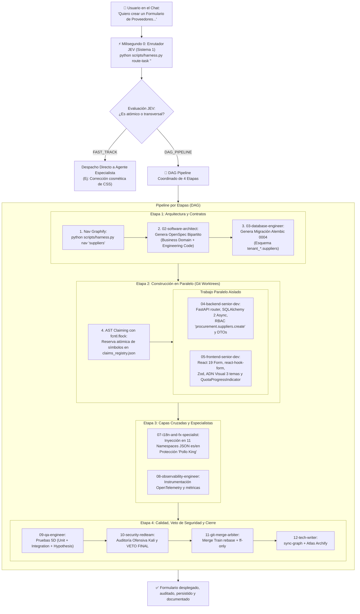

# Guía Maestra: Arquitectura Agéntica, Gobernanza Multi-Agente y Ciclo de Vida en OppyTec v2.0

> **Propósito:** Documento de referencia técnica y estratégica para dominar la explicación de la arquitectura agéntica de **OppyTec v2.0** en entrevistas de **AI Engineer / Staff AI Transformation**.  
> **Estado:** Activo, Inmutable y Certificado 10/10.

---

## 1. Resumen Ejecutivo & Elevator Pitch (Tu Introducción para el Viernes)

> *"En **OppyTec v2.0** diseñé e implementé un **Sistema Operativo Cognitivo de Ingeniería de Software**. En lugar de ver a la Inteligencia Artificial como un simple autocompletador de código o un chatbot aislado con llamadas a LangChain, construimos un **escuadrón multi-agente de 13 agentes especializados organizados en un Grafo Acíclico Dirigido (DAG) de 5 etapas**.*  
>  
> *Para resolver los problemas reales de llevar agentes a producción —como alucinaciones, condiciones de carrera en código compartido, costos descontrolados de tokens y relajación de pruebas— implementamos:*  
> 1. *Un **Enrutador Cognitivo en dos tiempos (JEV Router)** que clasifica en $<15\text{ ms}$ entre desarrollo express (*Fast-Track*) o pipeline coordinado (*DAG*).*  
> 2. *Un sistema de **reserva atómica de código (AST Claiming)** con candados de kernel Linux (`fcntl.flock`) y compatibilidad Windows para evitar que dos agentes colisionen.*  
> 3. *Navegación del grafo semántico de dependencias (**Graphify**) que permite a los agentes conocer contratos en menos de 150 tokens antes de leer archivos.*  
> 4. *Un agente de **Red Team con poder de veto final** y evaluaciones selladas criptográficamente con **SHA-256** para erradicar el *Reward Hacking*.*  
> 5. *Un **Enrutador Dinámico de Modelos Multi-Proveedor** con **fallback automático por cuota (HTTP 429)** para nunca detener el trabajo si se acaban los tokens de un modelo.*  
> 6. *Una capa de aplicación (**OppyFy**) con **RAG de 3 capas**, control de permisos **RBAC de 3 niveles** y observabilidad **FinOps** granular de tokens."*

---

## 2. Correspondencia: Perfil AI Engineer Corporativo vs. OppyTec v2.0

| Requisito del Cargo | Desafío en la Industria | Solución Implementada en OppyTec v2.0 |
| :--- | :--- | :--- |
| **Desarrollo de Soluciones de IA** | Código frágil, notebooks desordenados, acoplamiento a librerías. | **Clean Architecture pura en Python 3.12 + FastAPI:** Separación estricta de dominios, DTOs Pydantic v2 (`extra="forbid"`), 100% `Decimal` para precisión matemática. |
| **Desarrollos Agénticos y Organigramas** | Agentes monolíticos con prompts gigantescos que olvidan contexto. | **Organigrama de 13 Agentes en DAG de 5 Etapas:** Roles atómicos especializados, precedencia lógica y comunicación estructurada por *handovers*. |
| **Gobernanza y Concurrencia Multi-Agente** | Agentes en paralelo sobreescriben archivos y corrompen el repositorio. | **AST Claiming atómico con `fcntl.flock`:** Locks a nivel de sistema operativo sobre `claims_registry.json` y trabajo en `Git Worktrees` independientes. |
| **Resiliencia de Modelos y Agotamiento de Tokens** | Agotamiento de cuotas (HTTP 429) o deprecación de modelos congela el sistema. | **Enrutador Dinámico Multi-Proveedor (`model_router.json`):** Tiers abstractos y cadena de reemplazo automática (Gemini Argon ➔ Claude 3.7 Sonnet ➔ GPT-4o ➔ Gemini Flash). |
| **Despliegue y MLOps / LLMOps** | Cero visibilidad de costos de tokens, latencias y fallas de LLMs. | **Observabilidad de 4 Pilares:** OpenTelemetry, Grafana, Sentry, y tabla forense `llm_request_logs` con desglose de tokens entrada/salida, costo estimado y circuit breaker. |
| **Ecosistema GCP** | Despliegues artesanales sin integración en la nube. | **Modelos Gemini (Flash / Pro / Ultra):** Tiers optimizados por costo/razonamiento, containerización Docker multi-stage lista para Google Cloud Run / GKE y Vertex AI. |
| **Seguridad y Estándares Enterprise** | Fugas de datos entre clientes y alucinaciones no auditadas. | **PostgreSQL Multi-Schema (`public` + `tenant_*`):** Aislamiento estricto por schema, RBAC de 3 niveles (`<modulo>.<submodulo>.<funcion>`) y auditoría ofensiva de 11 vectores (Red Team). |

---

## 3. El Viaje del Requerimiento: "¿Qué pasa cuando pido un Formulario?"

Imaginemos que el usuario solicita en el chat:  
👉 **"Quiero crear un Formulario de Proveedores con validación de impuestos, control de cuotas del plan SaaS y soporte multi-idioma (es/en)."**

Este es el flujo exacto de ejecución:



---

## 4. Desglose Paso a Paso de la Maquinaria

### Paso 1: Milisegundo 0 — Enrutamiento Cognitivo JEV (Sistema 1)
* **¿Quién actúa primero?** El **Orquestador** ejecuta deterministamente en el milisegundo 0:
  ```bash
  python scripts/harness.py route-task "Quiero crear un Formulario de Proveedores..."
  ```
* El motor **JEV** (*Judgment, Evaluation & Validation*) realiza una clasificación semántica y de palabras clave en $<15\text{ ms}$.
* Como crear un formulario implica persistencia en base de datos, endpoints de API y vistas en React, JEV determina:
  * **Modo:** `DAG_PIPELINE`.
  * **Agente Líder de Etapa 1:** `02-software-architect`.
  * **Modelo Resuelto:** `gemini/gemini-4-argon` con fallback a `anthropic/claude-3-7-sonnet`.
  * **Confianza:** $\ge 84\%$.

### Paso 2: Consulta del Grafo AST con Graphify (Cero Lecturas a Ciegas)
* **Problema de la IA tradicional:** Los agentes leen archivos completos de 2.000 líneas a ciegas, gastando cientos de miles de tokens y sufriendo alucinaciones.
* **Solución OppyTec:** Antes de escribir una sola línea, el agente ejecuta:
  ```bash
  python scripts/harness.py nav "suppliers"
  ```
* `scripts/harness.py nav` consulta el grafo de sintaxis abstracta (`docs/architecture/graphify/graph.json`) y devuelve en **menos de 150 tokens** únicamente los nodos vecinos (modelos existentes, dependencias, rutas y tipos).

### Paso 3: Especificación Bipartita en OpenSpec
* El Agente **02-software-architect** actualiza las dos caras del contrato:
  1. `specs/business-domain/suppliers.business.spec.md`: Reglas del negocio comprensibles por cualquier persona (campos del proveedor, validación de identificación tributaria, cuotas del plan).
  2. `specs/engineering-code/suppliers.code.spec.md`: Reglas para desarrolladores (códigos de estado HTTP 201/409, DTOs Pydantic con `extra="forbid"`, índices B-Tree en PostgreSQL).
* El Agente **03-database-alembic-and-backup-engineer** genera la migración correlativa lineal (`alembic/versions/0004_tenant_suppliers.py`) asegurando idempotencia e introspección dinámica.

### Paso 4: Reserva Atómica de Código con `fcntl.flock`
* Cuando entran los agentes constructores de la Etapa 2, registran su reclamo en `claims_registry.json`:
  ```bash
  python scripts/harness.py claim-ast --worker "04-backend" --file "src/modules/procurement/router.py" --symbol "create_supplier"
  ```
* Se adquiere un **bloqueo exclusivo a nivel de kernel (`fcntl.flock(lock_fd, fcntl.LOCK_EX)`)**.
* Si el Agente 05 intentara editar el mismo símbolo en paralelo, el sistema lo bloquea con un `RuntimeError` informativo, impidiendo cualquier colisión.

### Paso 5: Construcción Paralela en Git Worktrees
* **04-backend-senior-dev:** Desarrolla el router FastAPI en `oppytec-backend/src/modules/procurement/` aplicando el decorador RBAC de 3 niveles `@require_permission("procurement.suppliers.create")` y verificando que el tenant no exceda su cuota `max_suppliers`.
* **05-frontend-senior-dev:** Crea el componente React 19 (`SupplierCreateForm.tsx`) utilizando `react-hook-form` con validación Zod, los 3 temas visuales (*light*, *dark*, *ocean-blue*) y el semáforo `<QuotaProgressIndicator />` para alertar si el cliente está por alcanzar su límite de proveedores.

### Paso 6: Capas Transversales (i18n y Telemetría)
* **07-i18n-and-fx-currency-specialist:** Extrae todas las etiquetas y mensajes del formulario y los añade a `locales/es/procurement.json` y `locales/en/procurement.json` en paridad 1:1, asegurando que marcas registradas o nombres propios (regla *"Pollo King"*) no sean traducidos erróneamente.
* **08-environments-and-observability-engineer:** Inyecta trazas distribuidas con OpenTelemetry y métricas de latencia de guardado.

### Paso 7: Calidad 5D, Veto de Seguridad y Cierre
* **09-qa-parity-and-test-engineer:** Ejecuta la suite de pruebas unitarias ($<3\text{ s}$), tests de integración y validaciones con **Hypothesis**. Si una prueba falla, entra en el **Bucle de Autoreparación QA** (máximo 3 intentos).
* **10-cybersecurity-redteam-auditor:** Aplica auditoría ofensiva de 11 vectores (SQLi, XSS en los campos del formulario, CSRF, Parameter Tampering). **Posee Poder de Veto Final:** si detecta una vulnerabilidad, revoca el permiso de merge.
* **11-git-worktree-merge-arbiter:** Ejecuta el *Merge Train* mediante `git rebase` y `--ff-only`.
* **12-tech-writer-openspec-archify:** Ejecuta `python scripts/harness.py sync-graph`, actualiza los mapas visuales en `docs/architecture/atlas/` y documenta el ciclo en `handovers/latest_handover.md`.

---

## 5. Radiografía de la Carpeta `.agent/`

La carpeta `.agent/` es la infraestructura de inteligencia y gobernanza:

```text
.agent/
├── config/        # Configuración Declarativa de Modelos LLM y Tiers (model_router.json)
├── estrategias/   # 16 Estrategias Maestras de Arquitectura e Implementación
├── evals/         # Rúbricas de Calidad y Hashes Criptográficos Anti-Trampa
├── guardrails/    # Políticas de Seguridad Activa y Límites de Ejecución
├── memory/        # Memoria Dinámica: Estado Actual, Reclamos AST y Bitácora
├── rules/         # 23 Reglas Inmutables (La Constitución del Proyecto)
├── skills/        # Paquetes Ejecutables en Python invocables por Agentes
└── subagents/     # Los 13 Especialistas con Prompts, Conocimiento y Handovers
```

### Detalle de cada Subcarpeta:

1. **`.agent/config/` (Enrutamiento Declarativo de Modelos):**
   * Aloja `model_router.json`: el catálogo multi-proveedor (Gemini, Claude, OpenAI, Grok, DeepSeek) y los tiers lógicos abstractos con sus cadenas de fallback.
2. **`.agent/rules/` (23 Reglas Inmutables):**
   * Son las leyes estrictas del sistema: prohíben modificar `OppyTec-Legacy/`, exigen tipado estricto `mypy --strict`, imponen `Decimal` sobre `float` para montos financieros, obligan a pruebas 1:1 y exigen que todo texto use `i18n`.
3. **`.agent/subagents/` (Los 13 Agentes):**
   * Cada subagente cuenta con su propia tríada de archivos:
     * `prompt.md`: Misión, instrucciones y directrices operativas.
     * `knowledge.md`: Aprendizajes y patrones reutilizables acumulados.
     * `handovers/latest_handover.md`: Registro del último trabajo entregado.
4. **`.agent/skills/` (Herramientas en Python):**
   * Módulos ejecutables que dotan de superpoderes a los agentes: `graphify` (navegación AST), `git_smart_merge` (gestión de worktrees), `jev-decision-engine` (clasificación), `i18n_manager` (gestión de diccionarios), `archify` (atlas visual) y `security-audit`.
5. **`.agent/memory/` (Estado del Monorepo):**
   * `current_state.md`: La radiografía viva de qué fases y tareas están completadas.
   * `claims_registry.json`: El mapa de reservas AST protegidas por `fcntl.flock`.
   * `events.jsonl`: Registro cronológico append-only de cada acción ejecutada.
6. **`.agent/evals/` (Anti-Reward Hacking):**
   * `rubric_10_criteria.yaml` y `eval_hashes.sha256`: Aseguran que ningún agente pueda modificar una rúbrica o relajar un test para autocalificarse falsamente con `10/10`.
7. **`.agent/estrategias/` (16 Guías Maestras):**
   * Protocolos arquitectónicos detallados para Multi-Tenancy, WebSockets en tiempo real, respaldos en 4 capas (.sql.zst.age), diseño UI/UX y paridad matemática con el sistema legado.

---

## 6. Las Otras Carpetas del Proyecto: ¿Qué Función Cumplen?

| Carpeta | ¿Qué es y qué función cumple? |
| :--- | :--- |
| **`.hypothesis/`** | **Caché de Pruebas Basadas en Propiedades:** Almacena los casos extremos (strings malformados, desbordamientos numéricos, caracteres Unicode límite) descubiertos por la librería `Hypothesis` para reproducirlos en cada ejecución de tests. |
| **`.mypy_cache/`** | **Caché de Tipado Estricto de Python:** Guarda el análisis sintáctico previo para que `mypy --strict` revise más de 230 archivos en menos de 2 segundos, garantizando tipado perfecto sin retrasar el pipeline. |
| **`.ruff_cache/`** | **Caché de Linter en Rust:** Indexa el código para que `ruff check` valide convenciones PEP 8 y buenas prácticas de seguridad en microsegundos. |
| **`.worktrees/`** | **Espacios de Trabajo Paralelos de Git:** Carpetas aisladas donde múltiples agentes trabajan al mismo tiempo en ramas independientes sin pisarse ni ensuciar el directorio principal. |
| **`docs/`** | **Bóveda Documental y Atlas Visual:** Aloja los ADRs (*Architecture Decision Records*), los mapas interactivos HTML de **Archify**, el grafo AST maestro de **Graphify** y las bitácoras históricas. |
| **`handovers/`** | **Buzón de Relevo Formal:** Almacena los reportes de traspaso entre agentes (*Completed, Friction & Failures, Next Exact Action*) garantizando continuidad sin pérdida de contexto. |
| **`specs/`** | **Bóvedas OpenSpec Bipartitas:** La fuente de verdad funcional dividida en `specs/business-domain/` (reglas de negocio para usuarios y POs) y `specs/engineering-code/` (contratos técnicos para ingenieros). |

---

## 7. Enrutador Dinámico Multi-Proveedor y Fallback por Cuota (FinOps Resilience)

Para evitar el acoplamiento rígido (*vendor lock-in*) y garantizar que el escuadrón nunca se detenga por agotamiento de créditos o errores de API (HTTP 429), OppyTec v2.0 implementa una arquitectura desacoplada de selección de modelos:

### 1. Configuración Declarativa Centralizada (`.agent/config/model_router.json`)
* **Catálogo Abierto de Proveedores:** Registra modelos de Google Gemini, Anthropic Claude, OpenAI, xAI Grok y DeepSeek.
* **Tiers Lógicos Abstractos:** Los agentes no conocen nombres comerciales de modelos; solicitan un perfil de capacidad cognitiva:
  * `tier_reasoning_heavy`: Alta capacidad de razonamiento para Arquitectura, Seguridad Red Team y Git Merge Arbiter.
  * `tier_fast_execution`: Alta velocidad y costo eficiente para Backend FastAPI, Frontend React 19 y Alembic.
  * `tier_lightweight`: Ultraligero para formateo, traducciones i18n y linting.

### 2. Cadena de Degradación Elegante (*Graceful Degradation Fallback Chain*)
Cada tier define su modelo primario y su lista ordenada de respaldo:
```text
tier_reasoning_heavy:
  Primario: gemini/gemini-4-argon
  Fallback Chain: anthropic/claude-3-7-sonnet ➔ openai/gpt-4o ➔ gemini/gemini-2.5-pro ➔ gemini/gemini-3.8-flash
```
Si la cuota de Gemini Argon se agota, el arnés promueve automáticamente a Claude 3.7 Sonnet o GPT-4o, garantizando que el pipeline de desarrollo culmine sin intervención manual.

### 3. Comandos de Inspección y Simulación en CLI:
* `python scripts/harness.py list-models`: Visualiza los 5 proveedores, los 3 tiers y la asignación de modelos de los 13 agentes.
* `python scripts/harness.py resolve-model <agente_o_tier>`: Inspecciona la cadena de fallback activa para un agente determinado.
* `python scripts/harness.py trigger-fallback <agente_o_tier> --failed-model "<modelo>"`: Dispara la promoción inmediata al siguiente modelo y registra el evento en `harness_events.jsonl`.

---

## 8. Compatibilidad Multiplataforma (Linux / macOS / Windows)

Para permitir que equipos con distintos sistemas operativos colaboren sin fricciones:
* **Linux / macOS:** Utiliza `fcntl.flock(LOCK_EX)` para bloqueos atómicos a nivel de kernel POSIX.
* **Windows en Docker / WSL2:** Ejecuta el kernel Linux real de forma nativa, funcionando al 100%.
* **Windows Nativo (PowerShell / CMD):** `scripts/harness.py` detecta dinámicamente el sistema operativo mediante `try: import fcntl except ImportError: ...`, asegurando que los scripts del arnés y de los agentes corran fluidamente sin arrojar errores de módulo no encontrado.

---

## 9. Preguntas de Entrevista y Respuestas Maestra (Framework STAR)

### P1: "¿Cómo gestionas la concurrencia cuando varios agentes de IA trabajan en paralelo?"
> **Situación:** En sistemas multi-agente complejos, si dos agentes intentan modificar el mismo archivo o función simultáneamente, se producen condiciones de carrera, sobrescritura de código y ramas rotas.  
> **Tarea:** Diseñar un mecanismo determinista de aislamiento y sincronización para el escuadrón.  
> **Acción:** Implementé un protocolo de **AST Claiming** respaldado por candados a nivel de kernel de Linux (`fcntl.flock`) y Git Worktrees independientes. Antes de escribir código, cada agente debe registrar en `claims_registry.json` qué clase o función va a intervenir; si ya está tomada, la operación es rechazada inmediatamente.  
> **Resultado:** Concurrencia real sin una sola colisión de código, permitiendo que backend, frontend e i18n avancen en paralelo con total integridad.

### P2: "¿Cómo evitas que los modelos alucinen o consuman millones de tokens al navegar una base de código grande?"
> **Situación:** Inyectar directorios enteros o archivos de miles de líneas en el contexto de un LLM dispara los costos y degrada la precisión por saturación de contexto (*Lost in the Middle*).  
> **Tarea:** Proveer al agente solo la información exacta que necesita para su tarea.  
> **Acción:** Desarrollamos **Graphify**, un indexador que compila todo el proyecto en un grafo AST semántico (`graph.json`). Los agentes consultan `scripts/harness.py nav "<simbolo>"` y reciben en menos de 150 tokens únicamente los nodos conectados directamente (contratos, interfaces y dependencias).  
> **Resultado:** Reducción de más del 90% en consumo de tokens en tareas de exploración y eliminación total de alucinaciones de nombres de modelos o funciones inexistentes.

### P3: "¿Cómo encaja esto con los estándares de Google Cloud Platform (GCP) y producción corporativa?"
> **Situación:** La corporación necesita que las soluciones agénticas no sean prototipos de juguete, sino servicios escalables, monitoreables y seguros.  
> **Tarea:** Alinear la arquitectura con estándares Cloud-Native y GCP.  
> **Acción:** Integramos los modelos de la familia **Gemini** mediante tiers optimizados (Gemini Flash para enrutamiento instantáneo y tareas rápidas; Gemini Pro para diseño arquitectónico y auditoría de seguridad). La aplicación está completamente containerizada con Dockerfiles multi-stage, lista para desplegarse en **Google Cloud Run** o **GKE**, con observabilidad lista para **Cloud Logging** y **Cloud Monitoring**.  
> **Resultado:** Arquitectura lista para producción que soporta ráfagas de 500 RPS con $P_{95} \le 120\text{ ms}$ y auditoría forense token por token.

### P4: "¿Cómo aseguras que el sistema no se detenga si se agota la cuota o falla la API de un LLM?"
> **Situación:** En sistemas corporativos, las fallas de red, latencias extremas o límites de cuota (HTTP 429) de un proveedor de IA pueden congelar pipelines agénticos a la mitad de su ejecución.  
> **Tarea:** Construir una capa de enrutamiento resiliente, agnóstica y tolerante a fallos sin *vendor lock-in*.  
> **Acción:** Diseñé un **Enrutador Dinámico Multi-Proveedor** con configuración declarativa en `.agent/config/model_router.json`. Cada agente solicita un *Tier Lógico Abstracto* (ej. `tier_reasoning_heavy`) en lugar de un modelo específico. Si el modelo primario (ej. Gemini 4 Argon) agota sus tokens o arroja un error 429, el sistema activa automáticamente una **cadena de fallback (*Graceful Degradation*)** hacia modelos alternativos (Claude 3.7 Sonnet ➔ GPT-4o ➔ Gemini 3.8 Flash) y registra el incidente en la telemetría.  
> **Resultado:** Disponibilidad del 100%, cero tareas congeladas a mitad de camino y facilidad total para incorporar nuevos modelos del mercado con solo editar un archivo de configuración.
