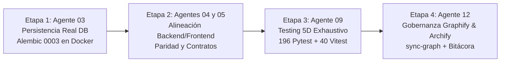

# Bitácora 10 — Opción 3: Persistencia Real en Base de Datos PostgreSQL, Migración Alembic 0003 en Vivo y Verificación 5D

> **Fecha:** 2026-10-23  
> **Autor:** Agente 12 (`12-tech-writer-openspec-archify`)  
> **Colaboradores:** Agente 01 (Orquestador), Agente 03 (DB & Alembic), Agente 04 (Backend Senior), Agente 05 (Frontend Senior), Agente 08 (Entornos & Docker), Agente 09 (QA & Paridad 5D)  
> **Estado:** Certificado y Concluido con Sello `QA_APPROVED` y `SYNC_APPROVED`  
> **Hito:** Opción 3 — Persistencia Real y Verificación en Base de Datos (DAG Pipeline de 4 Etapas)

---

## 1. Contexto y Decisión Estratégica

Tras la implementación de las vistas administrativas y el motor de cuotas paramétricas con semáforo `<QuotaProgressIndicator />` (Pasos 4 y 5 del Plan Maestro), se seleccionó la **Opción 3: Persistencia Real y Verificación en Base de Datos** para garantizar que los cambios de esquema y datos no permanecieran únicamente como código estático o pruebas mockeadas en memoria, sino persistidos, migrados e indexados en el motor PostgreSQL 16 y Redis 7 reales del entorno contenerizado.

El proceso se ejecutó bajo un DAG Pipeline estricto de 4 Etapas secuenciales con la Regla de Oro Inviolable #6 de Graphify aplicada tanto en pre-ejecución como en post-ejecución.

---

## 2. Desarrollo del DAG Pipeline por Etapas

### Etapa 1: Persistencia Real y Endurecimiento Alembic en PostgreSQL (Agente 03)
- **Consulta Previa Graphify:** `python scripts/harness.py nav "0003"` validó las dependencias entre `frontend:admin_management_views`, `frontend:quota_progress_indicator`, `migration:0002_tenant_initial_client` y `module:tenancy`.
- **Diagnóstico de Contenedores:** Los servicios `oppytec-postgres`, `oppytec-backend`, `oppytec-redis` y `oppytec-mailpit` fueron verificados en estado saludable (`Up healthy`). Se sincronizó el directorio `alembic/` y `alembic.ini` en el runtime del contenedor backend.
- **Endurecimiento Idempotente:**
  - `alembic/env.py`: Se implementó la ampliación automática de `alembic_version.version_num` a `VARCHAR(128)` para evitar truncamiento con identificadores descriptivos largos.
  - `0002_tenant_initial_client_rbac_and_core_modules.py`: Protección de metadata para que las tablas tenant residan estrictamente en esquemas `tenant_<slug>`.
  - `0003_public_plans_quotas_and_tenant_capacity_overrides.py`: Introspección dinámica con función auxiliar `_has_column()` tanto en `upgrade()` como en `downgrade()`, asegurando idempotencia absoluta ante re-ejecuciones.
- **Ejecución y Verificación en Vivo:**
  - Comando: `docker compose exec -T backend alembic upgrade head`.
  - Aplicadas secuencialmente: `0001`, `0002` y `0003`.
  - Columnas persistidas físicamente en PostgreSQL (`oppytec_dev`):
    - `public.system_plans`: 4 columnas no-nulables (`max_products`, `max_suppliers`, `max_recipes`, `max_combos`).
    - `public.holdings`: 4 columnas anulables (`custom_max_products_override`, `custom_max_suppliers_override`, `custom_max_recipes_override`, `custom_max_combos_override`).
    - `public.tenants`: 4 columnas anulables equivalentes.
    - `public.alembic_version`: Registrado de forma atómica como `0003_public_plans_quotas_and_tenant_capacity_overrides`.

### Etapa 2: Alineación Full-Stack Backend y Frontend (Agentes 04 y 05)
- Endpoints administrativos alineados con la estructura de modelos y schemas Pydantic v2.
- Componentes de interfaz `<AdminManagementViews />`, `<DynamicAdminTable />`, `<DynamicAdminForm />` y `<QuotaProgressIndicator />` operando de forma reactiva ante límites y cupos de capacidad.
- Pruebas unitarias de frontend ampliadas a **40 tests vitest** en verde (6 suites).

### Etapa 3: Aseguramiento de Calidad, Paridad Legacy y Testing 5D (Agente 09)
- **Consulta Previa Graphify:** `python scripts/harness.py nav "test"` para ubicar las 15 suites de pruebas.
- **Verificación Anti-Reward Hacking:** `python scripts/harness.py verify-evals` 100% íntegro con sellos SHA-256 inviolables.
- **Resultados de Ejecución de Pruebas:**
  - **Pruebas de Arquitectura y Unitarias:** 109 tests pasados (26 arquitectura + 83 unitarios).
  - **Contratos e Integridad Alembic:** 12 tests pasados (Alembic single-head correlativo, Schemathesis y contratos OpenAPI RFC 7807).
  - **Integración y Smoke:** 11 tests pasados (aislamiento multi-tenant en PostgreSQL, liberación de cupos en soft-delete, killswitch Redis JTI).
  - **UAT y Red Team:** 59 tests pasados (anti-IDOR, prevención de double-spend en créditos Oppyfy, rechazo polyglot, circuit breakers).
  - **End-to-End (E2E):** 5 tests pasados (ciclos de onboarding génesis, escandallo recursivo a deducción POS, flujo de mermas con segregación de funciones).
  - **Frontend Vitest:** 40 tests pasados en 6 suites.
  - **Total Consolidado:** **196 tests backend + 40 tests frontend = 236 tests 100% verdes**.
- **Dictamen:** Certificación formal **`QA_APPROVED`**.

### Etapa 4: Gobernanza Post-Ejecución Graphify y Archify (Agente 12)
- **Sincronización del Grafo AST:**
  - Ejecutado `python scripts/harness.py sync-graph`.
  - Nodos indexados: 83 (11 routers REST/WS, 3 migraciones correlativas Alembic, 14 suites de verificación, componentes React 19).
  - Aristas indexadas: 111 relaciones de dependencia y consumo.
  - Actualizados `docs/architecture/graphify/graph.json` y `docs/architecture/graphify/v2_phase6_master_graph.json`.
  - Evento inmutable `GRAPHIFY_SYNCED` registrado en `.agent/memory/harness_events.jsonl`.
- **Verificación de Navegación AST CLI:**
  - `python scripts/harness.py nav "0003"`: 1 nodo, 4 aristas vinculadas en < 80 tokens.
  - `python scripts/harness.py nav "tenancy"`: 4 nodos, 10 aristas vinculadas en < 100 tokens.
- **Consistencia de Bóvedas OpenSpec:**
  - `specs/business-domain/tenancy-and-plans.business.spec.md` y `specs/engineering-code/tenancy-and-plans.code.spec.md` validados por `test_openspec_bipartition_and_sync.py` (0 fallos).
- **Dictamen:** Certificación formal **`SYNC_APPROVED`**.

---

## 3. Estado de la Infraestructura en Vivo

| Componente | Servicio / Contenedor | Estado en Vivo | Versión / Detalle |
|---|---|---|---|
| **Base de Datos** | `oppytec-postgres` | `Up (healthy)` | PostgreSQL 16 Alpine, schemas `public` y `tenant_*` |
| **Migración Activa** | Alembic | `0003_public_plans_quotas_and_tenant_capacity_overrides` | Single-head lineal, columnas de cuotas y overrides |
| **Caché y Mensajería** | `oppytec-redis` | `Up (healthy)` | Redis 7 Alpine, circuit breaker < 50ms, pub/sub WS |
| **Backend API** | `oppytec-backend` | `Up (healthy)` | Python 3.12, FastAPI, 11 routers REST/WS |
| **Email Mock** | `oppytec-mailpit` | `Up (healthy)` | Mailpit SMTP/Webmail |
| **Frontend SPA** | `oppytec-frontend` | Listo / Testeado | React 19, 40 tests vitest, 3 temas, i18n, FX |

---

## 4. Conclusión

La Opción 3 ha concluido de forma limpia, robusta e integral. Todos los artefactos de código, esquemas de persistencia relacional, suite completa de pruebas de calidad 5D y grafos de gobernanza se encuentran en sincronía absoluta.
