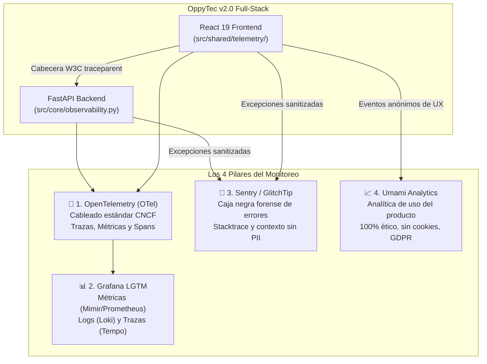
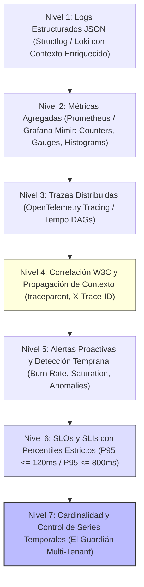
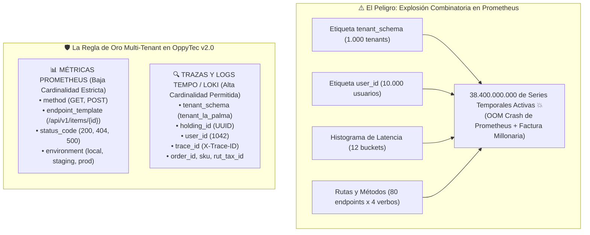

# Bitácora 11 — El Marco de los 7 Niveles de Observabilidad y la Regla de Oro de Cardinalidad Multi-Tenant

> **Fecha:** 2026-10-29  
> **Autor:** Agente 12 (`12-tech-writer-openspec-archify`)  
> **Colaboradores:** Agente 08 (Entornos & Docker), Agente 04 (Backend Senior), Agente 05 (Frontend Senior), Agente 10 (Seguridad & Red Team), Agente 01 (Orquestador)  
> **Estado:** Certificado e Integrado en el Segundo Cerebro (Obsidian)  
> **Estrategia Vinculada:** [[../../.agent/estrategias/estrategia_observabilidad_monitoreo_y_analitica_001|Estrategia de Observabilidad, Monitoreo y Analítica 001]]  
> **Decisión Arquitectónica:** [[../adr/ADR-016-four-pillar-observability-otel-grafana-sentry-umami|ADR-016: Observabilidad 4-Pilares]]  
> **Mapa Interactivo:** [[../architecture/atlas/05-environments-and-agentic-harness.archify.html|Atlas Archify — Mapa 5: Gobernanza Agéntica, 5 Entornos y Observabilidad]]  

---

## 1. De la Ceguera Reactiva a la Observabilidad de Clase Empresarial

En las aplicaciones web tradicionales (incluyendo `OppyTec-Legacy`), la monitorización solía ser un pensamiento tardío: se instalaba un plugin de errores suelto, se sembraba el código de sentencias `print()` o `console.log()` desordenadas y se esperaba a que un cliente enfurecido llamara por teléfono avisando que la plataforma "se había caído" o que "estaba lenta".

En una arquitectura **SaaS Multi-Tenant de alto rendimiento** como **OppyTec v2.0** —donde conviven múltiples organizaciones (Holdings), decenas de sucursales aisladas en esquemas dedicados de PostgreSQL (`tenant_<slug>`), cientos de trabajadores operando en simultáneo y estrictos compromisos de latencia ($P_{95} \le 120\text{ ms}$)— operar a ciegas o con logs planos es una receta para el desastre.

Por esta razón, OppyTec v2.0 ha adoptado formalmente una **estrategia de dos pilares conceptuales**:
1. **Los 4 Pilares Complementarios del Monitoreo:** Un ensamble armónico de herramientas libres y de código abierto que no compiten entre sí.
2. **El Marco Jerárquico de los 7 Niveles de Observabilidad:** Un modelo de madurez técnica que culmina en el control matemático estricto de la **Cardinalidad Multi-Tenant** ("El Jefe").

---

## 2. Los 4 Pilares: Por Qué No Compiten Entre Sí

Cada uno de los 4 pilares cumple una misión especializada, única y complementaria:

| Pilar | Herramienta | Misión Exacta en OppyTec v2.0 | Licencia y Modelo |
|---|---|---|---|
| **1** | **OpenTelemetry (OTel)** | **El Cableado Universal:** Es el estándar de instrumentación en el código. Genera trazas semánticas, métricas agregadas y propaga el identificador unívoco de cada petición (`trace_id`) entre React, FastAPI, SQLAlchemy, Redis y el asistente IA `OppyFy`. | Código Abierto (Apache 2.0 / CNCF). Desacoplado de cualquier proveedor comercial (*vendor-neutral*). |
| **2** | **Grafana LGTM** | **El Panel de Control de Rendimiento e Infraestructura:** Agrupa en un contenedor unificado (`grafana/otel-lgtm`) las 4 tecnologías líderes de Grafana: **L**oki (logs JSON estructurados), **G**rafana (tableros y alertas), **T**empo (trazas distribuidas en DAG) y **M**imir/Prometheus (series temporales y métricas agregadas). Vigila el pulso global, el uso del pool de base de datos (`pool_size=40`) y el cumplimiento de los SLOs de latencia. | 100% Libre y Gratuito auto-alojado o Grafana Cloud Free Tier. |
| **3** | **Sentry / GlitchTip** | **La Caja Negra Forense de Bugs:** Especialista quirúrgico en capturar fallos no capturados (*unhandled exceptions* en Python y *crash boundaries* en React). Fotografía el archivo exacto, número de línea, variables de entorno sanitizadas y versión de software (`git_sha`), notificando al equipo de ingeniería antes de que el cliente note la falla. | Compatible con `sentry-sdk`, operable gratis con Sentry Developer o 100% libre y auto-alojado con GlitchTip. |
| **4** | **Umami Analytics** | **Analítica de Producto y Comportamiento de Usuario:** Mide qué módulos se usan con mayor frecuencia (`Inventario`, `Recetas`, `Mermas`, `OppyFy`), qué idiomas predominan (`🇪🇸 ES` vs `🇺🇸 EN`) y qué monedas se transaccionan (`CLP`, `USD`, `EUR`, `BRL`), sin recolectar datos privados de navegación ni usar cookies invasivas. | 100% Libre y Gratuito (MIT Open-Source), corriendo sobre el mismo PostgreSQL. |

---

## 3. La Pirámide de los 7 Niveles de Observabilidad

Para estructurar la telemetría desde su emisión atómica más básica hasta su gobierno macroeconómico, OppyTec v2.0 categoriza la observabilidad en **7 niveles jerárquicos ascendentes**:

### Nivel 1 — Logs Estructurados JSON (`structlog` + Grafana Loki)
- **Concepto:** Se prohíbe taxativamente en todo el repositorio el uso de `print()` o logs en texto libre no procesable.
- **Implementación:** Cada línea de log se emite como un objeto JSON estructurado mediante la librería `structlog`. Contiene marca de tiempo ISO-8601 en UTC, severidad (`INFO`, `WARNING`, `ERROR`, `CRITICAL`), módulo Python emisor, función ejecutora y contexto atómico (`trace_id`, `tenant_schema`).
- **Seguridad e Higiene:** Todo log atraviesa obligatoriamente el filtro `scrub_telemetry_payload()`, que censura contraseñas, tokens JWT, números de tarjeta o identificadores tributarios con la marca `[REDACTED]`, garantizando conformidad con **ISO/IEC 27001 §A.12.4**.

### Nivel 2 — Métricas Agregadas (Prometheus + Grafana Mimir)
- **Concepto:** Mediciones numéricas continuas que responden a la pregunta: *"¿Cómo está funcionando el sistema en general en este instante?"*.
- **Implementación:** Series temporales divididas en:
  - **Contadores (`Counters`):** Total de peticiones HTTP procesadas, fallos 5xx, transacciones completadas.
  - **Medidores de Nivel (`Gauges`):** Conexiones activas en el pool de PostgreSQL (ej. 12/40 en uso), uso de memoria RAM, workers de Uvicorn ocupados.
  - **Histogramas (`Histograms`):** Distribución de tiempos de respuesta en cubetas estadísticas (*buckets*), fundamentales para calcular percentiles $P_{50}$, $P_{95}$ y $P_{99}$.
  - **Eficiencia de Caché:** Tasa de aciertos (*Cache Hit Ratio*) en Redis para las sesiones y catálogos calientes.

### Nivel 3 — Trazas Distribuidas (OpenTelemetry Tracing + Grafana Tempo)
- **Concepto:** Si las métricas te dicen que *"el endpoint de ventas está lento"*, las trazas te muestran exactamente qué milisegundo causó la lentitud a lo largo de toda la cadena de llamadas.
- **Implementación:** Cada interacción se descompone en un grafo acíclico dirigido de tramos jerárquicos (*Spans*):
  1. Clic del usuario en el botón de pago en React 19 (`oppytec-frontend`).
  2. Recepción de la petición en el router FastAPI (`oppytec-backend`).
  3. Ejecución del middleware de autenticación y aislamiento multi-tenant (`SET LOCAL search_path = tenant_restaurante_mar`).
  4. Consulta SQLAlchemy a PostgreSQL para verificar el stock de insumos.
  5. Consulta a Redis para verificar la cuota de ventas del plan.
  6. Llamada al motor de decisiones JEV (Sistema 1) o LLM OppyFy.
  7. Retorno de la respuesta HTTP 200 con la cabecera `X-Trace-ID`.
- **Visualización en Tempo:** Permite ver la cascada temporal (*Waterfall*) milisegundo por milisegundo, localizando de inmediato cualquier cuello de botella.

### Nivel 4 — Correlación W3C y Propagación de Contexto (`Trace ID` / `X-Trace-ID`)
- **Concepto:** El pegamento unificador que enlaza los 4 pilares en un único hilo narrativo.
- **Implementación:** Adopción estricta del estándar W3C *TraceContext* (`traceparent`).
  - Cuando el frontend emite una petición, inyecta la cabecera `traceparent`.
  - El backend adopta ese identificador, lo propaga a través de todos los Spans, lo adjunta a cada línea de log en Loki y lo asocia al evento forense en Sentry si ocurre una excepción.
  - El backend retorna al frontend la cabecera HTTP `X-Trace-ID`.
- **Impacto Humano y en Soporte:** Si un usuario experimenta un error en pantalla, la notificación (*toast*) muestra un identificador amigable como `err_a1b2c3d4`. El equipo de soporte o ingeniería no necesita adivinar ni pedir capturas: pega ese código en el buscador del **Centro de Mando de OppyTec** y en 1 segundo observa el log exacto, el stacktrace en Sentry y el diagrama de cascada en Tempo.

### Nivel 5 — Alertas Proactivas y Detección Temprana (Grafana Alerting + Sentry)
- **Concepto:** Notificar a los ingenieros antes de que los administradores del restaurante o los comensales perciban degradación del servicio.
- **Implementación:**
  - **Alertas de Saturación:** Disparo automático si el pool de PostgreSQL supera el 80% de capacidad durante más de 2 minutos.
  - **Tasa de Quemado de Presupuesto (*Burn Rate Alerting*):** Si los errores 5xx consumen el presupuesto mensual de error a un ritmo acelerado (ej. 2% en 1 hora), se envía una alerta crítica inmediata a Telegram/Slack.
  - **Eventos de Seguridad Red Team Bloqueados:** Alertas ante anomalías como rechazos reiterados de RBAC, detección de archivos con cabeceras falsas (*Magic Bytes Guard*) o intentos de *Prompt Injection* en OppyFy.

### Nivel 6 — SLOs y SLIs con Percentiles Estrictos ($P_{95} \le 120\text{ ms}$)
- **Concepto:** Compromisos cuantitativos de ingeniería innegociables basados en la experiencia real del usuario (*Service Level Objectives*).
- **Estándares Contractuales de OppyTec v2.0:**
  - **Transacciones Operativas Core (FastAPI):** $P_{95} \le 120\text{ ms}$ (inventario, pedidos POS, recetas, comandas y cierre de caja). El 95% de todas las peticiones operativas debe resolverse en menos de 120 milisegundos.
  - **Reportes Analíticos y Agregaciones:** $P_{95} \le 800\text{ ms}$.
  - **Disponibilidad de Plataforma (Uptime):** $\ge 99.9\%$ mensual en Staging y Producción.
  - **Política de Presupuesto de Error (*Error Budget Policy*):** Si el presupuesto de fallos permitidos para el mes se agota debido a incidentes, se congelan automáticamente los despliegues de nuevas características y todo el equipo se aboca a estabilización y resiliencia.

---

## 4. Nivel 7: "El Jefe" — Cardinalidad y Control de Explosión de Series Temporales

Llegamos a la cúspide de la pirámide: el **Nivel 7**. En la ingeniería de observabilidad moderna, la **cardinalidad** es considerada "El Jefe" porque un descuido en este nivel puede tumbar la infraestructura completa, agotar la memoria de los servidores de métricas (*Out-Of-Memory Kill*) y generar facturas en la nube de cientos de miles de dólares en cuestión de horas.

### 4.1 ¿Qué es la Cardinalidad y por qué es Crítica en un SaaS Multi-Tenant?

En un motor de métricas basado en series temporales como **Prometheus** o **Grafana Mimir**, cada combinación única de valores en las etiquetas (*labels*) de una métrica crea **una serie temporal físicamente independiente en la memoria RAM y en disco**.

- **Baja Cardinalidad:** Etiquetas con un conjunto pequeño, finito y predecible de valores (ejemplo: `method="GET"`, `status_code="200"`, `environment="production"`). El producto combinatorio es pequeño (decenas o cientos de series).
- **Alta Cardinalidad:** Etiquetas con valores infinitos o que crecen con cada nuevo cliente o usuario (ejemplo: `user_id`, `tenant_schema`, `trace_id`, `order_id`, `sku_code`).

### 4.2 El Desastre Matemático de la Explosión Combinatoria

Imaginemos que un desarrollador comete el error aparentemente inocente de agregar el `tenant_schema` y el `user_id` como etiquetas a la métrica de latencia de endpoints en Prometheus para *"ver qué usuario experimenta lentitud"*:

$$\begin{aligned}
\text{Tenants activos} &= 1.000 \\
\text{Usuarios concurrentes} &= 10.000 \\
\text{Cubetas de histograma (buckets)} &= 12 \\
\text{Rutas HTTP} &= 80 \\
\text{Métodos HTTP} &= 4 \\
\text{Total de Series} &= 1.000 \times 10.000 \times 12 \times 80 \times 4 = \mathbf{38.400.000.000} \text{ series activas}
\end{aligned}$$

**¿Qué ocurre con 38,4 mil millones de series temporales?**
1. **OOM Kill Inmediato:** El servidor de Prometheus o Mimir devora 64 GB, 128 GB o 256 GB de RAM en minutos y el kernel de Linux lo mata forzosamente con una señal `SIGKILL`.
2. **Ceguera Total:** Grafana queda inaccesible; se pierden todas las alertas y la visibilidad de toda la plataforma.
3. **Quiebra Financiera en la Nube:** Proveedores que cobran por series temporales (Datadog, Grafana Cloud, New Relic) facturarían decenas de miles de dólares por un solo día de pico.

### 4.3 La Regla de Oro de OppyTec v2.0

Para gobernar esto con rigor matemático, OppyTec v2.0 consagra una regla técnica inmutable:

> **La Regla de Oro de OppyTec v2.0:**  
> **"Métricas para tendencias agregadas de BAJA CARDINALIDAD; Trazas y Logs para causa raíz de ALTA CARDINALIDAD."**

#### ¿Qué está estrictamente PERMITIDO en las Métricas de Prometheus?
Únicamente etiquetas de dimensiones acotadas:
- `method`: Verbo HTTP (`GET`, `POST`, `PUT`, `DELETE`).
- `endpoint_template`: Ruta canonizada y abstracta (ejemplo: `/api/v1/inventory/items/{id}`). **Queda prohibido registrar URLs con IDs reales** como `/api/v1/inventory/items/9482`.
- `status_code`: Código HTTP numérico canónico (`200`, `201`, `400`, `401`, `404`, `500`).
- `environment`: Entorno (`local`, `preview`, `ci`, `staging`, `production`).

#### ¿Dónde viajan los Identificadores de Alta Cardinalidad?
Los identificadores como `tenant_schema`, `holding_id`, `user_id`, `trace_id`, `order_id` o `sku` viajan **exclusivamente**:
1. En los **Atributos de los Spans de OpenTelemetry** (`oppytec.tenant_schema`, `oppytec.holding_id`, `oppytec.user_id`).
2. En los **Campos de los Logs JSON de structlog / Loki** (`extra={"tenant_schema": ..., "user_id": ...}`).
3. En el **Contexto de Scope de Sentry / GlitchTip**.

**¿Por qué es seguro allí?** Porque tanto **Grafana Loki** como **Grafana Tempo** utilizan motores de almacenamiento columnar e indexación invertida basados en objetos (bloques comprimidos), diseñados desde su origen para almacenar billones de identificadores únicos a un costo computacional y de almacenamiento insignificante.

---

## 5. Alineación con los 5 Entornos y Cero Sobrecarga Local

Una queja común en equipos de desarrollo es que la observabilidad vuelve las computadoras de los programadores lentas. En OppyTec v2.0, esto está resuelto mediante **Docker Compose Profiles** y la variable `ENVIRONMENT`:

| Entorno | Comportamiento de Observabilidad | Consumo de RAM Extra en la Máquina del Dev |
|---|---|---|
| **`local`** | Por defecto, `OTEL_EXPORTER="none"`, Sentry inactivo y Umami inactivo. La app corre con el *Fast Gate* en $< 15$ segundos. Si el desarrollador desea auditar los paneles en local, ejecuta `docker compose --profile observability up -d`, levantando el contenedor todo-en-uno `grafana/otel-lgtm` en el puerto `3001`. | **0 MB extra** en el trabajo diario. |
| **`preview`** *(PRs/Worktrees)* | Cada traza se etiqueta con `service.namespace = ENV_NAMESPACE` (ej. `pr_142`), aislando las métricas de cada rama paralela. | Aislado en cluster efímero. |
| **`ci`** *(Test Runner)* | Utiliza **`InMemorySpanExporter`** (100% en memoria RAM, cero tráfico a la red externa). El pipeline de CI verifica que los spans se creen correctamente y que los secretos se censuren sin contactar servidores externos. | Efímero en memoria de test. |
| **`staging`** | **100% activo.** Sometido a pruebas de carga continua con Locust a `500 RPS` (*Deep Gate*), certificando que ningún endpoint supere los $120\text{ ms}$ antes de ir a producción. | Infraestructura de réplica productiva. |
| **`production`** | **100% activo con Muestreo Inteligente (*Tail Sampling*).** Captura el 100% de los errores y peticiones lentas, y una muestra estadística de las peticiones rápidas, protegiendo los límites de almacenamiento. | Monitoreo en vivo 24/7 con alertas. |

---

## 6. El Centro de Mando en el Panel de Administración de OppyTec

Para garantizar la soberanía operativa de la plataforma, el Panel de Administración Global (`features/platform-admin/`) incorpora el **Centro de Mando de Observabilidad** (`/platform-admin/observability-center`), con **5 secciones y 13 sub-vistas especializadas**:

1. **Sección 0 — Resumen Ejecutivo 360°:** Semáforo en vivo de los 5 entornos, Uptime %, latencia global $P_{95}$, tasa de errores en 24h y estado de los *Circuit Breakers* de Redis.
2. **Sección 1 — OpenTelemetry (Trazas y Latencias):**
   - *1.1 Ranking de Latencia de Endpoints:* Comparativa de $P_{50}, P_{95}, P_{99}$ contra el umbral de $120\text{ ms}$.
   - *1.2 Inspector de Base de Datos y Caché:* Tiempos de queries SQLAlchemy por esquema y *Hit Rate* de Redis.
   - *1.3 Buscador Forense por `X-Trace-ID`:* Cascada completa de cualquier petición en 1 segundo.
3. **Sección 2 — Grafana LGTM (Infraestructura y Logs):**
   - *2.1 Recursos del Servidor:* CPU, RAM, saturación del pool PostgreSQL (40 conexiones) y disco.
   - *2.2 Certificación de Carga y Resiliencia:* Historial de pruebas Locust a 500 RPS y caídas simuladas.
   - *2.3 Explorador de Logs JSON (Loki):* Búsqueda en vivo filtrada por tenant, holding y severidad.
4. **Sección 3 — Sentry / GlitchTip (Caza de Bugs):**
   - *3.1 Bandeja de Excepciones Full-Stack:* Errores backend (`.py`) y frontend (`.tsx`) agrupados por causa raíz.
   - *3.2 Mapa de Impacto por Cliente:* Identificación proactiva de sucursales afectadas antes de que emitan un ticket.
   - *3.3 Monitor de Ciberseguridad:* Bloqueos de archivos maliciosos (*Magic Bytes*), inyecciones SQL y *Prompt Injections*.
5. **Sección 4 — Umami Analytics (Analítica de Producto):**
   - *4.1 Audiencia y Sesiones:* Usuarios concurrentes y horas punta de operación gastronómica.
   - *4.2 Mapa de Adopción de Módulos:* Qué herramientas aportan más valor (`Inventario` vs `Recetas` vs `OppyFy`).
   - *4.3 Internacionalización y Moneda:* Cuota de uso de idiomas (`es`/`en`) y monedas transaccionadas (`CLP`/`USD`/`EUR`/`BRL`).

---

## 7. Verificación de Integridad y Siguientes Pasos

- **Verificación en Tests:** El arnés de pruebas de arquitectura valida continuamente el aislamiento de telemetría y censura de PII mediante `test_observability_pii_redaction_and_spans.py`.
- **Sincronización:** Los artefactos y relaciones han sido incorporados en el Segundo Cerebro y en el grafo de conocimiento Graphify.
- **Conclusión:** Con el Marco de los 7 Niveles y la Regla de Oro de Cardinalidad, OppyTec v2.0 garantiza que el crecimiento de clientes y usuarios escale de forma económicamente sostenible, técnicamente indestructible y con tiempos de resolución de incidentes del orden de segundos.
