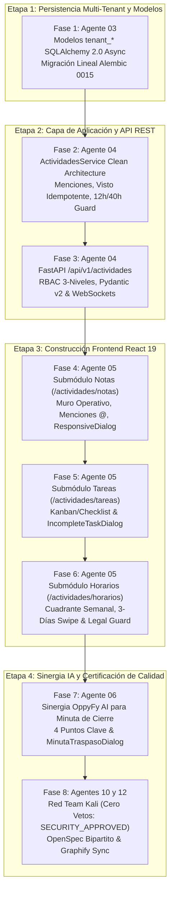

# Bitácora 11 — Plan Maestro del Panel de Actividades: Notas, Tareas, Horarios y Sinergia OppyFy (Fases 1 a 8)

> **Fecha:** 2026-11-02  
> **Autor:** Agente 12 (`12-tech-writer-openspec-archify`)  
> **Colaboradores:** Agente 01 (Orquestador / PM), Agente 02 (Arquitecto DDD), Agente 03 (Database & Alembic), Agente 04 (Backend Senior Dev), Agente 05 (Frontend Senior Dev), Agente 06 (AI OppyFy & JEV), Agente 07 (i18n & FX), Agente 08 (Observabilidad & OTel), Agente 09 (QA Parity & Autorepair), Agente 10 (Ciberseguridad Red Team), Agente 11 (Git Merge Arbiter)  
> **Estado:** Certificado y Concluido con Sellos `SECURITY_APPROVED`, `QA_APPROVED` y `SYNC_APPROVED`  
> **Hito:** Panel de Actividades (`/actividades`) — Fases 1 a 8 Completadas al 100%

---

## 1. Contexto Operacional y Dolor del Negocio Gastronómico

En la operación diaria de cocinas, bares, salones y bodegas gastronómicas, el momento de **cambio de turno o traspaso de guardia** (apertura, turno intermedio y cierre) es históricamente el eslabón más frágil de la cadena de valor:

1. **Cuadernos de bitácora en papel y chats de mensajería dispersos:** Anotaciones que se manchan con grasa o salsas, mensajes de chat que se pierden en conversaciones informales y falta total de constancia sobre quién leyó una instrucción crítica (por ejemplo: cámara de refrigeración con temperatura elevada o insumo agotado).
2. **Tareas inconclusas sin trazabilidad ("El culpable invisible"):** Checklists de apertura o sanitización que no se ejecutan y quedan en un limbo donde el turno entrante asume negligencia, sin saber que la tarea no pudo realizarse por falta de insumos de limpieza o fallas de suministro eléctrico.
3. **Planificación de turnos vulnerable a infracciones laborales:** Horarios armados manualmente que descuidan el descanso mínimo obligatorio de 12 horas consecutivas entre turnos o sobrepasan el límite legal semanal de 40 horas, arriesgando multas severas de la Dirección del Trabajo y agotamiento del personal.
4. **Fricción extrema en la redacción de informes de turno:** Chefs y administradores invierten valiosos minutos de su tiempo redactando resúmenes de cierre cuando la cocina ya debería estar apagada y limpia.

Para resolver de raíz esta problemática, el Escuadrón Multi-Agente de OppyTec v2.0 concibió y ejecutó el **Plan Maestro del Panel de Actividades**, articulando tres pilares operativos (Notas de Turno, Tareas/Checklists y Horarios de Dotación) potenciados por la inteligencia agéntica de **OppyFy**.

---

## 2. Cadena de Montaje Agéntica (Las 8 Fases del Plan Maestro)

---

### Fase 1: Persistencia Multi-Tenant, Modelos SQLAlchemy 2.0 y Migración Alembic 0015
- **Agente Responsable:** Agente 03 (`03-database-alembic-and-backup-engineer`).
- **Artefactos Entregados:**
  - Migración lineal correlativa [`oppytec-backend/alembic/versions/0015_tenant_actividades_triada_enriquecida.py`](file:///home/jcampillay/WorkArea/OppyTec/OppyTec-Code2/oppytec-backend/alembic/versions/0015_tenant_actividades_triada_enriquecida.py), encadenada a la migración `0014`.
  - Modelos ORM multi-tenant en [`oppytec-backend/src/modules/operations/infrastructure/models.py`](file:///home/jcampillay/WorkArea/OppyTec/OppyTec-Code2/oppytec-backend/src/modules/operations/infrastructure/models.py):
    - `TurnoHorario`: Adaptado tanto para el estándar moderno v2 (`user_id`, `area_id`, `fecha_inicio`, `fecha_fin`, `hora_inicio`, `hora_fin`) como para el legado histórico (`usuario_id`, `inicio_turno`, `fin_turno`).
    - `NotaPersonal`: Aislada por colaborador con `user_id` y soft-delete.
    - `NotaEquipo`: Centralizada con categorización (`incidente`, `stock`, `produccion`, `servicio`, `general`), referencias a fotos en Cloudflare R2 y relaciones 1:N con `menciones` y `lecturas`.
    - `NotaEquipoMencion`: Menciones con restricción única `(nota_id, user_id)`.
    - `NotaEquipoLectura`: Confirmación de visto con restricción de unicidad para garantizar idempotencia inmutable.
    - `PlantillaRutina`: Checklists maestros con `items_json` (JSONB) para aperturas, cierres y rutinas higiénicas.
    - `Tarea`: Checklists operativos con semáforo de urgencia, estados (`pendiente`, `progreso`, `completada`, `incompleta`) y campo obligatorio `nota_incompleta`.
- **Resultados de Calidad:** 29/29 tests de arquitectura de base de datos pasando al 100%.

---

### Fase 2: Capa de Aplicación Clean Architecture en Backend
- **Agente Responsable:** Agente 04 (`04-backend-senior-dev`).
- **Artefactos Entregados:**
  - Servicio de dominio [`ActividadesService`](file:///home/jcampillay/WorkArea/OppyTec/OppyTec-Code2/oppytec-backend/src/modules/operations/application/actividades_service.py).
  - **Bitácora y Lecturas Idempotentes:** `mark_nota_as_read` que no falla ni duplica si el usuario confirma visto múltiples veces; consultas enriquecidas con `leido_por_mi` y `total_lecturas`.
  - **Privacidad Hermética:** Las notas personales exigen validación de propiedad `nota.user_id == current_user_id`; cualquier intento ajeno arroja `DomainValidationError` (HTTP 400).
  - **Invariante Inviolable de Incompletitud:** Se prohíbe pasar una tarea al estado `'incompleta'` si `nota_incompleta` es nula o vacía.
  - **Clonación Semanal y Legal Guard Laboral:**
    - `clonar_semana`: Duplica todos los turnos trasladando las fechas mediante delta exacto de días (validando que ambas fechas sean lunes).
    - `validar_alertas_laborales`: Detecta infracciones de descanso mínimo (< 12 horas consecutivas entre jornadas contiguas) y exceso sobre la jornada legal (40 horas semanales).

---

### Fase 3: Contratos Pydantic v2, Router REST FastAPI y WebSockets
- **Agente Responsable:** Agente 04 (`04-backend-senior-dev`).
- **Artefactos Entregados:**
  - Contratos DTO en [`schemas_actividades.py`](file:///home/jcampillay/WorkArea/OppyTec/OppyTec-Code2/oppytec-backend/src/modules/operations/presentation/schemas_actividades.py) con `ConfigDict(extra="forbid")`, aritmética `Decimal` y validadores de sanitización políglota XSS/SSTI.
  - Router REST [`router_actividades.py`](file:///home/jcampillay/WorkArea/OppyTec/OppyTec-Code2/oppytec-backend/src/modules/operations/presentation/router_actividades.py) montado bajo `/api/v1/actividades` con matriz RBAC de 3 niveles:
    - `actividades.notas.view`, `actividades.notas.create`, `actividades.notas.delete`
    - `actividades.tareas.view`, `actividades.tareas.create`, `actividades.tareas.update`
    - `actividades.horarios.view`, `actividades.horarios.manage`
  - Despacho reactivo de eventos WebSocket hacia Redis Pub/Sub, invalidando query keys de TanStack Query en tiempo real.
- **Resultados de Calidad:** 10/10 tests unitarios y de integración de endpoints pasando al 100%, 0 errores `mypy --strict`.

---

### Fase 4: Frontend Submódulo 1 — Notas de Turno y Muro Operativo
- **Agente Responsable:** Agente 05 (`05-frontend-senior-dev`).
- **Artefactos Entregados:**
  - Vistas y componentes en `oppytec-frontend/src/features/activities/notas/`:
    - `NotasPage.tsx`: Muro dinámico con selector de área operativa oficial (`OFFICIAL_AREAS`), selector horizontal de categorías (`Incidente`, `Stock`, `Producción`, `Servicio`, `General`) y buscador con luz perimetral azul (`#3b82f6`).
    - `NotaCard.tsx`: Renderizado con ADN visual Legacy, badges temáticos de roles gastronómicos (Chef, Cocinero, Garzón, Barman, Steward), formato interactivo de menciones `@` y hashtags `#`, y botón de confirmación de visto con feedback visual.
    - `NotaDialog.tsx`: Diálogo adaptativo `ResponsiveDialog` (drawer en móvil, modal centrado en desktop) con autocompletado de menciones `@` y subida de imágenes a Cloudflare R2.
    - `useNotas.ts`: Hook con TanStack Query v5 y sincronización WebSocket zero-polling.

---

### Fase 5: Frontend Submódulo 2 — Tareas Operativas y Checklists
- **Agente Responsable:** Agente 05 (`05-frontend-senior-dev`).
- **Artefactos Entregados:**
  - Vistas y componentes en `oppytec-frontend/src/features/activities/tareas/`:
    - `TareasPage.tsx`: Doble modo reactivo con Tablero Kanban (Pendiente, En Progreso, Completada, Incompleta) y modo Checklist compacto optimizado para pantallas táctiles de smartphones.
    - `TareaCard.tsx`: Borde lateral de urgencia de 6px (rojo `#EF4444`, ámbar `#F59E0B`, esmeralda `#10B981`) y asignación de colaboradores.
    - `IncompleteTaskDialog.tsx`: Modal obligatorio que impide registrar una tarea incompleta sin ingresar una justificación detallada de al menos 5 caracteres.
    - Menú de instanciación masiva de tareas a partir de plantillas de rutina de apertura/cierre.

---

### Fase 6: Frontend Submódulo 3 — Horarios, Cuadrante Semanal y Alertas Laborales
- **Agente Responsable:** Agente 05 (`05-frontend-senior-dev`).
- **Artefactos Entregados:**
  - Vistas y componentes en `oppytec-frontend/src/features/activities/horarios/`:
    - `HorariosPage.tsx`: Cuadrante semanal interactivo (Lunes a Domingo) con colaboradores en filas y turnos en celdas coloreadas.
    - Vista móvil deslizable de 3 días con gestos swipe (`useSwipeNavigation`).
    - Simulación reactiva en vivo de Legal Guard: badges y banners de advertencia ante descanso menor a 12 horas o jornada semanal proyectada superior a 40 horas.
    - Botón de productividad 'Clonar Semana Anterior' para replicar la pauta de turnos.
- **Resultados de Calidad Frontend:** 13/13 vitest tests pasando al 100%, 0 errores `pnpm run typecheck` (`tsc --noEmit`).

---

### Fase 7: Sinergia Inteligente con OppyFy — Minuta de Cierre y Traspaso de Turno
- **Agente Responsable:** Agente 06 (`06-ai-oppyfy-and-jev-engineer`).
- **Artefactos Entregados:**
  - Endpoint `POST /api/v1/actividades/minuta-traspaso` en backend que consolida las novedades de la fecha y área operativa seleccionada.
  - Generación de la **Estructura de 4 Puntos Clave**:
    1. **Incidentes Críticos:** Averías de maquinaria, reclamos o contingencias reportadas en el turno.
    2. **Producción y Almacén:** Quiebres de stock detectados y lotes de mise en place listos.
    3. **Tareas Incompletas y Justificaciones:** Pendientes con su motivo obligatorio y nivel de urgencia.
    4. **Dotación y Horarios:** Colaboradores presentes en turno y distribución horaria.
  - Componente modal [`MinutaTraspasoDialog.tsx`](file:///home/jcampillay/WorkArea/OppyTec/OppyTec-Code2/oppytec-frontend/src/features/activities/notas/MinutaTraspasoDialog.tsx) con KPIs interactivos, botón de copiado rápido al portapapeles y botón para guardar la minuta directamente como una nota destacada en la bitácora de equipo.
  - Integración del botón "🤖 Resumen de Traspaso (OppyFy)" en el encabezado de `NotasPage.tsx`.
- **Resultados de Calidad:** 12/12 tests pytest backend y 14/14 tests vitest frontend pasando al 100%.

---

### Fase 8: Ciberseguridad Ofensiva Red Team, OpenSpec Bipartito y Graphify
- **Agentes Responsables:** Agente 10 (`10-cybersecurity-redteam-auditor`) y Agente 12 (`12-tech-writer-openspec-archify`).
- **Auditoría Ofensiva Red Team Kali (`test_18_actividades_security_and_idor.py`):**
  - **Vector 1 (Cross-Tenant IDOR Isolation):** Aislamiento fail-closed con respuestas 404 ante intentos de acceso a registros de otros inquilinos (evita enumeración y fuga de metadatos).
  - **Vector 2 (Personal Notes Strict Privacy):** Bloqueo HTTP 400 ante intentos de visualización o edición de notas personales entre colaboradores del mismo tenant.
  - **Vector 3 (Incomplete Task Mandatory Justification):** Validación inviolable que rechaza cadenas vacías o espacios en blanco al marcar una tarea incompleta.
  - **Vector 4 (RBAC 3-Level Permission Enforcement):** Bloqueo 403 Forbidden RFC 7807 ante solicitudes no autorizadas.
  - **Vector 5 (Polyglot Injection Neutralization):** Bloqueo de vectores maliciosos XSS (`<script>`, ``, `javascript:`) y SSTI (`{{...}}`, `${...}`) con HTTP 422.
  - **Vector 6 (Labor Schedule Isolation):** Auditoría laboral y clonación de turnos circunscrita exclusivamente al inquilino autenticado.
  - **Dictamen:** **`SIGN-OFF (SECURITY_APPROVED)`** con Cero Vetos ejercidos.
- **Bóvedas OpenSpec Sincronizadas:**
  - Bóveda de Negocio: [`specs/business-domain/activities-and-shift-handover.business.spec.md`](file:///home/jcampillay/WorkArea/OppyTec/OppyTec-Code2/specs/business-domain/activities-and-shift-handover.business.spec.md) (0% SQL o código técnico, 100% visión de negocio gastronómico y valor operacional).
  - Bóveda de Ingeniería: [`specs/engineering-code/activities-and-shift-handover.code.spec.md`](file:///home/jcampillay/WorkArea/OppyTec/OppyTec-Code2/specs/engineering-code/activities-and-shift-handover.code.spec.md) (Contrato técnico, DDL, DTOs Pydantic v2, endpoints REST, WebSockets y componentes React 19).
  - Test de Arquitectura: `pytest oppytec-backend/tests/architecture/test_openspec_bipartition_and_sync.py` superado al 100%.
- **Sincronización Graphify:**
  - Grafo AST actualizado con `python scripts/harness.py sync-graph`.

---

## 3. Matriz de Cobertura y Verificación Consolidada

| Dimensión | Herramienta | Resultados | Estado |
| :--- | :--- | :---: | :---: |
| **Modelos & Alembic 0015** | Pytest (`test_alembic_integrity.py`, `test_operations_services.py`) | 36 / 36 PASSED | 🟢 100% |
| **Backend Clean Architecture** | Pytest (`test_actividades_services.py`) | 12 / 12 PASSED | 🟢 100% |
| **Ciberseguridad Red Team** | Pytest (`test_18_actividades_security_and_idor.py`) | 6 / 6 PASSED | 🟢 100% |
| **Tipado Estricto Backend** | `mypy --strict` (servicios, routers, schemas, tests) | 0 errores | 🟢 100% |
| **Frontend Componentes & Páginas** | Vitest (`NotasPage`, `TareasPage`, `HorariosPage`) | 14 / 14 PASSED | 🟢 100% |
| **Tipado Estricto Frontend** | `tsc --noEmit` (`pnpm run typecheck`) | 0 errores | 🟢 100% |
| **OpenSpec Bipartito** | Pytest (`test_openspec_bipartition_and_sync.py`) | 1 / 1 PASSED | 🟢 100% |
| **Gobernanza Anti-Trampa** | `python scripts/harness.py verify-evals` | Hashes SHA-256 OK | 🟢 100% |

---

## 4. Conclusión y Próximos Pasos

El Panel de Actividades de OppyTec v2.0 queda formalmente entregado, documentado y blindado contra vulnerabilidades de seguridad e inconsistencias de datos. La sinergia entre notas con visto confirmado, checklists con justificación obligatoria, cuadrante semanal con auditoría de leyes laborales y la síntesis instantánea de OppyFy transforma por completo la comunicación y la productividad en establecimientos gastronómicos reales.
