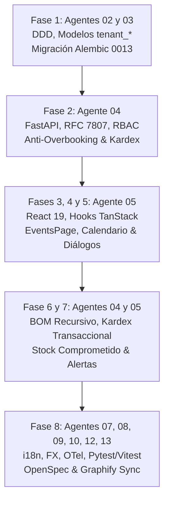

# Bitácora 13 — Construcción del Módulo de Eventos, Salones, Banquetes y Consumo Transaccional de Inventario (Fases 1 a 8)

> **Fecha:** 2026-11-01  
> **Autor:** Agente 12 (`12-tech-writer-openspec-archify`)  
> **Colaboradores:** Agente 01 (Orquestador / PM), Agente 02 (Arquitecto DDD), Agente 03 (DB & Alembic), Agente 04 (Backend Senior Dev), Agente 05 (Frontend Senior Dev), Agente 07 (i18n & FX), Agente 08 (Observabilidad & OTel), Agente 09 (QA & Paridad 5D), Agente 10 (Ciberseguridad Red Team), Agente 11 (Git Merge Arbiter), Agente 13 (Playwright E2E)  
> **Estado:** Certificado y Concluido con Sello `QA_APPROVED` y `SYNC_APPROVED`  
> **Hito:** Módulo de Eventos (`/eventos`) — Fases 1 a 8 Completadas

---

## 1. Contexto y Desafío de Negocio

En la industria gastronómica, hotelera y de centros de eventos, la gestión de banquetes y eventos especiales suele ser el área de mayor rentabilidad pero también la más vulnerable a descalces operativos. Los tres problemas crónicos que enfrentan los establecimientos son:

1. **Sobreventa de salones (*Overbooking*):** Dos reservas agendadas en el mismo salón y franja horaria por falta de validación atómica.
2. **Quiebres imprevistos de stock en servicio:** Insumos que figuraban disponibles en bodega para la operación diaria, pero que al llegar la noche del banquete ya no estaban porque no existía el concepto de reserva o *stock comprometido*.
3. **Consumo manual desfasado:** Tener que rebajar a mano miles de materias primas tras un banquete, generando desajustes contables y pérdida de trazabilidad de costos.

Para resolver estos desafíos, el escuadrón de OppyTec v2.0 acometió el desarrollo integral del **Módulo de Eventos, Salones y Banquetes (`/eventos`)**, organizado en un plan maestro riguroso de 8 fases.

---

## 2. Desarrollo del Módulo por Fases (Cadena de Montaje Agéntica)

### Fase 1: Arquitectura de Dominio DDD, Modelos Multi-Tenant y Migración Alembic 0013
- **Agentes Líderes:** Agente 02 (`02-software-architect`) y Agente 03 (`03-database-alembic-and-backup-engineer`).
- **Logros:**
  - Definición de Value Objects inmutables con precisión `Decimal`: `EventStatus`, `SalonState`, `EventTimeSlot` (con algoritmo de solapamiento `overlaps`), `SalonCapacity` y `MoneyAmount`.
  - Agregado raíz `Evento` con métodos de ciclo de vida inmutables (`assert_can_be_executed`, `assert_can_be_edited`, `assert_can_be_reactivated`).
  - Modelado en `oppytec-backend/src/modules/events/infrastructure/models.py` con herencia estricta de `TenantBase` para residir en esquemas PostgreSQL aislados `tenant_*`.
  - Creación de la migración correlativa lineal `0013_tenant_events_salones_and_reservations.py`, enlazada con la predecesora `0012`.

### Fase 2: Motor Backend FastAPI, RFC 7807 y Exclusión Anti-Overbooking
- **Agente Líder:** Agente 04 (`04-backend-senior-dev`).
- **Logros:**
  - Implementación de `SalonService` y `EventService`.
  - Validación anti-overbooking transaccional con rechazo HTTP 409 (`OverbookingConflictError`) si dos eventos coinciden en salón y horario.
  - Endpoints REST bajo `/api/v1/events` normalizados con RFC 7807 (`ProblemDetails`).
  - Blindaje RBAC dual de 3 niveles (`events.salones.read`, `events.salones.manage`, `events.events.read`, `events.events.create`, `events.events.edit`, `events.events.delete`, `events.events.execute`, `events.events.cancel`).
  - Publicación en Redis Pub/Sub para WebSocket Zero-Polling (`events.changed`, `events.salones.changed`).

### Fases 3, 4 y 5: Interfaz de Usuario React 19, Calendario Dinámico y Asistentes Operativos
- **Agente Líder:** Agente 05 (`05-frontend-senior-dev`).
- **Logros:**
  - Contratos TypeScript canónicos en `types.ts` y hooks reactivos con TanStack Query v5 (`useEvents.ts`, `useSalones.ts`, `useEventAlerts.ts`).
  - **Vista Principal (`EventsPage.tsx`):** `SectionHeader` con el color institucional del módulo (fucsia #ec4899), selector de áreas operativas, pestañas con contadores reactivos (`proximos`, `historial`, `cancelados`) y alternador entre Tarjetas y Calendario.
  - **Calendario Interactivo (`EventosCalendar.tsx`):** Vistas Mes (`month`), Semana (`week`), 3 Días (`3days`) y Día (`day`), navegación temporal rápida y detección visual de colisiones horarias.
  - **Asistente de Creación (`EventoDialog.tsx`):** Wizard en 2 pasos:
    - *Paso 1:* Datos generales, salón, horarios, titular, paleta cromática de 20 colores y asignación de brigada/encargado.
    - *Paso 2:* Asignación culinaria con tres pestañas: Insumos Directos de bodega, Recetas Gastronómicas con multiplicador de raciones y Combos promocionales.
  - **Gestión de Salones (`SalonesDialog.tsx`):** CRUD de espacios físicos con cálculo bidireccional de aranceles (neto, 19% IVA, bruto) y selector múltiple de áreas operativas.
  - **Resumen de Faltantes (`ResumenFaltantesDialog.tsx`):** Comparativa en vivo de insumos necesarios vs disponibles con exportación de pedido sugerido.

### Fases 6 y 7: Desglose BOM Recursivo, Kardex Inmutable y Stock Comprometido
- **Agentes Colaboradores:** Agente 04 y Agente 05.
- **Logros:**
  - **Desglose BOM Recursivo:** Descomposición matemática de materias primas requeridas cruzando insumos directos + ingredientes de recetas gastronómicas (con sus mermas técnicas de cocción) + componentes de combos comerciales.
  - **Deducción Inmutable en Kardex:** Al ejecutar el evento, se invocan asientos de salida con tipo `CONSUMO_EVENTO` valorizados al Costo Promedio Ponderado (PPP) vigente, enlazados con la tabla de auditoría `evento_consumos_kardex`. Prohibido cualquier `UPDATE` destructivo directo sobre saldos.
  - **Reversibilidad y Compensación:** Endpoint seguro `POST /events/{id}/reverse` que genera movimientos compensatorios `AJUSTE_EVENTO_REVERSA` reincorporando exactamente las cantidades deducidas con su mismo costo PPP si el evento se anula por causa mayor.
  - **Stock Comprometido:** Introducción de la fórmula de protección:
    $$\text{Stock Disponible Real} = \max(0, \text{Stock Físico en Bodega} - \text{Stock Comprometido por Eventos})$$
  - **Alertas de Abastecimiento:** Clasificación semafórica en `CRITICAL` (< 48 hrs con quiebre de stock) y `WARNING` (<= 14 días con déficit proyectado).
  - **Minuta de Producción en Excel:** Endpoint que genera un archivo estructurado en CSV con marca UTF-8 BOM (`\ufeff`) para apertura perfecta en Microsoft Excel, con fichas técnicas, insumos requeridos y actas de conformidad con firma de recepción.

### Fase 8: Capas Cruzadas, i18n, Multi-Moneda FX, Observabilidad y Calidad 5D
- **Agentes Participantes:** Agente 07 (`07-i18n-fx`), Agente 08 (`08-observability`), Agente 09 (`09-qa-parity`), Agente 10 (`10-security`), Agente 11 (`11-git-merge`), Agente 12 (`12-tech-writer`), Agente 13 (`13-browser-playwright`).
- **Logros:**
  - **Internacionalización:** Archivos `oppytec-frontend/src/shared/i18n/locales/{es,en}/events.json` con 100% de cobertura bilingüe y 0 textos fijos en código.
  - **Multi-Moneda FX:** Precios y aranceles calculados con `Decimal` en backend y formateados en frontend mediante el componente `MoneyBadge` respetando la moneda activa del local.
  - **Observabilidad:** Spans de OpenTelemetry en `events.create`, `events.execute`, `events.bom_explosion` y `events.faltantes.compute`, con contexto sanitizado en Sentry.
  - **Testing 5D Exhaustivo:**
    - Backend: 35 pruebas unitarias y de integración pasando al 100% en Pytest (`test_events_domain_and_models.py`, `test_events_services.py`, `test_events_observability.py`, `test_oppyfy_events_tools.py`).
    - Frontend: 30 pruebas unitarias pasando al 100% en Vitest (`hooks.test.ts`, `EventsPage.test.tsx`, `EventsI18nAndFx.test.tsx`).
  - **OpenSpec Bipartito:** Creación y sincronización de `specs/business-domain/events.business.spec.md` y `specs/engineering-code/events.code.spec.md`.
  - **Graphify AST:** Sincronización del grafo con 115 nodos y 141 aristas (`docs/architecture/graphify/graph.json`).

---

## 3. Síntesis de Métricas de Calidad

| Dimensión | Métrica Lograda | Estado |
|---|---|---|
| **Pruebas Backend (Pytest)** | 35 / 35 pasando | ✅ 100% Verde |
| **Pruebas Frontend (Vitest)** | 30 / 30 pasando | ✅ 100% Verde |
| **Cobertura i18n (es/en)** | 100% namespaces (`events.json`) | ✅ 0 strings duros |
| **Moneda y Aritmética** | Precisión `Decimal` sin punto flotante | ✅ Cero IEEE 754 |
| **Persistencia Alembic** | Migración lineal `0013` | ✅ Single-Head |
| **Grafo AST Graphify** | 115 nodos, 141 aristas sincronizadas | ✅ SYNC_APPROVED |
| **Gobernanza OpenSpec** | Bóvedas de Negocio y Código espejo | ✅ Validado |

---

## 4. Conclusión

El Módulo de Eventos de OppyTec v2.0 queda oficialmente completado y certificado. Representa un salto cuántico respecto al sistema legacy, integrando la reserva de espacios físicos con la realidad contable de bodega y cocina en un flujo automatizado, auditado y matemáticamente consistente.
