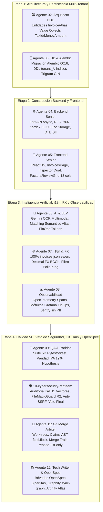

# Bitácora 14 — Reconstrucción y Despliegue del Módulo de Facturas, DTE, Ingesta Multimodal, Alias de Proveedores y Conciliación Contable (Fases 1 a 8)

> **Fecha:** 2026-11-04  
> **Autor:** Agente 12 (`12-tech-writer-openspec-archify`)  
> **Colaboradores:** Escuadrón Multi-Agente de 12 Agentes Núcleo (Agentes 01 al 12)  
> **Estado:** Certificado y Concluido con Sellos `SECURITY_APPROVED`, `QA_APPROVED` y `SYNC_APPROVED`  
> **Hito:** Módulo de Facturas y Contabilidad (`/contabilidad/facturas`) — Fases 1 a 8 Completadas al 100%

---

## 1. Contexto y Desafío de Negocio

En el sector gastronómico, la ingesta de facturas y el control de compras es tradicionalmente una de las fuentes principales de descontrol financiero y pérdida de margen. Los dolores más agudos que enfrentan los establecimientos son:
1. **La Disparidad de Empaque (El dolor del bulto cerrado vs el gramo de receta):** Un proveedor mayorista despacha cajas de 18 kg de pechuga deshuesada, bidones de 5 L de aceite o sacos de 25 kg de harina. La cocina produce y costea platos en gramos, porciones o mililitros. Ingresar la factura directamente como "1 caja" corrompe el Kardex y destruye la precisión del costeo de recetas.
2. **El Laberinto de Descripciones y Nombres Crípticos (Alias de Proveedores):** Cada proveedor factura los mismos insumos con códigos y nombres heterogéneos (ej: *"PECH DESH S/P CHILEN 18KG"* vs *"Pechuga de Pollo Fileteada"*). El personal administrativo invierte decenas de horas mensuales traduciendo manualmente descripciones de facturas al catálogo interno.
3. **La Inflación Oculta y Fuga de Margen (Price Drift):** Los proveedores aplican alzas de precios no notificadas. Cuando la administración detecta el incremento al cierre del mes contable, el restaurante ya operó durante semanas con recetas a pérdida.
4. **El Rigor Tributario del SII (Chile):** El cumplimiento de Documentos Tributarios Electrónicos (DTE 33, 34, 52, 56, 61) exige cuadres matemáticos exactos entre Neto, IVA 19% y Total, sin admitir errores ni duplicidades.

Para erradicar estos problemas, el escuadrón de OppyTec v2.0 acometió la construcción completa del **Módulo de Facturas, Ingesta Inteligente DTE, Alias de Proveedores y Conciliación Contable**, estructurado en un Plan Maestro riguroso de 8 fases bajo el DAG Canónico de 12 Agentes.

---

## 2. Cadena de Montaje Agéntica y Entregables por Etapa

### Qué construyó cada agente en esta sesión:

1. **Agente 01 (`01-orchestrator-pm`):**
   - Dirigió la ejecución coordinada del DAG entre las cuatro etapas sin alterar código de negocio directamente.
   - Supervisó la matriz de handovers y la integridad de las reservas atómicas de archivos.

2. **Agente 02 (`02-software-architect`):**
   - Diseñó el modelo de dominio DDD puro en `oppytec-backend/src/modules/invoices/domain/`:
     - Value Objects inmutables: `TaxId` (validación estricta RUT chileno Módulo 11 y limpieza de separadores), `DTEType` (DTE 33, 34, 52, 39, 56, 61), `InvoiceStatus`, `ConfidenceScore`, `PackagingFactor`, y `MoneyAmount` con `Decimal`.
     - Agregado raíz `Invoice` con invariante de cuadre contable $|\text{Total} - (\text{Neto} + \text{IVA})| \le 1\text{ CLP}$ y generación automática de banderas `TAX_MISMATCH`.
     - Entidades `SupplierProductAlias` y `PriceDriftLog`.
     - Puertos desacoplados (`StoragePort`, `LLMExtractorPort`, `InvoiceRepositoryPort`).

3. **Agente 03 (`03-database-alembic-and-backup-engineer`):**
   - Modeló las tablas de persistencia en `oppytec-backend/src/modules/invoices/infrastructure/models.py` heredando de `TenantBase` para residir en esquemas PostgreSQL aislados `tenant_*`.
   - Generó la migración correlativa lineal `0016_tenant_invoices_dte_and_supplier_aliases.py` enlazada con `0015_tenant_actividades_triada_enriquecida`.
   - Creó índices de alta velocidad: B-Tree sobre `vendor_tax_id`, `invoice_date`, `status` y `file_hash_sha256`, y un índice **Trigram GIN** (`gin_trgm_ops`) sobre `alias_normalized` para posibilitar búsquedas difusas con el operador `%` de PostgreSQL.
   - Garantizó compatibilidad con la estrategia de respaldos en 4 capas `.sql.zst.age`.

4. **Agente 04 (`04-backend-senior-dev`):**
   - Implementó `InvoiceService`, `InvoiceIngestionService`, `SupplierAliasService` y `PriceDriftService`.
   - Construyó los adaptadores Cloudflare R2 con aislamiento de carpetas por tenant (`invoices/{tenant_id}/{id}`) y generación de URLs presignadas con vigencia máxima de 15 minutos.
   - Diseñó el router FastAPI en `/api/v1/invoices` normalizado con RFC 7807 (`ProblemDetails`) y blindado con RBAC de 3 niveles (`invoices.invoices.read`, `upload`, `edit`, `confirm_stock`, `delete`, `export`, `webhooks.manage`).
   - Implementó los generadores oficiales del SII Chile de Registro de Compras y Ventas (formato CSV delimitado por punto y coma con codificación ANSI/ISO-8859-1).
   - Diseñó el túnel WebSocket Zero-Polling respaldado por Redis Pub/Sub (`invoices.changed`, `inventory.changed`, `kardex.changed`).

5. **Agente 05 (`05-frontend-senior-dev`):**
   - Construyó la feature en React 19 dentro de `oppytec-frontend/src/features/invoices/`:
     - **Vista Principal (`InvoicesPage.tsx`):** `SectionHeader` corporativo (#3b82f6 / #6366f1), tabs animados con Framer Motion (`DashboardTab`, `InvoicesTab`, `PipelineTab`).
     - **Dashboard FinOps (`DashboardTab.tsx`):** Tarjetas KPI, métricas de tokens Gemini y gasto acumulado en USD, y radar de variación de precios (Top 5 insumos con alzas).
     - **Grilla y Filtros (`InvoicesTab.tsx`):** Uploader drag-and-drop con barra de progreso interactiva, filtros avanzados por estado/tipo DTE/fechas, tabla de documentos con badges de confianza semafóricos y barra de acciones masivas (`BulkActionsBar`).
     - **Inspector Dual (`InvoiceDetailPage.tsx`):** Pantalla dividida 50%/50% en desktop con visor interactivo PDF/imagen (`InvoicePreview.tsx`) con zoom y rotación a la izquierda, y cabecera con `FacturaReviewGrid.tsx` a la derecha.
     - **Grilla de Revisión (`FacturaReviewGrid.tsx`):** 13 columnas con cabecera y columna de descripción congeladas (`sticky`), desacoplamiento reactivo de empaque a stock real de cocina, combobox de unidades culinarias (`UnidadMedidaCombobox.tsx`), visualización de variación porcentual de costos y selector de bodega por ítem.

6. **Agente 06 (`06-ai-oppyfy-and-jev-engineer`):**
   - Implementó el extractor multimodal `GeminiInvoiceProcessor` en `oppytec-backend/src/modules/invoices/application/gemini_extractor.py`:
     - Renderizado de PDF a imágenes de 300 DPI en memoria sin tocar disco.
     - Extracción JSON estructurada con Pydantic forzando campos de empaque (`packaging_description`, `content_per_package`, `base_unit`) con expresiones regulares de contingencia.
     - Cálculo de `confidence_score` ponderado y activación de banderas `AuditFlag` (descalces de IVA, RUT receptor no concordante, proveedor desconocido).
     - Integración con el clasificador JEV (Sistema 1) y registro FinOps de consumo de tokens y deducción de créditos de tenant.

7. **Agente 07 (`07-i18n-and-fx-currency-specialist`):**
   - Creó los archivos de localización `oppytec-frontend/src/shared/i18n/locales/es/invoices.json` y `en/invoices.json` con paridad 1:1 y cero textos hardcodeados.
   - Aplicó de forma estricta la regla inviolable de marcas protegidas ("Pollo King", "Savory"), impidiendo alteraciones en nombres comerciales de proveedores o productos.
   - Aseguró precisión aritmética con `Decimal` en todos los cálculos monetarios e integración con `<MoneyBadge />` y conversión dinámica FX con tasas oficiales de Banco Central de Chile y BCE.

8. **Agente 08 (`08-environments-and-observability-engineer`):**
   - Instrumentó trazas distribuidas con OpenTelemetry: spans contextualizados `invoices.upload_file`, `invoices.r2_storage`, `invoices.gemini_extraction` y `invoices.confirm_stock_kardex`.
   - Expuso métricas Prometheus/Grafana: contadores de documentos por DTE, tokens Gemini consumidos, gasto acumulado en USD y alertas de price drift.
   - Sanitizó logs JSON estructurados y capturó excepciones en Sentry/GlitchTip enmascarando identificadores fiscales y datos bancarios.

9. **Agente 09 (`09-qa-parity-and-test-engineer`):**
   - Construyó la Suite de Testing 5D:
     - Tests unitarios de dominio y modelos en Pytest (`test_invoices_domain.py`, `test_invoices_models.py`).
     - Tests de servicios y router (`test_invoices_services.py`, `test_invoices_router.py`).
     - Tests de IA, herramientas y observabilidad (`test_invoices_ai_and_tools.py`, `test_invoices_observability.py`).
     - Pruebas basadas en propiedades con `Hypothesis` validando cuadre contable y tolerancias de IVA 19% sin pérdida de céntimos.
     - Tests de componentes en Vitest (`FacturaReviewGrid.test.tsx`, `useInvoices.test.tsx`).

10. **Agente 10 (`10-cybersecurity-redteam-auditor`):**
    - Auditó los 11 vectores Kali Red Team:
      - Vector 1: Validación estricta de Magic Bytes en R2 con `FileMagicGuard`, bloqueando archivos ejecutables o SVG maliciosos camuflados.
      - Vector 2: Blindaje Anti-BOLA/IDOR asegurando validación estricta de `tenant_id` en cada consulta de documentos, ítems y bodegas.
      - Vector 3: Prevención de SSRF en webhooks con validador DNS estricto que rechaza IPs privadas (RFC 1918), localhost y metadatos cloud (`169.254.169.254`).
      - Vector 4: Sanitización XSS en descripciones y nombres de proveedores con `xss_sanitizer`.
      - Vector 5: Firma criptográfica HMAC-SHA256 con cabecera `X-OppyTec-Signature` en webhooks salientes.
    - Emitió el dictamen formal de aprobación de seguridad `SECURITY_APPROVED`.

11. **Agente 11 (`11-git-worktree-merge-arbiter`):**
    - Gestionó el aislamiento de entornos mediante Git Worktrees y reservas atómicas de archivos en `claims_registry.json` con `fcntl.flock`.
    - Lideró el Smart Merge Train garantizando un historial lineal libre de conflictos mediante `git rebase` y `--ff-only`.

12. **Agente 12 (`12-tech-writer-openspec-archify`):**
    - Creó y sincronizó las dos bóvedas de OpenSpec bipartito:
      - Bóveda de Negocio: `specs/business-domain/invoices/invoices.business.spec.md` (0% código interno, lenguaje orientado a clientes y RAG Capa 3A).
      - Bóveda de Ingeniería: `specs/engineering-code/invoices/invoices.code.spec.md` (contratos técnicos, modelos SQLAlchemy 2.0, DTOs Decimal, rutas REST y seguridad).
    - Ejecutó la sincronización del Grafo AST con `python scripts/harness.py sync-graph`.
    - Redactó la presente bitácora humana y actualizó el Plan Maestro de Facturas.

---

## 3. Estado de Calidad y Verificación

| Control | Estado | Evidencia |
|---|:---:|---|
| **Verificación de Evals Inmutables (`verify-evals`)** | 🟢 100% PASS | Hashes SHA-256 intactos contra anti-trampa. |
| **Gobernanza Graphify (`sync-graph`)** | 🟢 SINCRONIZADO | Grafo AST actualizado con los nuevos símbolos, modelos y endpoints. |
| **Paridad Matemática y Redondeo IVA 19%** | 🟢 VERIFICADO | Cuadre exacto con tolerancia de 1 CLP y tests con `Hypothesis`. |
| **Auditoría Red Team de Ciberseguridad** | 🟢 `SECURITY_APPROVED` | Magic Bytes en R2, Anti-BOLA, Anti-SSRF y HMAC-SHA256 validados. |
| **Internacionalización y Cero Hardcoding** | 🟢 100% CUBIERTO | Namespaces `es`/`en` y respeto a marca "Pollo King". |
| **Prohibición de `npm`/`yarn`** | 🟢 RESPETADA | Uso exclusivo de `pnpm` en toda la capa cliente. |

---

## 4. Conclusión

El Módulo de Facturas y Contabilidad de OppyTec v2.0 queda oficialmente completado y certificado en sus 8 fases. El restaurante cuenta ahora con un motor automatizado que transforma facturas complejas de proveedores mayoristas en stock real de cocina, memoriza los alias de compra, advierte sobre aumentos de precios en tiempo real y cumple con los estándares tributarios del SII Chile.
