# Bitácora 15 — Despliegue de Observabilidad Especializada Langfuse v2 y Pipeline de LLM Evals Continuos para OppyFy (Fases 1 a 8)

> **Fecha:** 2026-11-05  
> **Autor:** Agente 12 (`12-tech-writer-openspec-archify`)  
> **Colaboradores:** Escuadrón Multi-Agente de 12 Agentes Núcleo (Agentes 01 al 12)  
> **Estado:** Certificado y Concluido con Sellos `STAGE_3_OBSERVABILITY_AND_INFRASTRUCTURE_CERTIFIED`, `SECURITY_APPROVED`, `QA_APPROVED` y `SYNC_APPROVED`  
> **Hito:** Evals Continuos y Observabilidad Especializada LLM Langfuse para OppyFy (`/oppyfy` y `/admin/token-consumption`) — Fases 1 a 8 Completadas al 100%

---

## 1. Contexto y Desafío de Negocio

En la era de la inteligencia artificial generativa, el mayor riesgo para una plataforma gastronómica y hotelera como OppyTec v2.0 radica en la **falta de determinismo y las alucinaciones probabilísticas de los LLMs**. Un modelo de lenguaje que "supone" ingredientes para una receta de 200 personas, inventa la existencia de harina en un almacén en quiebre, o traduce libremente la marca de un proveedor ("Pollo King" a "King Chicken"), puede ocasionar pérdidas millonarias, quiebres de servicio o incluso riesgos sanitarios graves por alérgenos.

Para alcanzar el estándar de excelencia de la industria en **AI Engineering**, el escuadrón multi-agente implementó un sistema integral de **Evaluación Continua (*LLM Evals*) y Trazabilidad Especializada de Extremo a Extremo con Langfuse v2**, regido por cuatro pilares inquebrantables:
1. **Honestidad Epistémica Gastronómica:** OppyFy jamás inventa cantidades ni asume existencias. Si un producto no está registrado en el inventario del tenant, lo declara con total transparencia.
2. **Cero Floats en FinOps y Métricas:** Cálculos de costos, créditos y puntajes de calidad 100% sustentados en precisión exacta `Decimal`.
3. **Observabilidad Unificada y No Bloqueante:** Despliegue self-hosted de Langfuse correlacionado con OpenTelemetry (Tempo/Grafana) mediante cabeceras estándar W3C `traceparent`, dotado de circuit breaker para no degradar la experiencia de usuario si el colector experimenta lentitud.
4. **Ciclo de Retroalimentación Humana (RLHF):** Captura directa de satisfacción en el chat con botones 👍 / 👎 y categorización granular de fallas para la curaduría permanente del modelo.

---

## 2. Cadena de Montaje Agéntica y Entregables por Etapa

```mermaid
flowchart TD
    subgraph Etapa1["Etapa 1: Arquitectura DDD y Persistencia Multi-Tenant"]
        A02["🏛️ Agente 02: Arquitecto DDD<br/>Puertos LLMTracerPort, LLMEvalSuitePort, Value Objects EvalScore Decimal"]
        A03["🗄️ Agente 03: DB & Alembic<br/>Migración Alembic 0017: tenant_*.ai_chat_feedbacks y public.ai_eval_benchmarks"]
    end

    subgraph Etapa2["Etapa 2: Construcción Backend y Frontend"]
        A04["⚙️ Agente 04: Backend Senior<br/>LangfuseTracer httpx async, Censura PII Regex, Endpoints REST /feedback"]
        A05["🎨 Agente 05: Frontend Senior<br/>ChatFeedbackButtons, FeedbackReportModal, hook TanStack useOppyfyFeedback"]
    end

    subgraph Etapa3["Etapa 3: AI Engine, i18n & Observabilidad Multi-Entorno"]
        A06["🧠 Agente 06: AI & JEV<br/>Golden Dataset 50 casos, Evaluadores Custom Faithfulness/Relevance/Hallucination"]
        A07["🌐 Agente 07: i18n & FX<br/>Dataset bilingüe ES/EN, Invarianza 'Pollo King', Paridad de claves oppyfy.json"]
        A08["📊 Agente 08: Observabilidad<br/>Langfuse v2 Docker Self-Hosted, Correlación W3C OTel, Dashboard Grafana FinOps"]
    end

    subgraph Etapa4["Etapa 4: Calidad, Red Team, Git y OpenSpec"]
        A09["🧪 Agente 09: QA & Paridad<br/>Suite 75/75 tests ai_evals, Quality Gate Fail-Closed en CI/CD"]
        A10["🛡️ Agente 10: Cybersecurity Red Team<br/>Auditoría PII, Aislamiento Tenant_ID, Blindaje Prompt Injection"]
        A11["🔀 Agente 11: Git Merge Arbiter<br/>Worktrees, Control claims_registry.json, Merge Train rebase + ff-only"]
        A12["📚 Agente 12: Tech Writer & OpenSpec<br/>Bóvedas OpenSpec Bipartitas, Graphify sync-graph, Archify Atlas"]
    end

    Etapa1 --> Etapa2
    Etapa2 --> Etapa3
    Etapa3 --> Etapa4
```

### Detalle de la Construcción por Agente:

1. **Agente 01 (`01-orchestrator-pm`):**
   - Dirigió la gobernanza del DAG de 4 etapas, monitoreando la secuencia estricta de traspasos sin interferir en el código de aplicación.

2. **Agente 02 (`02-software-architect`):**
   - Diseñó el modelo de dominio DDD puro en `oppytec-backend/src/modules/oppy_ai/domain/`:
     - Value Object inmutable `EvalScore` con validación estricta que prohíbe terminantemente valores de tipo `float` y garantiza el rango `[0.00, 1.00]`.
     - Value Objects `EvalMetricThresholds` (con umbrales mínimos de producción) y `TraceContext` (fábrica de correlación W3C).
     - Entidades de Dominio `AIChatFeedback`, `AIEvalBenchmark` y `AIEvalCaseResult`.
     - Puertos desacoplados `LLMTracerPort`, `LLMEvalSuitePort` y `AIChatFeedbackRepositoryPort`.

3. **Agente 03 (`03-database-alembic-and-backup-engineer`):**
   - Creó la migración correlativa lineal `0017_public_ai_benchmarks_and_tenant_feedback.py`:
     - Tabla `tenant_*.ai_chat_feedbacks` con aislamiento estricto por local, índices B-Tree en `(tenant_id, trace_id)` y `(tenant_id, message_id)`.
     - Tabla `public.ai_eval_benchmarks` para registrar las corridas históricas de CI/CD con puntajes agregados de fidelidad y alucinaciones.

4. **Agente 04 (`04-backend-senior-dev`):**
   - Implementó el adaptador desacoplado `LangfuseTracer` utilizando `httpx.AsyncClient`:
     - Modo no bloqueante (*Graceful Degradation*): ante caídas o latencias del servidor de telemetría, la atención al usuario final no sufre demoras.
     - Filtro interceptor en origen para censura de PII (`scrub_pii_text` y `scrub_telemetry_payload`) con expresiones regulares para RUTs, tarjetas de crédito, correos y teléfonos.
     - Repositorios `SqlAlchemyAIChatFeedbackRepository` e `InMemoryAIChatFeedbackRepository`.
     - Endpoints REST `POST /api/v1/oppy_ai/chat/feedback` y `GET /api/v1/oppy_ai/chat/feedback` con RBAC granular de 3 niveles y rate limiting.

5. **Agente 05 (`05-frontend-senior-dev`):**
   - Desarrolló los componentes UI en React 19:
     - `ChatFeedbackButtons.tsx`: botones reactivos 👍 / 👎 con estados optimistas, accesibilidad ARIA completa y touch targets $\ge 44\text{px}$.
     - `FeedbackReportModal.tsx`: diálogo accesible con Radix UI para clasificar fallas entre 5 categorías operativas (`hallucination`, `math_error`, `incomplete`, `bad_formatting`, `other`) y capturar sugerencias de corrección.
     - Hook `useOppyfyFeedback.ts` basado en TanStack Query v5 y retroalimentación con Sonner Toasts.

6. **Agente 06 (`06-ai-oppyfy-and-jev-engineer`):**
   - Curó el **Golden Dataset Gastronómico** con 50 casos de prueba altamente representativos en `gastronomic_golden_dataset.json`, cubriendo Banquetes, Mermas, Stock FEFO, Facturas y Muro de Fuego.
   - Creó los evaluadores tipados `FaithfulnessEvaluator`, `AnswerRelevanceEvaluator`, `ContextPrecisionEvaluator` y `HallucinationEvaluator` operando 100% con aritmética `Decimal`.
   - Calibró los prompts de sistema con directivas explícitas de **honestidad epistémica**.

7. **Agente 07 (`07-i18n-and-fx-currency-specialist`):**
   - Duplicó en espejo el Golden Dataset en inglés (`gastronomic_golden_dataset_en.json`), garantizando paridad bilingüe 1:1.
   - Auditó la **Regla Inmutable "Pollo King"**: protección absoluta de nombres comerciales registrados en ambos idiomas.
   - Sincronizó las traducciones completas en `oppyfy.json` (`es` y `en`) y verificó los cálculos FX con tasas del Banco Central de Chile y Banco Central Europeo en `Decimal`.

8. **Agente 08 (`08-environments-and-observability-engineer`):**
   - Desplegó `langfuse-server` (v2) en `docker-compose.yml` bajo el perfil `observability`, integrando PostgreSQL (`?schema=langfuse`) y Redis en DB 2.
   - Integró la propagación del encabezado W3C `traceparent` unificando el identificador de traza entre OpenTelemetry (Tempo) y Langfuse.
   - Construyó el panel integral de FinOps y Observabilidad en Grafana (`oppyfy_llm_finops_observability.json`).

9. **Agente 09 (`09-qa-parity-and-test-engineer`):**
   - Ejecutó la batería de certificación:
     * `pytest tests/ai_evals/`: 75/75 tests passing.
     * `pytest tests/unit/modules/test_oppy*.py`: 134/134 tests passing.
     * `pytest tests/architecture/`: 29/29 tests passing.
     * Vitest Frontend: 6 suites, 70/70 tests passing.
   - Diseñó el Quality Gate con política **Fail-Closed**: cualquier caída de fidelidad por debajo de 0.85 o alucinación superior al 0.00 en recetas bloquea el merge.

10. **Agente 10 (`10-cybersecurity-redteam-auditor`):**
    - Verificó la sanitización activa de PII impidiendo fugas de datos sensibles a la telemetría externa.
    - Auditó el aislamiento multi-tenant en todas las trazas y feedbacks mediante el tag obligatorio `tenant_id`.
    - Certificó la resistencia del sistema frente a 10 vectores adversariales de inyección de prompt (jailbreaks y ataques de fuga de código fuente).

11. **Agente 11 (`11-git-worktree-merge-arbiter`):**
    - Coordinó el Merge Train determinista (`rebase + --ff-only`) y la gestión de claims atómicos en `claims_registry.json`.

12. **Agente 12 (`12-tech-writer-openspec-archify`):**
    - Redactó la especificación de negocio `specs/business-domain/ai_evals.business.spec.md`.
    - Redactó la especificación de ingeniería `specs/engineering-code/ai_evals.code.spec.md`.
    - Actualizó el Plan Maestro oficial, la bitácora del escuadrón y ejecutó la sincronización del grafo Graphify y el atlas Archify.

---

## 3. Métricas de Calidad Obtenidas

| Métrica Evaluada | Umbral SLA Requerido | Resultado Obtenido | Estado |
|---|---|---|---|
| **Faithfulness (Fidelidad de Contexto)** | $\ge 0.85$ (85%) | **0.96** (96%) | ✅ Aprobado |
| **Answer Relevance (Pertinencia)** | $\ge 0.85$ (85%) | **0.95** (95%) | ✅ Aprobado |
| **Context Precision (Herramientas)** | $\ge 0.80$ (80%) | **0.98** (98%) | ✅ Aprobado |
| **Hallucination Rate Crítica** | $\le 0.00$ (0%) | **0.00** (0%) | ✅ Aprobado |
| **Protección PII en Trazas** | 0 filtraciones | **0 filtraciones** | ✅ Aprobado |
| **Invarianza "Pollo King"** | 100% inmutable | **100% inmutable** | ✅ Aprobado |
| **Precisión Matemática** | 0 floats (`Decimal`) | **0 floats (`Decimal`)** | ✅ Aprobado |

---

## 4. Conclusión

Con la conclusión exitosa de las Fases 1 a 8, el subsistema **OppyFy v2.0** cuenta con una infraestructura de nivel empresarial para el monitoreo, evaluación y mejora sistemática de sus capacidades de inteligencia artificial, garantizando la confianza total de los operadores gastronómicos y directores hoteleros en las respuestas y cálculos del sistema.
