# Bitácora del Escuadrón — Lanzamiento del Holding Hub Enterprise de OppyTec v2.0

> **Fecha:** 2026-11-05  
> **Autor:** Agente 12 (`12-tech-writer-openspec-archify`)  
> **Participantes:** Escuadrón Multi-Agente Núcleo (Agentes 01 al 12)  
> **Estado:** Certificado con Sellos `STAGE_2_BACKEND_CERTIFIED`, `HOLDING_HUB_STAGE_3_I18N_AND_FX_CERTIFIED`, `HOLDING_HUB_ENTERPRISE_STAGE3_OBSERVABILITY_CERTIFIED`, `GRAPHIFY_SYNC_APPROVED`  
> **Hito:** Holding Hub Enterprise (Consola Multi-Sucursal, Planes SaaS, Distribución de Créditos IA, Oppy Daily Briefing, Paleta Cmd+K y Recharts) — Etapas 1 a 4 Concluidas al 100%

---

## 1. El Desafío: Gobernar una Cadena Gastronómica sin Romper la Autonomía Local

En la industria gastronómica moderna, las cadenas y consorcios enfrentan un dilema estructural: ¿cómo consolidar la dirección financiera y el consumo tecnológico sin vulnerar el aislamiento operativo de cada sucursal? 

Antes del Holding Hub Enterprise, los dueños y directores de consorcios debían ingresar restaurante por restaurante para conocer las ventas diarias o revisar las mermas de insumos. Más crítico aún: con la adopción masiva de los asistentes de inteligencia artificial de OppyFy, no existía un mecanismo para distribuir el presupuesto mensual de IA de forma equitativa o compartida entre locales con distintas demandas estacionales.

El **Holding Hub Enterprise** resuelve esta problemática de raíz mediante una consola corporativa de alta dirección diseñada para operar bajo el principio de **privacidad estricta por local con agregación ejecutiva en tiempo real**.

---

## 2. Lo que Construyó Cada Agente del Escuadrón

El desarrollo del Holding Hub Enterprise se ejecutó mediante un flujo de colaboración agéntica disciplinada, donde cada especialista asumió un rol no negociable para cumplir con el estándar de oro de OppyTec v2.0:

```mermaid
flowchart TD
    subgraph Capa1["Capa 1: Gobernanza, Dominio y Persistencia"]
        A01["📋 Agente 01 (Orquestador PM)<br/>Cronograma de fases y gobernanza DAG"]
        A02["🏛️ Agente 02 (Arquitecto DDD)<br/>Contratos de Dominio, Value Objects y Políticas de Crédito"]
        A03["🗄️ Agente 03 (Database & Alembic)<br/>Migración 0018: holdings, credit_distributions, credit_purchases"]
    end

    subgraph Capa2["Capa 2: Motores de Aplicación y Experiencia Visual"]
        A04["⚙️ Agente 04 (Backend Senior)<br/>HoldingHubService, 7 Endpoints REST, RBAC 3-Niveles y Anti-IDOR"]
        A05["🎨 Agente 05 (Frontend Senior)<br/>HoldingHubLayout, Vistas Central/Planes/Créditos, Recharts y Cmd+K"]
        A06["🧠 Agente 06 (AI OppyFy & JEV)<br/>Oppy Daily Briefing (2 párrafos), Safety Cap Predictivo"]
    end

    subgraph Capa3["Capa 3: Calidad Institucional y Operaciones"]
        A07["🌐 Agente 07 (i18n & FX Specialist)<br/>Paridad Bilingüe ES/EN (174 claves), FX CLP/USD/EUR/BRL, Regla Pollo King"]
        A08["📊 Agente 08 (Observabilidad OTel)<br/>Spans Distribuidos, Tags Sentry, Buffer Métricas y SLA p95 < 200ms"]
        A09["🧪 Agente 09 (QA Parity)<br/>89 Tests Backend + 13 Tests Vitest al 100% Verde"]
    end

    subgraph Capa4["Capa 4: Seguridad, Integración y Memoria del Sistema"]
        A10["🛡️ Agente 10 (Cybersecurity Red Team)<br/>Blindaje Anti-IDOR entre Holdings y Sanitización PII"]
        A11["🔀 Agente 11 (Git Merge Arbiter)<br/>Gestión de Worktrees y Sincronización sin Conflictos"]
        A12["📚 Agente 12 (Tech Writer & OpenSpec)<br/>OpenSpec Bipartito, Graphify AST (132 nodos) y Bitácora Humana"]
    end

    Capa1 --> Capa2
    Capa2 --> Capa3
    Capa3 --> Capa4
```

### Detalle de las Contribuciones Especializadas:

1. **Agente 01 (`01-orchestrator-pm`):**
   - Estructuró las 4 etapas del plan maestro del Holding Hub Enterprise, fijando los umbrales de paso estrictos (*Quality Gates*) para autorizar las transiciones entre base de datos, backend, frontend y QA.

2. **Agente 02 (`02-software-architect`):**
   - Modeló el núcleo de dominio DDD en `oppytec-backend/src/modules/tenancy/domain/holding_hub.py`:
     - Reglas de negocio para los modos de crédito: bolsa compartida (`shared`) vs cuotas fijas asignadas (`allocated`).
     - Validación determinista que impide que la suma de cupos asignados a las sucursales sobrepase el tope contratado por el consorcio (`validate_credit_distribution_sum`).

3. **Agente 03 (`03-database-alembic-and-backup-engineer`):**
   - Diseñó y ejecutó la migración correlativa lineal `0018_public_holding_hub_credit_distribution_and_purchases.py`:
     - Extensión de `public.holdings` con la columna `credit_distribution_mode`.
     - Creación de la tabla `public.holding_credit_distributions` con clave foránea en cascada y restricción de unicidad `uq_holding_tenant_credit_distribution`.
     - Creación de la tabla de compras `public.holding_credit_purchases` para bolsas de recarga prepagadas.
     - Cumplimiento estricto de reversibilidad LIFO y tipado monetario `Numeric(14, 2)` y `Numeric(14, 4)` sin uso de números flotantes.

4. **Agente 04 (`04-backend-senior-dev`):**
   - Construyó el servicio de aplicación `HoldingHubService` con SQLAlchemy 2.0 Async puro.
   - Creó los 7 endpoints REST en `oppytec-backend/src/modules/tenancy/presentation/holding_hub_router.py`:
     - `GET /api/v1/holding-hub/summary`: KPIs financieros, existencias y balance de IA.
     - `GET /api/v1/holding-hub/tenants`: Auditoría de consumo y estado de sucursales.
     - `GET /api/v1/holding-hub/daily-credit-usage`: Series temporales continuas con relleno automático de fechas para Recharts.
     - `PUT /api/v1/holding-hub/credit-distribution`: Modificación dinámica del modelo de distribución.
     - `POST /api/v1/holding-hub/purchase-credits`: Acreditación atómica de bolsas corporativas.
     - `POST /api/v1/holding-hub/change-plan`: Escalabilidad y upgrade de planes comerciales.
     - `GET /api/v1/holding-hub/benchmarking`: Comparativas de desempeño entre restaurantes.
   - Implementó la guardia de seguridad `RequireHoldingPermission` con evaluación en 3 niveles y blindaje anti-IDOR que bloquea con `HTTP 403` cualquier intento de consultar información de un consorcio ajeno.

5. **Agente 05 (`05-frontend-senior-dev`):**
   - Desarrolló en React 19 la suite completa de componentes corporativos (`oppytec-frontend/src/features/holding-hub/`):
     - `HoldingHubLayout.tsx`: Shell responsive con Navbar corporativo de 80px, selector de temas (`ocean-blue`, `dark`, `light`) y sidebar retráctil.
     - `HoldingCentralSection.tsx`: Torre de control con 4 KPIs en glassmorphism, vista dual de sucursales (tabla interactiva o tarjetas) y modal de inspección.
     - `HoldingPlansSection.tsx`: Matriz comparativa de suscripciones (Starter, Growth, Enterprise) con selector de ciclo mensual/anual y modal de confirmación.
     - `HoldingCreditsSection.tsx`: Tablero FinOps con gráfico interactivo Recharts, sliders intuitivos para asignación de cupos y modal de compra de bolsas de crédito.
     - `TenantCommandPalette.tsx`: Buscador interactivo global invocado mediante `Cmd+K` / `Ctrl+K` para cambiar de sucursal en milisegundos.

6. **Agente 06 (`06-ai-oppyfy-and-jev-engineer`):**
   - Creó el servicio `HoldingBriefingService` en `oppytec-backend/src/modules/oppy_ai/application/`:
     - Generador del **Oppy Daily Holding Briefing**, una síntesis ejecutiva estructurada rigurosamente en **dos párrafos**:
       - *Párrafo 1:* Análisis consolidado de ventas, inventario y porcentaje de merma con mención del restaurante líder.
       - *Párrafo 2:* Estado del saldo de IA, tasa diaria de consumo (*burn rate*) y días estimados de autonomía.
     - Algoritmo predictivo de **Safety Cap** que calcula un semáforo de 3 estados (`NORMAL`, `WARNING`, `CRITICAL`) con recomendaciones preventivas antes de que se agoten los créditos.
     - Componente frontend `HoldingAiBriefingCard.tsx` con soporte de colapso y acceso directo a la compra de créditos.

7. **Agente 07 (`07-i18n-and-fx-currency-specialist`):**
   - Llevó a cabo la auditoría exhaustiva de internacionalización y multimoneda:
     - Catálogos bilingües completos con **174 claves espejo** en `locales/es/holding_hub.json` y `locales/en/holding_hub.json`.
     - Erradicación total de textos quemados (*zero raw strings*) en el JSX de los 8 componentes visuales.
     - Integración reactiva del selector de divisas (`CurrencySelector`) mediante `useCurrencyFormatter`, convirtiendo al vuelo montos consolidados a CLP, USD, EUR y BRL con tasas oficiales del BCCh y BCE Frankfurter.
     - Blindaje de la regla de oro **"Pollo King"**: las identidades de marcas, razones sociales ("Pollo King SpA"), RUTs y nombres de esquemas PostgreSQL (`pollo_king_providencia`) tienen `translatable = False` y se mantienen inalterables entre idiomas.

8. **Agente 08 (`08-environments-and-observability-engineer`):**
   - Instrumentó la observabilidad distribuida de nivel enterprise:
     - Spans explícitos de OpenTelemetry bajo el tracer `oppytec.tenancy.holding_hub` para los 7 endpoints y métodos de aplicación.
     - Enriquecimiento del contexto de Sentry / GlitchTip con tags obligatorios `holding_id`, `tenant_id` y `user_role`.
     - Sanitización determinista de información sensible (PII) para evitar la filtración de RUTs o contraseñas en telemetría.
     - Verificación del **SLA de Latencia**: percentil 95 ($p95 < 200\text{ ms}$) validado en corridas continuas de estrés.

9. **Agente 09 (`09-qa-parity-and-test-engineer`):**
   - Ejecutó la verificación integral de pruebas con resultado impecable:
     - Backend: **89 tests passing en 2.04s** (incluye unitarios de dominio, briefing IA, observabilidad OTel, i18n/FX, migración 0018 e integración REST).
     - Frontend: **13 tests passing en 7.68s** con Vitest y Testing Library.
     - Cero regresiones en la suite general `harness.py test-fast`.

10. **Agente 10 (`10-cybersecurity-redteam-auditor`):**
    - Auditó la superficie de ataque del nuevo router `/api/v1/holding-hub`:
      - Comprobó que un token válido de un holding no puede acceder bajo ninguna circunstancia a datos de otro consorcio (rechazo con `HTTP 403 Forbidden`).
      - Validó los esquemas Pydantic v2 con política `extra="forbid"` ante inyecciones de campos maliciosos.

11. **Agente 11 (`11-git-worktree-merge-arbiter`):**
    - Coordinó la integración atómica en los repositorios sin colisiones de archivos ni desvíos de ramas.

12. **Agente 12 (`12-tech-writer-openspec-archify` — nosotros):**
    - Redactó las especificaciones bipartitas formales en `openspec/specs/business/holding-hub-enterprise.md` y `openspec/specs/engineering/holding-hub-architecture.md` (y sincronizadas en `specs/`).
    - Actualizó el arnés `scripts/harness.py` para incorporar los nuevos routers, servicios, vistas y suites del Holding Hub en el motor AST de Graphify.
    - Ejecutó `python scripts/harness.py sync-graph` alcanzando **132 nodos, 15 routers, 20 migraciones, 31 suites de verificación y 161 aristas**.
    - Escribió la presente bitácora para documentar con transparencia el trabajo entregado.

---

## 3. ¿Cómo Funciona el Holding Hub Enterprise en la Práctica?

Para entender el valor operativo del sistema, observemos el recorrido de un usuario real, por ejemplo el Director de Operaciones del "Holding Gastronómico Pollo King":

### Paso 1: Apertura de la Consola Central
Al ingresar a `/holding-hub`, el director visualiza de inmediato el **Oppy Daily Holding Briefing**:
> *"El consorcio presenta una facturación acumulada consolidada de $48.500.000 CLP y un inventario valorizado de $12.300.000 CLP en 3 locales activos. La tasa promedio de merma se sitúa en 2,1%, liderando la eficiencia operacional el local Providencia con una merma destacada de solo 1,2% sobre ventas.*  
>  
> *La bolsa corporativa cuenta con 14.500 créditos de IA disponibles sobre una cuota mensual de 20.000 créditos, operando bajo modalidad compartida. Al ritmo de consumo actual de 250 créditos diarios, se proyecta una autonomía de 58 días, garantizando cobertura completa para el ciclo comercial en curso."*

### Paso 2: Detección y Acción Inmediata
Si el director nota en la tabla de sucursales que el local de Viña del Mar presenta una merma elevada o requiere ajustes de inventario, puede:
1. Abrir la paleta de comandos con `Cmd+K`.
2. Escribir "Viña" y presionar `Enter`.
3. Conmutar al entorno del restaurante de Viña de forma inmediata para revisar los detalles del stock físico.

### Paso 3: Ajuste de Presupuesto FinOps
Al llegar a la pestaña **Créditos**, el director observa el gráfico diario de Recharts. Si detecta que un local está consumiendo más IA de la prevista por realizar escaneos intensivos de facturas, puede cambiar el modo de distribución de *Compartida* a *Asignada*, ajustar con un slider que Viña reciba un cupo tope de 2.000 créditos y presionar "Guardar Distribución". El sistema valida que no exceda el total contratado y aplica el límite al instante.

---

## 4. Estándar de Excelencia y Conclusión

El Holding Hub Enterprise de OppyTec v2.0 se entrega cumpliendo con los más altos estándares de ingeniería de software corporativa:
- **Cero Flotantes Financieros:** 100% de los precios, consumos de créditos y porcentajes se calculan con tipos `Decimal` exactos.
- **Soberanía y Paridad de Idioma:** Experiencia 100% traducida a Español e Inglés, preservando la inviolabilidad de las marcas registradas.
- **Rendimiento Comprobado:** Tiempos de respuesta certificados por debajo de 200 ms ($p95$).
- **Gobernanza Total:** Trazabilidad en tiempo real a través de Graphify y OpenSpec.

Con esta entrega, OppyTec v2.0 consolida su liderazgo como la plataforma integral más robusta para consorcios y cadenas gastronómicas de habla hispana.
