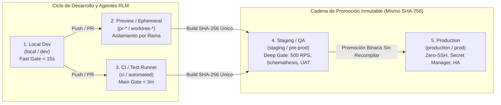

# Estrategia Maestra de Entornos (Environments), Promoción de Artefactos y Gobernanza DevSecOps (Versión 001)

> **Documento:** `estrategia_entornos_y_despliegue_001.md`  
> **Versión:** 001 (Especificación Normativa de Arquitectura de Entornos, Fronteras de Red, Configuración Fail-Fast e ISO 27001 / ISO 9001)  
> **Base Normativa:**  
> - `MASTER-AGENTIC-ENGINEERING-FRAMEWORK.md`  
> - `propuesta_arquitectura_tree_001.md`  
> - `estrategia_migraciones_alembic_001.md`  
> - `estrategia_rbac_y_auditoria_001.md`  
> - `estrategia_testing_calidad_y_seguridad_001.md`  
> - Estándares ISO/IEC 27001 (§A.9.4.4, §A.12.1.4, §A.14.2.6, §A.14.3.1, §A.18.1.4), ISO 9001 (§7.5, §8.1, §8.5) y Metodología *The Twelve-Factor App*.  
> **Propósito:** Establecer la cadena de promoción de **4 entornos permanentes + 1 entorno efímero**, garantizando aislamiento total de datos y red (*Blast Radius Contained*), invarianza de artefactos (*Build Once, Deploy Everywhere*), validación *Fail-Fast* en el milisegundo `0` y soporte nativo para ejecución paralela de sub-agentes en Git Worktrees.  
> **Fecha:** Octubre 2026  

---

## 1. Diagnóstico de Configuración y Entornos en `OppyTec-Legacy`

Al inspeccionar `OppyTec-Legacy/OppyTec_Backend/src/config.py` y `alembic/env.py`, se identificaron **5 vulnerabilidades arquitectónicas** en el manejo de entornos del proyecto original:

1. **Contradicción peligrosa de valores por defecto:** `GlobalSettings` definía por defecto `ENVIRONMENT: str = "production"`, pero en la línea siguiente declaraba `ALLOWED_ORIGINS: str = "http://localhost:5173,http://localhost:8000"`.
2. **Ausencia de validación *Fail-Fast* en Producción:** Secretos críticos como `SECRET_KEY`, `JWT_ACCESS_SECRET_KEY`, `DB_PASSWORD`, `SUPERADMIN_PASSWORD`, `GEMINI_API_KEY` y `R2_SECRET_ACCESS_KEY` estaban tipados como `Optional[str] = None`. Esto permitía que el servidor iniciara en producción con claves vacías o nulas sin abortar el arranque.
3. **Clases de entorno vacías e inoperantes:** `DevelopmentSettings(GlobalSettings)` y `PremasterSettings(ProductionSettings)` tenían únicamente `pass`, sin diferenciación de reglas de seguridad, orígenes CORS ni proveedores de infraestructura.
4. **Fuga de `os.environ.get()` fuera de Pydantic:** En `ProductionSettings.get_aws_client_for_image_upload()` se leían credenciales directamente con `os.environ.get()`, saltándose la validación de tipos y enmascaramiento.
5. **Reescritura manual de hosts en `alembic/env.py`:** Existían parches en código como `db_url.replace("@db:5432", "@localhost:5443")` que acoplaban el motor de migraciones a puertos locales específicos.

---

## 2. Matriz Canónica de los 5 Entornos de OppyTec v2.0

Para cumplir con **ISO/IEC 27001 §A.12.1.4** (*Separación de los recursos de desarrollo, prueba y operación*), OppyTec v2.0 implementa **4 entornos permanentes y 1 entorno efímero**:



| # | Entorno | Identificador (`ENVIRONMENT`) | Propósito Primario | Fuente de Datos y Esquemas | Integraciones Externas y APIs | Quality Gate Asociado |
|---|---|---|---|---|---|---|
| **1** | **Local Dev** | `local` | Co-creación iterativa 1:1 (humano + agente IA), depuración local. | Contenedores locales (`docker-compose.yml`) con semilla determinista (`seed_dev_data.py`). | Mocks/stubs locales; Storage en disco local aislado; Email en `Mailpit` local; IA en tier dev/mock. | **Fast Gate** (`< 15s` en cada paso y `pre-commit`) |
| **2** | **Preview / Ephemeral** | `preview` | Validación aislada por Pull Request o por `Git Worktree` de sub-agentes paralelos. | Base de datos/esquemas efímeros con namespace único (`oppytec_pr_<id>`) y `REDIS_KEY_PREFIX="pr_<id>:"`. | Sandboxes aislados sin salida a clientes reales; destruido automáticamente al cerrar el PR/worktree. | **Fast Gate + Smoke + UI Preview** |
| **3** | **CI / Test Runner** | `ci` | Árbitro determinista e imparcial del repositorio en cada Push/PR. | Contenedores desechables por job; aislamiento por test mediante `SAVEPOINT` rollback (`< 10ms`). | **100% aislado de internet público**; proveedores externos emulados para latencia `0` y costo `$0`. | **Main Gate** (`< 3m`: Unit, Integration, Red Team `01..11`, Semgrep, Knip) |
| **4** | **Staging / QA** | `staging` | Espejo 1:1 de Producción; certificación UAT, pruebas de estrés, migraciones y DAST. | Datos sintéticos masivos o copia **100% anonimizada** (cero PII real ni tokens de prod). | Sandboxes oficiales (R2 bucket de staging, Gemini staging key, pasarelas test) con **Sinkhole** de correo. | **Deep Gate** (`Schemathesis`, `Locust 500 RPS`, `Trivy`, `Alembic Stairway`) |
| **5** | **Production** | `production` | Operación comercial en vivo de Holdings y Tenants reales bajo SLA. | Cluster PostgreSQL 16 HA cifrado en reposo (AES-256) y en tránsito (TLS 1.3) + Backups PITR continuos. | Proveedores productivos reales; secretos inyectados exclusivamente desde **Cloud Secret Manager**. | **Monitoreo Continuo APM, Auditoría Forense, Alertas Sentinel** |

---

## 3. Función Específica y Reglas Inviolables de Cada Entorno

### 3.1 Entorno 1: Desarrollo Local (`ENVIRONMENT=local`)
- **Función:** Estación de trabajo del ingeniero o agente de IA con retroalimentación instantánea (`< 10-15 segundos`).
- **Reglas de Gobernanza:**
  1. Se alimenta exclusivamente del archivo `.env` local (ignorado en `.gitignore` y auditado por `gitleaks`).
  2. Ejecuta obligatoriamente el **Fast Gate** (`ruff`, `mypy --strict`, `eslint`, `tsc --noEmit`, `tests/architecture/` y `tests/unit/` con `--hypothesis-profile=dev`).
  3. **Candado en Código (Anti-Remote DB):** El validador de `LocalSettings` aborta el arranque si `DATABASE_URL` o `REDIS_URL` apuntan a cualquier host que no sea `localhost`, `127.0.0.1` o los nombres de servicio internos de Docker Compose (`postgres`, `redis`). Es técnicamente imposible conectarse por accidente a Staging o Producción desde `ENVIRONMENT=local`.

### 3.2 Entorno 2: Previsualización y Worktrees Efímeros (`ENVIRONMENT=preview`)
- **Función:** Levantar entornos efímeros por cada Pull Request (`pr-142`) o por cada sub-agente recursivo de **Prime Agent** operando en un **Git Worktree** paralelo.
- **Reglas de Gobernanza:**
  1. **Aislamiento por `NAMESPACE_ID` (`PR_ID` / `WORKTREE_ID`):** Cuando 2 o más agentes/desarrolladores corren en paralelo, cada instancia inyecta `ENV_NAMESPACE="wt_01"`, lo que aísla automáticamente el nombre de la base de datos (`oppytec_wt_01`) y el prefijo de todas las claves en Redis (`wt_01:`).
  2. **Caché Incremental de AST de `Graphify` por Contenido (`ast_hash`):** Los worktrees locales y de `preview` comparten la caché de extracción AST basada en hash de archivo (`docs/architecture/graphify/cache/ast`) gobernada por `.graphifyignore` (que excluye `node_modules/`, `.venv/`, `dist/`, `tinymce`, `*.sql` y `.worktrees/`), permitiendo actualizar y consultar el grafo de impacto de cada rama en `< 500ms` con costo `0` de tokens.
  3. Se aprovisiona desde cero corriendo `alembic upgrade head` + `bootstrap.py` + `seed_dev_data.py`.
  4. Se destruye automáticamente (`DROP DATABASE` / destrucción de contenedor) al fusionar o cerrar el PR/worktree.

### 3.3 Entorno 3: Integración Continua (`ENVIRONMENT=ci`)
- **Función:** Árbitro determinista donde ningún código se aprueba por opinión subjetiva, sino por `Exit Code 0`.
- **Reglas de Gobernanza:**
  1. **Cero Estado Compartido:** Cada ejecución parte de esquemas limpios y cada test de integración usa transacciones anidadas (`BEGIN NESTED` / `SAVEPOINT`) que hacen rollback al finalizar el test en menos de `10ms`.
  2. **Cero Dependencia de Red Externa:** Las llamadas HTTP salientes fuera de `localhost`/contenedores de test están bloqueadas por fixture (`respx` / socket guard) para garantizar que ningún test consuma créditos de Gemini ni falle por caídas de internet externo.
  3. Ejecuta el **Main Gate** completo (`test_01` al `test_11` de seguridad, `gitleaks`, `semgrep`, `knip`, `deptry`, paridad 1:1 y cobertura de ramas $\ge 85\%$).

### 3.4 Entorno 4: Pre-Producción / Homologación (`ENVIRONMENT=staging`)
- **Función:** Clon estructural y topológico idéntico a Producción para certificar despliegues bajo carga y fuego real antes del pase productivo.
- **Reglas de Gobernanza (ISO 27001 §A.14.3.1 — Protección de datos de prueba):**
  1. **Prohibición Absoluta de Datos PII de Producción en Crudo:** Está terminantemente prohibido restaurar un `pg_dump` directo de Producción en Staging. Si se requiere volumen estadístico real, debe pasar por el pipeline de anonimización (`scripts/anonymize_for_staging.py`) que:
     - Reemplaza nombres, correos, teléfonos, direcciones y RUTs (`tax_id`) por valores sintéticos deterministas.
     - Trunca al 100% las tablas de sesiones, tokens (`refresh_tokens`, `password_reset_tokens`) y secretos de webhooks.
  2. **Cortafuegos de Salida (*Outbound Sinkhole*):** En `staging`, el adaptador de correo y notificaciones solo puede emitir mensajes a dominios incluidos en `SAFE_OUTBOUND_EMAIL_DOMAINS` (ej. `@oppytec.com`) o a la bandeja de captura QA. Cualquier correo hacia un proveedor o cliente externo es interceptado automáticamente.
  3. **Certificación Pesada (Deep Gate):** Es el entorno donde se ejecutan:
     - `Schemathesis` fuzzing multi-rol contra `/openapi.json` (protegido tras autenticación de admin).
     - `Locust` a $500\text{ RPS}$ validando $P_{95} \le 120\text{ ms}$ en operaciones de stock y $\le 800\text{ ms}$ en reportes.
     - Validación de migraciones hacia adelante y hacia atrás (`alembic upgrade head` $\to$ `alembic downgrade -1` $\to$ `alembic upgrade head`).

### 3.5 Entorno 5: Producción (`ENVIRONMENT=production`)
- **Función:** Operación de misión crítica para todos los Holdings y Tenants clientes con alta disponibilidad, seguridad Zero-Trust y trazabilidad forense.
- **Reglas de Gobernanza (ISO 27001 §A.9.4.4 & §A.12.1.2):**
  1. **Acceso Humano Directo Cero (*Zero-SSH / Zero-Manual-SQL*):** Nadie se conecta manualmente por SSH ni ejecuta `UPDATE`/`ALTER` manuales en la base de datos productiva. Todo cambio de código o de esquema entra exclusivamente por el pipeline automatizado de CI/CD tras aprobar `ci` y `staging`.
  2. **Protocolo de Emergencia *Break-Glass* (Romper el Cristal):** En caso de incidente catastrófico P0, cualquier acceso de diagnóstico de emergencia requiere autorización mancomunada (*Four-Eyes Principle*), genera credenciales efímeras con expiración automática (`TTL <= 30 min`) y graba cada comando ejecutado en el log forense inmutable.
  3. **Inyección Exclusiva por Secret Manager:** En producción **no existe archivo `.env` en disco**. Todas las variables sensibles se inyectan en memoria al contenedor desde el *Secret Manager* de la nube (AWS Secrets Manager / GCP Secret Manager / Doppler / Cloudflare Secrets).
  4. **Minimización de Superficie de Ataque (OWASP API8):** En `production`, las rutas `/docs`, `/redoc` y `/openapi.json` se desactivan automáticamente (`docs_url=None, redoc_url=None, openapi_url=None`), las cabeceras `Server` se ofuscan y `HSTS` + `CSP` + cookies `Secure`/`HttpOnly` son obligatorias.

---

## 4. Los 4 Principios de Excelencia Arquitectónica en Entornos

### 4.1 Invarianza del Artefacto (*Build Once, Deploy Everywhere*) — Backend y Frontend
El contenedor Docker del Backend y el contenedor del Frontend que superan las pruebas en `Staging` deben ser **exactamente la misma imagen inmutable (identificada por su digest `SHA-256`)** que se promueve a `Production`.

#### Cómo resolvemos la Invarianza en el Frontend React 19 / Vite (`runtime-env.js`):
- **Problema estándar de Vite:** `import.meta.env.VITE_*` se reemplaza estáticamente durante el `pnpm build`, lo que obligaría a recompilar una imagen para Staging y otra distinta para Producción.
- **Solución en OppyTec v2.0:**
  1. El bundle de React se compila **una sola vez** de forma agnóstica al entorno.
  2. Al arrancar el contenedor en `preview`, `staging` o `production`, un script ligero de entrypoint genera en memoria `/runtime-env.js` con las variables públicas del entorno (`API_BASE_URL`, `SENTRY_DSN`, `ENVIRONMENT`) y el módulo `oppytec-frontend/src/shared/config/env.ts` las valida con **Zod** al cargar la aplicación.
  3. **Resultado:** El artefacto compilado tiene **exactamente el mismo SHA-256** en toda la cadena de promoción.

### 4.2 Configuración *Fail-Fast* en el Milisegundo 0 (`src/core/config.py`)
Al iniciar cualquier proceso de FastAPI o worker de Alembic, el objeto `Settings` de **Pydantic v2** ejecuta validadores cruzados (`@model_validator(mode="after")`) antes de aceptar una sola conexión:
- Verifica que `ENVIRONMENT` sea estrictamente `Literal["local", "preview", "ci", "staging", "production"]`.
- Verifica que `SECRET_KEY` y `JWT_ACCESS_SECRET_KEY` tengan **mínimo 32 bytes (256 bits) de longitud y alta entropía** (rechaza cadenas repetitivas o valores de ejemplo como `"changeme"` o `"secret"`).
- Si `ENVIRONMENT in ("staging", "production")`:
  - Aborta inmediatamente si `ALLOWED_ORIGINS` incluye `"*"`, `"localhost"` o `"127.0.0.1"`, o si usa `http://` en lugar de `https://`.
  - Aborta inmediatamente si `STORAGE_PROVIDER == "local"`.
- Si `ENVIRONMENT in ("local", "ci")`:
  - Aborta inmediatamente si detecta cualquier URL o host que pertenezca a `staging` o `production`.

### 4.3 Aislamiento Total de Red y Credenciales (*Blast Radius Contained*)
- Cada entorno (`local`, `preview`, `ci`, `staging`, `production`) posee **VPCs/redes aisladas, instancias de base de datos separadas, instancias Redis separadas, buckets R2/S3 separados y claves criptográficas `SECRET_KEY` completamente distintas**.
- La compromisión hipotética de una credencial de `local`, `ci` o `staging` tiene un radio de explosión nulo (**0% de acceso**) sobre `production`.

### 4.4 Observabilidad 4-Pilares (`OpenTelemetry`, `Grafana`, `Sentry/GlitchTip`, `Umami`) y Redacción Automática de Logs (ISO 27001 §A.12.4.1)
- **Alineación por Entorno (ver `estrategia_observabilidad_monitoreo_y_analitica_001.md`):**
  - En `local`: Logs legibles en consola; `OTEL_EXPORTER="none"`, `SENTRY_DSN=None` y `UMAMI_ENABLED=False` por defecto (`0 MB` de RAM extra). Se encienden bajo demanda con `docker compose --profile observability up -d` (`grafana/otel-lgtm` + `glitchtip` + `umami`).
  - En `preview`: Etiqueta cada traza y error con `service.namespace = ENV_NAMESPACE` (`wt_01`, `pr_142`) y mantiene `UMAMI_ENABLED=False`.
  - En `ci`: Usa obligatoriamente `OTEL_EXPORTER="memory"` (`InMemorySpanExporter`, cero tráfico a internet) y valida el filtro de redacción PII.
  - En `staging` y `production`: ** Logs JSON estructurados + OpenTelemetry + Grafana + Sentry/GlitchTip** activos al 100% con `X-Trace-ID`, `holding_id`, `tenant_schema` y filtro `scrub_telemetry_payload()` que enmascara `SecretStr`, `Authorization` y `Cookie`. `Umami` se inyecta en Frontend vía `/runtime-env.js` preservando el mismo hash `SHA-256` del contenedor.

---

## 5. Diseño de Referencia para `oppytec-backend/src/core/config.py`

```python
from typing import Literal
from pydantic import AnyHttpUrl, EmailStr, Field, SecretStr, model_validator
from pydantic_settings import BaseSettings, SettingsConfigDict

EnvironmentType = Literal["local", "preview", "ci", "staging", "production"]

class Settings(BaseSettings):
    model_config = SettingsConfigDict(
        env_file=".env",
        env_file_encoding="utf-8",
        case_sensitive=True,
        extra="forbid",
    )

    # 1. Identidad del Entorno y Namespace Efímero (para PRs y Git Worktrees)
    ENVIRONMENT: EnvironmentType
    ENV_NAMESPACE: str = Field(default="default", pattern=r"^[a-z0-9_]{1,32}$")

    # 2. Criptografía y JWT (Siempre SecretStr)
    SECRET_KEY: SecretStr
    JWT_ACCESS_SECRET_KEY: SecretStr
    JWT_REFRESH_SECRET_KEY: SecretStr
    ALGORITHM: Literal["HS256"] = "HS256"
    ACCESS_TOKEN_EXPIRE_MINUTES: int = Field(default=30, ge=5, le=120)
    REFRESH_TOKEN_EXPIRE_DAYS: int = Field(default=7, ge=1, le=30)

    # 3. Persistencia, Caché y Modo de Pooling (QueuePool vs NullPool para PgBouncer/Neon)
    DATABASE_URL: SecretStr
    REDIS_URL: SecretStr
    DB_POOL_CLASS: Literal["AsyncAdaptedQueuePool", "NullPool"] = "AsyncAdaptedQueuePool"
    DB_POOL_SIZE: int = Field(default=40, ge=5, le=200)
    DB_MAX_OVERFLOW: int = Field(default=20, ge=0, le=100)
    DB_STATEMENT_CACHE_SIZE: int = Field(default=0, ge=0, le=1024)  # 0 obligatorio si hay PgBouncer en Transaction Mode

    # 4. SuperUser Génesis (Inyectado desde .env o Secret Manager, jamás hardcodeado)
    SUPERUSER_GENESIS_EMAIL: EmailStr
    SUPERUSER_GENESIS_USERNAME: str = Field(min_length=4, max_length=64)
    SUPERUSER_GENESIS_PASSWORD: SecretStr

    # 5. Red, CORS y Proveedores
    ALLOWED_ORIGINS: list[AnyHttpUrl]
    STORAGE_PROVIDER: Literal["local", "r2", "s3"]
    EMAIL_PROVIDER: Literal["console_mock", "mailpit", "resend", "smtp"]
    SAFE_OUTBOUND_EMAIL_DOMAINS: list[str] = Field(default_factory=lambda: ["oppytec.com"])

    # 6. Observabilidad (OpenTelemetry, Grafana LGTM, Sentry/GlitchTip y Umami)
    OTEL_EXPORTER: Literal["none", "memory", "otlp"] = "none"
    OTEL_EXPORTER_OTLP_ENDPOINT: AnyHttpUrl | None = None
    SENTRY_DSN: SecretStr | None = None
    UMAMI_ENABLED: bool = False
    UMAMI_WEBSITE_ID: str | None = None

    # 7. Bóveda de Respaldos en 4 Capas (Neon PITR, R2 Vault Cifrado, VPS Secundario, Oficina Local)
    BACKUP_R2_BUCKET_NAME: str = "oppytec-backups-vault"
    BACKUP_ENCRYPTION_PUBLIC_KEY: str | None = None
    BACKUP_SECONDARY_VPS_ENABLED: bool = False
    BACKUP_SECONDARY_VPS_ENDPOINT: str | None = None

    @property
    def is_openapi_enabled(self) -> bool:
        """Apaga Swagger/OpenAPI público en Producción (OWASP API8)."""
        return self.ENVIRONMENT in ("local", "preview", "ci", "staging")

    @model_validator(mode="after")
    def enforce_environment_security_boundaries(self) -> "Settings":
        from urllib.parse import urlparse

        # Validar entropía y longitud mínima de secretos (256 bits = 32 bytes)
        for secret_name in ("SECRET_KEY", "JWT_ACCESS_SECRET_KEY", "JWT_REFRESH_SECRET_KEY"):
            val = getattr(self, secret_name).get_secret_value()
            if len(val) < 32 or len(set(val)) < 10:
                raise ValueError(
                    f"Fail-Fast Security Error: '{secret_name}' debe tener al menos 32 caracteres "
                    "y suficiente entropía criptográfica."
                )

        db_url_plain = self.DATABASE_URL.get_secret_value().lower()
        parsed_db = urlparse(db_url_plain)
        db_host = parsed_db.hostname or ""
        origins_str = [str(o).lower() for o in self.ALLOWED_ORIGINS]

        # Guardrail 1A: En local y ci, el host de BD debe ser estrictamente local o de red Docker interna
        if self.ENVIRONMENT in ("local", "ci"):
            allowed_local_hosts = {"localhost", "127.0.0.1", "postgres", "db", "test-db"}
            if db_host not in allowed_local_hosts or any(m in db_url_plain for m in ("prod", "staging")):
                raise ValueError(
                    f"SecurityBoundaryViolation: El entorno '{self.ENVIRONMENT}' solo permite hosts locales "
                    f"({allowed_local_hosts}) y tiene prohibido conectarse a bases de datos remotas."
                )
            if self.ENVIRONMENT == "ci" and (self.OTEL_EXPORTER == "otlp" or self.UMAMI_ENABLED):
                raise ValueError(
                    "SecurityBoundaryViolation: En 'ci', OTEL_EXPORTER debe ser 'memory' o 'none' "
                    "y UMAMI_ENABLED debe ser False (cero tráfico externo)."
                )

        # Guardrail 1B: En preview (permite ramas efímeras ej. Neon branching, pero prohíbe prod/staging)
        if self.ENVIRONMENT == "preview":
            if any(marker in db_url_plain for marker in ("oppytec-prod", "oppytec_prod", "staging", "prod-db")):
                raise ValueError(
                    "SecurityBoundaryViolation: Un entorno 'preview' jamás puede apuntar a Staging o Producción."
                )

        # Guardrail 2: Endurecimiento estricto en Staging y Producción
        if self.ENVIRONMENT in ("staging", "production"):
            if any("localhost" in o or "127.0.0.1" in o or o.startswith("http://") for o in origins_str):
                raise ValueError(
                    f"SecurityBoundaryViolation: En '{self.ENVIRONMENT}', ALLOWED_ORIGINS no puede "
                    "contener localhost ni orígenes sin HTTPS."
                )
            if self.STORAGE_PROVIDER == "local":
                raise ValueError(
                    f"SecurityBoundaryViolation: En '{self.ENVIRONMENT}', STORAGE_PROVIDER no puede ser 'local'."
                )
            if self.EMAIL_PROVIDER in ("console_mock", "mailpit"):
                raise ValueError(
                    f"SecurityBoundaryViolation: En '{self.ENVIRONMENT}', EMAIL_PROVIDER debe ser 'resend' o 'smtp'."
                )

        return self
```

### 5.1 Acoplamiento Explícito en `oppytec-backend/src/main.py` y `src/core/database.py`

1. **Cierre determinista de `/docs`, `/redoc` y `/openapi.json` en `src/main.py`:**
   ```python
   app = FastAPI(
       title="OppyTec SaaS API",
       version="2.0.0",
       docs_url="/docs" if settings.is_openapi_enabled else None,
       redoc_url="/redoc" if settings.is_openapi_enabled else None,
       openapi_url="/openapi.json" if settings.is_openapi_enabled else None,
   )
   ```
2. **Compatibilidad con Poolers Externos (PgBouncer / Neon Transaction Mode) en `src/core/database.py`:**
   - Si `settings.DB_POOL_CLASS == "NullPool"` (cuando existe PgBouncer/Neon Pooler externo en modo transacción), SQLAlchemy delega el pooling a la infraestructura con `statement_cache_size=0`, garantizando que `SET LOCAL search_path` permanezca estrictamente confinado al bloque `BEGIN ... COMMIT` de la transacción activa.

---

## 6. Artefactos a Construir para Gobernanza de Entornos

| # | Artefacto | Ruta Exacta en el Proyecto | Propósito |
|---|---|---|---|
| **1** | **ADR de Entornos y Promoción** | `docs/adr/ADR-008-five-tier-environments-and-artifact-invariance.md` | Congela la arquitectura de 5 entornos, *Build Once Deploy Everywhere* y aislamiento por namespace. |
| **2** | **Regla Agéntica de Entornos** | `.agent/rules/09-environments-and-deployment-governance.md` | Prohíbe a cualquier agente mezclar configuraciones entre entornos, usar `VITE_*` para secretos o abrir `/docs` en producción. |
| **3** | **Configuración Fail-Fast Backend** | `oppytec-backend/src/core/config.py` | Implementa los validadores de frontera de red, entropía de `SecretStr` y `ENV_NAMESPACE`. |
| **4** | **Inyector Runtime Frontend** | `oppytec-frontend/src/shared/config/env.ts` | Valida con `Zod` las variables públicas en runtime garantizando invarianza del bundle SHA-256. |
| **5** | **Anonimizador para Staging** | `oppytec-backend/scripts/anonymize_for_staging.py` | Pipeline determinista que limpia PII y trunca tokens antes de poblar entornos de homologación. |
| **6** | **Test Red Team de Entornos** | `oppytec-backend/tests/security_redteam/test_11_environment_boundary_and_failfast.py` | **Quality Gate:** Prueba que `Settings` aborte el inicio si se inyectan orígenes `localhost` en `production`, secretos débiles, DB de prod en `local`, o si `/openapi.json` queda expuesto en `production`. |
