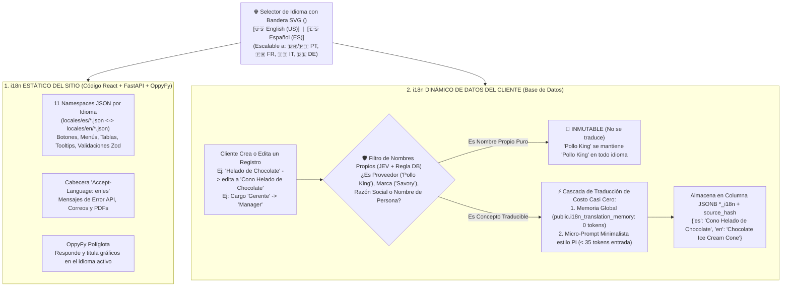

# Estrategia Maestra de Internacionalización (`i18n`) Full-Stack, Traducción Dinámica de Datos del Cliente y Optimización de Tokens con `Pi` (Versión 001)

> **Documento:** `estrategia_internacionalizacion_i18n_multilenguaje_001.md`  
> **Versión:** 001 (Especificación Normativa de Multilenguaje Estático en JSON y Dinámico en Base de Datos, Protección de Nombres Propios, Memoria Global de Traducción, Patrón Minimalista `Pi` y Selector de Banderas SVG)  
> **Base Normativa:**  
> - `MASTER-AGENTIC-ENGINEERING-FRAMEWORK.md`  
> - `propuesta_arquitectura_tree_001.md`  
> - `estrategia_migraciones_alembic_001.md`  
> - `estrategia_rbac_y_auditoria_001.md`  
> - `estrategia_testing_calidad_y_seguridad_001.md`  
> - `estrategia_entornos_y_despliegue_001.md`  
> - `estrategia_orquestacion_git_worktrees_y_smart_merge_001.md`  
> - `estrategia_visualizacion_y_auditoria_archify_001.md`  
> - `estrategia_openspec_negocio_vs_codigo_001.md`  
> - `estrategia_asistente_ai_oppyfy_rag_y_creditos_001.md`  
> - `estrategia_motor_decisiones_jev_system1_001.md`  
> **Propósito:** Establecer la regla inquebrantable de que todo código construido en OppyTec v2.0 nazca 100% internacionalizado (`i18n`), iniciando con **Español (`es` — Bandera de España 🇪🇸)** e **Inglés (`en` — Bandera de Estados Unidos 🇺🇸)** y listo para escalar a **Portugués (`pt`), Francés (`fr`), Italiano (`it`) y Alemán (`de`)**, cubriendo tanto los textos estáticos de la plataforma como la **traducción dinámica inteligente de los datos creados/editados por el cliente** (respetando nombres propios como `"Pollo King"`) con consumo mínimo de tokens estilo **`Pi`**.  
> **Fecha:** Octubre 2026  

---

## 1. Visión General: Los 2 Mundos del `i18n` en OppyTec v2.0

Para que la experiencia multilenguaje sea 100% coherente cuando un usuario selecciona la **Bandera de Estados Unidos (`en`)** o la **Bandera de España (`es`)**, OppyTec v2.0 resuelve simultáneamente **dos capas de traducción**:



---

## 2. Mundo 1: `i18n` Estático del Sitio, Namespaces JSON y Selector de Banderas SVG

### 2.1 Selector Visual de Idioma con Banderas en SVG Vectorial (`<LanguageFlagSelector />`)
1. **Comportamiento Visual Exacto:**
   - Si el selector muestra la **Bandera de Estados Unidos (`US`)** $\to$ Todo el sitio, mensajes y respuestas de `OppyFy` están en **Inglés (`en`)**.
   - Si el selector muestra la **Bandera de España (`ES`)** $\to$ Todo el sitio, mensajes y respuestas de `OppyFy` están en **Español (`es`)**.
   - Preparado en configuración para activar en el futuro: **Portugués (`pt`)**, **Francés (`fr`)**, **Italiano (`it`)** y **Alemán (`de`)**.
2. **Por qué usamos Iconos SVG Nativos y NO Emojis Unicode:**
   - En sistemas Windows 10/11, los navegadores Chromium no renderizan emojis de banderas Unicode (`🇺🇸`/`🇪🇸`), mostrando en su lugar las letras `"US"` y `"ES"`.
   - Por ello, `<LanguageFlagSelector />` utiliza **SVGs vectoriales embebidos** (`FlagUS.tsx`, `FlagES.tsx`, `FlagBR.tsx`, `FlagFR.tsx`, `FlagIT.tsx`, `FlagDE.tsx`), garantizando visualización idéntica en Linux (CachyOS), Windows, macOS, iOS y Android.
3. **Persistencia e Independencia del Selector de Moneda:**
   - El idioma seleccionado se persiste en `localStorage` (para la pantalla de Login) y en `user.preferred_language` en base de datos, y se envía en cada request mediante la cabecera HTTP `Accept-Language`.
   - **Puente con Multi-Moneda:** El selector de idioma es independiente del **Selector de Moneda** (que se especifica en el documento dedicado a Multi-Moneda y Conversión FX), permitiendo por ejemplo ver todo el sitio en **Inglés (`🇺🇸 EN`)** manteniendo los precios en **Pesos Chilenos (`CLP`)** o cambiándolos a **`USD` / `EUR` / `BRL`**.

---

### 2.2 Estructura Modular de Archivos JSON por Namespace (Cero Conflictos de Git)
Para evitar que múltiples agentes en `Git Worktrees` o varios programadores choquen editando un único archivo gigante `es.json` / `en.json`, las traducciones se dividen en **11 Namespaces modulares** (espejo de los módulos de la arquitectura):

```plaintext
oppytec-frontend/src/shared/i18n/
├── config.ts                                   # Inicialización de i18next + detector de idioma
├── i18next.d.ts                                # ★ Tipado estricto TypeScript (falla en tsc si una llave no existe)
├── flags/                                      # Banderas SVG vectoriales (US, ES, PT, FR, IT, DE)
└── locales/
    ├── es/                                     # 🇪🇸 Español (100% paridad de llaves)
    │   ├── common.json                         # Botones globales, estados, fechas, navegación
    │   ├── auth.json                           # Login, OAuth, selector de sucursal
    │   ├── rbac_audit.json                     # Roles, permisos 3-niveles, cupos, auditoría
    │   ├── catalog.json                        # Productos, categorías, familias, unidades, Excel IA
    │   ├── inventory.json                      # Bodegas, áreas, Kardex, conteos, mermas
    │   ├── recipes.json                        # Escandallos, sub-recetas, combos, opciones
    │   ├── procurement.json                    # Compras, proveedores, recepción, facturas
    │   ├── operations.json                     # Consumo, ventas, buffet, eventos, turnos, notas
    │   ├── analytics.json                      # Dashboards, reportes ejecutivos, proyecciones
    │   ├── oppyfy.json                         # Asistente OppyFy, créditos, medidor de contexto %
    │   └── platform_admin.json                 # Administración global OppyTec y vistas FinOps
    └── en/                                     # 🇺🇸 Inglés (Espejo exacto 1:1 de todas las llaves de es/)
        ├── common.json
        ├── auth.json
        ├── rbac_audit.json
        ├── catalog.json
        ├── inventory.json
        ├── recipes.json
        ├── procurement.json
        ├── operations.json
        ├── analytics.json
        ├── oppyfy.json
        └── platform_admin.json
```

En el **Backend (`oppytec-backend/src/core/i18n/locales/{es,en}/errors_and_emails.json`)** existe el espejo correspondiente para mensajes de validación HTTP, notificaciones y plantillas de correo/reportes.

---

## 3. Mundo 2: `i18n` Dinámico de los Datos Creados y Editados por el Cliente

Si el sitio web está en **Inglés (`🇺🇸 EN`)**, sería incoherente que los botones estén en inglés pero el producto creado por el cliente siga diciendo `"Helado de Chocolate"` o el cargo siga diciendo `"Gerente"`.

### 3.1 Matriz de Campos Traducibles vs. Nombres Propios Inmutables (`Pollo King`)
El sistema distingue de forma estricta qué datos del cliente se traducen dinámicamente y cuáles son **Nombres Propios Inmutables**:

| Categoría de Dato del Cliente | Ejemplos Concretos | ¿Se Traduce Automáticamente? | Comportamiento al Crear y al Editar |
|---|---|---|---|
| **1. Conceptos Gastronómicos y Operativos (`Translatable JSONB`)** | • **Producto:** `"Helado de Chocolate"` $\to$ `"Chocolate Ice Cream"`<br/>• **Edición de Producto:** `"Cono Helado de Chocolate"` $\to$ `"Chocolate Ice Cream Cone"`<br/>• **Cargo / Rol:** `"Gerente"` $\to$ `"Manager"`, `"Cajero"` $\to$ `"Cashier"`<br/>• **Categoría / Familia:** `"Postres"` $\to$ `"Desserts"`<br/>• **Bodega / Área:** `"Cocina Caliente"` $\to$ `"Hot Kitchen"`<br/>• **Recetas, Pasos, Grupos de Opciones y Etiquetas** | **✅ SÍ (Creación y Re-sincronización al Editar)** | Cada entidad posee su columna JSONB `i18n_data` + `i18n_source_hash`:<br/>`{"es": "Cono Helado de Chocolate", "en": "Chocolate Ice Cream Cone"}`.<br/>Cuando el cliente edita el texto en cualquiera de sus idiomas activos, el cambio del hash dispara la actualización automática de los demás idiomas habilitados en el Tenant. |
| **2. Nombres Propios, Marcas y Proveedores (`Proper Nouns — Inmutables`)** | • **Proveedor:** `"Pollo King"`, `"Distribuidora El Sol"`<br/>• **Marca Comercial:** `"Savory"`, `"Coca-Cola"`, `"Soprole"`<br/>• **Holding / Razón Social / Nombre Comercial del Local**<br/>• **Nombres y Apellidos de Trabajadores**<br/>• **SKUs, Códigos de Barra, Folios Tributarios** | **🚫 NUNCA SE TRADUCE** | `"Pollo King"` jamás se traduce a `"Pollo Rey"` ni `"Chicken King"`. Sus columnas están marcadas en el modelo como `translatable = False`.<br/>Si un nombre de producto incluye una marca registrada (ej. `"Helado de Chocolate Savory"`), **JEV + el traductor** preservan intacto el nombre propio (`"Chocolate Ice Cream Savory"`). |

---

### 3.2 Cómo Traducimos Datos del Cliente Sin Cobrarle Créditos y con Mínimo Consumo de Tokens (Filosofía `Pi`)

> [!IMPORTANT]
> **REGLA COMERCIAL Y DE UX:**  
> Traducir automáticamente los nombres de productos, categorías, recetas o cargos creados/editados por el cliente **NO descuenta créditos de la billetera de `OppyFy` del cliente (`credits_deducted = 0`)**. Es una función nativa de la plataforma cuyo costo marginal para OppyTec se reduce a prácticamente **$0.00** mediante esta arquitectura de 2 niveles:

#### Nivel 1: Memoria Global de Traducción Gastronómica (`public.i18n_translation_memory` — 0 Tokens, $0 Costo, < 1 ms)
- En la industria de restaurantes y hoteles, más del 85% de los cargos (`"Gerente"`, `"Cajero"`, `"Cocinero"`), categorías (`"Postres"`, `"Carnes"`, `"Bebidas"`), bodegas e insumos (`"Helado de Chocolate"`, `"Cono Helado de Chocolate"`, `"Lomo Vetado"`) se repiten entre distintos clientes.
- Antes de invocar cualquier modelo de IA, el servicio consulta por hash del término normalizado en `public.i18n_translation_memory` (y su caché en Redis):
  - **Si el término ya fue traducido antes en cualquier Tenant:** copia instantáneamente las traducciones en `< 1 ms` con **0 tokens consumidos**.

#### Nivel 2: Micro-Agente Traductor con Contexto Minimalista estilo `Pi` (< 35 Tokens de Entrada)
- Solo cuando el cliente escribe un término completamente inédito que no existe en `public.i18n_translation_memory`:
  1. Se ejecuta de forma asíncrona (*background task*) al crear o editar el registro, para que el guardado en la UI sea instantáneo.
  2. Aplica la filosofía de **contexto mínimo por defecto de `Pi`**: cero historial conversacional, cero definiciones de herramientas innecesarias; envía únicamente un micro-prompt quirúrgico (`< 35 tokens` de entrada) con el texto, las marcas/proveedores asociados que deben preservarse intactos y los idiomas activos del Tenant (`["es", "en"]`).
  3. Guarda el resultado tanto en el registro del cliente como en `public.i18n_translation_memory` para que nunca más vuelva a gastar tokens en ese término.
  4. Registra la operación en `public.llm_request_logs` con `caller_feature = "i18n_auto_translate"` y `credits_deducted = 0` para transparencia contable total en el panel administrativo de OppyTec.

---

### 3.3 Aplicación del Patrón Minimalista de Tokens de Entrada de `Pi` también en `OppyFy`
Siguiendo el mismo principio de eficiencia de **`Pi`** (que minimiza los tokens de entrada por defecto):
- En **`OppyFy`**, el orquestador **jamás** envía un prompt gigante con los 50 esquemas de base de datos ni las 30 definiciones de herramientas en cada mensaje del usuario.
- Primero **JEV (Sistema 1)** selecciona en milisegundos **la única función en código duro** requerida para esa pregunta, y luego el constructor de contexto estilo **Pi** inyecta al modelo únicamente: **(1) Directriz base compacta + Idioma activo (`es`/`en`), (2) El resultado JSON limpio de esa única función, y (3) La pregunta actual**, reduciendo entre un **60% y 80% el consumo de tokens de entrada** en `OppyFy`.

---

## 4. El Sub-Agente `i18n-specialist` y los 3 Candados Deterministas

Para que durante toda la refactorización (y en cualquier módulo nuevo futuro) todo agente cumpla estrictamente la regla de internacionalización y mantenga actualizados los archivos JSON:

1. **Candado 1 — Quality Gate de Paridad Exacta de Archivos JSON (`test_i18n_keys_parity_and_no_hardcoded_strings.py`):**
   - Corre en `< 1 segundo` en el **Fast Gate** (`tests/architecture/`) y verifica mecánicamente:
     - Que todos los archivos en `locales/es/*.json` y `locales/en/*.json` (y cualquier idioma futuro) tengan **exactamente el mismo conjunto de llaves anidadas**.
     - Que ningún valor esté vacío (`""`) ni contenga marcadores pendientes (`"TODO"`, `"TRANSLATE"`).
     - Que los placeholders de variables coincidan al 100% entre idiomas (ej. si en `es` existe `{{productName}}`, en `en` debe existir exactamente `{{productName}}`).
2. **Candado 2 — Prohibición AST/ESLint de Textos Quemados en UI y API:**
   - Falla el linter/test si un componente React contiene texto visible para el usuario fuera de `t("namespace:key")` o si un endpoint FastAPI devuelve mensajes de error sin su código `i18n_key`.
3. **Candado 3 — Sub-Agente Especialista (`.agent/subagents/i18n-specialist.md`) + Skill Ejecutable (`.agent/skills/i18n_manager/`):**
   - Incluye la utilidad `i18n_tool.py` protegida con candado atómico `fcntl.flock` para que los agentes en distintos `Git Worktrees` agreguen nuevas llaves simultáneamente en `es/*.json` y `en/*.json` sin corromper ni pisar el JSON.

---

## 5. Artefactos a Construir en el Proyecto (Nombres y Ubicaciones)

| # | Artefacto | Ruta Exacta en el Proyecto | Propósito |
|---|---|---|---|
| **1** | **ADR de Internacionalización (`i18n`)** | `docs/adr/ADR-014-fullstack-i18n-dynamic-data-translation-and-pi-minimalism.md` | Congela la arquitectura de 11 namespaces JSON, traducción dinámica de datos del cliente, protección de nombres propios (`Pollo King`) y memoria global de traducción. |
| **2** | **Regla Agéntica Inmutable** | `.agent/rules/15-i18n-multilanguage-and-dynamic-translation.md` | Obliga a todo agente a usar llaves `i18n` en el 100% del código, actualizar los JSON en cada paso y usar columnas `*_i18n` en entidades editables por el cliente. |
| **3** | **Skill Ejecutable `i18n_manager`** | `.agent/skills/i18n_manager/` (`SKILL.md`, `__init__.py`, `i18n_tool.py`) | Herramienta en Python con lock atómico (`fcntl.flock`) para insertar/actualizar llaves en todos los idiomas y verificar paridad. |
| **4** | **Sub-Agente Especialista `i18n`** | `.agent/subagents/i18n-specialist.md` | Blueprint del sub-agente dedicado a mantener al día los diccionarios JSON y auditar traducciones. |
| **5** | **Motor `i18n` y Traductor Dinámico Backend** | `oppytec-backend/src/core/i18n/` (`translator.py`, `dynamic_field_sync.py`, `locales/{es,en}/`) | Gestiona `Accept-Language`, la memoria global `public.i18n_translation_memory`, el filtro de nombres propios y el micro-prompt estilo `Pi`. |
| **6** | **Motor `i18n` y Selector de Banderas Frontend** | `oppytec-frontend/src/shared/i18n/` + `LanguageFlagSelector.tsx` | Configuración `react-i18next` tipada, banderas SVG (`US`, `ES` y futuros idiomas) y los 11 archivos JSON por idioma. |
| **7** | **Quality Gate Determinista `i18n`** | `oppytec-backend/tests/architecture/test_i18n_keys_parity_and_no_hardcoded_strings.py` | Bloquea cualquier commit si falta una llave en `es` o `en`, si no coinciden las variables `{{var}}` o si hay strings quemados sin `i18n`. |
