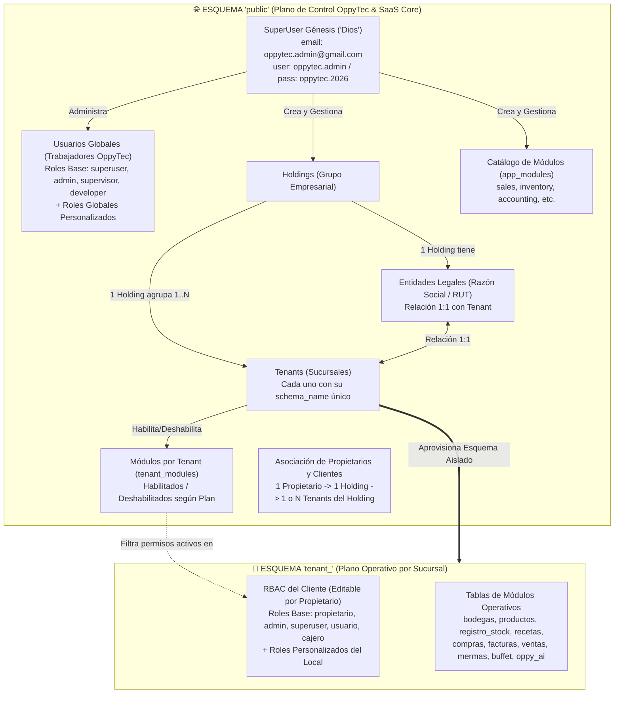

# Estrategia Maestra de Migraciones Alembic, Esquemas Multi-Tenant y RBAC Dual (Versión 001)

> **Documento:** `estrategia_migraciones_alembic_001.md`  
> **Versión:** 001 (Especificación de Diseño y Gobernanza Pre-Refactorización)  
> **Base Normativa:** `MASTER-AGENTIC-ENGINEERING-FRAMEWORK.md`, `propuesta_arquitectura_tree_001.md` y `specs/05-DATABASE-SCHEMA.md`  
> **Propósito:** Documentar el diagnóstico del caos de migraciones en `OppyTec-Legacy` y establecer la arquitectura definitiva de migraciones correlativas (`0001..NNNN`), separación `public` vs `tenant_*`, trabajo multi-programador sin conflictos y su integración con la jerarquía de Holdings, Módulos y RBAC Dual.  
> **Fecha:** Octubre 2026  

---

## 1. Diagnóstico y Autopsia de `OppyTec-Legacy`

Al auditar `OppyTec-Legacy/OppyTec_Backend/alembic/` y el sistema de inicialización (`src/authorization/system_seeder.py`, `src/database.py`), se identificaron **4 problemas estructurales** que degradaron la mantenibilidad del proyecto original:

### 1.1 Ruptura del Orden Correlativo y Mezcla de 3 Formatos de Nomenclatura
- **Inicio correlativo (`0001` a `0036`):** Al principio, las migraciones tenían un orden secuencial claro para los desarrolladores (`0001_initial...`, `0002_ajustes...`).
- **Paso a hashes aleatorios sin plantilla (`file_template` comentado en `alembic.ini`):** Para evitar colisiones de nombres en `git merge` cuando varios programadores trabajaban en paralelo, se pasó a usar hashes hexadecimales aleatorios (`28c60834205a`, `6092c7824ebf`, `cf96f3a10d7f`).
- **Hashes inventados y regreso caótico a correlativos (`0038`, `0039`):** Posteriormente se crearon hashes secuenciales artificiales (`a1b2c3d4e5f6`, `b2c3d4e5f6a7`, `c3d4e5f6a7b8`) y más tarde se volvió a nombrar archivos como `0038_add_voice_command_to_users.py` y `0039_add_tenant_documents_and_chunks.py`.
- **Consecuencia:** Al listar el directorio `alembic/versions/`, el orden visual no tiene ninguna relación con el orden cronológico real. Por ejemplo, `0039` aparece al principio de la carpeta, pero su padre real (`down_revision = 'e2f3a4b5c6d7'`) aparece casi al final del listado alfabético.

### 1.2 El Falso Alivio del Hash Aleatorio: Bifurcación de Ramas (`Multiple Heads`)
Cambiar de números correlativos (`0003`) a hashes aleatorios (`93d225ca93ab` y `c1c99815967c`) **no evitó los conflictos de migración**, solo los ocultó durante el `git merge`:
- Aunque Git no marcaba conflicto de archivo porque ambos tenían nombres distintos, **ambas migraciones apuntaban al mismo `down_revision` padre**.
- Esto rompía el grafo dirigido (DAG) de Alembic generando el error `Multiple head revisions are present`, lo que obligó al equipo a crear múltiples migraciones parche vacías o de reparación:
  - `e129a7c03f31_merge_migrations.py`
  - `6d39f9f7b07f_merge_multi_tenant_features_with_.py`
  - `e9f8a7b6c5d4_merge_heads.py`
  - `f0d1e1bdadd6_add_missing_columns_after_merge.py` (evidencia directa de pérdida de columnas tras un merge de heads).

### 1.3 Mezcla de `public` y `tenant_*` en el Motor `alembic/env.py`
En `OppyTec-Legacy/OppyTec_Backend/alembic/env.py`:
- Se iteraba sobre todos los esquemas de inquilinos activos (`for schema in schemas:`) ejecutando **el mismo conjunto de migraciones** sin distinguir cuáles tablas eran del esquema global `public` y cuáles eran operativas del `tenant_*`.
- Si una migración creaba o alteraba una tabla en `public` (ej. `public.holdings` o `public.system_plans`), se ejecutaba repetidamente por cada restaurante activo, obligando a usar parches defensivos en SQL crudo (`ALTER TABLE ... ADD COLUMN IF NOT EXISTS`) e incluso dejando valores quemados en `env.py` (`INSERT INTO alembic_version VALUES ('b6e913e7675e')`).

### 1.4 Crisis de Identidad en Usuarios y RBAC entre `public` y `tenant_*`
En Legacy existía `public.global_users` pero al mismo tiempo `users`, `roles` y `permissions` estaban atados al metadata de los inquilinos (`tenant_metadata`). Como consecuencia, `system_seeder.py` tenía que recorrer todos los esquemas de los clientes e insertar copias del SuperUser de OppyTec dentro de la tabla `users` de cada restaurante.

---

## 2. Contexto de Dominio Rector: Esquemas, Usuarios, Módulos y RBAC Dual

Para que las migraciones de Alembic en **OppyTec v2.0** sean limpias, predecibles y escalables, la arquitectura de base de datos se fundamenta en la siguiente regla de negocio:



### 2.1 Reglas Fundacionales de Identidad, Tenancy y RBAC

1. **SuperUser Génesis ("Dios") — Inyectado estrictamente vía Variables de Entorno (Cero Hardcoding):**
   - Al inicializar el sistema por primera vez (semilla determinista sobre `public` en `src/core/bootstrap.py`), se crea el primer SuperUser global leyendo sus valores **exclusivamente desde `.env` o el Secret Manager en la nube** a través de `src/core/config.py` (con `SecretStr`, **jamás hardcodeados en el código fuente**):
     - `SUPERUSER_GENESIS_EMAIL` (ej. en entorno inicial: `oppytec.admin@gmail.com`)
     - `SUPERUSER_GENESIS_USERNAME` (ej. en entorno inicial: `oppytec.admin`)
     - `SUPERUSER_GENESIS_PASSWORD` (ej. en entorno inicial: `oppytec.2026`, almacenada en base de datos únicamente como hash Argon2id).
   - No es necesariamente el único `superuser` que existirá, pero sí el **primero**, con acceso total a la Administración del Sistema de OppyTec en el esquema `public`.

2. **Dos Universos de Usuarios y Roles (Separación `public` vs `tenant_*`):**
   - **2.1 Usuarios Globales (Trabajadores de OppyTec — Operan en `public`):**
     - Sus cuentas, sesiones y roles administrativos viven exclusivamente en `public`.
     - **Roles Globales Base:** `superuser`, `admin`, `supervisor`, `developer`.
     - **Extensibilidad:** El SuperUser puede crear **todos los roles globales adicionales que desee** y asignarles permisos sobre la administración del SaaS.
   - **2.2 Usuarios Clientes (Clientes de OppyTec — Operan en `tenant_*` y nivel `Holding`):**
     - **Propietario:** Está asociado a **1 Holding**, y dentro de ese mismo Holding puede estar asociado a **1 o varios Tenants**.
     - Un `propietario` puede crear a otros usuarios clientes (incluyendo crear a otro `propietario`) y **puede crear todos los roles personalizados que quiera** dentro de su negocio.
     - **Roles Cliente Base (Editables):**
       - `propietario`
       - `admin`
       - `superuser` (a nivel cliente/sucursal)
       - `usuario`
       - `cajero`

3. **Reglas de Cardinalidad de la Jerarquía Corporativa (Creada por el SuperUser):**
   - El SuperUser crea: **Holdings**, **Entidades Legales**, **Tenants** y **Módulos** (`sales`, `inventory`, `accounting`, etc.).
   - **Holding $\leftrightarrow$ Entidad Legal $\leftrightarrow$ Tenant:**
     - `1 Holding` tiene `1 Entidad Legal` (o las entidades legales asociadas a sus locales).
     - `1 Holding` puede tener **varios Tenants**, pero `1 Tenant` pertenece exactamente a **1 Holding**.
     - `1 Tenant` tiene **1 Entidad Legal** y `1 Entidad Legal` tiene **1 Tenant** (relación `1:1` estricta a nivel de base de datos mediante restricción `UNIQUE` en `tenants.legal_entity_id`).
     - Cada `Tenant` posee su propio `schema_name` único en PostgreSQL (ej. `tenant_pacifico_centro`), garantizando aislamiento físico de sus datos operativos.

4. **Modularización Dinámica por Plan vs. Homogeneidad de Esquemas DDL:**
   - Cada `Tenant` tiene módulos contratados en `public.tenant_modules` (`enabled = true | false` según su plan: `sales`, `inventory`, `accounting`, etc.).
   - **Principio Arquitectónico Clave para Alembic:**
     - **A nivel físico (DDL / Migraciones):** Todos los esquemas `tenant_*` tienen **exactamente la misma versión de migración y las mismas tablas creadas**. Nunca se deja un esquema de tenant con tablas "a medias" según su plan, porque eso rompería las llaves foráneas y haría imposible correr migraciones lineales cuando el cliente decida mejorar su plan.
     - **A nivel lógico (Aplicación / RBAC):** Que un módulo (`accounting`, `sales`, `inventory`) esté habilitado o deshabilitado se controla en tiempo real cruzando `public.tenant_modules` con el middleware RBAC. Si el SuperUser habilita `accounting` para un Tenant, el módulo funciona en el acto sin ejecutar migraciones en caliente.

---

## 3. Las 3 Propuestas Nucleares + 4 Salvaguardas para Alembic en OppyTec v2.0

### Propuesta 1: Nomenclatura Correlativa Estricta de 4 Dígitos (`0001_`, `0002_`...) con Alcance Explícito
Se prohíben los hashes hexadecimales aleatorios. Toda migración en `oppytec-backend/alembic/versions/` sigue el patrón determinista:

```plaintext
NNNN_<scope>_<descripcion_snake_case>.py
```

Donde:
- `NNNN`: Número correlativo de 4 dígitos con ceros a la izquierda (`0001`, `0002`, `0003`, ...).
- `<scope>`: Obligatoriamente **`public`** o **`tenant`**:
  - `public`: Altera tablas de `PublicBase` (Holdings, Entidades Legales, Tenants, Módulos, Usuarios/Roles Globales de trabajadores de OppyTec).
  - `tenant`: Altera tablas de `TenantBase` (RBAC del cliente, Inventario, Ventas, Contabilidad, Recetas, etc.).
- `<descripcion_snake_case>`: Resumen claro en minúsculas (máximo 45 caracteres).
- **Dentro del archivo Python:**
  - `revision: str = "NNNN"` (exactamente los 4 dígitos, ej. `"0003"`).
  - `down_revision: str | None = "NNNN-1"` (exactamente el número anterior, ej. `"0002"`).

**Ejemplo de cómo se verá siempre la carpeta `oppytec-backend/alembic/versions/`:**
```plaintext
oppytec-backend/alembic/versions/
├── 0001_public_genesis_tenancy_modules_and_global_rbac.py
├── 0002_tenant_initial_client_rbac_and_core_modules.py
├── 0003_tenant_add_accounting_cost_centers.py
├── 0004_public_add_holding_billing_webhooks.py
└── 0005_tenant_add_cashier_shift_audit_fields.py
```

---

### Propuesta 2: Protocolo de Trabajo Multi-Programador sin Conflictos ("Cero `merge_heads`")
¿Cómo mantenemos números correlativos (`0001`, `0002`...) cuando **2 o más programadores (o agentes)** trabajan al mismo tiempo en ramas distintas?

#### Regla Inquebrantable: Historial 100% Lineal (Single-Head Policy)
1. **Prohibido ejecutar `alembic merge heads`:** Nunca existirán archivos `merge_migrations.py`.
2. **Una Feature = Una Migración al Cierre:** Durante el desarrollo en su rama local, el programador no acumula 4 micro-migraciones de prueba; antes de abrir su Pull Request consolida su cambio en una única migración correlativa.
3. **Resolución Automática de Colisión mediante `db_migration.py rebase`:**
   - Supongamos que en `main` la última migración es `0003`.
   - **Programador A** crea `0004_tenant_add_mermas.py` (`down_revision = "0003"`) y fusiona a `main`.
   - **Programador B** en su rama paralela también había creado `0004_public_add_audit_log.py` (`down_revision = "0003"`).
   - Cuando el **Programador B** hace `git pull --rebase origin main` (o cuando el CI valida su PR):
     - El test determinista detecta que hay dos archivos `0004_*` (dos heads apuntando a `0003`).
     - El **Programador B** ejecuta un único comando:
       ```bash
       make migration-rebase
       ```
     - El script toma la migración de la rama de B (`0004_public_add_audit_log.py`), la renombra automáticamente a `0005_public_add_audit_log.py`, actualiza `revision = "0005"` y cambia `down_revision = "0004"`.
   - **Resultado:** El historial en `main` queda `0001 -> 0002 -> 0003 -> 0004 -> 0005`, limpio, lineal y sin conflictos manuales.

---

### Propuesta 3: Ejecución Consciente de Esquema (`public` vs `tenant_*`) en `alembic/env.py`
Para eliminar el defecto de Legacy donde las migraciones de `public` se ejecutaban N veces dentro del bucle de inquilinos:
- Cada migración declara en su cabecera una constante explícita:
  ```python
  migration_scope: Literal["public", "tenant"] = "public"  # o "tenant"
  ```
- **Comportamiento del nuevo `alembic/env.py`:**
  - Mantiene la tabla de control `alembic_version` tanto en `public` como en cada `tenant_*`, pero cuando ejecuta la cadena `0001 -> NNNN`:
    - Si `schema == "public"`: ejecuta las operaciones DDL de las migraciones con `migration_scope == "public"` y avanza el puntero de versión en `public.alembic_version`.
    - Si `schema == "tenant_*"`: ejecuta las operaciones DDL de las migraciones con `migration_scope == "tenant"` (con `SET LOCAL search_path TO "tenant_x"`) y avanza el puntero de versión en `tenant_x.alembic_version`.
- **Aprovisionamiento instantáneo de nuevos Tenants creados por el SuperUser:**
  - Cuando el SuperUser crea un nuevo Tenant en la plataforma, el servicio de aprovisionamiento:
    1. Ejecuta `CREATE SCHEMA "tenant_nuevo"`.
    2. Crea las tablas vigentes de `TenantBase.metadata` en `"tenant_nuevo"`.
    3. Estampa en `"tenant_nuevo".alembic_version` el número `NNNN` actual (Head).
    4. Siembra los 5 roles cliente base editables (`propietario`, `admin`, `superuser`, `usuario`, `cajero`) y vincula al `Propietario` del Holding.

---

### Las 4 Salvaguardas Adicionales Integradas
1. **Gran Squash Fundacional (`0001` y `0002`):** No arrastramos los 75 archivos históricos de Legacy. Partimos en v2.0 con `0001_public_...` y `0002_tenant_...` limpios.
2. **Reversibilidad Obligatoria (*Stairway Test*):** Toda migración debe implementar su `downgrade()` real. Está prohibido dejar `def downgrade(): pass`.
3. **Detección de Drift (`alembic check`):** El CI verifica que ningún desarrollador haya modificado un modelo SQLAlchemy sin reflejarlo en su migración correspondiente.
4. **Sembrado Separado de Migraciones:** Las migraciones (`alembic/versions/`) solo definen estructura (DDL) y catálogos inmutables si aplica; la creación del SuperUser Génesis (`oppytec.admin@gmail.com`) y los roles iniciales se ejecuta mediante un **Bootstrapper Idempotente** (`src/core/bootstrap.py`) tras `alembic upgrade head`.

---

## 4. Mapa de Artefactos a Construir (Nombres, Ubicaciones y Especificación)

Cuando pasemos del modo lectura/análisis al modo construcción (Fases 0, 1 y 2), esta estrategia se materializará en **6 archivos concretos** dentro de nuestra arquitectura:

| # | Tipo de Artefacto | Ruta Exacta en el Proyecto | Propósito |
|---|---|---|---|
| **1** | **ADR (Decisión de Arquitectura)** | `docs/adr/ADR-005-linear-correlative-alembic-migrations.md` | Documenta por qué se prohíben los hashes aleatorios y `merge_heads`, y cómo opera el alcance `public` vs `tenant`. |
| **2** | **Specs Bipartitos (OpenSpec)** | `specs/business-domain/tenancy-and-plans.business.spec.md` + `specs/engineering-code/tenancy-rbac-and-migrations.code.spec.md` | Contrato de negocio (Holdings, Planes, Sucursales) y contrato técnico (SuperUser Génesis, ciclo de vida de esquemas y Alembic). |
| **3** | **Regla Agéntica Inmutable** | `.agent/rules/06-alembic-and-schema-governance.md` | Restricciones obligatorias para cualquier Agente de IA o desarrollador antes de tocar modelos o migraciones. |
| **4** | **Skill + Script CLI** | `.agent/skills/alembic-migration-manager/SKILL.md` + `oppytec-backend/scripts/db_migration.py` | Herramienta automatizada para crear migraciones correlativas (`new`), renumerar en caso de ramas paralelas (`rebase`) y verificar estado (`verify`). |
| **5** | **Motor Alembic Multi-Schema** | `oppytec-backend/alembic/env.py` + `oppytec-backend/alembic/script.py.mako` | Plantilla y ejecutor que respetan `migration_scope` (`public` vs `tenant`) sin repetir DDL global en cada sucursal. |
| **6** | **Quality Gate Determinista** | `oppytec-backend/tests/architecture/test_alembic_integrity.py` | Test automático que bloquea cualquier PR si hay más de 1 Head, si un archivo no es `NNNN_<scope>_<slug>.py`, si falta `downgrade()` o si hay números repetidos/saltados. |

---

## 5. Especificación Detallada de cada Artefacto (Listos para Construir)

A continuación se deja el diseño exacto de cada uno de los artefactos para que su implementación futura sea directa y libre de ambigüedades:

### 5.1 Regla Agéntica: `.agent/rules/06-alembic-and-schema-governance.md`

```markdown
# Regla 06: Gobernanza de Esquemas PostgreSQL, RBAC Dual y Migraciones Alembic

## 1. Separación Estricta de Metadatos (`PublicBase` vs `TenantBase`)
- Todo modelo que pertenezca a la administración de OppyTec (Usuarios Globales, Roles Globales, Holdings, Entidades Legales, Tenants, Planes, Catálogo de Módulos y Suscripciones `tenant_modules`) DEBE heredar de `PublicBase` (`schema="public"`).
- Todo modelo que pertenezca a la operación de una sucursal cliente (RBAC del local, Bodegas, Productos, Stock, Recetas, Compras, Facturas, Ventas, Mermas, Buffet, Oppy AI) DEBE heredar de `TenantBase` (esquema dinámico vía `SET LOCAL search_path`).
- **PROHIBIDO** duplicar cuentas de trabajadores globales de OppyTec dentro de los esquemas `tenant_*`.

## 2. Reglas Inquebrantables de Migraciones Alembic
1. **Nomenclatura Correlativa Obligatoria:**
   - Formato único permitido: `NNNN_<scope>_<slug>.py` donde `NNNN` es un entero de 4 dígitos (`0001`, `0002`...) y `<scope>` es `public` o `tenant`.
   - **PROHIBIDO** usar hashes hexadecimales aleatorios de Alembic (`e129a7c03f31`).
2. **Historial 100% Lineal (Single-Head):**
   - **PROHIBIDO** ejecutar `alembic merge heads` o crear migraciones con `down_revision` tipo tupla `('0003', '0004')`.
   - Si tu rama colisiona en el número `NNNN` tras actualizar `main`, ejecuta `python scripts/db_migration.py rebase` para renumerar tu migración a `NNNN+1`.
3. **Creación mediante Herramienta Oficial:**
   - Nunca crees archivos manualmente en `alembic/versions/`. Usa siempre:
     `python scripts/db_migration.py new --scope [public|tenant] -m "descripcion_corta"`
4. **Reversibilidad Real (`downgrade`):**
   - Toda migración debe implementar su función `downgrade()` simétrica. Está prohibido usar `pass` en `downgrade()`.
```

---

### 5.2 Skill y Script Automatizado: `oppytec-backend/scripts/db_migration.py`
*(Referenciado por `.agent/skills/alembic-migration-manager/SKILL.md` y por el `Makefile`)*

Este script resuelve el trabajo en equipo entre varios programadores con 3 subcomandos:
1. **`python scripts/db_migration.py new --scope [public|tenant] -m "mensaje"`**
   - Escanea `oppytec-backend/alembic/versions/`, encuentra el número más alto `MAX_N` (ej. `0004`), calcula `NEXT_N = "0005"`, sanitiza el `slug` y genera `0005_<scope>_<slug>.py` con `revision = "0005"`, `down_revision = "0004"` y `migration_scope = "<scope>"`.
2. **`python scripts/db_migration.py rebase`**
   - Si tras hacer `git fetch origin main` existen dos migraciones con el mismo número (ej. `0004_public_a.py` de `main` y `0004_tenant_b.py` de tu rama actual):
     - Identifica cuál archivo fue creado en la rama local (vía `git diff --name-only origin/main...HEAD -- alembic/versions/`).
     - Lo renumera secuencialmente después del último número de `origin/main` (`0005_tenant_b.py`), reescribe internamente `revision = "0005"` y `down_revision = "0004"`.
3. **`python scripts/db_migration.py verify`**
   - Verifica en milisegundos que toda la cadena `0001..NNNN` sea continua, sin colisiones, con un único Head.
4. **`python scripts/db_migration.py impact --model <ModelName>` (Integración con `Graphify` — Ahorro de Tokens):**
   - Antes de generar una migración que altere o elimine columnas de un modelo en `PublicBase` o `TenantBase`, consulta programáticamente `.agent/skills/graphify/graph_navigator.py` (`v2_graph` y `legacy_graph`) para listar todos los repositorios, servicios, esquemas Pydantic y vistas de Frontend que tienen aristas dirigidas hacia ese modelo, evitando lecturas masivas de archivos y previniendo roturas aguas arriba.

---

### 5.3 Quality Gate Determinista: `oppytec-backend/tests/architecture/test_alembic_integrity.py`

Este test se ejecutará en cada commit y Pull Request para garantizar que jamás se repita el desorden de `OppyTec-Legacy`:

```python
import ast
import re
from pathlib import Path
from alembic.config import Config
from alembic.script import ScriptDirectory

FILENAME_PATTERN = re.compile(r"^(\d{4})_(public|tenant)_([a-z0-9_]+)\.py$")

def test_alembic_correlative_linear_integrity() -> None:
    """
    Garantiza mecánicamente:
    1. Cero hashes aleatorios: todos los archivos cumplen NNNN_(public|tenant)_slug.py
    2. Cero colisiones: números estrictamente consecutivos 0001, 0002, ..., NNNN
    3. Cero merge_heads: existe exactamente 1 Head en Alembic y ningún down_revision es tupla
    4. Coherencia interna: revision == NNNN, down_revision == NNNN-1 y migration_scope == scope
    5. Reversibilidad: ninguna función downgrade() está vacía (pass)
    """
    backend_root = Path(__file__).resolve().parents[2]
    versions_dir = backend_root / "alembic" / "versions"
    migration_files = sorted(f for f in versions_dir.glob("*.py") if f.name != "__init__.py")

    assert migration_files, "Debe existir al menos la migración 0001 en alembic/versions/"

    expected_num = 1
    prev_rev_id: str | None = None

    for file_path in migration_files:
        match = FILENAME_PATTERN.match(file_path.name)
        assert match is not None, (
            f"Archivo de migración inválido '{file_path.name}'. "
            "Formato obligatorio: NNNN_(public|tenant)_descripcion.py (ej. 0003_tenant_add_mermas.py)"
        )

        num_str, scope, _ = match.groups()
        current_num = int(num_str)
        assert current_num == expected_num, (
            f"Secuencia correlativa rota en '{file_path.name}': "
            f"se esperaba {expected_num:04d} pero se encontró {current_num:04d}. "
            "Si hiciste merge con otra rama, ejecuta: make migration-rebase"
        )

        # Inspección AST del archivo para verificar revision, down_revision y downgrade()
        tree = ast.parse(file_path.read_text(encoding="utf-8"), filename=str(file_path))
        assignments: dict[str, object] = {}
        downgrade_non_empty = False

        for node in tree.body:
            if isinstance(node, ast.Assign):
                for target in node.targets:
                    if isinstance(target, ast.Name) and isinstance(node.value, ast.Constant):
                        assignments[target.id] = node.value.value
            elif isinstance(node, ast.AnnAssign) and isinstance(node.target, ast.Name):
                if node.value and isinstance(node.value, ast.Constant):
                    assignments[node.target.id] = node.value.value
            elif isinstance(node, ast.FunctionDef) and node.name == "downgrade":
                # Verificar que downgrade() no sea solo docstring + pass
                executable_stmts = [
                    stmt for stmt in node.body
                    if not isinstance(stmt, ast.Pass)
                    and not (isinstance(stmt, ast.Expr) and isinstance(stmt.value, ast.Constant))
                ]
                downgrade_non_empty = len(executable_stmts) > 0

        assert assignments.get("revision") == num_str, (
            f"En '{file_path.name}', revision debe ser '{num_str}', encontrado: {assignments.get('revision')}"
        )
        assert assignments.get("down_revision") == prev_rev_id, (
            f"En '{file_path.name}', down_revision debe ser {prev_rev_id!r}, encontrado: {assignments.get('down_revision')!r}"
        )
        assert assignments.get("migration_scope") == scope, (
            f"En '{file_path.name}', migration_scope debe ser '{scope}'"
        )
        assert downgrade_non_empty, (
            f"En '{file_path.name}', la función downgrade() está vacía. Toda migración debe ser reversible."
        )

        prev_rev_id = num_str
        expected_num += 1

    # Verificación adicional con el motor de Alembic: exactamente 1 Head
    alembic_cfg = Config(str(backend_root / "alembic.ini"))
    alembic_cfg.set_main_option("script_location", str(backend_root / "alembic"))
    script_dir = ScriptDirectory.from_config(alembic_cfg)
    heads = script_dir.get_heads()
    assert len(heads) == 1, f"Se detectaron múltiples heads en Alembic ({heads}). Ejecuta: make migration-rebase"
```

---

### 5.4 Contrato de Bootstrap Génesis (`specs/engineering-code/tenancy-rbac-and-migrations.code.spec.md`)

Define cómo se inicializa el sistema en limpio apenas terminan de correr las migraciones `0001_public_...` y `0002_tenant_...`:

1. **Paso 1 — Migración `0001_public_genesis_tenancy_modules_and_global_rbac.py`:**
   - Crea en `public`:
     - `global_users`, `global_roles`, `global_permissions`, `global_role_permissions`, `global_user_roles`, `global_audit_rbac_changes`, `global_audit_activity_log`.
     - `holdings`, `legal_entities` (con FK a `holdings`), `tenants` (con FK `UNIQUE` 1:1 a `legal_entities`, FK a `holdings`, `schema_name UNIQUE` y `base_currency`).
     - `app_modules` (`sales`, `inventory`, `accounting`, etc.), `system_plans` (con `max_active_users`, `max_storage_mb` y precios multi-moneda), `tenant_modules` (estado habilitado/deshabilitado por tenant).
     - `client_users` y `client_user_tenant_access` (asocia a los Propietarios y trabajadores con acceso transversal a 1 Holding y a 1 o N Tenants dentro del mismo Holding).
     - Tablas transversales del ecosistema v2.0: `llm_request_logs`, `audio_request_logs`, `ai_model_configs`, `ai_credit_packages`, `spec_sync_metadata`, `spec_chunks` (`pgvector` HNSW, solo `specs/business-domain/`), `i18n_translation_memory`, `fx_current_rates`, `fx_rate_history`, `fx_audit_log` y `backup_execution_logs`.

2. **Paso 2 — Migración `0002_tenant_initial_client_rbac_and_core_modules.py`:**
   - Crea en cada esquema `tenant_*`:
     - `roles` (con `name_i18n`), `permissions`, `role_permissions`, `user_tenant_roles`, `user_permission_grants`, `audit_rbac_changes`, `audit_activity_log`.
     - Gobernanza exclusiva de **`OppyFy`** y Almacenamiento: `oppyfy_domains`, `oppyfy_subdomains`, `oppyfy_permission_grants`, `oppyfy_worker_credit_wallets`, `oppyfy_prompt_audit_log`, `tenant_documents`, `document_chunks`, `tenant_ai_memories` y `tenant_media_assets` (control de cuota MB en R2).
     - Tablas operativas de los módulos con soporte `*_i18n` JSONB (`bodegas`, `productos`, `producto_bodegas`, `registro_stock`, `recetas`, `compras`, `facturas`, `ventas`, `mermas`, `buffet`, etc.).

3. **Paso 2.5 — Snapshot Automático Pre-Migración (`estrategia_respaldos_base_datos_y_recuperacion_001.md`):**
   - En `staging` y `production`, antes de aplicar cualquier nueva migración `0003..NNNN`, el motor invoca automáticamente `python scripts/backup_manager.py pre-migration-snapshot` (creando rama PITR en Neon y respaldo cifrado `.sql.zst.age` en R2).

3. **Paso 3 — Bootstrapper Idempotente (`src/core/bootstrap.py`):**
   - En `public`:
     - Siembra los **Roles Globales Base** de los trabajadores de OppyTec: `superuser`, `admin`, `supervisor`, `developer`.
     - Siembra el **Catálogo Maestro de Módulos** (`sales`, `inventory`, `accounting`, `recipes`, `purchases`, `analytics`, `oppy_ai`, etc.).
     - Crea el **SuperUser Génesis ("Dios")** si no existe, inyectando sus credenciales desde variables de entorno validadas (`settings.SUPERUSER_GENESIS_EMAIL`, `settings.SUPERUSER_GENESIS_USERNAME`, `settings.SUPERUSER_GENESIS_PASSWORD.get_secret_value()`, **cero hardcoding en código**):
       - Valor en `.env` inicial: `oppytec.admin@gmail.com` / `oppytec.admin` / `oppytec.2026` (hasheada con Argon2id)
       - Rol asignado: `superuser` en `public`.
   - En cada `tenant_*` aprovisionado:
     - Siembra los **Roles Cliente Base Editables**:
       - `propietario`
       - `admin`
       - `superuser`
       - `usuario`
       - `cajero`
     - Permite que el `propietario` cree nuevos propietarios, edite los roles base o cree todos los roles personalizados que requiera su operación.
