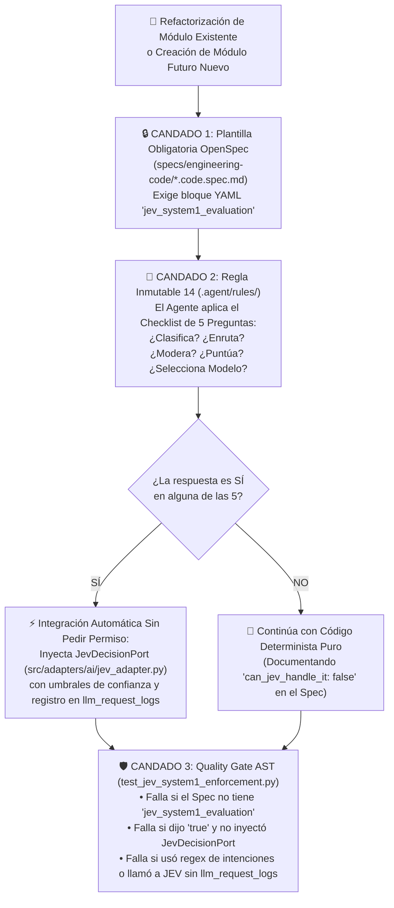
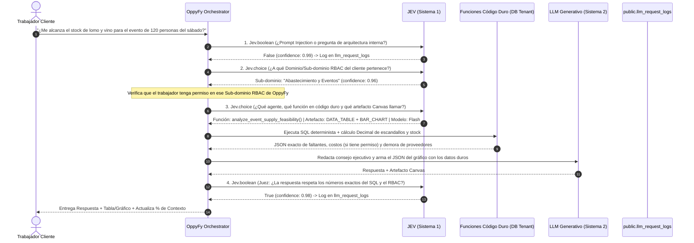

# Estrategia Maestra del Motor de Decisiones `JEV` (Sistema 1): Evaluación Autónoma Obligatoria, Enrutamiento y Telemetría Global (Versión 001)

> **Documento:** `estrategia_motor_decisiones_jev_system1_001.md`  
> **Versión:** 001 (Especificación Normativa del Modelo *Sistema 1* `JEV`, Regla Autónoma "¿Lo puede hacer JEV: Sí/No?", Clasificación Tipada, Enrutamiento de `OppyFy`, Importador Excel IA y Registro en `llm_request_logs`)  
> **Base Normativa:**  
> - `MASTER-AGENTIC-ENGINEERING-FRAMEWORK.md`  
> - `propuesta_arquitectura_tree_001.md`  
> - `estrategia_migraciones_alembic_001.md`  
> - `estrategia_rbac_y_auditoria_001.md`  
> - `estrategia_testing_calidad_y_seguridad_001.md`  
> - `estrategia_entornos_y_despliegue_001.md`  
> - `estrategia_orquestacion_git_worktrees_y_smart_merge_001.md`  
> - `estrategia_visualizacion_y_auditoria_archify_001.md`  
> - `estrategia_openspec_negocio_vs_codigo_001.md`  
> - `estrategia_asistente_ai_oppyfy_rag_y_creditos_001.md`  
> **Propósito:** Establecer a **`JEV` (TypeSafe AI — Modelo de Decisión y Control *Sistema 1*)** como el motor transversal de decisiones estructuradas (`Boolean/Noul`, `Choice`, `Score`) en todo OppyTec v2.0, implantando **4 candados automáticos** para que todo agente de IA evalúe por sí mismo en cada funcionalidad presente o futura: *"¿Esta tarea la puede realizar JEV de manera eficiente y eficaz (Sí/No)?"* y, de ser afirmativo, lo integre automáticamente y registre su consumo en `public.llm_request_logs`.  
> **Fecha:** Octubre 2026  

---

## 1. Diagnóstico de `OppyTec-Legacy`: Por qué Faltaba un Motor "Sistema 1"

Al auditar `OppyTec-Legacy` (`src/ai_management/semantic_orchestrator.py`, `src/ai_management/operational_tools.py`, `src/security/ai_guardrails.py` y `docs/specs/IMPORTADOR_EXCEL_SPEC.md`), se identificaron dos extremos ineficientes al tomar decisiones en el software:

1. **Extremo 1 — Expresiones Regulares y Listas de Palabras Fijas Frágiles:**
   - En `semantic_orchestrator.py` y `operational_tools.py`, la detección de qué agente o función de base de datos llamar dependía de diccionarios estáticos (`INTENT_KEYWORDS`). Si el cliente formulaba su pregunta con sinónimos o giros cotidianos no previstos en la lista, el sistema elegía el agente equivocado.
   - En `ai_guardrails.py`, la detección de *Prompt Injection* eran 14 expresiones regulares fijas (`r"ignore previous instructions"`), fácilmente evadibles mediante paráfrasis.
2. **Extremo 2 — Uso Excesivo de LLMs Generativos Pesados (Sistema 2) para Decisiones Cerradas:**
   - En el **Importador de Excel con IA (`IMPORTADOR_EXCEL_SPEC.md`)**, se invocaba un modelo generativo completo (Gemini) solo para clasificar a qué categoría pertenecía un producto, qué tipo de envase usaba (`Botella`, `Lata`, `A Granel`) o si era un duplicado semántico, consumiendo miles de tokens de salida y añadiendo segundos de latencia.

---

## 2. Qué es `JEV` (Sistema 1) y sus 3 Primitivas Tipadas con Confianza Calibrada

**`JEV`** actúa como el **"Sistema 1" (rápido, intuitivo, determinista en su estructura y 100% tipado)** frente al **"Sistema 2" (LLMs generativos como Gemini/Claude, pensados para redactar texto libre o análisis extensos)**. Opera entre **70 y 500 ms** a un costo órdenes de magnitud menor y devuelve únicamente tipos de datos nativos que el código Python/TypeScript consume directamente sin parsear texto libre:

| Primitiva de `JEV` | Tipo de Retorno en Código (`JevResult[T]`) | Casos de Uso Ideales en OppyTec v2.0 |
|---|---|---|
| **1. Sí / No (`Jev.boolean` / `Noul`)** | `value: bool`<br/>`confidence: Decimal (0.00..1.00)` | • ¿Este mensaje es un intento de *Prompt Injection*, spam o consulta prohibida de arquitectura interna?<br/>• ¿Estos dos productos del Excel/Factura (*"Coca Cola 350cc"* vs *"Coca-Cola Lata 350mL"*) son el mismo insumo?<br/>• ¿Esta tarea requiere despertar un modelo generativo caro? |
| **2. Opción Múltiple (`Jev.choice`)** | `value: T (Enum / Literal)`<br/>`confidence: Decimal (0.00..1.00)`<br/>`alternatives: list[tuple[T, Decimal]]` | • En `OppyFy`: ¿A qué **Dominio/Sub-dominio del RBAC del cliente** pertenece esta pregunta y **qué función en código duro** (`analyze_event_supply_feasibility`, `get_stock_health`, etc.) se debe invocar?<br/>• En **Importador Excel IA**: ¿A qué `Categoría`, `Tipo de Envase` y `Unidad Base` corresponde esta fila?<br/>• En **Soporte y Correo**: ¿A qué equipo/cola derivar este ticket? |
| **3. Puntuación (`Jev.score`)** | `value: Literal["LOW", "MEDIUM", "HIGH", "CRITICAL"]`<br/>`numeric_score: Decimal (0.00..1.00)`<br/>`confidence: Decimal (0.00..1.00)` | • Evaluar la **urgencia** de un ticket, tarea o alerta de quiebre de stock.<br/>• Actuar como **Juez (Evaluator)**: puntuar la credibilidad de una justificación de merma o verificar que la respuesta de `OppyFy` sea fiel a los datos SQL.<br/>• **Model Routing**: puntuar la complejidad de un prompt para decidir si enviarlo a un modelo ligero o a un modelo Pro. |

---

## 3. Los 4 Candados Automáticos: Cómo el Agente Decide Solo *"¿Esto lo puede hacer JEV (Sí/No)?"*

Para que **nunca tengas que recordarle al agente de IA que use `JEV`** —ni durante la refactorización actual ni cuando en el futuro agregues módulos nuevos que hoy no existen—, el sistema impone **4 candados mecánicos**:



### 3.1 Candado 1: Bloque Obligatorio `jev_system1_evaluation` en Todo Spec de Ingeniería
En `specs/engineering-code/*.code.spec.md`, el frontmatter YAML de **cualquier módulo actual o futuro** exige declarar explícitamente la evaluación de `JEV`:

```yaml
jev_system1_evaluation:
  evaluated: true                                    # OBLIGATORIO (validado en < 2s por Fast Gate)
  can_jev_handle_it: true                            # Respuesta obligatoria a: ¿Lo puede hacer JEV (Sí/No)?
  delegated_decisions:
    - decision_id: "CATALOG_EXCEL_CATEGORY_MATCH"
      description: "Clasificar cada fila del Excel en la categoría y tipo de envase del Tenant"
      primitive: "Jev.choice"                        # [Jev.boolean | Jev.choice | Jev.score]
      auto_accept_confidence: 0.85
      review_warning_confidence: 0.50
```
Si un agente crea un módulo nuevo en el futuro y olvida completar este bloque en el spec, `test_openspec_bipartition_and_sync.py` **falla inmediatamente y bloquea el paso**.

### 3.2 Candado 2: El Checklist Autónomo de 5 Disparadores (`.agent/rules/14-jev-system1-mandatory-gate.md`)
Antes de escribir código en cualquier capa `application/`, el agente evalúa internamente estas **5 preguntas disparadoras**:
1. **¿Clasificación / Categorización?** ¿Hay que asignar una entrada de usuario, archivo o evento a una categoría, etiqueta, columna o estado de una lista? $\to$ **SÍ = Usar `Jev.choice`**.
2. **¿Enrutamiento de Agentes o Funciones?** ¿Hay que decidir a qué función en código duro, herramienta, sub-agente o departamento derivar una solicitud? $\to$ **SÍ = Usar `Jev.choice`**.
3. **¿Moderación, Seguridad o Condición Difusa Sí/No?** ¿Hay que detectar *Prompt Injection*, spam, contenido inapropiado o equivalencia semántica entre dos textos? $\to$ **SÍ = Usar `Jev.boolean`**.
4. **¿Evaluación (Juez) o Priorización?** ¿Hay que calificar urgencia, riesgo, credibilidad de un motivo o calidad/fidelidad de una respuesta generada? $\to$ **SÍ = Usar `Jev.score`**.
5. **¿Enrutamiento Inteligente de Modelos (*Model Cascading*)?** ¿Hay que decidir qué modelo LLM usar según la dificultad para ahorrar tokens y dinero? $\to$ **SÍ = Usar `Jev.score` / `Jev.choice`**.

> **Directiva Autónoma:** Si cualquiera de las 5 respuestas es **SÍ**, el agente **integra automáticamente `JevDecisionPort`** en la funcionalidad que está construyendo, sin necesidad de que el usuario humano se lo recuerde.

### 3.3 Candado 3: Quality Gate AST (`test_jev_system1_enforcement.py`)
Corre en `< 2 segundos` dentro del *Fast Gate* (`tests/architecture/`) y verifica mecánicamente:
1. Que todo módulo cuyo `*.code.spec.md` declare `can_jev_handle_it: true` realmente importe e invoque `JevDecisionPort` en su capa `application/`.
2. Que ningún módulo reintroduzca diccionarios estáticos de palabras clave para adivinar intenciones (`INTENT_KEYWORDS`) ni llame a un LLM generativo pesado cuando el tipo de retorno esperado es un simple `bool` o `Enum`.
3. Que **ningún archivo** instancie un cliente de JEV por fuera de `MeteredJevAdapter`, garantizando el registro del 100% de las llamadas en `public.llm_request_logs`.

---

## 4. Mapa de Implementación de `JEV` en los Módulos de OppyTec v2.0

### 4.1 En el Asistente `OppyFy` (`src/modules/oppy_ai/` — El Cerebro Enrutador)
Cuando un trabajador envía una consulta a `OppyFy`, **JEV ejecuta 4 decisiones estructuradas en milisegundos** antes y después de las funciones en código duro:



### 4.2 En el "Importador Excel IA" (`IMPORTADOR_EXCEL_SPEC.md` — `src/modules/catalog/`)
En las Etapas 3, 4 y 5 del Importador Masivo de Planillas:
1. **Mapeo de Columnas no estándar (`Jev.choice`):** Si un encabezado del Excel no tiene coincidencia exacta en Levenshtein, JEV elige a cuál de los 14 campos de OppyTec corresponde (`nombre`, `costo_neto`, `unidad`, `bodega`, `IGNORE`, etc.).
2. **Clasificación de Categoría, Envase y Unidad Base en 3 Capas (`Jev.choice`):**
   - Clasifica cada producto contra las categorías activas del Tenant, determina su `Tipo de Envase` (`A Granel`, `Botella`, `Lata`, `Caja`, `Bolsa`, `Paquete`) y normaliza su unidad (`cc` $\to$ `mL`).
3. **Detección de Familias y Duplicados Semánticos + Semáforo de Salud (`Jev.boolean` + `Jev.score`):**
   - Evalúa si el ítem entrante es un duplicado semántico de un producto ya existente en el catálogo (`duplicate_status = "semantic_match"`) y usa la **confianza calibrada de JEV** para alimentar el semáforo de la grilla:
     - `confidence >= 0.85` y datos completos $\to$ 🟢 **Listo (`ready`)**.
     - `0.50 <= confidence < 0.85` o posible duplicado $\to$ 🟡 **Por Revisar (`warning`)**.
     - Datos obligatorios inválidos $\to$ 🔴 **Error (`error`)**.

### 4.3 En Compras, Facturas, Mermas, Tickets y Arnés de Desarrollo
- **Facturas de Proveedores (`procurement/`):** `Jev.choice` empareja la descripción libre del proveedor en la factura con el producto del catálogo del restaurante y `Jev.score` evalúa el nivel de alerta si el precio facturado se desvió del histórico.
- **Mermas (`inventory/`):** `Jev.score` puntúa la validez y el nivel de riesgo de la justificación escrita por el trabajador al declarar una merma.
- **Tickets de Soporte y Notas (`operations/` / `platform-admin/`):** `Jev.choice` clasifica y deriva tickets o correos al equipo correspondiente, y `Jev.score` les asigna prioridad (`LOW`, `MEDIUM`, `HIGH`, `CRITICAL`).
- **Arnés Agéntico (`scripts/harness.py`):** `Jev.boolean` y `Jev.choice` validan la seguridad de tool-calls y clasifican conflictos en el *Merge Train*.

---

## 5. Registro Estricto e Ineludible de `JEV` en `public.llm_request_logs`

Tal como ocurre con los modelos generativos de `OppyFy`, **toda llamada a `JEV` en cualquier módulo del proyecto debe quedar registrada sin excepción en `public.llm_request_logs`**:

1. **Adaptador Único Medido (`oppytec-backend/src/adapters/ai/jev_adapter.py`):**
   - Implementa `JevDecisionPort` (`decide_boolean`, `decide_choice`, `decide_score`).
   - En cada invocación mide `request_duration_ms`, captura los tokens/unidades consumidas, calcula `provider_cost_usd` y `provider_cost_clp` (`Decimal`) y escribe el registro en `public.llm_request_logs` con:
     - `engine_tier = "SYSTEM_1_JEV"`
     - `decision_primitive = "BOOLEAN" | "CHOICE" | "SCORE"`
     - `confidence_score = Decimal`
     - `holding_id`, `tenant_id`, `tenant_schema`, `user_id`, `caller_feature`.
2. **Visibilidad en las 2 Vistas Administrativas de OppyTec (`platform-admin/`):**
   - En el panel administrativo de OppyTec podrás filtrar el consumo y gasto real de **`JEV (Sistema 1)` vs `Modelos Generativos (Sistema 2)`** por modelo y por cada Tenant, visualizando incluso la métrica de **"Ahorro Estimado por Enrutamiento con JEV"**.

---

## 6. Artefactos a Construir en el Proyecto (Nombres y Ubicaciones)

| # | Artefacto | Ruta Exacta en el Proyecto | Propósito |
|---|---|---|---|
| **1** | **ADR del Motor JEV Sistema 1** | `docs/adr/ADR-013-jev-system1-global-decision-and-routing-engine.md` | Congela el árbol de decisión *Código $\to$ JEV $\to$ LLM*, los umbrales de confianza calibrada y el registro en `llm_request_logs`. |
| **2** | **Regla Agéntica Inmutable** | `.agent/rules/14-jev-system1-mandatory-gate.md` | Obliga a todo agente a responder *"¿Esta tarea la puede hacer JEV (Sí/No)?"* en cada módulo actual o futuro e implementarlo automáticamente si es *Sí*. |
| **3** | **Skill Ejecutable de JEV** | `.agent/skills/jev-decision-engine/` (`SKILL.md`, `__init__.py`, `contracts.py`) | Provee las plantillas tipadas (`JevBoolean`, `JevChoice`, `JevScore`) y la guía de umbrales de confianza. |
| **4** | **Puerto y Adaptador Medido de JEV** | `oppytec-backend/src/adapters/ai/jev_protocol.py` y `jev_adapter.py` | Implementación centralizada que ejecuta JEV y registra obligatoriamente cada decisión en `public.llm_request_logs`. |
| **5** | **Quality Gate AST de JEV** | `oppytec-backend/tests/architecture/test_jev_system1_enforcement.py` | Bloquea el commit si un módulo con `can_jev_handle_it: true` no usa `JevDecisionPort`, si alguien usa listas regex de intenciones o si llama a JEV sin pasar por `llm_request_logs`. |
