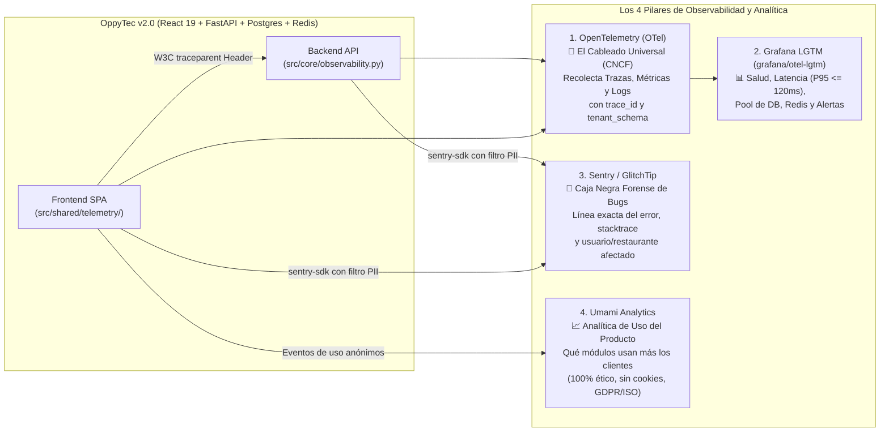
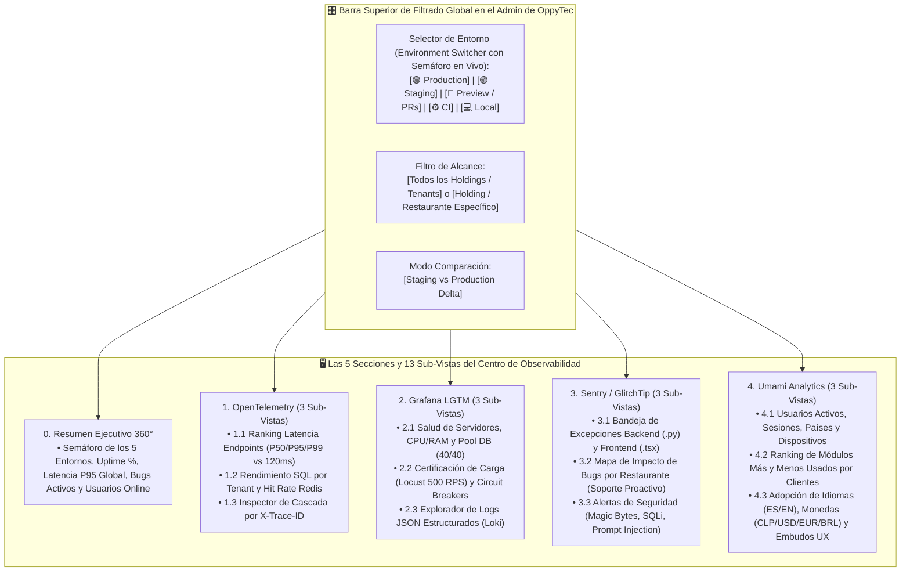

# Estrategia Maestra de Observabilidad, Monitoreo de Errores y Analítica de Producto: OpenTelemetry, Grafana, Sentry/GlitchTip y Umami (Versión 001)

> **Documento:** `estrategia_observabilidad_monitoreo_y_analitica_001.md`  
> **Versión:** 001 (Especificación Normativa de Instrumentación desde Fase 1, Correlación Multi-Tenant, Perfiles Docker Ligeros y Alineación con los 5 Entornos e ISO 27001)  
> **Base Normativa:**  
> - `MASTER-AGENTIC-ENGINEERING-FRAMEWORK.md`  
> - `propuesta_arquitectura_tree_001.md`  
> - `estrategia_migraciones_alembic_001.md`  
> - `estrategia_rbac_y_auditoria_001.md`  
> - `estrategia_testing_calidad_y_seguridad_001.md`  
> - `estrategia_entornos_y_despliegue_001.md`  
> - `estrategia_orquestacion_git_worktrees_y_smart_merge_001.md`  
> - `estrategia_visualizacion_y_auditoria_archify_001.md`  
> - `estrategia_openspec_negocio_vs_codigo_001.md`  
> - `estrategia_asistente_ai_oppyfy_rag_y_creditos_001.md`  
> - `estrategia_motor_decisiones_jev_system1_001.md`  
> - `estrategia_internacionalizacion_i18n_multilenguaje_001.md`  
> - `estrategia_multimoneda_fx_precios_y_cobros_001.md`  
> **Propósito:** Definir cómo se instrumentan desde el Día 1 las cuatro herramientas complementarias de monitoreo (**`OpenTelemetry`**, **`Grafana LGTM`**, **`Sentry / GlitchTip`** y **`Umami`**) en un punto central del Backend y del Frontend, sin sobrecargar la estación de desarrollo local y garantizando detección inmediata de errores, cuellos de botella de rendimiento ($P_{95} \le 120\text{ ms}$) y métricas de uso en Staging y Producción.  
> **Fecha:** Octubre 2026  

---

## 1. Los 4 Pilares del Monitoreo en OppyTec v2.0 (Por qué no compiten entre sí)

En `OppyTec-Legacy` se instaló el SDK de Sentry pero nunca se integró dentro de una estrategia de monitoreo real. En **OppyTec v2.0**, implementamos desde la **Fase 1** cuatro herramientas estándar de la industria, cada una responsable de una dimensión distinta y con opciones **100% libres y gratuitas (Open-Source)**:



| # | Herramienta | Función Exacta en OppyTec v2.0 | Licencia y Costo |
|---|---|---|---|
| **1** | **`OpenTelemetry` (OTel)** | **Instrumentación estándar en el código.** Mide automáticamente cuánto tarda cada endpoint FastAPI, cada query SQLAlchemy (`SET LOCAL search_path`), cada comando Redis y cada llamada a `OppyFy`/`JEV`, uniendo todo bajo un mismo `trace_id`. | **100% Libre y Gratuito** (Apache 2.0 — Estándar CNCF). |
| **2** | **`Grafana` (`grafana/otel-lgtm`)** | **Tablero de rendimiento e infraestructura.** Visualiza los datos de OpenTelemetry (Métricas en Prometheus, Logs en Loki, Trazas en Tempo) en un único contenedor oficial todo-en-uno y envía alertas si un endpoint supera $120\text{ ms}$ o si el pool de DB se llena. | **100% Libre y Gratuito** (Contenedor oficial `grafana/otel-lgtm` o Grafana Cloud Free Tier). |
| **3** | **`Sentry` / `GlitchTip`** | **Cazador de errores de código en tiempo real.** Cuando ocurre una excepción en Python o un crash en React (`ErrorBoundary`), captura el archivo exacto, número de línea, navegador y `tenant_schema` antes de que el cliente reporte el fallo. | Plan gratuito de Sentry.io **o 100% Libre y Gratuito** auto-alojado con **GlitchTip** (compatible con `sentry-sdk`). |
| **4** | **`Umami`** | **Analítica de uso comercial y UX.** Permite saber qué módulos (`Inventario`, `Recetas`, `Mermas`, `OppyFy`), qué idiomas (`es`/`en`) y qué monedas (`CLP`/`USD`/`EUR`/`BRL`) usan más los clientes para guiar decisiones de negocio. | **100% Libre y Gratuito** (MIT Open-Source, corre sobre PostgreSQL sin cookies invasivas). |

---

## 2. Por qué Instrumentar desde la Fase 1 y Cómo Evitar que Consuma RAM en Local

1. **Instrumentación Única en el Núcleo Transversal (`Zero Boilerplate` en los Módulos):**
   - Los sensores no se escriben manualmente dentro de los 150 endpoints; se registran **una sola vez** en el arranque de la aplicación:
     - Backend: `oppytec-backend/src/core/observability.py` (auto-instrumenta `FastAPI`, `SQLAlchemy AsyncEngine`, `Redis` y `httpx`).
     - Frontend: `oppytec-frontend/src/shared/telemetry/` (integra el `ErrorBoundary` de Sentry, el cliente HTTP con cabecera `traceparent` y el rastreador ligero de Umami).
   - Así, cada módulo que construyamos de la Fase 2 a la Fase 5 **nace monitoreado automáticamente**.
2. **Cero Sobrecarga en el Trabajo Diario mediante `Docker Compose Profiles`:**
   - Durante la programación diaria (`docker compose up -d`), los contenedores de Grafana, GlitchTip y Umami **no se encienden** y los exportadores están en modo `noop` (`0 MB` de RAM extra, manteniendo el *Fast Gate* en `< 15 segundos`).
   - Cuando deseas ver los paneles en local, ejecutas:
     ```bash
     docker compose --profile observability up -d
     ```
     Esto levanta el contenedor todo-en-uno `grafana/otel-lgtm` (puerto `3001`), `umami` (puerto `3002`) y `glitchtip` (puerto `3003`).

---

## 3. Alineación Estricta con los 5 Entornos (`estrategia_entornos_y_despliegue_001.md`)

El comportamiento de las 4 herramientas está gobernado directamente por la variable `ENVIRONMENT` en `src/core/config.py` y por `/runtime-env.js` en el Frontend (preservando la invarianza del artefacto `SHA-256`):

| Entorno (`ENVIRONMENT`) | `OpenTelemetry` + `Grafana` | `Sentry` / `GlitchTip` | `Umami Analytics` | Regla de Gobernanza en este Entorno |
|---|---|---|---|---|
| **1. `local`** | `OTEL_EXPORTER="none"` por defecto (`"otlp"` si se activa `--profile observability`). | Desactivado (`SENTRY_DSN=None`). | Desactivado (`UMAMI_ENABLED=False`). | Cero consumo de recursos locales y cero contaminación de métricas con datos de desarrollo. |
| **2. `preview`** *(PR-* / Worktrees)* | Etiqueta cada traza con `service.namespace = ENV_NAMESPACE` (`wt_01`, `pr_142`). | Activo con `environment=f"preview:{ENV_NAMESPACE}"`. | Desactivado. | Aísla los logs y trazas de cada sub-agente paralelo o Pull Request. |
| **3. `ci`** *(Test Runner)* | Usa **`InMemorySpanExporter`** (100% en memoria RAM, cero red externa). | Modo test en memoria (valida que el filtro `before_send` limpie secretos). | Desactivado. | Cumple la prohibición de salida a internet en `ci` y verifica en el *Main Gate* que la telemetría funcione. |
| **4. `staging`** *(Pre-Producción)* | **100% Activo.** Certifica en Grafana que el *Deep Gate* (`Locust 500 RPS`) cumpla $P_{95} \le 120\text{ ms}$. | **100% Activo** (`environment="staging"`). Captura cualquier fallo durante el fuzzing de `Schemathesis`. | Activo apuntando al `WEBSITE_ID` de homologación. | Ensayo general idéntico a Producción bajo carga y auditoría DAST. |
| **5. `production`** *(Producción)* | **100% Activo con Muestreo Inteligente (*Tail Sampling*)** y alertas en vivo. | **100% Activo** (`environment="production"`, `send_default_pii=False`). | **100% Activo** con `UMAMI_WEBSITE_ID` productivo vía `/runtime-env.js`. | Detección inmediata de incidentes por restaurante y analítica real de producto. |

---

## 4. Contexto Multi-Tenant y Redacción de Datos Sensibles (ISO/IEC 27001 §A.12.4)

### 4.1 Etiquetado Automático por Holding y Tenant en Cada Traza y Error
Cada vez que una petición atraviesa el middleware de autenticación y resolución de Tenant en FastAPI, `observability.py` inyecta automáticamente en el Span actual de OpenTelemetry y en el Scope de Sentry:
- `oppytec.trace_id`: ID único devuelto también en la cabecera HTTP `X-Trace-ID` (si un cliente reporta un error en pantalla, el toast muestra ese código corto para buscarlo en 1 segundo en Grafana y Sentry).
- `oppytec.holding_id`: UUID del Holding.
- `oppytec.tenant_schema`: Nombre del esquema de la sucursal activa (ej. `tenant_pacifico_centro`).
- `oppytec.user_id` y `oppytec.role_rank`: ID numérico del trabajador (sin su nombre ni correo personal) y su rango jerárquico.
- `oppytec.ui_language` y `oppytec.display_currency`: Idioma (`es`/`en`) y moneda activa (`CLP`/`USD`/`EUR`/`BRL`).

### 4.2 Filtro Estricto de Redacción PII y `SecretStr` (*Zero Secret Leak to Telemetry*)
Para cumplir con **ISO 27001** y con nuestra regla de **Cero Fuga de Secretos**:
- El procesador de OpenTelemetry y el hook `before_send` de Sentry pasan todo evento por `scrub_telemetry_payload()`:
  - Elimina automáticamente cabeceras `Authorization`, `Cookie`, `X-Api-Key`.
  - Enmascara con `"[REDACTED]"` cualquier campo llamado `password`, `hashed_password`, `token`, `refresh_token`, `secret`, `api_key`, `tax_id`, `credit_card`.
  - Configura obligatoriamente `send_default_pii=False` en `sentry_sdk.init()`.

---

## 5. Centro de Mando de Observabilidad en el Panel de Administración de OppyTec (`platform-admin/observability-center/`)

Para que el `SuperUser` y el equipo de OppyTec no tengan que abrir 4 sitios externos distintos, el Panel de Administración Global de OppyTec (`features/platform-admin/`) incorpora un **Apartado Especial de Observabilidad y Telemetría** con vistas y sub-vistas dedicadas por cada herramienta, gobernadas por un **Filtro Global de Entorno y Cliente**.



### 5.1 El Filtro Global por `Environment` (+ Filtro por `Holding / Tenant` y Modo Comparación)
1. **Conmutador de Entorno con Indicador de Salud:**
   - Permite alternar en 1 clic entre **`production`**, **`staging`**, **`preview`**, **`ci`** y **`local`**.
   - Cada botón de entorno muestra su semáforo en tiempo real (`🟢 Healthy`, `🟡 Warning`, `🔴 Critical`) para saber de inmediato qué entorno se está inspeccionando y si otro entorno presenta alertas.
2. **Filtro Combinado por `Holding` y `Tenant`:**
   - Permite ver las métricas agregadas de toda la plataforma o aislar en 1 clic a un cliente específico (*"Ver trazas de OpenTelemetry, errores de Sentry y analítica de Umami del **Restaurante Pacífico** en **`Production`**"*).
3. **Modo Comparación `Staging vs. Production`:**
   - Permite contrastar la latencia $P_{95}$ y tasa de errores de `staging` frente a `production` antes de autorizar una promoción de versión.

---

### 5.2 Detalle de las Vistas y Sub-Vistas por Herramienta

#### Sección 0: Resumen Ejecutivo 360° (Vista Unificada)
- **KPIs Principales:** Disponibilidad Uptime (`99.9%+`), Latencia $P_{95}$ Global vs umbral de `120 ms`, Errores no resueltos en las últimas 24h, Usuarios concurrentes en vivo, Uso del Pool de Conexiones PostgreSQL y estado de los *Circuit Breakers* (Redis y Tasas FX).

#### Sección 1: Vistas de `OpenTelemetry` (Trazas Distribuidas y Latencias Internas)
- **Sub-vista 1.1 — Rendimiento de Endpoints API:** Tabla y gráfico de percentiles ($P_{50}, P_{95}, P_{99}$) por ruta HTTP, resaltando cualquier endpoint que se acerque al límite de $120\text{ ms}$ (operaciones) o $800\text{ ms}$ (reportes).
- **Sub-vista 1.2 — Inspector de Base de Datos y Caché Redis:** Tiempo de ejecución de queries SQLAlchemy Async, latencia de cambio de esquema (`SET LOCAL search_path`), porcentaje de aciertos (*Cache Hit Ratio*) en Redis y latencia de `OppyFy` / `JEV`.
- **Sub-vista 1.3 — Buscador Forense por `X-Trace-ID`:** Permite ingresar el código `X-Trace-ID` de cualquier petición y visualizar el diagrama de cascada (*Waterfall*) milisegundo por milisegundo desde el clic en React hasta PostgreSQL y Redis.

#### Sección 2: Vistas de `Grafana` (Infraestructura, Carga y Logs)
- **Sub-vista 2.1 — Recursos e Infraestructura:** Uso de CPU, Memoria RAM, Disco, Red, Workers de Uvicorn y saturación del Pool de Base de Datos (`pool_size=40, max_overflow=20`).
- **Sub-vista 2.2 — Certificación de Estrés y Resiliencia:** Métricas de pruebas de carga (`500 RPS` con Locust en `staging`) e historial de activación de *Circuit Breakers* / Fallback de Redis.
- **Sub-vista 2.3 — Explorador de Logs Estructurados (Loki):** Buscador en tiempo real de logs JSON filtrable por `environment`, `holding_id`, `tenant_schema`, `user_id` y severidad (`INFO`, `WARNING`, `ERROR`, `CRITICAL`).

#### Sección 3: Vistas de `Sentry / GlitchTip` (Errores de Código y Ciberseguridad)
- **Sub-vista 3.1 — Bandeja de Bugs Backend y Frontend:** Errores agrupados por causa raíz con ruta del archivo `.py`/`.tsx`, línea exacta, stacktrace sanitizado (sin PII ni `SecretStr`), navegador/SO y commit `SHA` que lo introdujo.
- **Sub-vista 3.2 — Mapa de Impacto por Cliente (Soporte Proactivo):** Muestra qué Holdings o Tenants han experimentado algún error hoy para que el equipo de OppyTec pueda solucionarlo proactivamente antes de que el cliente abra un ticket.
- **Sub-vista 3.3 — Monitor de Eventos de Seguridad Bloqueados:** Intentos detenidos de subida de archivos maliciosos (*Magic Bytes*), intentos de *Prompt Injection* en `OppyFy`, rechazos de RBAC y bloqueos por *Rate Limiting*.

#### Sección 4: Vistas de `Umami` (Analítica de Producto y Adopción Comercial)
- **Sub-vista 4.1 — Tráfico, Sesiones Activas y Dispositivos:** Usuarios activos diarios/mensuales (DAU/MAU), horarios punta de operación gastronómica y uso por tipo de dispositivo (PC de caja, tablet de cocina, smartphone).
- **Sub-vista 4.2 — Mapa de Calor de Módulos y Funcionalidades:** Ranking de uso real de cada módulo (`Inventario`, `Recetas`, `Mermas`, `Compras`, `Buffet`, `OppyFy`), permitiendo identificar qué módulos aportan más valor y cuáles requieren mejoras de UX.
- **Sub-vista 4.3 — Adopción de Idiomas (`i18n`), Monedas (`FX`) y Embudos:** Porcentaje de clientes que operan en Español (`🇪🇸 ES`) vs Inglés (`🇺🇸 EN`), uso del selector de moneda (`CLP`, `USD`, `EUR`, `BRL`) y tasa de conversión en flujos guiados (Wizard de Productos de 4 pasos e Importador de Excel de 5 etapas).

---

### 5.3 Control de Acceso RBAC Global (`public`) para el Centro de Observabilidad
El acceso a estas vistas en `platform-admin` está protegido por permisos de 3 niveles en `public`:
- `platform_observability.overview.view` (Resumen 360°)
- `platform_observability.otel.view` (Trazas y latencias de OpenTelemetry)
- `platform_observability.grafana.view` (Infraestructura y logs de Grafana)
- `platform_observability.sentry.view` y `platform_observability.sentry.manage_issues` (Bugs en Sentry/GlitchTip)
- `platform_observability.umami.view` (Métricas comerciales y de producto en Umami)

---

## 6. Artefactos a Construir en el Proyecto (Nombres y Ubicaciones)

| # | Artefacto | Ruta Exacta en el Proyecto | Propósito |
|---|---|---|---|
| **1** | **ADR de Observabilidad 4-Pilares** | `docs/adr/ADR-016-four-pillar-observability-otel-grafana-sentry-umami.md` | Congela la arquitectura de `OpenTelemetry` + `Grafana LGTM` + `Sentry/GlitchTip` + `Umami` alineada con los 5 entornos. |
| **2** | **Regla Agéntica Inmutable** | `.agent/rules/17-observability-opentelemetry-sentry-and-umami.md` | Obliga a propagar `X-Trace-ID` y `tenant_schema`, redactar PII/`SecretStr` y prohibir `print()` en favor de `structlog` + OTel. |
| **3** | **Skill de Observabilidad** | `.agent/skills/observability_telemetry/SKILL.md` | Guía para añadir métricas de negocio personalizadas, eventos de Umami y configurar dashboards en Grafana. |
| **4** | **Núcleo de Observabilidad Backend** | `oppytec-backend/src/core/observability.py` | Inicializa OpenTelemetry, `structlog` JSON, `sentry-sdk` con `scrub_telemetry_payload()` y middleware `X-Trace-ID`. |
| **5** | **Núcleo de Telemetría Frontend** | `oppytec-frontend/src/shared/telemetry/` (`sentry.ts`, `otel.ts`, `umami.ts`, `useTrackEvent.ts`) | Conecta `ErrorBoundary`, propaga `traceparent` en Axios e inyecta Umami desde `/runtime-env.js`. |
| **6** | **Perfil Docker de Observabilidad** | `docker-compose.yml` (`profiles: ["observability"]`) + `infra/observability/grafana-dashboards/` | Levanta bajo demanda `grafana/otel-lgtm`, `glitchtip` y `umami` pre-configurados sin afectar el desarrollo diario. |
| **7** | **Quality Gate de Telemetría y Privacidad** | `oppytec-backend/tests/architecture/test_observability_pii_redaction_and_spans.py` | Verifica con `InMemorySpanExporter` que toda petición genere su `X-Trace-ID`, adjunte el `tenant_schema` y que el filtro PII oculte al 100% contraseñas y tokens antes de enviar a Sentry/OTel. |
