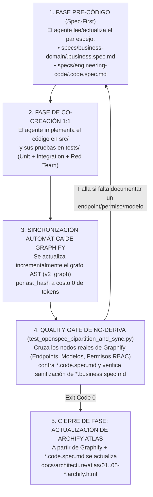

# Estrategia Maestra de OpenSpec: Bipartición "Negocio vs. Código", Sincronización Continua y Preparación para RAG Dual (Versión 001)

> **Documento:** `estrategia_openspec_negocio_vs_codigo_001.md`  
> **Versión:** 001 (Especificación Normativa de Spec-Driven Development, Separación de Audiencias para Futuro RAG y Sincronización con Graphify y Archify)  
> **Base Normativa:**  
> - `MASTER-AGENTIC-ENGINEERING-FRAMEWORK.md`  
> - `propuesta_arquitectura_tree_001.md`  
> - `estrategia_migraciones_alembic_001.md`  
> - `estrategia_rbac_y_auditoria_001.md`  
> - `estrategia_testing_calidad_y_seguridad_001.md`  
> - `estrategia_entornos_y_despliegue_001.md`  
> - `estrategia_orquestacion_git_worktrees_y_smart_merge_001.md`  
> - `estrategia_visualizacion_y_auditoria_archify_001.md`  
> **Propósito:** Definir la estructura y las reglas inmutables para que todo agente de IA y desarrollador mantenga sincronizados en tiempo real los **Specs de Negocio (`specs/business-domain/`)**, los **Specs de Código (`specs/engineering-code/`)**, el grafo **`Graphify`** y el Atlas **`Archify`**, dejando la base documental 100% limpia y clasificada para alimentar en el futuro tanto un **RAG para Clientes** (sin fuga de código) como un **RAG para Desarrolladores**.  
> **Fecha:** Octubre 2026  

---

## 1. Diagnóstico de `OpenSpec` en `OppyTec-Legacy`

Al inspeccionar `OppyTec-Legacy/OppyTec_Backend/openspec/` y `OppyTec-Legacy/OppyTec_Frontend/openspec/`, se detectaron **3 problemas críticos** que habrían contaminado el mantenimiento y cualquier futuro sistema RAG:

1. **Duplicación y Desincronización de Carpetas `openspec/`:**
   - En Legacy existía un directorio `openspec/specs/` dentro de `OppyTec_Backend` y otra copia casi idéntica dentro de `OppyTec_Frontend`. Al editar uno, el otro quedaba obsoleto.
2. **Contaminación Cruzada de Audiencias ("Negocio" mezclado con "Código SQL/React"):**
   - Archivos ubicados bajo `openspec/specs/business/` (como `business/inventory/mermas.md`) mezclaban en el mismo documento la explicación operativa del negocio con detalles internos de implementación (`useMerma.ts`, `Promise.all`, rutas internas de FastAPI y sentencias `CREATE TABLE {tenant_slug}.mermas_registro`).
   - **Riesgo Crítico para el Futuro RAG de Clientes (Information Disclosure):** Si un sistema RAG para clientes indexa documentos que mezclan guías de uso con SQL y nombres de archivos internos, un usuario final que pregunte *"¿Cómo funciona la aprobación de mermas?"* puede recibir en la respuesta nombres de tablas, esquemas internos o endpoints del backend.
3. **Deriva Documental (*Spec Drift*):**
   - No existía un *Quality Gate* que verificara que cada nuevo endpoint, tabla o permiso RBAC creado en el código estuviera reflejado en su especificación correspondiente.

---

## 2. Arquitectura Bipartita de `specs/` en OppyTec v2.0 (Bóveda de Negocio vs. Bóveda de Código)

Para eliminar la duplicación y preparar desde hoy el terreno para **dos motores RAG independientes a futuro** (sin construir aún el RAG, pero recolectando y estructurando toda la información de forma impecable a medida que refactorizamos), se unifica todo bajo `specs/` en la raíz del monorepo con **dos bóvedas estrictamente separadas**:

```mermaid
graph TD
    subgraph RootSpecs["📋 Directorio Raíz 'specs/' (Fuente Única de Verdad)"]
        Core["00..06-*.md<br/>(PRD, TRD, User Flows, Design System, DB Schema, Plan)"]
        Config["openspec.config.yaml<br/>(Reglas de validación y plantillas)"]

        subgraph VaultBiz["🟢 BÓVEDA 1: specs/business-domain/<br/>('Cómo Funciona el Negocio y Cómo se Usa OppyTec')"]
            BizRule["Audiencia: Clientes, Usuarios Finales, Soporte, Producto<br/>🔒 REGLA: 0% SQL, 0% Rutas .py/.tsx, 0% Arquitectura Interna"]
            BizFiles["• tenancy-and-plans.business.spec.md<br/>• rbac-quotas-and-audit.business.spec.md<br/>• catalog-and-units.business.spec.md<br/>• inventory-and-kardex.business.spec.md<br/>• waste-and-mermas.business.spec.md<br/>• recipes-and-combos.business.spec.md<br/>• purchases-and-invoices.business.spec.md<br/>• operations-and-buffet.business.spec.md<br/>• analytics-and-reports.business.spec.md<br/>• oppy-ai-and-voice.business.spec.md<br/>• multi-currency-and-pricing.business.spec.md<br/>• media-storage-and-quotas.business.spec.md<br/>• data-security-and-backups.business.spec.md"]
        end

        subgraph VaultEng["🔵 BÓVEDA 2: specs/engineering-code/<br/>('Cómo Funciona el Código y la Arquitectura de OppyTec')"]
            EngRule["Audiencia: Desarrolladores, Arquitectos y Agentes de IA<br/>⚙️ CONTIENE: DDL SQL, Endpoints, Pydantic/Zod, RBAC Codes, JEV Gate, i18n, Locks"]
            EngFiles["• tenancy-rbac-and-migrations.code.spec.md<br/>• rbac-quotas-and-audit.code.spec.md<br/>• catalog-and-units.code.spec.md<br/>• inventory-and-kardex.code.spec.md<br/>• waste-and-mermas.code.spec.md<br/>• recipes-and-combos.code.spec.md<br/>• purchases-and-invoices.code.spec.md<br/>• operations-and-buffet.code.spec.md<br/>• analytics-and-reports.code.spec.md<br/>• oppy-ai-and-voice.code.spec.md<br/>• multi-currency-and-pricing.code.spec.md<br/>• media-storage-and-quotas.code.spec.md<br/>• data-security-and-backups.code.spec.md<br/>• multi-agent-git-harness.code.spec.md"]
        end
    end

    VaultBiz <-->|Relación Espejo 1:1 (paired_spec)| VaultEng
    VaultBiz -.->|Alimenta| ClientRAG[("🤖 RAG para Clientes en OppyFy<br/>(Capa 3A: public.spec_chunks)")]
    VaultEng & VaultBiz -.->|Alimentarán a futuro| DevRAG[("🛠️ Futuro RAG para Desarrolladores<br/>(Asistente de Ingeniería)")]
```

---

## 3. Qué Debe Contener Cada Bóveda (Contrato de Contenido)

### 3.1 Bóveda 1: `specs/business-domain/*.business.spec.md` (Conocimiento del Negocio y Uso de Plataforma)
Cada archivo en esta carpeta explica **qué hace el módulo en el mundo gastronómico/hotelero y cómo lo utiliza paso a paso el usuario en la interfaz**:
1. **Propósito de Negocio y Valor Operativo:** Qué problema resuelve en el restaurante, hotel o holding (ej. control de *Food Cost*, rotación FEFO, conciliación de facturas, cupos de trabajadores por plan).
2. **Conceptos y Fórmulas Explicadas para el Usuario:**
   - Ejemplo en Catálogo: Diferencia entre **Categoría**, **Familia de Productos** y **Etiquetas (`#tags`)**, y cómo funcionan las 3 capas de unidades (Compra $\to$ Almacenamiento $\to$ Receta) con ejemplos reales de cocina y bar.
   - Ejemplo en Mermas: Qué ocurre cuando una merma supera el umbral permitido y cómo funciona el flujo de solicitud y aprobación gerencial.
3. **Guía Paso a Paso de Flujos en Pantalla (UX/Wizards):**
   - Cómo navegar en el menú lateral, qué campos son obligatorios en cada paso del formulario, cómo funciona el autoguardado de borradores y qué significan las alertas o estados visuales.
4. **Roles, Permisos y Planes Requeridos (en lenguaje de negocio):**
   - Qué módulo debe estar activo en el plan del cliente y qué roles base (`Propietario`, `Administrador`, `Supervisor`, `Cajero`, `Usuario`) pueden ver o ejecutar cada función.
5. **Preguntas Frecuentes (FAQ) y Casos Borde de Operación:**
   - Qué pasa si se desactiva un trabajador (liberación de cupo), qué pasa si un empleado trabaja en el Hotel y en el Restaurante del mismo Holding, etc.
6. **PROHIBICIÓN ESTRICTA (Sanitización Anti-Fuga):**
   - Prohibido incluir sentencias SQL (`SELECT`, `CREATE TABLE`), nombres de tablas o esquemas internos (`tenant_metadata`, `SET LOCAL search_path`), nombres de archivos `.py`/`.tsx`, hooks de React (`useMemo`) o variables de entorno (`.env`).

---

### 3.2 Bóveda 2: `specs/engineering-code/*.code.spec.md` (Conocimiento Técnico del Código)
Cada archivo en esta carpeta es el **espejo técnico exacto** de su par en `business-domain/` y documenta cómo está construido en el código:
1. **Mapa de Ubicación en Clean Architecture:**
   - Rutas exactas de `domain/`, `application/`, `infrastructure/` y `presentation/` en `oppytec-backend` y `features/` en `oppytec-frontend`.
2. **Contratos de Base de Datos y Esquemas (`PublicBase` vs `TenantBase`):**
   - Tablas involucradas, llaves foráneas, índices, restricciones `UNIQUE` y reglas de bloqueo transaccional (ej. `ORDER BY producto_id ASC, bodega_id ASC FOR UPDATE`).
3. **Contratos de Endpoints HTTP y Esquemas Pydantic v2 / Zod:**
   - Método, ruta, payload de entrada (`extra="forbid"`), respuesta y códigos de estado (`200`, `201`, `400`, `401`, `403`, `409`, `422`).
4. **Matriz de Códigos RBAC de 3 Niveles y Linaje de Auditoría:**
   - Lista exacta de permisos `<modulo>.<submodulo>.<funcion>` requeridos por cada endpoint y componente `<Can>`, más los eventos que emite hacia `AuditService`.
5. **Invariantes Matemáticos y Suite de Pruebas Asociada:**
   - Qué propiedades valida `Hypothesis` y qué archivos de `tests/unit/`, `tests/integration/` y `tests/security_redteam/` certifican el módulo.

---

## 4. Estándar de Metadatos YAML (`Frontmatter RAG-Ready`)

Todo archivo dentro de `specs/business-domain/` y `specs/engineering-code/` debe comenzar obligatoriamente con este bloque YAML para que los validadores actuales (y los indexadores RAG del futuro) puedan clasificar y filtrar cada documento con precisión matemática:

```yaml
---
spec_id: "BIZ-INV-MERMAS-001"                              # ID único inmutable (BIZ-* o ENG-*)
title: "Gestión, Control y Aprobación de Mermas"
audience: "business_client"                                # ESTRICTO: "business_client" | "engineering_internal"
domain_module: "inventory"                                 # Módulo padre en app_modules
submodule: "mermas"                                        # Sub-módulo
required_plan_module: "module:inventory:mermas"            # Módulo comercial requerido en el plan del Tenant
rbac_permissions:                                          # Permisos de 3 niveles vinculados al documento
  - "inventory.mermas.view"
  - "inventory.mermas.create"
  - "inventory.mermas.approve"
paired_spec: "specs/engineering-code/waste-and-mermas.code.spec.md" # Enlace cruzado obligatorio 1:1
jev_system1_evaluation:                                    # OBLIGATORIO EN TODO SPEC DE INGENIERÍA (Actual o Futuro)
  evaluated: true
  can_jev_handle_it: true                                  # Respuesta a: ¿Esta tarea la puede hacer JEV (Sí/No)?
  delegated_decisions:
    - "Jev.score: Puntuar credibilidad y urgencia del motivo de merma declarado"
last_verified_phase: "Phase-0"                             # Fase de 06-IMPLEMENTATION-PLAN.md
---
```

---

## 5. La "Cuadriga de Sincronización": Cómo Obligamos a los Agentes a Actualizar `OpenSpec` + `Graphify` + `Archify`

Para que ningún agente de IA ni programador modifique el código dejando desactualizados los specs, el grafo o los diagramas, establecemos un **Protocolo de Sincronización de 4 Puntas** exigido por un Quality Gate determinista:



### 5.1 Qué verifica mecánicamente el Quality Gate `test_openspec_bipartition_and_sync.py`
Este test se ejecuta en menos de `2 segundos` dentro del **Fast Gate** (`tests/architecture/`) y garantiza **4 invariantes**:
1. **Invariante de Espejo 1:1 (`Paired Specs`):** Por cada archivo `*.business.spec.md` en `specs/business-domain/` debe existir su contraparte exacta `*.code.spec.md` en `specs/engineering-code/` con su `frontmatter` YAML completo y válido.
2. **Invariante de Sanitización de la Bóveda de Negocio (Cero Fuga de Código):** Escanea todos los archivos de `specs/business-domain/` y falla inmediatamente si detecta patrones prohibidos de implementación interna (`CREATE TABLE`, `ALTER TABLE`, `SELECT `, `sqlalchemy`, `FastAPI`, `Pydantic`, `mapped_column`, `SET LOCAL search_path`, `.tsx`, `.py`, `useMemo`, `AsyncSession`).
3. **Invariante de Paridad Código $\leftrightarrow$ Spec de Ingeniería (vía `Graphify`):**
   - Extrae desde el AST / `Graphify` todos los endpoints registrados en `src/modules/<mod>/presentation/router.py` y todos los códigos de permiso `<modulo>.<submodulo>.<funcion>` usados en ese módulo.
   - Verifica que cada ruta HTTP y cada código de permiso exista documentado en `specs/engineering-code/<mod>.code.spec.md`. Si un agente creó un endpoint o permiso nuevo en el código y olvidó actualizar el spec, **el test falla indicando exactamente qué ruta o permiso falta documentar en el Spec**.
4. **Invariante de Frescura con `Graphify` y `Archify`:** Verifica que cuando cambia la topología de módulos o modelos de un dominio, el manifiesto de `Graphify` y la fuente `*.archify.json` correspondiente estén sincronizados.

---

## 6. Protocolo de Rescate y Destilación desde `OppyTec-Legacy`

En `OppyTec-Legacy/OppyTec_Backend/openspec/specs/` y `docs/specs/` ya existe conocimiento valioso sobre las reglas del negocio gastronómico (productos, familias, conversión L/mL y kg/g, mermas, recetas, compras, buffet, turnos). Durante la refactorización de cada fase:
1. El agente lee en modo solo lectura el spec antiguo de `OppyTec-Legacy`.
2. **Separa y purifica la lógica de negocio y UX** (limpiándola de cualquier referencia al código viejo) y la redacta en `specs/business-domain/<modulo>.business.spec.md`.
3. **Diseña y documenta el contrato técnico moderno v2.0** (adaptado a Clean Architecture, SQLAlchemy 2 Async, RBAC de 3 niveles y locks canónicos) en `specs/engineering-code/<modulo>.code.spec.md`.

---

## 7. Artefactos a Construir en el Proyecto (Nombres y Rutas)

| # | Artefacto | Ruta Exacta en el Proyecto | Propósito |
|---|---|---|---|
| **1** | **Configuración Raíz OpenSpec** | `specs/openspec.config.yaml` | Configuración unificada del monorepo para las dos bóvedas (`business-domain` y `engineering-code`). |
| **2** | **ADR de Bipartición OpenSpec** | `docs/adr/ADR-011-bipartite-openspec-business-vs-code-rag-ready.md` | Congela la decisión de separar los specs de negocio (futuro RAG clientes) de los specs de código (futuro RAG devs). |
| **3** | **Regla Agéntica Inmutable** | `.agent/rules/12-openspec-bipartition-and-sync.md` | Obliga a todo agente a actualizar `business-domain/`, `engineering-code/`, `Graphify` y `Archify` en cada módulo. |
| **4** | **Skill de Sincronización OpenSpec** | `.agent/skills/openspec-sync/SKILL.md` | Plantillas de frontmatter YAML, reglas de sanitización de negocio y validador de paridad contra `Graphify`. |
| **5** | **Bóveda de Specs de Negocio** | `specs/business-domain/*.business.spec.md` | Documentación funcional y de uso de OppyTec (100% libre de detalles de código interno). |
| **6** | **Bóveda de Specs de Ingeniería** | `specs/engineering-code/*.code.spec.md` | Contratos técnicos de tablas, endpoints, esquemas Pydantic/Zod, permisos RBAC e invariantes. |
| **7** | **Quality Gate de Paridad y Sanitización** | `oppytec-backend/tests/architecture/test_openspec_bipartition_and_sync.py` | Bloquea cualquier commit si se filtra código técnico en `business-domain/` o si un endpoint/permiso nuevo no se documentó en `engineering-code/`. |
