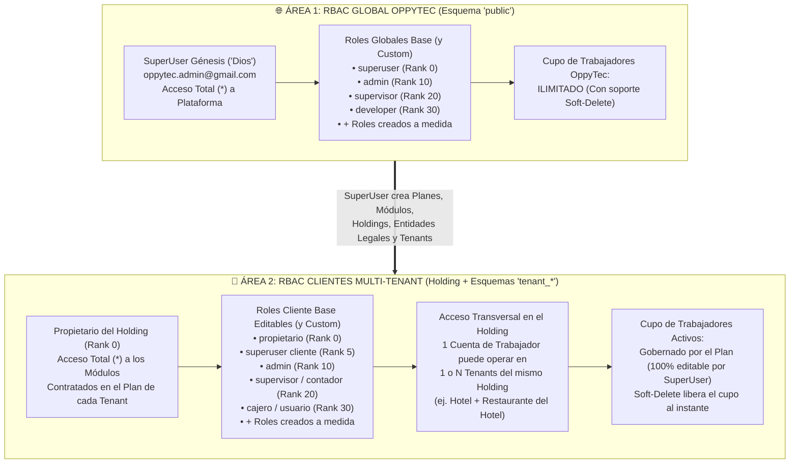

# Estrategia Maestra de RBAC Dual, Cupos por Plan, Acceso Multi-Tenant y Auditoría Forense (Versión 001)

> **Documento:** `estrategia_rbac_y_auditoria_001.md`  
> **Versión:** 001 (Especificación de Diseño, Reglas de Negocio y Gobernanza Pre-Refactorización)  
> **Base Normativa:** `MASTER-AGENTIC-ENGINEERING-FRAMEWORK.md`, `propuesta_arquitectura_tree_001.md` y `estrategia_migraciones_alembic_001.md`  
> **Propósito:** Definir la arquitectura definitiva de Control de Acceso Basado en Roles (RBAC), Principio de Mínimo Privilegio, Delegación Jerárquica, Permisos Temporales (JIT), Acceso Transversal entre Tenants de un mismo Holding, Control de Cupos por Plan con Soft-Delete y Auditoría Forense Inmutable para OppyTec v2.0.  
> **Fecha:** Octubre 2026  

---

## 1. Diagnóstico Crítico del RBAC en `OppyTec-Legacy`

Al inspeccionar la implementación original en `OppyTec-Legacy/OppyTec_Backend/src/authorization/` (`dependencies.py`, `permissions_registry.py`, `router.py`, `models.py`), se detectaron **6 limitaciones estructurales** que debemos erradicar en la refactorización:

1. **Bypass excesivo para el rol `admin`:** En `dependencies.py` (línea 24), el rol `admin` tenía exactamente el mismo bypass incondicional que el `propietario`, rompiendo el principio de mínimo privilegio.
2. **Desconexión entre el Bypass del `Propietario` y el Plan Contratado:** El bypass del `propietario` permitía ejecutar endpoints sin comprobar primero si el módulo correspondiente estaba contratado y habilitado para ese Tenant en `public.tenant_modules`.
3. **Permisos planos sin jerarquía de 3 niveles:** Los permisos eran cadenas simples (`inventory.view_products`) sin distinguir formalmente entre **Módulo $\to$ Sub-Módulo $\to$ Función**, dificultando bloquear sub-módulos completos o botones puntuales de la UI.
4. **Duplicación de cuentas para trabajadores Multi-Sucursal:** Como la tabla `users` vivía aislada dentro de cada esquema `tenant_*`, si un administrador o supervisor trabajaba tanto en el *Hotel* como en el *Restaurante del Hotel* (dos Tenants del mismo Holding), había que duplicar su cuenta de usuario en cada esquema.
5. **Ausencia de Permisos Temporales (JIT) y Delegación Controlada:** La tabla `user_permissions` era una relación plana `(user_id, permission_id)` permanente. No registraba quién otorgó el permiso (`granted_by`), por qué motivo (`reason`), ni fecha de expiración (`expires_at`), ni impedía que un rol intermedio otorgara permisos superiores a los suyos.
6. **Falta de trazabilidad forense de autorización:** Cuando ocurría una acción sensible (ej. aprobar una merma o eliminar un insumo), no quedaba registrado bajo qué rol o permiso temporal específico el trabajador había podido ejecutarla ni quién le había concedido ese permiso.

---

## 2. Arquitectura General del RBAC Dual en OppyTec v2.0

El sistema RBAC de OppyTec v2.0 se divide en **dos áreas operativas independientes pero simétricas en su motor de seguridad**:



---

## 3. Reglas de Negocio Nucleares (Contratos Inquebrantables)

### 3.1 La Ecuación Matemática del Acceso Efectivo (Mínimo Privilegio)
Ningún endpoint del Backend ni vista/botón del Frontend evalúa permisos mirando únicamente el nombre del rol. Todo acceso se resuelve mediante la siguiente intersección determinista:

$$\text{Acceso Efectivo (Tenant)} = \mathbf{M}_{\text{Plan}} \cap \left( \left( \mathbf{P}_{\text{Rol}} \cup \mathbf{P}_{\text{TempAllow}} \right) \setminus \mathbf{P}_{\text{ExplicitDeny}} \right)$$

Donde:
- $\mathbf{M}_{\text{Plan}}$ (**Techo Comercial del Plan**): Conjunto de módulos y sub-módulos habilitados para ese Tenant en `public.tenant_modules` según el plan contratado.
  - **Regla del Propietario:** El `propietario` posee todos los permisos ($\mathbf{P}_{\text{Rol}} = *$) **dentro de los módulos contratados en $\mathbf{M}_{\text{Plan}}$**. Si el Tenant no tiene contratado el módulo `accounting`, ni siquiera el `propietario` puede acceder a `accounting` hasta que el `SuperUser` o el plan lo habilite.
- $\mathbf{P}_{\text{Rol}}$: Permisos asignados al rol del trabajador en ese Tenant.
- $\mathbf{P}_{\text{TempAllow}}$: Permisos temporales adicionales vigentes (`expires_at > NOW()` y `used_count < max_uses`).
- $\mathbf{P}_{\text{ExplicitDeny}}$: Permisos que un superior le ha **restado explícitamente** a ese trabajador o rol (prevalecen siempre sobre `ALLOW`).

Para los **Trabajadores de OppyTec en `public`**, no aplica la restricción de plan comercial ($\mathbf{M}_{\text{Plan}} = \text{Todos los módulos de administración}$), y el `superuser` (`oppytec.admin`) tiene acceso irrestricto ($*$).

---

### 3.2 Granularidad Jerárquica en 3 Niveles: `Módulo -> Sub-Módulo -> Función`
Todo código de permiso en OppyTec v2.0 debe escribirse obligatoriamente con **3 segmentos separados por punto**:

```plaintext
<modulo>.<submodulo>.<funcion>
```

| Nivel | Propósito en UI y API | Ejemplo Cliente (`tenant_*`) | Ejemplo OppyTec (`public`) |
|---|---|---|---|
| **1. Módulo (`<modulo>`)** | Oculta/habilita la sección completa en el menú lateral (Sidebar) y bloquea todo el prefijo de rutas API. | `inventory`, `management`, `sales`, `accounting`, `analytics` | `platform_tenants`, `platform_plans`, `platform_security`, `platform_staff` |
| **2. Sub-Módulo (`<submodulo>`)** | Permite entrar al módulo padre, pero oculta/habilita pestañas o sub-secciones completas dentro de él. | `management.products`, `management.recipes`, `management.mermas`, `management.suppliers` | `platform_tenants.holdings`, `platform_tenants.legal_entities`, `platform_tenants.modules` |
| **3. Función (`<funcion>`)** | Controla botones, columnas sensibles (ej. costos), modales o acciones puntuales (CRUD, aprobar, exportar). | `management.products.view`, `management.products.create`, `management.products.view_costs`, `management.products.delete` | `platform_tenants.holdings.create`, `platform_plans.quotas.edit_max_users` |

**Comportamiento en Cascada:**
- Si un rol no tiene ningún permiso bajo `management.*`, el módulo **Gestión** ni siquiera se renderiza en su interfaz.
- Si tiene `management.products.view` pero nada en `management.suppliers.*`, ve el módulo **Gestión**, entra al sub-módulo **Productos**, pero el sub-módulo **Proveedores** está oculto y bloqueado con `HTTP 403` en el backend.
- Si tiene `management.products.view` pero no `management.products.delete`, ve la tabla de productos pero el botón **"Eliminar"** no existe en su pantalla ni puede invocar `DELETE /api/v1/catalog/products/{id}`.

---

### 3.3 Delegación Jerárquica en Cascada (*Bounded Delegation*)
Tanto el `SuperUser` (en `public`) como el `Propietario` (en el cliente) pueden delegar en roles subordinados (ej. `admin` o `supervisor`) la facultad de administrar usuarios y asignar o restar permisos a roles inferiores, bajo **3 Leyes Matemáticas de No-Escalamiento**:

Cada Rol posee un atributo entero `hierarchy_rank` (donde **`0` es la máxima autoridad** y números mayores representan menor jerarquía):

```plaintext
[Jerarquía en 'public' (OppyTec)]           [Jerarquía en 'tenant_*' (Clientes)]
Rank 0  : superuser (Dios)                  Rank 0  : propietario (Dueño del Holding)
Rank 10 : admin                             Rank 5  : superuser (Director / Gerente General)
Rank 20 : supervisor                        Rank 10 : admin (Administrador de Local)
Rank 30 : developer                         Rank 20 : supervisor / contador
Rank 40+: roles personalizados              Rank 30+: cajero / usuario / roles personalizados
```

1. **Ley 1 — Rango Estricto Inferior (`actor.rank < target.rank`):**
   - Un usuario con rango $R$ solo puede crear, editar, desactivar (`soft-delete`) o modificar permisos de roles y usuarios cuyo rango sea **estrictamente mayor en número ($> R$)** (es decir, inferior en jerarquía).
   - *Excepción única:* El `superuser (Rank 0)` en OppyTec puede crear a otro `superuser (Rank 0)`, y el `propietario (Rank 0)` en el cliente puede crear a otro `propietario (Rank 0)`. Ningún rol con `Rank > 0` puede tocar a alguien de su mismo rango o superior.
2. **Ley 2 — Techo de Concesión (*Grant Ceiling*):**
   - Ningún rol delegador (ej. `admin`) puede otorgar a un subordinado (ej. `supervisor` o `cajero`) un permiso que **el propio `admin` no posea activamente**.
   - Si al `admin` el Propietario le quitó el permiso `management.mermas.approve`, ese `admin` jamás podrá asignarle `management.mermas.approve` a ningún trabajador ni rol inferior.
3. **Ley 3 — Capacidad de Delegación Explícita:**
   - Para que un rol intermedio pueda asignar o restar permisos a sus subordinados, debe poseer explícitamente la función `settings.rbac.delegate_subordinates` (en cliente) o `platform_security.rbac.delegate_subordinates` (en OppyTec).

---

### 3.4 Acceso Transversal Multi-Tenant dentro del mismo Holding
En la industria hotelera y gastronómica es habitual que un mismo trabajador (ej. un Administrador General, un Contador o un Supervisor de Operaciones) trabaje simultáneamente en el **Hotel (`tenant_hotel`)** y en el **Restaurante del Hotel (`tenant_restaurante`)**, ambos pertenecientes al mismo `Holding`.

Para soportarlo de forma nativa y sin duplicar usuarios:
1. **Cuenta Única a Nivel Holding (`public.client_users`):**
   - La identidad del trabajador cliente (credenciales, email, username, nombre, estado `is_deleted`, `holding_id`) es **única dentro del Holding**.
2. **Membresía y Roles por Sucursal (`public.client_user_tenant_access` + RBAC en `tenant_*`):**
   - El `Propietario` (o un `admin` con permiso de delegación en esos tenants) selecciona a qué Tenants dentro del mismo Holding tiene acceso cada trabajador.
   - **Asignación de Rol Transversal o Diferenciada:**
     - **Modo Transversal:** El Propietario asigna al trabajador como `admin` en los 3 Tenants del Holding en un solo paso.
     - **Modo Diferenciado por Local:** El Propietario puede definir que ese mismo trabajador sea `admin` en el *Restaurante*, pero solo `supervisor` en el *Hotel*.
   - **Aislamiento Cross-Holding Garantizado:** Una restricción de clave foránea compuesta `(holding_id, tenant_id)` en PostgreSQL hace físicamente imposible asignar un trabajador del `Holding A` a un Tenant del `Holding B`.

---

### 3.5 Gestión de Cupos de Trabajadores por Plan (`Seat Quotas`) y `Soft-Delete`

#### A. Reglas para Clientes (`Holding` / `Tenants`)
1. **Planes 100% Editables por el SuperUser:**
   - En `public.system_plans`, el `SuperUser` de OppyTec puede crear todos los planes que desee y configurar/editar en cualquier momento el campo `max_active_users` (ej. Plan Semilla = 5 trabajadores, Plan Profesional = 10 trabajadores, Plan Corporativo = 50 trabajadores).
   - Adicionalmente, cada suscripción tiene un campo opcional `custom_max_users_override` editable por el `SuperUser` para otorgar cupos extra personalizados a un cliente específico sin alterar el plan base.
2. **Libertad Total de Distribución para el Propietario:**
   - Si el plan contratado permite **10 trabajadores activos**, el Propietario decide libremente qué roles ocupan esos 10 cupos (ej. 2 `admin`, 3 `supervisor`, 4 `cajero`, 1 `usuario`).
   - Cada trabajador humano ocupa **1 cupo activo** en su Holding/Tenant (independientemente de cuántos roles o permisos internos tenga).
3. **Regla de Oro del `Soft-Delete` (Liberación Instantánea de Cupo):**
   - Cuando un trabajador deja la empresa, el Propietario (o `admin` autorizado) lo elimina mediante **Soft-Delete (`is_deleted = true`, `deleted_at = NOW()`, `deleted_by = actor_id`)**.
   - **Efectos automáticos y atómicos en la misma transacción:**
     1. **No consume cupo:** El conteo de cupos del plan evalúa exclusivamente:
        ```sql
        SELECT COUNT(*) FROM public.client_users
        WHERE holding_id = :holding_id AND is_deleted = FALSE
        ```
        Por lo tanto, el trabajador en `soft-delete` **libera su cupo en el acto**, permitiendo crear al nuevo trabajador contratado sin mermar la capacidad del plan.
     2. **Kill-Switch de Sesión en Redis:** Se revocan inmediatamente todos sus tokens JWT / Refresh Tokens activos para cortar cualquier acceso abierto.
     3. **Conservación Forense:** Su registro jamás se borra físicamente (`DELETE`), manteniendo intacta toda su trazabilidad histórica en ventas, inventario, mermas y auditoría.
     4. **Validación al Reactivar:** Si en el futuro se intenta restaurar (`is_deleted = false`) a un ex-trabajador, el sistema verifica primero con bloqueo transaccional (`SELECT ... FOR UPDATE`) que `usuarios_activos < max_allowed_users`. Si el cupo ya fue ocupado por otro empleado, rechaza la reactivación con un mensaje claro (`409 Conflict: Cupo máximo del plan alcanzado`).

#### B. Reglas para Trabajadores Internos de OppyTec (`public`)
- **Cupo Ilimitado:** El `SuperUser` de OppyTec puede crear tantos trabajadores globales (`superuser`, `admin`, `supervisor`, `developer` o roles custom) como requiera la operación de OppyTec, **sin restricción de cantidad**.
- **Soft-Delete Obligatorio:** Cuando un miembro del equipo de OppyTec se retira, se aplica igualmente `is_deleted = true` con revocación inmediata de sesión en Redis y conservación perpetua de su historial en la auditoría interna de OppyTec.

---

### 3.6 Permisos Temporales con Expiración Automática (*Time-Bound / JIT Grants*)
Tanto en OppyTec (`public`) como en los Clientes (`tenant_*`), un superior puede otorgar un **Permiso Temporal** a un trabajador para realizar una tarea puntual sin cambiar su rol permanente:

- **Campos obligatorios de toda concesión temporal (`permission_grants`):**
  - `user_id`: Trabajador que recibe el permiso.
  - `permission_code`: Función específica (ej. `management.mermas.approve`).
  - `effect`: `'ALLOW'` (conceder temporalmente) o `'DENY'` (restringir temporalmente o permanentemente una función de su rol).
  - `granted_by_user_id`: Quién otorgó el permiso (auditabilidad directa).
  - `reason`: Motivo obligatorio (mínimo 10 caracteres, ej. *"Cierre de inventario turno domingo por licencia del supervisor"*).
  - `starts_at`: Fecha/hora de inicio (por defecto `NOW()`).
  - `expires_at`: Fecha/hora exacta de caducidad (`TIMESTAMPTZ`).
  - `max_uses` *(opcional)*: Si se define en `1` (o $N$), el permiso se autodestruye (`is_revoked = true`, `revoked_reason = 'MAX_USES_REACHED'`) apenas el trabajador completa la tarea asignada.

---

### 3.7 Auditoría Forense Inmutable (Responsabilidad y Detección de Anomalías)
Para que el `Propietario` (en su negocio) y el `SuperUser` (en OppyTec) tengan visibilidad total de qué hace cada trabajador y quién dio qué permisos, se implementan **dos tablas Append-Only (solo inserción, prohibido `UPDATE`/`DELETE`)**:

#### 1. `audit_rbac_changes` (Quién dio o quitó permisos y por qué)
Registra todo cambio en roles, creación/baja de usuarios y entrega de permisos temporales:
- **Quién lo hizo:** `actor_user_id`, `actor_username`, `actor_role_at_moment`, `ip_address`, `user_agent`.
- **A quién afectó:** `target_user_id` o `target_role_id`, `tenant_id` (si aplica).
- **Qué cambió:** `event_type` (`USER_CREATED`, `USER_SOFT_DELETED`, `ROLE_CREATED`, `ROLE_PERMISSIONS_UPDATED`, `TEMP_PERMISSION_GRANTED`, `TEMP_PERMISSION_REVOKED`, `TENANT_ACCESS_GRANTED`).
- **Detalle exacto:** `previous_permissions` (JSONB), `new_permissions` (JSONB), `expires_at`, `reason`.

#### 2. `audit_activity_log` (Qué hizo cada trabajador en la plataforma y con qué permiso)
Registra toda acción operativa relevante (crear/editar/borrar productos, movimientos de stock, aprobar mermas, crear compras, subir facturas, cambiar precios, modificar planes):
- **Actor y Contexto:** `user_id`, `username`, `tenant_id`, `bodega_id`, `timestamp`, `ip_address`.
- **Acción:** `module` (`inventory`), `submodule` (`mermas`), `function_code` (`inventory.mermas.approve`), `entity_type` (`Merma`), `entity_id` (`402`).
- **Evidencia Antes/Después:** `before_state` (JSONB) y `after_state` (JSONB).
- **Huella Forense de Autorización (`authorization_lineage` JSONB):**
  Registra **cómo** obtuvo permiso ese trabajador en ese milisegundo exacto:
  ```json
  {
    "authorized_via": "TEMPORARY_GRANT",
    "permission_code": "inventory.mermas.approve",
    "grant_id": "9f8c2a10-...",
    "granted_by_user_id": 12,
    "granted_by_username": "pedro.admin",
    "granted_at": "2026-10-17T14:00:00Z",
    "expires_at": "2026-10-17T22:00:00Z",
    "grant_reason": "Autorización excepcional para cierre de cocina"
  }
  ```
  *Valor de negocio:* Si un trabajador hace algo indebido, el Propietario no solo descubre **qué trabajador lo hizo**, sino **quién le dio el permiso (`pedro.admin`), cuándo y bajo qué pretexto**, permitiendo corregir el permiso en un clic.

---

## 4. Diseño del Modelo de Datos para RBAC, Cupos y Auditoría

### 4.1 Tablas en el Esquema `public` (`PublicBase`)
1. **`public.global_users`**: Trabajadores de OppyTec (`id`, `email`, `username`, `hashed_password`, `preferred_language`, `preferred_currency`, `is_superuser_god`, `is_deleted`, `deleted_at`, `deleted_by`).
2. **`public.global_roles`**: Roles internos de OppyTec (`id`, `slug`, `name`, `name_i18n`, `hierarchy_rank`, `is_system_base`). Semilla: `superuser (0)`, `admin (10)`, `supervisor (20)`, `developer (30)`.
3. **`public.global_permissions`**: Catálogo de permisos de plataforma (`code` en formato `modulo.submodulo.funcion`, incluyendo `platform_observability.*`, `platform_fx.*`, `platform_backups.*` y `platform_finops.*`).
4. **`public.global_role_permissions`** y **`public.global_user_permission_grants`** (con `effect`, `granted_by`, `reason`, `expires_at`, `max_uses`).
5. **`public.system_plans`**: Planes comerciales (`id`, `slug`, `name`, `name_i18n`, **`max_active_users`**, **`max_storage_mb`**, `included_modules` JSONB, `price_clp`, `price_usd`, `price_eur`, `price_brl`).
6. **`public.holdings`**: (`id`, `nombre`, `plan_id`, **`custom_max_users_override`**, **`custom_storage_mb_override`**).
7. **`public.legal_entities`**: (`id`, `holding_id`, `tax_id`, `legal_name` — inmutable en `i18n`).
8. **`public.tenants`**: (`id`, `holding_id`, `legal_entity_id` UNIQUE 1:1, `schema_name` UNIQUE, `nombre_comercial`, **`base_currency`**, **`custom_max_users_override`**, **`custom_storage_mb_override`**).
9. **`public.app_modules`** y **`public.tenant_modules`**: Jerarquía de módulos/sub-módulos y estado (`is_enabled: bool`) por Tenant.
10. **`public.client_users`**: Identidad única de los trabajadores/propietarios del cliente a nivel Holding (`id`, `holding_id`, `email`, `username`, `hashed_password`, `preferred_language`, `preferred_currency`, `is_holding_owner`, `is_deleted`, `deleted_at`, `deleted_by`).
11. **`public.client_user_tenant_access`**: Qué Tenants dentro del mismo Holding puede operar cada trabajador (`user_id`, `holding_id`, `tenant_id`, `is_active`).
12. **`public.global_audit_rbac_changes`** y **`public.global_audit_activity_log`**: Auditoría inmutable de los trabajadores de OppyTec.

### 4.2 Tablas en cada Esquema `tenant_*` (`TenantBase`)
1. **`roles`**: Roles del local (`id`, `slug`, `name`, `name_i18n` JSONB, `hierarchy_rank`, `is_system_base`, `is_deleted`).
   - Semilla inicial editable: `propietario (0)`, `superuser (5)`, `admin (10)`, `usuario (30)`, `cajero (30)` + creación libre de roles por el Propietario.
2. **`permissions`**: Registro de permisos de 3 niveles (`code`: `<modulo>.<submodulo>.<funcion>`, `module_slug`, `submodule_slug`, `action_slug`).
3. **`role_permissions`**: (`role_id`, `permission_id`, `granted_by_user_id`, `created_at`).
4. **`user_tenant_roles`**: Qué rol(es) tiene el `client_user_id` dentro de este Tenant específico (`user_id`, `role_id`, `assigned_by_user_id`).
5. **`user_permission_grants`**: Permisos temporales o excepciones (`ALLOW` / `DENY`) por trabajador en este Tenant (`id`, `user_id`, `permission_id`, `effect`, `granted_by_user_id`, `reason`, `starts_at`, `expires_at`, `max_uses`, `used_count`, `is_revoked`).
6. **`oppyfy_domains`**, **`oppyfy_subdomains`** y **`oppyfy_permission_grants`**: El árbol RBAC especializado y 100% editable de `OppyFy` por cliente (ver `estrategia_asistente_ai_oppyfy_rag_y_creditos_001.md`).
7. **`audit_rbac_changes`** y **`audit_activity_log`**: Tablas de auditoría forense inmutable propias del Tenant (visibles para el Propietario y el SuperUser).

---

## 5. Artefactos a Construir (Reglas, Contratos, Skills y Quality Gates)

Para garantizar que ningún agente de IA ni programador construya un solo endpoint o vista sin aplicar este sistema RBAC y su auditoría, se definen los siguientes artefactos en el árbol del proyecto:

| # | Artefacto | Ruta Exacta en el Proyecto | Función Principal |
|---|---|---|---|
| **1** | **ADR de RBAC y Auditoría** | `docs/adr/ADR-006-dual-hierarchical-rbac-and-forensic-audit.md` | Congela la decisión arquitectónica de RBAC Dual, rangos jerárquicos, cupos con soft-delete y permisos JIT. |
| **2** | **Specs Bipartitos (OpenSpec)** | `specs/business-domain/rbac-quotas-and-audit.business.spec.md` + `specs/engineering-code/rbac-quotas-and-audit.code.spec.md` | Especificación de negocio (roles, cupos, auditoría para clientes) y contrato técnico (esquemas Pydantic/Zod, delegación y logs inmutables). |
| **3** | **Regla Agéntica Inmutable** | `.agent/rules/07-rbac-least-privilege-and-audit.md` | Obliga a todo agente a declarar `RequirePermission("mod.sub.fn")` en cada ruta FastAPI y `<Can perform="mod.sub.fn">` en cada vista/botón React. |
| **4** | **Skill de Matriz RBAC + Graphify** | `.agent/skills/rbac-permission-guard/SKILL.md` | Guía y script apoyado en `Graphify` para registrar permisos de 3 niveles y auditar en el grafo el linaje `APIRoute -> RequirePermission -> Service -> AuditService` sin gastar tokens leyendo cada router manualmente. |
| **5** | **Motor Backend de Autorización** | `oppytec-backend/src/modules/identity/application/rbac_engine.py` | Evaluador de la ecuación $\mathbf{M}_{\text{Plan}} \cap ((\mathbf{P}_{\text{Rol}} \cup \mathbf{P}_{\text{Temp}}) \setminus \mathbf{P}_{\text{Deny}})$, leyes de rango y generador del `authorization_lineage`. |
| **6** | **Guardia Frontend React 19** | `oppytec-frontend/src/shared/auth/Can.tsx` y `usePermissions.ts` | Componente declarativo y hook que ocultan módulos, sub-módulos y botones según los permisos activos en el Tenant seleccionado. |
| **7** | **Quality Gate Determinista** | `oppytec-backend/tests/architecture/test_rbac_and_audit_coverage.py` | **Bloqueador de CI:** Falla automáticamente si existe algún endpoint en FastAPI sin `RequirePermission` o con códigos de permiso que no cumplan los 3 niveles `mod.sub.fn`. |

---

## 6. Especificación de Referencia para la Construcción

### 6.1 Regla Agéntica: `.agent/rules/07-rbac-least-privilege-and-audit.md`

```markdown
# Regla 07: RBAC de Mínimo Privilegio, Cupos por Plan y Auditoría Forense

## 1. Taxonomía Obligatoria de 3 Niveles (`<modulo>.<submodulo>.<funcion>`)
- Todo permiso DEBE tener exactamente 3 segmentos en minúsculas separados por punto:
  Ejemplo: `inventory.mermas.approve`, `sales.pos.cancel_order`, `platform_plans.quotas.edit`.
- **PROHIBIDO** crear permisos de 1 o 2 segmentos o verificar roles con `if user.role == "admin":` quemados en los servicios.

## 2. Protección Obligatoria en Todos los Endpoints (Zero Unprotected Routes)
- Todo endpoint en `src/modules/*/presentation/router.py` (salvo rutas públicas explícitas como `/auth/login` y `/health`) DEBE inyectar la dependencia:
  - `RequireTenantPermission("modulo.submodulo.funcion")` para rutas operativas de clientes.
  - `RequireGlobalPermission("modulo.submodulo.funcion")` para rutas de administración interna de OppyTec (`public`).
- Todo endpoint de mutación (`POST`, `PUT`, `PATCH`, `DELETE`) DEBE registrar su evento en `AuditService.record_activity(...)` adjuntando el `authorization_lineage` devuelto por el guard RBAC.

## 3. Reglas de Delegación, Cupos y Soft-Delete
- **No-Escalamiento:** Ningún usuario puede asignar roles ni modificar usuarios con `hierarchy_rank <= actor.hierarchy_rank` (salvo Rank 0: `superuser` en `public` y `propietario` en `tenant_*`).
- **Techo de Concesión:** Ningún usuario puede conceder un permiso (en rol o temporal) que él mismo no tenga activo.
- **Control de Cupos (`max_active_users`):** Antes de crear o reactivar (`is_deleted = False`) un trabajador cliente, se debe adquirir lock (`SELECT ... FOR UPDATE` sobre el Holding/Tenant) y verificar que `active_non_deleted_users < effective_max_users`.
- **Soft-Delete y Sesiones:** Eliminar un trabajador SIEMPRE es `is_deleted = True` (jamás `DELETE` físico), debe revocar inmediatamente sus tokens en Redis y liberar su cupo en el plan.
```

---

### 6.2 Quality Gate Determinista: `oppytec-backend/tests/architecture/test_rbac_and_audit_coverage.py`

Este test garantiza mecánicamente que ningún agente de IA ni desarrollador olvide proteger un endpoint nuevo en el futuro:

```python
import re
from fastapi.routing import APIRoute
from src.main import app

PERMISSION_CODE_REGEX = re.compile(r"^[a-z0-9_]+\.[a-z0-9_]+\.[a-z0-9_]+$")

PUBLIC_WHITELIST_PATHS = {
    "/api/v1/health",
    "/api/v1/auth/login",
    "/api/v1/auth/refresh",
    "/api/v1/auth/oauth/google",
    "/docs",
    "/openapi.json",
}

def test_every_api_route_enforces_three_level_rbac() -> None:
    """
    Quality Gate Determinista:
    1. Verifica que ningún endpoint de la API quede sin protección RBAC.
    2. Verifica que todo código de permiso cumpla la jerarquía <modulo>.<submodulo>.<funcion>.
    """
    unprotected_routes: list[str] = []
    invalid_permission_codes: list[str] = []

    for route in app.routes:
        if not isinstance(route, APIRoute):
            continue
        if route.path in PUBLIC_WHITELIST_PATHS:
            continue

        # Extraer metadatos del guard RBAC adjuntado a las dependencias de la ruta
        rbac_Codes: list[str] = getattr(route.endpoint, "__rbac_permissions__", [])
        if not rbac_Codes:
            for dep in route.dependant.dependencies:
                codes = getattr(dep.call, "__rbac_permissions__", None)
                if codes:
                    rbac_Codes.extend(codes)

        if not rbac_Codes:
            unprotected_routes.append(f"{','.join(route.methods)} {route.path}")
            continue

        for code in rbac_Codes:
            if not PERMISSION_CODE_REGEX.match(code):
                invalid_permission_codes.append(f"{route.path} -> '{code}'")

    assert not unprotected_routes, (
        "Se detectaron endpoints sin guardia RBAC (RequireTenantPermission / RequireGlobalPermission):\n"
        + "\n".join(f"  - {r}" for r in unprotected_routes)
    )
    assert not invalid_permission_codes, (
        "Se detectaron permisos que NO cumplen la taxonomía de 3 niveles '<modulo>.<submodulo>.<funcion>':\n"
        + "\n".join(f"  - {c}" for c in invalid_permission_codes)
    )
```
