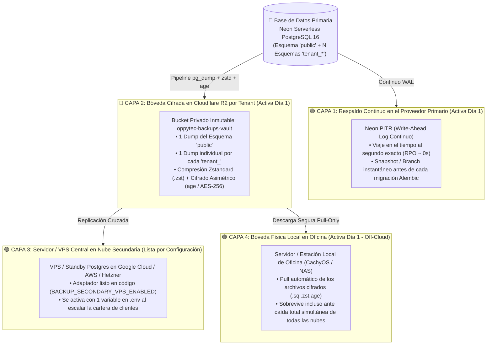

# Estrategia Maestra de Respaldos de Base de Datos en 4 Capas, Recuperación Quirúrgica por Tenant y Continuidad de Negocio (Versión 001)

> **Documento:** `estrategia_respaldos_base_datos_y_recuperacion_001.md`  
> **Versión:** 001 (Especificación Normativa de Respaldos Multi-Capa `3-2-1-1-0`, Aislamiento de Dumps por Esquema `tenant_*`, Cifrado `AES-256/age`, Integración Neon PITR + Cloudflare R2 + Servidor Local + Cloud Secundario e ISO 27001 §A.12.3.1)  
> **Base Normativa:**  
> - `MASTER-AGENTIC-ENGINEERING-FRAMEWORK.md`  
> - `propuesta_arquitectura_tree_001.md`  
> - `estrategia_migraciones_alembic_001.md`  
> - `estrategia_rbac_y_auditoria_001.md`  
> - `estrategia_testing_calidad_y_seguridad_001.md`  
> - `estrategia_entornos_y_despliegue_001.md`  
> - `estrategia_orquestacion_git_worktrees_y_smart_merge_001.md`  
> - `estrategia_visualizacion_y_auditoria_archify_001.md`  
> - `estrategia_openspec_negocio_vs_codigo_001.md`  
> - `estrategia_asistente_ai_oppyfy_rag_y_creditos_001.md`  
> - `estrategia_motor_decisiones_jev_system1_001.md`  
> - `estrategia_internacionalizacion_i18n_multilenguaje_001.md`  
> - `estrategia_multimoneda_fx_precios_y_cobros_001.md`  
> - `estrategia_observabilidad_monitoreo_y_analitica_001.md`  
> - `estrategia_almacenamiento_imagenes_r2_y_cuotas_001.md`  
> **Propósito:** Diseñar desde el Día 1 una arquitectura de respaldos y recuperación ante desastres (DRP) en **4 Capas escalables** para que la pérdida de datos de un cliente sea físicamente imposible, permitiendo operar hoy con costo casi `$0` sobre **Neon + Cloudflare R2 + Servidor Local** y encender la réplica en nube secundaria sin refactorizar una sola línea de código a medida que OppyTec escale a cientos o miles de restaurantes.  
> **Fecha:** Octubre 2026  

---

## 1. Visión Arquitectónica: Las 4 Capas de Respaldo Diseñadas para Escalar desde el Día 1

Perder los datos de inventario, recetas, facturación o contabilidad de un restaurante u hotel es inaceptable. Por ello, OppyTec v2.0 implementa la regla industrial **`3-2-1-1-0`** (3 copias, 2 tecnologías distintas, 1 en otra nube, 1 fuera de línea/inmutable, 0 errores en pruebas de restauración) estructurada en **4 Capas desacopladas por puertos (`BackupStoragePort`)**:



### 1.1 Escalabilidad Progresiva Sin Deuda Técnica
Gracias a que las 4 capas se implementan mediante el patrón de **Puertos y Adaptadores** desde el inicio de la refactorización:
- **Etapa Inicial (Hoy — Costo Marginal Casi $0):** Operan activamente la **Capa 1 (Neon PITR)**, la **Capa 2 (Cloudflare R2 Cifrado por Tenant)** y la **Capa 4 (Descarga automática al servidor/computador local de la oficina)**.
- **Etapa de Escalamiento Masivo (Cientos/Miles de Clientes):** Se enciende la **Capa 3 (`BACKUP_SECONDARY_CLOUD_ENABLED=true` en `.env`)** apuntando al VPS central en Google Cloud / AWS / Hetzner, y el motor empieza a replicar hacia la cuarta ubicación **sin tocar ni una línea de código del proyecto**.

---

## 2. El Superpoder Multi-Tenant: Respaldo y Restauración Quirúrgica de un Solo Cliente (`tenant_<slug>`)

En un SaaS Multi-Tenant donde conviven 100 o 500 restaurantes en el mismo cluster PostgreSQL, hacer únicamente un backup gigante de toda la base de datos tiene un defecto crítico: **si un solo cliente comete un error grave en su inventario a las 16:00 y pide volver a las 14:00, no puedes restaurar el cluster entero a las 14:00 porque borrarías 2 horas de ventas de los otros 499 restaurantes**.

Gracias a nuestra arquitectura de **un esquema PostgreSQL por Tenant (`tenant_<slug>`)**, `backup_manager.py` opera en **Doble Granularidad**:

### 2.1 Granularidad A: Respaldo Global del Cluster (`full_cluster` + `public`)
- Respalda el esquema `public` (Holdings, Entidades Legales, Tenants, Planes, Usuarios Globales, `llm_request_logs`, tasas FX) y la totalidad de esquemas para recuperación ante desastres totales.

### 2.2 Granularidad B: Respaldo Aislado por Cliente (`per_tenant_schema_dump`)
El orquestador consulta `SELECT id, holding_id, schema_name FROM public.tenants WHERE is_active = true` y genera un archivo independiente y cifrado para cada restaurante en el bucket privado de Cloudflare R2:

```plaintext
r2://oppytec-backups-vault/{environment}/
├── global_public/
│   └── 2026-10-17/public_20261017T030000Z.sql.zst.age
└── tenants/
    ├── holding_8a1f.../
    │   ├── tenant_restaurante_pacifico/
    │   │   ├── 2026-10-17/tenant_restaurante_pacifico_20261017T030000Z.sql.zst.age
    │   │   └── manifest_sha256.json
    │   └── tenant_hotel_pacifico/
    │       └── 2026-10-17/tenant_hotel_pacifico_20261017T030000Z.sql.zst.age
```

#### Cómo funciona la Restauración Quirúrgica de 1 Solo Restaurante en Vivo (Cero Impacto a Otros Clientes):
Si el *Restaurante Pacífico* necesita restaurar su base de datos a un punto anterior:
1. **Desde Capa 1 (Neon Instant Branching — Precisión de 1 segundo):**
   - El script crea por API una rama efímera en Neon en el segundo exacto previo al incidente (`timestamp = "2026-10-17T15:59:00Z"`), extrae con `pg_dump --schema="tenant_restaurante_pacifico"` únicamente ese esquema y destruye la rama efímera.
2. **O Desde Capa 2 / 3 / 4 (Archivo `.sql.zst.age` en R2 o Servidor Local):**
   - Descarga y desencripta en memoria el archivo exclusivo de `tenant_restaurante_pacifico`.
3. **Reemplazo Transaccional Atómico con Respaldo de Seguridad Previo:**
   - Antes de sobrescribir, guarda una instantánea del estado actual (`pre_restore_safety_snapshot`), restaura el esquema `tenant_restaurante_pacifico` dentro de una transacción aislada, verifica que su `alembic_version` coincida con el `HEAD` actual y registra la operación en la auditoría forense. **Los demás restaurantes ni se enteran.**

---

## 3. Seguridad Criptográfica, Retención Inteligente y Gancho con Alembic

### 3.1 Compresión `Zstandard (.zst)` + Cifrado Asimétrico `age / AES-256` (ISO 27001 §A.10.1.1)
1. **Prohibido guardar `.sql` en texto plano en la nube:** Todo dump pasa por una tubería en memoria (`pg_dump | zstd -10 | age -r $BACKUP_PUBLIC_KEY`) antes de tocar Cloudflare R2 o el VPS secundario.
2. **Separación de Llaves (Seguridad anti-ransomware):**
   - El servidor de producción solo conoce la **Llave Pública de Cifrado (`BACKUP_ENCRYPTION_PUBLIC_KEY`)**: puede crear y subir respaldos cifrados, pero **no tiene la llave privada para desencriptarlos**.
   - La **Llave Privada de Desencriptación (`BACKUP_DECRYPTION_PRIVATE_KEY`)** reside resguardada en el Secret Manager de administración / en tu servidor local de oficina (Capa 4). Incluso si un atacante comprometiera un servidor cloud, los backups son matemáticamente ilegibles.
3. **Inmutabilidad contra Borrado Malicioso (*Object Lock / Pull-Only Layer 4*):**
   - El bucket `oppytec-backups-vault` en R2 aplica políticas de ciclo de vida y el servidor local de oficina (Capa 4) descarga los respaldos en modo **Pull-Only** (el servidor local pide los archivos a R2; la nube jamás tiene credenciales para entrar a borrar archivos de tu servidor local).

### 3.2 Política de Retención `GFS` (Abuelo-Padre-Hijo) para Optimizar Espacio
Para no acumular terabytes innecesarios a medida que crezca el número de tenants:
- **Diarios (*Son*):** Se conservan los últimos **7 días** de respaldos diarios por Tenant.
- **Semanales (*Father*):** Se conserva el respaldo de cada domingo durante **4 semanas**.
- **Mensuales (*Grandfather*):** Se conserva el respaldo del último día de cada mes durante **12 meses**.
- **Pre-Migración (*Alembic Safety Snapshots*):** Antes de cada `alembic upgrade head` en `staging` o `production`, el motor genera automáticamente un respaldo etiquetado `pre_alembic_NNNN` para garantizar rollback sin pérdida de datos.

---

## 4. "Un Respaldo No Probado No Existe": Verificación Automática de Restauración (*Restore Drill*)

Uno de los errores más graves en la industria es descubrir el día de una emergencia que los backups llevaban meses guardándose corruptos. En OppyTec v2.0 implementamos el **Verificador Automático de Integridad de Respaldos**:
1. **Validación Inmediata Post-Backup:** Comprueba que el archivo `.sql.zst.age` tenga tamaño `> 0`, calcula su hash `SHA-256` y lo registra en `public.backup_execution_logs`. Si un backup falla o demora más de lo esperado, dispara una alerta inmediata en **Sentry / Grafana** (conectado con `estrategia_observabilidad_monitoreo_y_analitica_001.md`).
2. **Simulacro Automatizado de Restauración (*Automated Restore Drill*):**
   - Un job de verificación levanta un contenedor PostgreSQL efímero aislado, toma el último respaldo cifrado de un Tenant, lo desencripta, lo restaura y ejecuta una consulta de paridad de tablas y conteo de filas (`COUNT(*)` en `productos`, `registro_stock`, `ventas`), certificando con `Exit Code 0` que el respaldo es **100% restaurable**.

---

## 5. Consola de Respaldos y Recuperación en `platform-admin` (SuperUser OppyTec)

Dentro del Panel de Administración de OppyTec (`features/platform-admin/`), el `SuperUser` cuenta con la vista **"Bóveda de Respaldos y Continuidad de Negocio (`Backups & DRP Console`)"**, filtrable por `Environment` (`production` | `staging`):

1. **Semáforo de las 4 Capas en Tiempo Real:**
   - **Capa 1 (Neon PITR):** Estado de retención WAL y ventana de recuperación activa.
   - **Capa 2 (Cloudflare R2 Vault):** Último backup global y por Tenant, peso comprimido total (`MB/GB`) y verificación `SHA-256`.
   - **Capa 3 (VPS Secundario Cloud):** Estado `STANDBY_READY` / `ACTIVE_SYNC`.
   - **Capa 4 (Servidor Local Oficina):** Timestamp de la última sincronización descargada a oficina (`last_local_pull_at`).
2. **Explorador de Respaldos por Holding y Tenant:**
   - Permite buscar cualquier restaurante, ver todos sus puntos de restauración disponibles y disparar con 1 clic un **"Respaldo Manual Instantáneo"** antes de realizar un mantenimiento.
3. **Asistente de Restauración Quirúrgica Protegido:**
   - Permite restaurar un `tenant_<slug>` específico a un punto en el tiempo (exigiendo confirmación de seguridad del SuperUser y dejando registro inmutable en `global_audit_activity_log`).

---

## 6. Artefactos a Construir en el Proyecto (Nombres y Ubicaciones)

| # | Artefacto | Ruta Exacta en el Proyecto | Propósito |
|---|---|---|---|
| **1** | **ADR de Respaldos en 4 Capas** | `docs/adr/ADR-018-four-layer-encrypted-backups-and-per-tenant-restore.md` | Congela la arquitectura de 4 capas (Neon PITR, R2 Cifrado, VPS Secundario y Servidor Local) y la restauración quirúrgica por esquema. |
| **2** | **Specs Bipartitos (OpenSpec)** | `specs/business-domain/data-security-and-backups.business.spec.md` + `specs/engineering-code/data-security-and-backups.code.spec.md` | Explicación de continuidad operativa y garantías de protección de datos para clientes (`business`) + contrato técnico de `pg_dump`, `zstd`, `age` y tablas de control (`code`). |
| **3** | **Regla Agéntica Inmutable** | `.agent/rules/19-database-backups-and-disaster-recovery.md` | Exige snapshot pre-migración Alembic, cifrado obligatorio antes de subir a R2 y prohibición de restauraciones destructivas sin snapshot previo. |
| **4** | **Skill de Respaldos y DRP** | `.agent/skills/db_backup_recovery/SKILL.md` | Comandos y procedimientos para ejecutar backups globales, backups por `tenant_<slug>`, sincronización local (Capa 4) y simulacros de restauración. |
| **5** | **Motor y Adaptadores de Backup** | `oppytec-backend/src/core/backup/` (`protocol.py`, `neon_pitr_adapter.py`, `r2_vault_adapter.py`, `secondary_vps_adapter.py`, `crypto_stream.py`) | Implementa los puertos de las 4 capas, compresión `zstd`, cifrado `age` y registro en `public.backup_execution_logs`. |
| **6** | **CLI de Respaldos y Sincronización Local** | `oppytec-backend/scripts/backup_manager.py` | Ejecuta `backup-all`, `backup-tenant`, `pre-migration-snapshot`, `restore-tenant`, `verify-drill` y `pull-to-local-office`. |
| **7** | **Quality Gate de Cifrado y Restauración** | `oppytec-backend/tests/architecture/test_backup_encryption_and_tenant_restore.py` | Verifica que ningún backup se genere en texto plano, que un dump de `tenant_a` se restaure íntegramente sin afectar a `tenant_b` y que el checksum `SHA-256` sea exacto. |

---

## 7. Especificaciones de Referencia para la Construcción

### 7.1 Regla Agéntica: `.agent/rules/19-database-backups-and-disaster-recovery.md`

```markdown
# Regla 19: Gobernanza de Respaldos en 4 Capas, Cifrado Obligatorio y Restauración Quirúrgica por Tenant

## 1. Prohibición de Respaldos en Texto Plano (Zero Unencrypted Dumps)
- Ningún proceso, script ni endpoint puede escribir o subir archivos `.sql` o `.dump` sin cifrar a Cloudflare R2, VPS secundario ni almacenamiento externo.
- Todo respaldo DEBE pasar por el flujo en streaming `pg_dump -> zstd -> age (AES-256)` generando artefactos `.sql.zst.age` junto con su manifiesto `SHA-256`.

## 2. Doble Granularidad Obligatoria (`public` + `tenant_<slug>`)
- Los respaldos programados deben generar tanto el dump del esquema `public` como dumps individuales por cada esquema `tenant_<slug>` activo en `r2://{bucket}/{env}/tenants/{holding_id}/{tenant_schema}/`.
- Toda restauración de un cliente (`restore-tenant`) debe aislarse exclusivamente a su esquema `tenant_<slug>`, generando antes un `pre_restore_safety_snapshot` automático y sin interrumpir ni alterar ningún otro esquema del cluster.

## 3. Snapshot Pre-Migración Alembic Obligatorio
- En `staging` y `production`, antes de ejecutar `alembic upgrade head`, el pipeline debe invocar obligatoriamente `python scripts/backup_manager.py pre-migration-snapshot`.
```

---

### 7.2 Quality Gate Determinista: `oppytec-backend/tests/architecture/test_backup_encryption_and_tenant_restore.py`

```python
from pathlib import Path

def test_backup_pipeline_enforces_encryption_and_per_tenant_isolation() -> None:
    """
    Garantiza mecánicamente:
    1. Que todo artefacto generado por el motor de backups tenga extensión '.sql.zst.age'
       y nunca comience con cabeceras SQL en texto plano ('-- PostgreSQL database dump').
    2. Que la restauración quirúrgica de 'tenant_a' restablezca exactamente sus datos
       sin modificar ni una sola fila de 'tenant_b' ni de 'public'.
    3. Que los puertos de las 4 capas (Neon PITR, Cloudflare R2, VPS Secundario y Pull Local)
       cumplan el protocolo BackupStoragePort.
    """
    backend_root = Path(__file__).resolve().parents[2]
    backup_dir = backend_root / "src" / "core" / "backup"
    assert backup_dir.exists(), "El módulo central src/core/backup/ debe existir"
```
