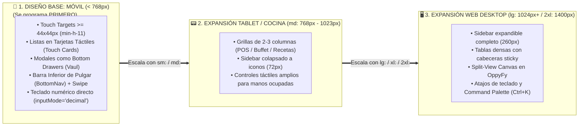

# Estrategia Maestra de Sistema de Diseño (UI/UX), Rescate del ADN Visual de Legacy y Arquitectura "Mobile-First" (Versión 001)

> **Documento:** `estrategia_sistema_diseno_ux_ui_y_mobile_first_001.md`  
> **Versión:** 001 (Especificación Normativa de Coherencia Visual 100% con `OppyTec-Legacy`, Los 3 Temas `light`/`dark`/`ocean-blue`, Animaciones Semánticas, Gestos Táctiles, Librerías Interactivas y Diseño *Mobile-First* Progresivo)  
> **Base Normativa:**  
> - `MASTER-AGENTIC-ENGINEERING-FRAMEWORK.md`  
> - `propuesta_arquitectura_tree_001.md`  
> - `specs/04-DESIGN-SYSTEM.md`  
> - Las **15 Estrategias Maestras (`estrategia_*_001.md`)** de OppyTec v2.0.  
> **Propósito:** Garantizar que cada vista, botón, modal, tabla, animación y efecto que se construya en `oppytec-frontend` conserve al 100% la identidad visual, paleta cromática, micro-interacciones y fluidez de `OppyTec-Legacy`, aplicando desde la primera línea de CSS/Tailwind la filosofía estricta **"Mobile-First y luego Web (Desktop)"**.  
> **Fecha:** Octubre 2026  

---

## 1. Principio Rector: Rescate Exhaustivo del ADN Visual de Legacy + Filosofía *Mobile-First*

Para el usuario final (dueño de restaurante, chef, bodeguero, cajero), **la interfaz ES el producto**. Durante la refactorización hacia OppyTec v2.0 está estrictamente prohibido que los agentes de IA generen interfaces genéricas o dispares:

1. **Inspección Previa Obligatoria de `OppyTec-Legacy/OppyTec_Frontend/`:**
   - Antes de construir o refactorizar cualquiera de las 22 secciones en `oppytec-frontend/src/features/`, el **Agente 05 (`05-frontend-senior-dev.md`)** tiene la obligación de inspeccionar en modo lectura la vista original en `OppyTec-Legacy/OppyTec_Frontend/src/pages/` y sus componentes en `src/components/` para rescatar cada detalle de diseño, distribución, colores, iconos, efectos hover, modales y tours guiados.
2. **Filosofía Estricta *"Mobile-First, Then Web"*:**
   - En la operación gastronómica real, el personal usa celulares y tablets en movimiento (bodegas, pasillos, cocina, terraza) y computadores en caja/oficina.
   - **Regla de codificación CSS/Tailwind:** Todo componente se diseña y escribe primero para pantallas móviles (`360px – 430px`, clases base sin prefijo en Tailwind) y luego se expande progresivamente hacia tablets (`sm:`, `md:`) y monitores de escritorio (`lg:`, `xl:`, `2xl:`).

---

## 2. El ADN Visual de OppyTec Rescatado de Legacy (`index.css`, `useTheme.tsx`, `categoriaUI.ts`)

### 2.1 Los 3 Temas Oficiales del Sistema (`light` ↔ `dark` ↔ `ocean-blue`)
A diferencia de un sistema común de 2 temas, OppyTec cuenta con **3 temas visuales completos** gestionados por `ThemeProvider` (`useTheme.tsx`), todos basados en la fuente tipográfica **`'Outfit', sans-serif` (pesos 300, 400, 500, 600, 700)** y `--radius: 0.75rem`:

| Variable CSS (HSL) | ☀️ Tema 1: `light` (`:root`) | 🌙 Tema 2: `dark` (`.dark`) | 🌊 Tema 3: `ocean-blue` (`.ocean-blue`) | Función Visual |
|---|---|---|---|---|
| `--background` | `220 33% 98%` | `224 71% 4%` | `222 47% 7%` *(Marino profundo)* | Fondo base con gradientes radiales sutiles en `body`. |
| `--foreground` | `224 71% 4%` | `210 20% 98%` | `210 100% 92%` *(Blanco hielo)* | Texto principal de máxima legibilidad. |
| `--card` / `--popover` | `0 0% 100%` | `224 71% 6%` | `220 40% 10%` | Superficies de tarjetas, paneles y menús flotantes. |
| `--primary` | `161 72% 38%` *(Esmeralda)* | `161 72% 45%` *(Esmeralda)* | `186 100% 50%` *(Cian Ocean Glow)* | Botones principales, anillos de foco, estados activos. |
| `--primary-foreground` | `210 20% 98%` | `224 71% 4%` | `222 47% 7%` | Contraste de texto sobre botones primarios. |
| `--secondary` | `220 14% 96%` | `215 28% 17%` | `220 35% 16%` | Botones secundarios, filtros y píldoras neutras. |
| `--muted` | `220 14% 96%` | `215 28% 17%` | `220 35% 14%` | Fondos atenuados, skeletons y cabeceras de tabla. |
| `--muted-foreground` | `220 9% 46%` | `215 20% 65%` | `213 50% 65%` | Textos secundarios, etiquetas y metadatos. |
| `--accent` | `220 14% 96%` | `215 28% 17%` | `220 35% 16%` *(Texto: `186 100% 70%`)* | Hover en listas, selectores y menús. |
| `--destructive` | `0 84% 60%` | `0 62% 30%` | `0 80% 55%` | Mermas, quiebres de stock, alertas críticas y borrado. |
| `--success` | `161 72% 38%` | `161 72% 38%` | `152 80% 50%` | Stock saludable, confirmaciones y metas cumplidas. |
| `--warning` | `38 92% 50%` | `38 92% 50%` | `42 100% 58%` | Stock bajo mínimo, lotes próximos a vencer (FEFO). |
| `--border` / `--input` | `220 13% 91%` | `215 28% 17%` | `220 40% 18%` | Bordes de inputs, divisores y grillas. |

---

### 2.2 Efectos Visuales, Glassmorphism y Micro-Animaciones de Firma (`index.css`)
Todo componente en `oppytec-frontend` debe preservar las clases y keyframes distintivos de OppyTec:

1. **Glassmorphism Adaptativo (`.glass` y `.glass-card`):**
   - En `light`/`dark`: `bg-white/70 dark:bg-black/40 backdrop-blur-md border border-white/20 dark:border-white/10 shadow-xl` con transición suave `duration-300`.
   - En `ocean-blue`: Fondo `hsla(220, 40%, 10%, 0.75)`, `backdrop-filter: blur(16px)`, sombra luminosa cian y animación `ocean-aurora-shimmer` (`4s linear infinite`) al hacer `:hover`.
2. **Animaciones Semánticas de Estado y Atención:**
   - **`.animate-blink-orange` (`2.0s ease-in-out infinite`):** Borde parpadeante ámbar con `box-shadow` para alertas preventivas y vencimientos próximos.
   - **`.animate-blink-red` (`2.0s ease-in-out infinite`):** Borde parpadeante rojo intenso para productos agotados o alertas urgentes.
   - **`.animate-blink-green` (`2.5s ease-in-out infinite`):** Borde parpadeante esmeralda para confirmaciones activas.
   - **`.animate-perimeter-glow` (`1.8s ease-in-out infinite`):** Respiración luminosa perimetral en botones de acción prioritaria (ej. *"+ Nuevo Producto"*, *"Confirmar Conteo"*).
   - **`.ocean-blue a.bg-primary` (`ocean-glow-pulse`):** Resplandor cian pulsante en el ítem activo de navegación cuando el tema `ocean-blue` está activo.
3. **Blindaje Anti-Salto de Pantalla (`CLS = 0` en Modales Radix):**
   - Se conserva íntegro el bloque CSS de alta especificidad (`html > body[data-scroll-locked]` con `scrollbar-gutter: stable !important`) que neutraliza la inyección de `margin-right` de `react-remove-scroll-bar` cuando se abren diálogos o menús desplegables.
4. **Inputs y Scrollbars Especializados:**
   - `.centered-date-input` para selectores de fecha perfectamente centrados.
   - Eliminación global de flechas nativas (`spin-button`) en `input[type="number"]`.
   - `.custom-scrollbar` (`4px`) y `.custom-table-scrollbar` (`6px`, bordes redondeados y adaptados a los 3 temas).

---

### 2.3 Paleta de 42 Colores (`PRESET_COLORS`) y 49 Íconos Gastronómicos (`CATEGORIZED_ICONS`)
Para que las **Bodegas**, **Áreas Operativas**, **Categorías de Productos/Recetas** y **Cargos RBAC** mantengan su identidad visual exacta (`BodegaBadge`, `SimpleCategoriaSeccion`, selectores con navegación por teclado `useColorKeyboardNav` y `useIconKeyboardNav`):
- **Matriz de 42 Colores (`6 filas x 7 columnas` en `categoriaUI.ts`):**
  1. *Rojos y Rosados:* `#EF4444`, `#DC2626`, `#B91C1C`, `#F43F5E`, `#E11D48`, `#EC4899`, `#DB2777`
  2. *Naranjas y Amarillos:* `#F97316`, `#EA580C`, `#D97706`, `#F59E0B`, `#EAB308`, `#FACC15`, `#CA8A04`
  3. *Verdes y Limas:* `#84CC16`, `#65A30D`, `#22C55E`, `#16A34A`, `#15803D`, `#10B981`, `#059669`
  4. *Turquesas, Cians y Azules:* `#14B8A6`, `#06B6D4`, `#0891B2`, `#0EA5E9`, `#0284C7`, `#3B82F6`, `#2563EB`
  5. *Índigos, Púrpuras y Violetas:* `#6366F1`, `#4F46E5`, `#A855F7`, `#9333EA`, `#8B5CF6`, `#7C3AED`, `#C026D3`
  6. *Grises y Neutros:* `#94A3B8`, `#64748B`, `#475569`, `#78716C`, `#57534E`, `#525252`, `#334155`
- **Las 5 Familias de Íconos (`lucide-react`):** `🍽️ Alimentos` (21 íconos), `🥤 Bebidas` (8 íconos), `🧼 Operación y limpieza` (8 íconos), `🌱 Especiales` (4 íconos) y `General / UI` (8 íconos).

---

### 2.4 Ecosistema de Librerías de Interacción y Movimiento que dan el "Toque OppyTec"

| Librería / Hook | Cómo se Utiliza en OppyTec v2.0 |
|---|---|
| **`framer-motion`** | Transiciones suaves entre vistas (`AnimatePresence`), acordeones de familias de productos, micro-interacciones de tarjetas y el botón flotante de carrito de compra/consumo arrastrable (`drag`, `dragConstraintsRef`). |
| **`useSwipeNavigation`** | Permite deslizar horizontalmente con el dedo en móvil (desde cabeceras/`h1..h6`/`.glass`) o con dos dedos en el touchpad de PC para navegar secuencialmente entre las secciones de la plataforma con *cooldown* de `500ms`. |
| **`vaul` + `@radix-ui/*`** | Primitivas accesibles para diálogos, popovers, menús, tabs, acordeones y *Bottom Drawers* táctiles en móvil. |
| **`driver.js` (`.oppy-driver-popover`)** | Tours interactivos guiados paso a paso con el estilo visual de tarjetas y botones de OppyTec (`src/tours/`). |
| **`@dnd-kit/core` & `sortable`** | Arrastrar y soltar para ordenar estaciones de buffet, categorías, tareas y columnas. |
| **`html5-qrcode` & `react-easy-crop`** | Escaneo de códigos de barra con la cámara del celular (`BarcodeScanner.tsx`) y recorte interactivo de imágenes/mosaicos de buffet (`ImageCropper.tsx`, `ImageMosaicModal.tsx`). |
| **`sonner`** | Notificaciones toast flotantes enriquecidas y coherentes con el tema activo. |
| **`recharts` + `katex`** | Gráficos analíticos interactivos y renderizado matemático de fórmulas en `OppyFy` y reportes. |

---

## 3. Arquitectura Estricta "Mobile-First, Then Web"

### 3.1 Las 5 Reglas Inquebrantables del Desarrollo *Mobile-First*
1. **Ergonomía Táctil (`>= 44x44 px`):** Todo botón interactivo, selector de bodega, fila seleccionable o control de `+ / -` en conteo de inventario debe tener un área táctil mínima de `44px` en móvil para evitar clics erróneos en cocina o bodega.
2. **Patrón de Vista Adaptativa (`<AdaptiveDataView />`):**
   - Prohibido mostrar una tabla de 10 columnas aplastada en una pantalla de celular.
   - En pantallas `< md` (`< 768px`), los listados se muestran como **Tarjetas Operativas Táctiles (`MobileCard`)** con foto `thumb.webp`, badge de categoría/bodega, saldo grande y botones de acción rápida; en `>= md` se renderiza la `DataTable` completa.
3. **Diálogos Responsivos (`<ResponsiveDialog />`):**
   - En móvil (`useIsMobile() === true`), los formularios y selectores se abren como un **Drawer inferior deslizable (`vaul`)** con soporte de teclado virtual (`dvh` — *Dynamic Viewport Height* para que el teclado del celular nunca tape el botón "Guardar"). En escritorio se abren como `Dialog` centrado.
4. **Cabecera y Controles Superiores Compactos en Móvil:**
   - En móvil, el `Navbar` agrupa de forma limpia y accesible el selector de Bodega/Sucursal, el `<LanguageFlagSelector />` (bandera SVG) y el `<CurrencySelector />` sin desbordar el ancho de pantalla (`overflow-x-hidden`).
5. **Teclados Nativos Inteligentes:**
   - Todo `<NumericInput />` (cantidades de stock, precios, pesos, mermas) declara `inputMode="decimal"` para invocar automáticamente el teclado numérico grande en iOS y Android.

---

## 4. Mapa de las 22 Vistas de `OppyTec-Legacy` a Auditar y Preservar

El **Agente 05 (Frontend Senior)** debe auditar y mantener la paridad visual y de interacción de las 22 páginas existentes en `OppyTec-Legacy/OppyTec_Frontend/src/pages/`:
1. `Login` y `SelectTenant`
2. `HomeDashboard`
3. `StockRegistro` (`MermaDialog`, `CompraDialog`, carrito flotante)
4. `ContarInventario` y `RecuentoInventario`
5. `Gestion` (Pestañas: *Productos* [Wizard 4 pasos + Excel IA], *Recetas*, *Combos*, *Grupos de Opciones*, *Pedidos*, *Mermas*)
6. `GestionarMerma` (`KpiDashboard`, `MermaStats`, Heatmap 7x24, `MermaHistory`)
7. `Compras`, `Proveedores` (`ConectarProveedorDialog`) y `facturas`
8. `Consumo` (Registro de consumo y *Manos Libres* con voz Silero VAD)
9. `Eventos` (`EventoDialog`, salones y buffet con `ImageCropper` / `ImageMosaicModal`)
10. `Proyeccion`, `Historial`, `Informes` y `Reportes` (Resumen General, Ejecutivo, Control de Pérdidas, Eficiencia, Visión Financiera)
11. `Actividades` (Notas, Tareas, Horarios/Turnos, Usuarios/Cargos), `Alertas` y `Notificaciones`
12. `Configuracion`, `Profile`, `Admin` (`platform-admin`) y `OppybotWorkspace` (evolucionado a **`OppyFy`**).

---

## 5. Artefactos a Construir en el Proyecto (Nombres y Ubicaciones)

| # | Artefacto | Ruta Exacta en el Proyecto | Propósito |
|---|---|---|---|
| **1** | **ADR de Diseño y Mobile-First** | `docs/adr/ADR-020-legacy-visual-dna-three-themes-and-mobile-first.md` | Congela los 3 temas (`light`, `dark`, `ocean-blue`), las animaciones semánticas, el rescate visual de Legacy y la arquitectura *Mobile-First*. |
| **2** | **Regla Agéntica Inmutable** | `.agent/rules/21-design-system-legacy-dna-and-mobile-first.md` | Obliga a inspeccionar la vista en `OppyTec-Legacy` antes de migrarla, prohíbe colores hardcodeados fuera de tokens y exige diseño *Mobile-First* (`>= 44px` touch targets, `dvh`, `<ResponsiveDialog />`). |
| **3** | **Skill del Sistema de Diseño** | `.agent/skills/ui_ux_design_system/SKILL.md` | Catálogo de clases `.glass`, `.animate-blink-*`, `.animate-perimeter-glow`, `PRESET_COLORS` (42), `CATEGORIZED_ICONS` (49) y patrones *Mobile-First*. |
| **4** | **Hoja de Estilos y Temas Base** | `oppytec-frontend/src/index.css` y `src/shared/theme/ThemeProvider.tsx` | Implementa los 3 temas (`light`, `dark`, `ocean-blue`), el fix `CLS=0` de Radix, estilos `driver.js` y animaciones. |
| **5** | **Componentes Adaptativos Mobile-First** | `oppytec-frontend/src/shared/components/ui/` (`ResponsiveDialog.tsx`, `AdaptiveDataView.tsx`, `NumericInput.tsx`, `BottomNav.tsx`) | Garantizan que cada modal, tabla e input funcione de forma nativa en celular, tablet y escritorio. |
| **6** | **Quality Gate Visual y Mobile-First** | `oppytec-backend/tests/architecture/test_ui_design_tokens_and_mobile_first.py` | Verifica que `index.css` conserve los 3 temas (`:root`, `.dark`, `.ocean-blue`), las animaciones semánticas, los 42 `PRESET_COLORS` y que no se introduzcan estilos inline arbitrarios que rompan los temas. |
