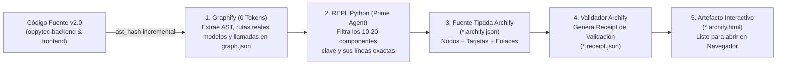

# Estrategia Maestra de Visualización Interactiva y Auditoría de Arquitectura con Archify (Versión 001)

> **Documento:** `estrategia_visualizacion_y_auditoria_archify_001.md`  
> **Versión:** 001 (Especificación Normativa del Atlas Visual Interactivo, Trazabilidad Código $\to$ Diagrama y Sinergia `Graphify` $\to$ `Archify`)  
> **Base Normativa:**  
> - `MASTER-AGENTIC-ENGINEERING-FRAMEWORK.md`  
> - `propuesta_arquitectura_tree_001.md`  
> - `estrategia_migraciones_alembic_001.md`  
> - `estrategia_rbac_y_auditoria_001.md`  
> - `estrategia_testing_calidad_y_seguridad_001.md`  
> - `estrategia_entornos_y_despliegue_001.md`  
> - `estrategia_orquestacion_git_worktrees_y_smart_merge_001.md`  
> - **Repositorio Base:** `tt-a1i/archify` (v3.1.0+ — *Interactive Source-Backed Architecture Diagrams*).  
> **Propósito:** Establecer cómo se construye y mantiene el **Atlas Visual Interactivo de OppyTec v2.0 (`docs/architecture/atlas/`)** a medida que avanza la refactorización paso a paso, permitiendo auditar visualmente los modelos, esquemas (`public` vs `tenant_*`), reglas de negocio, jerarquía RBAC y flujos de resiliencia en archivos HTML autocontenidos sin desperdiciar tokens de contexto.  
> **Fecha:** Octubre 2026  

---

## 1. Propósito y Matriz de Complementariedad (`Graphify` vs `Mermaid` vs `Archify`)

Durante la refactorización de un sistema complejo como OppyTec v2.0, auditar miles de líneas nuevas de Python y TypeScript leyendo archivo por archivo dificulta ver el panorama completo. Para resolverlo sin contaminar la ventana de contexto de los agentes, utilizamos **tres herramientas complementarias**, cada una con una responsabilidad estrictamente delimitada:

| Herramienta | Consumidor Principal | Nivel de Abstracción | Propósito Exacto en OppyTec v2.0 | Costo de Tokens en el Ciclo Diario |
|---|---|---|---|---|
| **1. `Graphify`** | **Agentes de IA y Scripts (`harness.py`, `pytest`)** | **Micro-Nivel (25.000+ nodos AST)** | Grafo matemático crudo de funciones, clases, imports y tests para calcular radio de impacto (*1-hop*) y *Test Impact Analysis* en milisegundos. | **0 tokens** (Extracción AST determinista + consulta en REPL Python) |
| **2. `Mermaid`** | **Lectura Rápida en Archivos `.md`** | **Esquemático Estático (5–15 nodos)** | Diagramas pequeños embebidos dentro de `specs/*.md` y ADRs para explicar conceptos puntuales. | Mínimo (Texto plano dentro del `.md`) |
| **3. `Archify` (`tt-a1i/archify`)** | **Arquitecto Humano y Auditoría de Fases** | **Macro y Meso Interactivo (8–25 nodos semánticos con tarjetas ricas)** | Genera **archivos `.html` interactivos autocontenidos** (respaldados por fuentes JSON tipadas y enlaces al código real) para explorar rutas, fronteras de confianza (*Trust Boundaries*) y reglas de negocio. | **0 tokens durante la codificación** (Se ejecuta solo al cerrar cada Fase o bajo demanda alimentado por `Graphify`) |

---

## 2. La Sinergia `Graphify` $\to$ `Archify` (Cero Desperdicio de Tokens)

El error más común al usar generadores de diagramas con IA es pedirle al agente que lea 60 archivos del repositorio para dibujar la arquitectura, consumiendo 100.000 tokens. En **OppyTec v2.0** aplicamos un flujo de **2 etapas con costo mínimo**:

1. **Extracción Determinista Previa:** `Graphify` ya conoce todas las tablas, modelos SQLAlchemy, servicios, routers FastAPI y componentes React con sus rutas de archivo exactas.
2. **Regla de Oro de `Archify` (*"Put supporting detail in cards instead of adding more edges"*):**
   - El lienzo visual se mantiene limpio (entre **8 y 20 nodos semánticos** por mapa, agrupados por *Trust Boundaries* y capas).
   - Toda la riqueza técnica (columnas de la tabla, restricciones `UNIQUE`/`FK`, fórmula de conversión de 3 capas, ecuación RBAC, código de permiso `<modulo>.<submodulo>.<funcion>` y enlace directo al archivo `.py`/`.tsx`) se almacena **dentro de la tarjeta interactiva (`card`) de cada nodo**.
3. **Fuente Tipada Editable (`*.archify.json`):**
   - Nunca se edita el HTML a mano. Siempre se actualiza la fuente tipada JSON en `docs/architecture/atlas/sources/*.archify.json` y el motor de Archify compila y valida el `.html` resultante.

---

## 3. El "Atlas Visual Interactivo" de OppyTec v2.0 (`docs/architecture/atlas/`)

A medida que avanzamos por las **6 Fases de `specs/06-IMPLEMENTATION-PLAN.md`**, el proyecto construye y actualiza **5 Mapas Interactivos Canónicos**:

| # | Mapa Interactivo (`docs/architecture/atlas/`) | Se Construye / Actualiza en... | Qué te Permite Auditar Visualmente |
|---|---|---|---|
| **Mapa 1** | **`01-tenancy-and-schemas.archify.html`** *(Fuente: `01-tenancy-and-schemas.archify.json`)* | **Fase 2** (Base de Datos, Esquemas, Backups 4-Capas y Bootstrap Génesis) | • Frontera física entre el esquema `public` (`PublicBase`) y los esquemas `tenant_<slug>` (`TenantBase`). • El **SuperUser Génesis (`oppytec.admin`)**, Holdings, Entidades Legales (relación `1:1` con Tenant), Tenants y Módulos. • El flujo de migraciones correlativas (`0001..NNNN`) y las **4 Capas de Respaldos Cifrados (`Neon PITR + R2 + VPS + Local`)** con restauración quirúrgica por Tenant. |
| **Mapa 2** | **`02-rbac-quotas-and-audit.archify.html`** *(Fuente: `02-rbac-quotas-and-audit.archify.json`)* | **Fase 3** (Identidad, RBAC Dual, RBAC `OppyFy`, Cupos y Auditoría) | • Las **2 áreas de RBAC del ERP** (Trabajadores de OppyTec en `public` vs. Clientes en `Holding`/`tenant_*`) + el **Panel RBAC Exclusivo de `OppyFy`** (con Dominios y Sub-dominios editables por cliente). • La jerarquía de rangos (`Rank 0..30+`), el acceso transversal en el Holding y los permisos temporales JIT. • Las **3 Cuotas Comerciales**: Cupos de trabajadores (`soft-delete` + Kill-Switch Redis), Cuota de Memoria de Imágenes R2 (`max_storage_mb`) y Billetera de Créditos `OppyFy` acumulables sin caducidad. |
| **Mapa 3** | **`03-clean-architecture-and-domain.archify.html`** *(Fuente: `03-clean-architecture-and-domain.archify.json`)* | **Fases 3 y 4** (Módulos de Negocio, `OppyFy`, `JEV`, `i18n` y `FX`) | • Los 10 módulos de negocio y sus anillos de Clean Architecture (`Domain <- Application <- Infrastructure / Presentation`). • El cerebro de **`OppyFy` (RAG en 3 Capas + funciones en código duro + `llm_request_logs`)** y el motor **`JEV (Sistema 1)`**. • El sistema **`i18n` Estático y Dinámico** (con memoria global y filtro de nombres propios como `"Pollo King"`) y el **Motor Multi-Moneda FX (BCCh + BCE)**. |
| **Mapa 4** | **`04-critical-runtime-flows-and-resilience.archify.html`** *(Fuente: `04-critical-runtime-flows.archify.json`)* | **Fases 4, 5 y 6** (Endpoints, UI React 19, R2 WebP y Resiliencia) | • Recorrido E2E desde React (`<Can>`, `<LanguageFlagSelector>`, `<CurrencySelector>`) $\to$ FastAPI $\to$ Guard RBAC $\to$ Redis $\to$ PostgreSQL. • Pipeline de subida de imágenes R2 (`Magic Bytes -> Strip EXIF -> thumb.webp + display.webp -> Cuota MB`). • Rutas de **Caída de Redis (Vector 10)**, **Escudo Anti-Anomalías FX (`> 8%`)** y **Prevención de Deadlocks (`ORDER BY id ASC FOR UPDATE`)**. |
| **Mapa 5** | **`05-environments-and-agentic-harness.archify.html`** *(Fuente: `05-environments-and-harness.archify.json`)* | **Paso 0 y Fase 1** (Gobernanza Agéntica, Entornos y Observabilidad 4-Pilares) | • El grafo de `scripts/harness.py` + **Prime Agent**: Orquestador REPL, `Git Worktrees`, `claims_registry.json` (`fcntl.flock`), *Merge Train* (`rebase + --ff-only`) y Agente Árbitro de 4 vías. • La cadena de los **5 entornos** (`local -> preview -> ci -> staging -> production`) con invarianza `SHA-256`, los **3 niveles de Quality Gates** y el **Centro de Mando de Observabilidad (`OpenTelemetry` + `Grafana` + `Sentry/GlitchTip` + `Umami`)**. |

---

## 4. Capacidades de Auditoría Interactiva que Tendrás en Cada Archivo `.html`

Al abrir cualquiera de los 5 archivos `.archify.html` en tu navegador (sin necesitar ningún servidor encendido), podrás auditar el proyecto usando los controles nativos de **Archify v3.1+**:

1. **Inspección de Tarjetas de Evidencia (Clic en cualquier Nodo):**
   - Al hacer clic en un nodo (por ejemplo, `QuotaService` o `Tabla: public.tenants`), se despliega su panel lateral con:
     - **Ruta exacta del archivo y líneas de código** en el repositorio.
     - **Reglas de negocio e invariantes** que implementa.
     - **Tests que lo protegen** (enlace a su test unitario, de integración y vector Red Team).
2. **Rastreo de Alcance Aguas Arriba y Aguas Abajo (`Upstream / Downstream Reach`):**
   - Seleccionas un modelo o servicio (ej. `ProductoBodega` o `RbacEvaluator`) y activas **Downstream** para ver iluminados únicamente los módulos, endpoints y vistas de React que dependen de él (`#focus=rbac_evaluator&reach=downstream`).
3. **Sonda de Ruta Dirigida (`R` o `PATH` — *Route Probe*):**
   - Seleccionas un nodo de origen (ej. `Propietario hace Soft-Delete de Trabajador`) y un nodo de destino (ej. `Cupo Liberado + Sesión Revocada`), y Archify resalta paso a paso la cadena exacta de llamadas entre ambos (`#route=soft_delete_endpoint~redis_killswitch`).
4. **Lentes de Comparación Semántica (`L` o `LENS`):**
   - Permite filtrar y comparar dos roles o capas a la vez (por ejemplo, comparar visualmente qué nodos pertenecen al esquema `public` vs cuáles pertenecen al esquema `tenant_*`, o qué nodos pertenecen a `Domain` vs `Infrastructure` mediante `#lens=public_schema~tenant_schema`).
5. **Radar de Vista General (`M` o `MAP`) y Modo Presentación (`F`):**
   - Para navegar mapas grandes con fluidez y alternar entre tema claro/oscuro (`T`) o estilos visuales (`S`).

---

## 5. Comando de Instalación y Uso como Skill del Proyecto

La habilidad oficial de Archify se integra en `.agent/skills/archify/` (instalable mediante `npx skills add tt-a1i/archify -g` o empaquetada localmente en el repositorio) y se gobierna bajo las siguientes reglas:

### 5.1 Cuándo se Actualiza el Atlas de Archify
1. **Al cerrar cada Fase de `specs/06-IMPLEMENTATION-PLAN.md`:** Como parte del checklist de salida de la fase, el agente actualiza el archivo `*.archify.json` correspondiente con las rutas y clases reales construidas en esa fase, ejecuta el validador de Archify y regenera el `.archify.html`.
2. **Bajo demanda tuya en cualquier momento:** Cuando quieras revisar visualmente cómo quedó estructurado un módulo o flujo antes de aprobar un cambio.
3. **Nunca dentro del Fast Gate de cada micro-commit:** Para mantener el *Fast Gate* por debajo de `15 segundos` y con costo `0` de tokens.

---

## 6. Artefactos de Archify en la Estructura del Proyecto

| # | Artefacto | Ruta Exacta en el Proyecto | Propósito |
|---|---|---|---|
| **1** | **ADR del Atlas Visual** | `docs/adr/ADR-010-interactive-architecture-atlas-with-archify.md` | Establece el uso de `Graphify` (AST para agentes) + `Archify` (Atlas HTML interactivo para auditoría humana). |
| **2** | **Regla Agéntica de Visualización** | `.agent/rules/11-visual-architecture-and-archify-atlas.md` | Define la regla *"details in cards, not excessive edges"*, la alimentación desde `Graphify` y la actualización por fase. |
| **3** | **Skill de Archify** | `.agent/skills/archify/SKILL.md` | Contrato de generación, validación de esquema JSON y compilación a HTML autocontenido. |
| **4** | **Fuentes Tipadas del Atlas** | `docs/architecture/atlas/sources/01..05-*.archify.json` | Fuentes JSON versionadas en Git de los 5 mapas arquitectónicos de OppyTec v2.0. |
| **5** | **Atlas HTML Interactivo** | `docs/architecture/atlas/01..05-*.archify.html` | Los 5 tableros interactivos autocontenidos listos para abrir en el navegador y auditar el sistema. |
