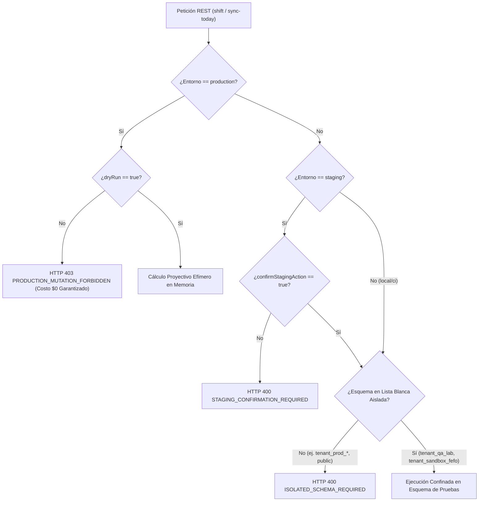

# Lab & QA Sandbox — Arquitectura Técnica de Referencia

## 1. Visión General de la Arquitectura

La consola **Lab & QA Sandbox** implementa un subsistema integral de experimentación, calidad, simulación y observabilidad para **Platform Admin** en OppyTec v2.0 (`/admin/sandbox`). Conecta la capa de presentación de React 19 SPA con la capa de aplicación y servicios de backend en FastAPI, respaldada por un Catálogo Dinámico de Tests Playwright con streaming reactivo vía Server-Sent Events (SSE), Switch Maestro de datos sintéticos (`demo` vs `clean`), catálogo de 4 presets gastronómicos canónicos, simulador de envejecimiento temporal FEFO con motor de Time-Travel (-30 a +60 días), acción quirúrgica de sincronización a hoy, guardarraíles fail-fast por entorno y telemetría distribuida OpenTelemetry con propagación W3C TraceContext.

```mermaid
flowchart TD
    subgraph Frontend["Frontend React 19 SPA (/admin/sandbox)"]
        Layout["SandboxLayout.tsx (Context, Tabs & Nav)"]
        MasterSwitch["MockDataMasterSwitch.tsx (Demo vs Clean)"]
        MockDataView["MockDataSandboxView.tsx (Generador, Editor & Presets)"]
        PlaywrightView["PlaywrightRunnerSandboxView.tsx (Dynamic Runner & SSE Terminal)"]
        FefoView["FefoDatesSandboxView.tsx (Time-Travel & FEFO Simulation)"]
        StorageUtil["mockModeStorage.ts (localStorage: oppytec_mock_data_mode)"]
        HTTPClient["httpClient.ts (X-OppyTec-Mock-Mode Header Injection)"]
        SandboxAPI["sandbox/sandboxApi.ts (FEFO API, SSE Client, Traceparent)"]
        FefoMath["fefoMath.ts (Zero-Lag Pure Functional Calculations)"]
        SandboxTypes["sandboxTypes.ts (0 any, Readonly DTOs & Constants)"]
    end

    subgraph API["FastAPI Application & Presentation Layer"]
        Router["sandbox_router.py (/api/v1/platform-admin/sandbox)"]
        RBAC["RequireGlobalPermission (platform_admin.sandbox.access/manage)"]
        EnvGuard["EnvironmentIsolationGuard (Fail-fast 403 on Prod Mutations)"]
        SchemaGuard["IsolatedSchemaGuard (tenant_qa_* / tenant_sandbox_*)"]
        OTel["OpenTelemetry Tracer (oppytec.sandbox) & structlog JSON"]
        Schemas["schemas_sandbox.py (Pydantic v2 Models extra='forbid')"]
    end

    subgraph CoreServices["Domain & Application Services"]
        SandboxService["SandboxApplicationService (tenancy/sandbox_service.py)"]
        PWRegistry["_PLAYWRIGHT_TESTS_REGISTRY (Declarative 38 Canonical Tests)"]
        PresetEngine["Gastronomic Presets & Factory Reset Engine"]
        MockGen["Synthetic Data Generator Engine"]
        E2ERunner["Playwright Stream Broadcaster & Worker Dispatcher"]
        FefoEngine["FEFO Time-Shift Engine & Loss Calculator (Memory & Shift)"]
    end

    subgraph DataIsolation["Data Schemas & Tenancy Isolation"]
        PublicSchema["public schema (Holdings, Tenants, System Plans, llm_request_logs)"]
        IsolatedTenants["tenant_qa_* / tenant_sandbox_* (Authorized Test Tenants)"]
        ProdTenants["Production Commercial Tenants (Hard-Blocked HTTP 400/403)"]
    end

    Layout --> MockDataView & PlaywrightView & FefoView
    PlaywrightView --> SandboxAPI
    PlaywrightView --> SandboxTypes
    MockDataView --> MasterSwitch
    MasterSwitch --> StorageUtil
    StorageUtil --> HTTPClient
    FefoView --> FefoMath
    FefoView --> SandboxAPI
    FefoView --> SandboxTypes
    MockDataView & FefoView --> SandboxAPI
    SandboxAPI -->|HTTP REST + Bearer JWT + W3C TraceContext| Router
    SandboxAPI -->|GET /stream/{run_id} EventSource SSE| Router
    Router --> RBAC
    Router --> EnvGuard
    Router --> SchemaGuard
    Router --> OTel
    Router --> Schemas
    Router --> SandboxService
    SandboxService --> PWRegistry
    SandboxService --> PresetEngine & MockGen & E2ERunner & FefoEngine
    PresetEngine --> IsolatedTenants
    MockGen --> IsolatedTenants
    E2ERunner --> IsolatedTenants
    FefoEngine --> IsolatedTenants
    EnvGuard -.->|Blocks Mutations HTTP 403| ProdTenants
    SchemaGuard -.->|Blocks Customer Schemas HTTP 400| ProdTenants
    SandboxService -.-> PublicSchema
```

---

## 2. Consola Dinámica y Extensible de Tests Playwright

### 2.1 Principio Zero-Code Frontend Addition y Patrón Registry
Para eliminar el acoplamiento histórico de listas estáticas en el frontend, el sistema implementa el **Patrón de Registro Declarativo (Registry Pattern)**:
- Los casos de prueba se declaran en el backend dentro de `_PLAYWRIGHT_TESTS_REGISTRY` en `sandbox_service.py`.
- Cada elemento define identificador canónico (`id`), dominio de negocio (`domain`), título descriptivo (`title`), descripción de flujos y asertos (`description`), estado de madurez (`status`), etiquetas de filtrado (`tags`) y duración estimada en segundos (`estimated_duration_sec`).
- El frontend consulta dinámicamente `GET /playwright/catalog` al montar la vista; cualquier caso añadido, actualizado o promovido de estado aparece inmediatamente en la interfaz sin requerir despliegues ni modificaciones en el código de React.

### 2.2 Invariantes Matemáticas de Dominio
El agregador de catálogo en `SandboxApplicationService.get_catalog()` garantiza de forma determinista:
1. **Conservación de Conteos Globales:**
   $$\text{Total} = \text{Ready} + \text{InProgress} + \text{Planned}$$
2. **Cálculo Determinista de Cobertura Global:**
   $$\text{CoveragePercentage} = \begin{cases} 0.0 & \text{si } \text{Total} = 0 \\ \operatorname{round}\left(\frac{\text{Ready}}{\text{Total}} \times 100, 1\right) & \text{si } \text{Total} > 0 \end{cases}$$
3. **Consistencia de Conteo por Dominio:**
   Para cada dominio $d \in \text{Domains}$:
   $$\text{totalCount}_d = \sum [t.\text{domain} = d]$$
   $$\text{readyCount}_d = \sum [t.\text{domain} = d \land t.\text{status} = \text{'ready'}]$$

### 2.3 Los 7 Dominios Canónicos de Negocio
El catálogo estructura 38 pruebas canónicas distribuidas en 7 dominios oficiales de OppyTec v2.0:
- `tenancy`: Aislamiento de inquilinos, holdings, cuotas SaaS y ciclo de vida de sucursales.
- `auth_rbac`: Control de acceso jerárquico de 3 niveles, expiración JWT y auditoría de impersonación.
- `inventory`: Kardex inmutable, lotes perecibles, alertas FEFO y mermas autorizadas.
- `recipes`: Costeo PPP, escandallo multinivel, alérgenos obligatorios y factores de merma.
- `procurement`: Factura electrónica DTE 33, pesaje con balanza digital y conciliación OCR.
- `finops`: Descuento atómico de créditos OppyFy, corte HTTP 402 y auditoría `llm_request_logs`.
- `pos`: Cuadre de caja, comandeo KDS, control Pax en modo Buffet y división de cuenta multi-pago.

---

## 3. Switch Maestro de Mock Data y Presets Canónicos

### 3.1 Contrato del Switch en Frontend (`mockModeStorage.ts`)
- **Tipo de Modo**: `export type MockDataMode = "demo" | "clean";`
- **Clave de Persistencia**: `oppytec_mock_data_mode` en `localStorage`.
- **Evento Reactivo Multi-Pestaña**: `oppytec_mock_mode_changed`.
- **Inyección HTTP y Supresión de Fallback**: En modo `"clean"`, se inyecta `X-OppyTec-Mock-Mode: clean` y se suprime incondicionalmente cualquier dato simulado de respaldo (*fallbackData*), permitiendo auditar pantallas de estado vacío auténticas (*Empty States*).

### 3.2 Los 4 Presets Gastronómicos Canónicos Multi-Tenant
1. `fast-food-pollo-king` (`FF-PK-01`): Holding Pollo King Chile con freidoras industriales y descartables.
2. `carnes-angus-cava` (`ST-AC-02`): Steakhouse de alta gama con cámaras de maduración Dry-Aged y cava subterránea.
3. `hotel-desayuno-buffet` (`HO-DB-03`): Operación de hospitalidad con salones de eventos y desayuno buffet masivo.
4. `clean-slate` (`CS-00-00`): Base completamente virgen para validación de estados vacíos e inicio de onboarding.

---

## 4. Simulador FEFO y Motor de Time-Travel (Sub-Plan 4)

### 4.1 Modelo Matemático Formal del Motor FEFO

Sea:
- $T_{\text{today}} \in \mathbb{D}$: Fecha calendario real del sistema en formato ISO-8601 (`YYYY-MM-DD`).
- $\Delta \in [-30, +60] \subset \mathbb{Z}$: Desplazamiento temporal en días seleccionado mediante el Slider de Time-Travel.
- $T_{\text{sim}}(\Delta) = T_{\text{today}} + \Delta \cdot 1\text{ día}$: Fecha simulada en tiempo de ejecución.
- $\mathcal{B} = \{ B_1, B_2, \dots, B_N \}$: Conjunto de $N$ lotes evaluados en el tenant o bodega.
- Para cada lote $B_i \in \mathcal{B}$:
  * $E(B_i) \in \mathbb{D}$: Fecha de expiración original del lote.
  * $Q(B_i) \in \mathbb{R}^+$: Cantidad física de existencias disponible.
  * $C_u(B_i) \in \mathbb{R}^+$: Costo unitario de reposición en moneda base (CLP).
  * $FX \in \mathbb{R}^+$: Tasa de conversión cambiaria a moneda secundaria (ej. USD/CLP).
  * $\text{IsBuffet}(B_i) \in \{0, 1\}$: Indicador de lote porcionado para servicio de buffet (ciclos cortos: 24h a 72h).

#### Días Restantes de Vida Útil Proyectada:
$$D_{\text{rem}}(B_i, \Delta) = \mathrm{date\_diff\_days}(E(B_i), T_{\text{sim}}(\Delta)) = E(B_i) - (T_{\text{today}} + \Delta)$$

#### Función de Semáforo FEFO de 4 Estados Canónicos ($S$):
$$S(D_{\text{rem}}) = \begin{cases}
  \texttt{OPTIMAL} & \text{si } D_{\text{rem}} \ge 15 \\
  \texttt{WARNING} & \text{si } 7 \le D_{\text{rem}} \le 14 \\
  \texttt{CRITICAL} & \text{si } 1 \le D_{\text{rem}} \le 6 \\
  \texttt{EXPIRED} & \text{si } D_{\text{rem}} \le 0
\end{cases}$$

#### Tabla Canónica de Estados y Ratios de Riesgo:
| Estado Canónico | Rango ($D_{\text{rem}}$) | Semáforo UI | Tasa de Riesgo ($\lambda$) | Protocolo Operativo Gastronómico |
| :--- | :---: | :---: | :---: | :--- |
| **`OPTIMAL`** | $\ge 15\text{ días}$ | Verde Esmeralda (`#10b981`) | $0.00$ ($0\%$) | Frescura óptima garantizada. Rotación estándar bajo política FIFO/FEFO sin acción requerida. |
| **`WARNING`** | $7\text{ a }14\text{ días}$ | Ámbar / Amarillo (`#f59e0b`) | $0.00$ ($0\%$) | Ventana de atención preventiva. Priorización en programación de producción, escandallo y minutas. |
| **`CRITICAL`** | $1\text{ a }6\text{ días}$ | Naranja Carmín (`#f97316`) | $0.75$ ($75\%$) | Riesgo inminente de caducidad (24h a 144h). Acción quirúrgica: congelado, pase forzado a menú del día, rebaja de buffet o traspaso urgente. |
| **`EXPIRED`** | $\le 0\text{ días}$ | Rojo Escarlata (`#ef4444`) | $1.00$ ($100\%$) | Vencimiento sanitario cumplido. Bloqueo automático para despacho según normas HACCP. Retiro físico obligatorio y merma total. |

#### Cuantificación Financiera de Merma (*Merma Risk Math*):
$$L(B_i, \Delta) = Q(B_i) \times C_u(B_i) \times \lambda(S(D_{\text{rem}}(B_i, \Delta)))$$

donde:
$$\lambda(S) = \begin{cases}
  0.00 & \text{si } S \in \{\texttt{OPTIMAL}, \texttt{WARNING}\} \\
  0.75 & \text{si } S = \texttt{CRITICAL} \\
  1.00 & \text{si } S = \texttt{EXPIRED}
\end{cases}$$

Riesgo financiero consolidado:
$$M_{\text{risk}}^{\text{CLP}}(\Delta) = \sum_{B_i \in \mathcal{B}} L(B_i, \Delta)$$
$$M_{\text{risk}}^{\text{FX}}(\Delta) = \frac{M_{\text{risk}}^{\text{CLP}}(\Delta)}{FX}$$

### 4.2 Matriz de los 3 Escenarios de Demostración Preconfigurados

| Parámetro | `HEALTHY` (Saludable) | `WARNING` (Advertencia Fin de Semana) | `CRITICAL` (Auditoría / Rotura de Frío) |
| :--- | :--- | :--- | :--- |
| **Código Canónico** | `healthy-01` | `warning-02` | `critical-03` |
| **Propósito de Demostración** | Rotación FEFO perfecta y aprovisionamiento Just-in-Time. | Inventario perecible acumulado tras fin de semana o feriado con stock crítico en 48h. | Contingencia térmica (cámara apagada) o auditoría forense con pérdidas cuantificables. |
| **Distribución `OPTIMAL`** | **90%** | **50%** | **25%** |
| **Distribución `WARNING`** | **10%** | **30%** | **25%** |
| **Distribución `CRITICAL`** | **0%** | **20%** ($\le 48\text{h}$) | **35%** |
| **Distribución `EXPIRED`** | **0%** | **0%** | **15%** |
| **Riesgo Financiero Estimado** | $0\text{ CLP}$ ($0.0\%$) | Controlado ($\approx 15\%$) | Elevado ($\approx 42.5\%$ de merma proyectada) |
| **Offset Sugerido** | $0$ días | $+7$ días | $+18$ días |
| **Icono y Color UI** | `ShieldCheck` / Esmeralda | `AlertTriangle` / Ámbar | `Flame` / Rojo Carmín |

### 4.3 Control de Time-Travel y Proyección Zero-Lag
- **Rango:** `minDays: -30, maxDays: 60, defaultDays: 0, stepDays: 1`.
- **Zero-Lag Client Evaluation:** Al mover el slider, `fefoMath.ts` recalcula en memoria a 60 FPS sin latencia de red.
- **Backend Debounced Validation:** Al soltar el control (debounce 300ms), se emite `POST /fefo/simulate` para confirmar los datos y registrar trazabilidad.

### 4.4 Mecanismo Quirúrgico de Sincronización a Hoy
- **Problema:** En entornos de staging/sandbox inactivos, todos los lotes sintéticos envejecen y caen en `EXPIRED`, bloqueando las pruebas operativas.
- **Solución Quirúrgica:**
  1. Identifica lotes con $D_{\text{rem}} \le 0$.
  2. Asigna nueva vida útil activa garantizada: $20\text{ a }29\text{ días}$ para insumos de bodega, y $4\text{ días}$ para buffet (ciclos 72h).
  3. Restablece el offset de Time-Travel a $\Delta = 0$.
  4. Preserva el stock físico, costos unitarios, trazabilidad de recetas y órdenes del local.

---

## 5. Contratos de la API REST y DTOs

Prefijo canónico del router: `/api/v1/platform-admin/sandbox` ([`sandbox_router.py`](file:///home/jcampillay/WorkArea/OppyTec/OppyTec-Code2/oppytec-backend/src/modules/tenancy/presentation/sandbox_router.py)).

### 5.1 Endpoint de Simulación Proyectiva FEFO
`POST /api/v1/platform-admin/sandbox/fefo/simulate`
- **Permiso RBAC:** `platform_admin.sandbox.access`
- **Cabeceras:** `Authorization: Bearer <token>`, `traceparent`, `X-Trace-ID`
- **Payload (`FefoSimulationRequest`):**
  - `mode`: `"relative_offset"` | `"absolute_date"` | `"spoilage_acceleration"`
  - `offset_days` / `offsetDays`: Rango $[-30, +60]$ (default `0`)
  - `target_date_iso` / `targetDateIso`: string ISO-8601 opcional
  - `tenant_schema` / `tenantSchema`: Identificador del esquema
  - `warehouse_id` / `warehouseId`: Opcional
  - `scenario_preset` / `scenarioPreset`: `"HEALTHY"` | `"WARNING"` | `"CRITICAL"`
  - `dry_run` / `dryRun`: bool (default `true`)
  - `generate_spoilage_events` / `generateSpoilageEvents`: bool
  - `currency`: string (default `"CLP"`)
  - `exchange_rate` / `exchangeRate`: float opcional
- **Respuesta (200 OK - `FefoSimulationResponse`):**
  - `simulation_id` / `simulationId`: UUID de simulación
  - `executed_at` / `executedAt`: ISO-8601 UTC
  - `simulated_system_date` / `simulatedSystemDate`: ISO-8601
  - `total_batches_evaluated` / `totalBatchesEvaluated`: int
  - `optimal_batches_count` / `optimalBatchesCount`: int
  - `warning_batches_count` / `warningBatchesCount`: int
  - `critical_batches_count` / `criticalBatchesCount`: int
  - `expired_batches_count` / `expiredBatchesCount`: int
  - `total_spoilage_risk_amount` / `totalSpoilageRiskAmount`: float
  - `total_spoilage_risk_fx_amount` / `totalSpoilageRiskFxAmount`: float
  - `currency`: string
  - `target_fx_currency` / `targetFxCurrency`: string
  - `alerts_created` / `alertsCreated`: int
  - `scenario_applied` / `scenarioApplied`: string
  - `batches`: lista de `FefoBatchSimulationImpact`

### 5.2 Endpoint de Desplazamiento Físico en BD (Shift)
`POST /api/v1/platform-admin/sandbox/fefo/shift`
- **Permiso RBAC:** `platform_admin.sandbox.manage`
- **Guardrails:**
  - En `production`: **HTTP 403 `PRODUCTION_MUTATION_FORBIDDEN`** incondicional.
  - En `staging`: **HTTP 400 `STAGING_CONFIRMATION_REQUIRED`** si `confirmStagingAction=false`.
  - Esquemas no autorizados: **HTTP 400 `ISOLATED_SCHEMA_REQUIRED`**.
- **Payload (`FefoShiftRequest`):**
  - `offset_days` / `offsetDays`: int
  - `tenant_schema` / `tenantSchema`: string (esquema autorizado)
  - `dry_run` / `dryRun`: bool (default `true`)
  - `recalculate_buffet` / `recalculateBuffet`: bool
  - `confirm_staging_action` / `confirmStagingAction`: bool
- **Respuesta (200 OK - `FefoShiftResponse`):**
  - `tenant_schema` / `tenantSchema`: string
  - `shifted_batches_count` / `shiftedBatchesCount`: int
  - `offset_days` / `offsetDays`: int
  - `applied_at` / `appliedAt`: datetime
  - `status`: `"applied"` | `"preview_only"`
  - `buffets_shifted_count` / `buffetsShiftedCount`: int

### 5.3 Endpoint Quirúrgico de Sincronización a Hoy
`POST /api/v1/platform-admin/sandbox/fefo/sync-today`
- **Permiso RBAC:** `platform_admin.sandbox.manage`
- **Guardrails:**
  - En `production`: **HTTP 403 `PRODUCTION_MUTATION_FORBIDDEN`** incondicional.
  - En `staging`: **HTTP 400 `STAGING_CONFIRMATION_REQUIRED`** si `confirmStagingAction=false`.
  - Esquemas no autorizados: **HTTP 400 `ISOLATED_SCHEMA_REQUIRED`**.
- **Payload (`FefoSyncTodayRequest`):**
  - `tenant_schema` / `tenantSchema`: string
  - `warehouse_id` / `warehouseId`: string opcional
  - `recalculate_buffet_lots` / `recalculateBuffetLots`: bool (default `true`)
  - `dry_run` / `dryRun`: bool (default `true`)
  - `confirm_staging_action` / `confirmStagingAction`: bool
- **Respuesta (200 OK - `FefoSyncTodayResponse`):**
  - `tenant_schema` / `tenantSchema`: string
  - `synchronized_batches_count` / `synchronizedBatchesCount`: int
  - `buffets_recalculated_count` / `buffetsRecalculatedCount`: int
  - `synchronized_at` / `synchronizedAt`: string ISO-8601
  - `base_today_iso` / `baseTodayIso`: string ISO-8601
  - `status`: `"synchronized"` | `"preview_only"`

### 5.4 Catálogo y Streaming Playwright
- `GET /playwright/catalog`: Catálogo dinámico 7 dominios (`PlaywrightCatalogResponseSchema`).
- `POST /playwright/run`: Disparo asíncrono con scopes `all`, `domain`, `test` (202 Accepted).
- `GET /playwright/stream/{run_id}`: Streaming Server-Sent Events (RFC 8895) con eventos `step` y `completed`.
- `GET /playwright/status/{run_id}`: Consulta síncrona de bitácora y estado.

---

## 6. Modelos Pydantic v2 en Backend y Tipos TypeScript en Frontend

### 6.1 Modelos Pydantic v2 ([`schemas_sandbox.py`](file:///home/jcampillay/WorkArea/OppyTec/OppyTec-Code2/oppytec-backend/src/modules/tenancy/presentation/schemas_sandbox.py))
Todos los modelos implementan `model_config = ConfigDict(extra="forbid", populate_by_name=True)` con alias camelCase y snake_case bidireccionales:
- `FefoWarpMode`: Literal enum (`"relative_offset"`, `"absolute_date"`, `"spoilage_acceleration"`).
- `FefoBatchCanonicalStatus`: Literal enum (`"OPTIMAL"`, `"WARNING"`, `"CRITICAL"`, `"EXPIRED"`).
- `FefoBatchStatus`: Literal enum (soporte de minúsculas y mayúsculas canónicas).
- `FefoDemoScenarioId`: Literal enum (`"HEALTHY"`, `"WARNING"`, `"CRITICAL"`).
- `FefoSimulationRequest` / `FefoWarpSimulationRequest`: Parámetros de simulación no destructiva.
- `FefoBatchSimulationImpact` / `FefoBatchItemSchema`: Detalle individual de lote simulado, días de vencimiento, pérdida calculada y tasa aplicada.
- `FefoSimulationResponse`: Agregación de métricas de lotes, conteos por semáforo, merma total en CLP y FX.
- `FefoShiftRequest` y `FefoShiftResponse`: Contratos para desplazamiento físico en esquemas autorizados.
- `FefoSyncTodayRequest` y `FefoSyncTodayResponse`: Contratos para sincronización quirúrgica de lotes a fecha actual.

### 6.2 Tipos TypeScript ([`sandboxTypes.ts`](file:///home/jcampillay/WorkArea/OppyTec/OppyTec-Code2/oppytec-frontend/src/features/platform-admin/sandboxTypes.ts))
Tipado estricto con **0 `any`** y modificadores inmutables `readonly` para garantizar integridad en tiempo de compilación (`tsc --noEmit`).
- Interfaces: `FefoSimulationRequest`, `FefoSimulationResponse`, `FefoShiftRequest`, `FefoShiftResponse`, `FefoSyncTodayRequest`, `FefoSyncTodayResponse`, `FefoBatchSimulationImpact`.
- Constantes de Dominio:
  * `FEFO_TIME_TRAVEL_RANGE`: `minDays: -30, maxDays: 60, defaultDays: 0, stepDays: 1, criticalThresholdDays: 6, warningThresholdDays: 14, optimalThresholdDays: 15`.
  * `FEFO_DEMO_SCENARIO_CONFIGS`: Configuraciones completas de `HEALTHY`, `WARNING` y `CRITICAL`.

---

## 7. Guardrails de Seguridad Fail-Fast y Prevención de Contaminación

El sistema implementa una defensa en profundidad que combina barreras en la capa de presentación (Router) y en la capa de aplicación (Service):



### 7.1 Blindaje de Entornos Fail-Fast
- En entorno `production`, cualquier mutación física (`dry_run=false` en `/fefo/shift` o `/fefo/sync-today`) es bloqueada incondicionalmente con **HTTP 403 `PRODUCTION_MUTATION_FORBIDDEN`**.
- En entorno `staging`, se requiere obligatoriamente `confirmStagingAction=true`; de lo contrario, se rechaza de inmediato con **HTTP 400 `STAGING_CONFIRMATION_REQUIRED`**.

### 7.2 Aislamiento Estricto de Esquemas (Anti-IDOR)
- Únicamente se autorizan esquemas de laboratorio: `tenant_qa_lab`, `tenant_genesis`, `tenant_sandbox_fefo` o esquemas prefijados con `tenant_qa_*`, `tenant_sandbox_*`.
- Cualquier intento de apuntar a esquemas de producción reales (ej. `tenant_prod_cava_angus`) o al esquema global `public` es abortado inmediatamente con **HTTP 400 `ISOLATED_SCHEMA_REQUIRED`**.

### 7.3 Confinamiento RBAC 3-Niveles
- `platform_admin.sandbox.access`: Requerido para operaciones de solo lectura y simulación no destructiva (`dry_run=true`).
- `platform_admin.sandbox.manage`: Requerido para operaciones de desplazamiento físico (`shift`) y sincronización a hoy (`sync-today`).
- Tokens de usuario pertenecientes a inquilinos específicos (no personal global staff) son rechazados con **HTTP 403 `GLOBAL_STAFF_REQUIRED`**.

### 7.4 Inviolabilidad Financiera FinOps y Aislamiento RAG
- Invariante financiera certificada por el Agente 06:
  $$\Delta \text{Balance}(\text{Holding}_{\text{producción}}) = 0.00\text{ CLP}$$
  $$\Delta \text{Balance}(\text{Tenant}_{\text{producción}}) = 0.00\text{ CLP}$$
  $$\Delta \text{Registros}(\texttt{public.llm\_request\_logs}) = 0$$
- Las simulaciones FEFO operan 100% en memoria en modo dry-run y no invocan modelos generativos de IA.
- Cero fechas simuladas o modificadas se indexan en pgvector (`public.spec_chunks`) ni en las memorias del local (`tenant_ai_memories`), garantizando que el asistente de cocina OppyBot jamás sea contaminado con datos temporales sintéticos.

---

## 8. Observabilidad OpenTelemetry y Trazabilidad W3C

- **Spans OpenTelemetry Dedicados** en tracer `oppytec.sandbox`:
  * `platform_admin_sandbox.fefo.simulate`: Medición de tiempo de evaluación analítica y lotes computados.
  * `platform_admin_sandbox.fefo.shift`: Auditoría de desplazamiento físico de fechas con atributos de esquema y días corridos.
  * `platform_admin_sandbox.fefo.sync_today`: Auditoría de sincronización quirúrgica y lotes recalculados.
- **Propagación Bidireccional W3C TraceContext & X-Trace-ID:**
  * Headers `traceparent` (`00-{trace_id}-{span_id}-01`) y `X-Trace-ID` presentes en todas las respuestas HTTP de éxito y errores RFC 7807.
- **Logs Estructurados JSON (structlog):**
  * Eventos clave emitidos: `sandbox_fefo_shift_applied`, `sandbox_fefo_sync_today_applied`, `sandbox_fefo_simulation_executed`.

---

## 9. Matriz de Cobertura de Verificación Automatizada

| Componente | Archivo de Test | Alcance de Verificación | Resultado |
| :--- | :--- | :--- | :--- |
| **Backend FEFO & Sandbox API** | `oppytec-backend/tests/unit/test_platform_admin_sandbox.py` | Simulación FEFO, 4 semáforos, 3 escenarios calibrados, shift, sync-today, guardrails 403/400 y RBAC | **38/38 pasados (100%)** |
| **Backend Entornos & OTel** | `oppytec-backend/tests/unit/test_sandbox_observability_and_environments.py` | Propagación W3C `traceparent` y `X-Trace-ID`, fail-fast producción (400/403) y SLA P95 | **20/20 pasados (100%)** |
| **Frontend FEFO Pure Math** | `oppytec-frontend/src/features/platform-admin/sandbox/__tests__/fefoMath.test.ts` | Fechas deterministas, semáforos, merma financiera, FX, 3 escenarios preconfigurados y sync | **16/16 pasados (100%)** |
| **Frontend FEFO View & UI** | `oppytec-frontend/src/features/platform-admin/sandbox/__tests__/FefoDatesSandboxView.test.tsx` | Slider -30 a +60, botón quirúrgico a Hoy, tarjetas de escenarios y modal de confirmación | **12/12 pasados (100%)** |
| **Frontend Master Switch & Presets** | `oppytec-frontend/src/features/platform-admin/sandbox/__tests__/MockDataMasterSwitchAndPresets.test.tsx` | Switch Maestro demo/clean, reactividad localStorage, 4 presets y Factory Reset | **21/21 pasados (100%)** |
| **Frontend Playwright Runner** | `oppytec-frontend/src/features/platform-admin/sandbox/__tests__/PlaywrightRunnerSandboxView.test.tsx` | Catálogo dinámico, badges de madurez, selector Live Demo vs CI y terminal SSE | **15/15 pasados (100%)** |
| **Frontend i18n & Multi-Currency** | `oppytec-frontend/src/features/platform-admin/sandbox/__tests__/SandboxI18nAndFx.test.tsx` | Paridad bilingüe ES/EN, selector de monedas y formateo financiero FEFO | **20/20 pasados (100%)** |
| **Frontend Views** | `oppytec-frontend/src/features/platform-admin/sandbox/__tests__/SandboxViews.test.tsx` | Renderizado de pestañas, formularios, triggers de simulación y logs | **14/14 pasados (100%)** |
| **Frontend Telemetry** | `oppytec-frontend/src/features/platform-admin/sandbox/__tests__/SandboxApiAndTelemetry.test.ts` | Inyección de headers W3C `traceparent`, `X-Trace-ID`, `X-OppyTec-Mock-Mode` y fail-fast | **14/14 pasados (100%)** |
| **Fast-Test Harness** | `python scripts/harness.py test-fast` | Suite integral de regresión unitaria, smoke e integración | **100% verde (exit code 0)** |
| **Arquitectura OpenSpec** | `oppytec-backend/tests/architecture/test_openspec_bipartition_and_sync.py` | Bipartición de bóvedas OpenSpec, ausencia de SQL en negocio y emparejamiento 1:1 | **1/1 pasado (100%)** |
