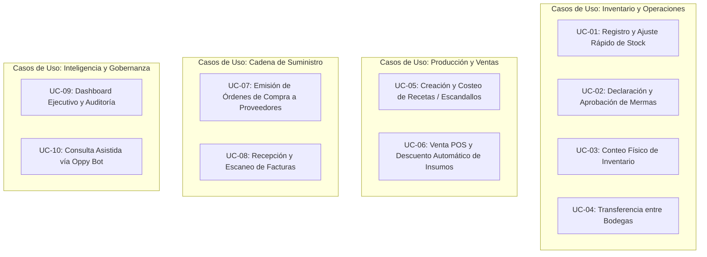

# 01-PRD.md — Product Requirements Document (PRD)

> **Documento:** Requerimientos de Producto y Especificación Funcional  
> **Proyecto:** OppyTec SaaS  
> **Versión:** 2.0  
> **Fecha:** Octubre 2026  

---

## 1. Resumen Ejecutivo y Problema a Resolver

### 1.1 Contexto de Mercado
Los establecimientos gastronómicos, hoteleros y de retail alimentario (restaurantes, bares, cafeterías, dark kitchens y hostales) enfrentan una fuga constante de rentabilidad atribuible a:
1. **Falta de visibilidad en tiempo real del stock:** El desfase entre compras, ventas y consumos genera quiebres de inventario o sobrestock de perecibles.
2. **Descontrol en mermas y desperdicios:** Inexistencia de registros formales que permitan aislar causas (vencimiento, errores de preparación, robos hormiga).
3. **Escandallos y recetas obsoletos:** Los costos de los insumos fluctúan dinámicamente y las cartas no reflejan el costo real de elaboración ni el margen de contribución.
4. **Fricción en la recepción de mercadería:** El cotejo manual de guías y facturas de proveedores es lento, propenso a errores humanos y no actualiza los costos unitarios de inmediato.
5. **Dificultad de gestión en múltiples sucursales:** Los holdings carecen de una vista unificada que a la vez respete la autonomía operativa de cada local.

### 1.2 La Propuesta de OppyTec
OppyTec es una plataforma SaaS integral y multi-tenant que unifica:
- Gestión de inventario en tiempo real con soporte multi-bodega por local.
- Control estricto de mermas y auditorías de inventario mediante conteos ciegos o asistidos.
- Costeo dinámico de recetas (escandallos) y sincronización con el punto de venta (POS).
- Flujo ágil de compras con escaneo inteligente de facturas y recepción digital.
- Analítica operativa y financiera en tiempo real con dashboards ejecutivos.
- Asistente inteligente (Oppy Bot) potenciado por modelos de lenguaje e indexación vectorial (RAG) para consultas rápidas por voz o texto.

---

## 2. Personas de Usuario y Casos de Uso Principales

### 2.1 Personas de Usuario

| Perfil | Rol en el Sistema | Objetivos Principales | Frustraciones Actuales |
|---|---|---|---|
| **Carlos — Propietario / Socio de Holding** | `propietario` (Holding Admin) | Conocer la rentabilidad neta consolidada, rotación de activos y margen por local; tomar decisiones estratégicas de expansión. | Información dispersa en planillas Excel, reportes extemporáneos, falta de control en mermas globales. |
| **Marcela — Administradora de Sucursal** | `admin` (Tenant Admin) | Asegurar el abastecimiento continuo, controlar costos de adquisición, autorizar mermas extraordinarias y supervisar turnos. | Tiempos excesivos cargando facturas a mano y cuadrando diferencias de inventario a fin de mes. |
| **Esteban — Jefe de Cocina / Chef Ejecutivo** | `supervisor` / `chef` | Mantener fichas técnicas (recetas) estandarizadas, registrar mermas operativas y solicitar pedidos de reposición inmediatos. | Las recetas se desactualizan cuando suben los insumos; la cocina pierde tiempo reportando stock en papel. |
| **Javier — Cajero / Operador de Barra** | `user` (Operador) | Registrar consumos rápidos, ingresar comandas o ventas en POS y ejecutar conteos de turno con fluidez y sin demoras. | Interfaces lentas o confusas con demasiados pasos para registrar una merma accidental de una botella. |
| **Lorena — Contadora / Auditora Externa** | `auditor` | Revisar la trazabilidad de comprobantes tributarios, validar márgenes de ganancia y exportar reportes para el balance contable. | Facturas extraviadas o registradas sin su correspondiente respaldo tributario. |

### 2.2 Casos de Uso Principales

---

## 3. Alcance Funcional Detallado: MVP vs. Fases Posteriores

### 3.1 Fase MVP (Alcance Inmediato / Core del Negocio)

1. **Gestión de Catálogo e Inventario Multi-Bodega:**
   - Creación, edición y categorización de productos e insumos.
   - Definición de unidades de medida (kg, gr, lt, ml, unidad) y factores de conversión.
   - Parametrización de stock crítico y stock ideal por producto y bodega.
   - Registro de movimientos manuales: Entrada, Ajuste positivo/negativo y Consumo operativo.
2. **Control Integral de Mermas:**
   - Registro tipificado de pérdidas: caducidad, deterioro, daño en manipulación, error de comanda.
   - Reglas de autorización según perfil de usuario y montos máximos.
3. **Escandallos y Recetas (Fichas Técnicas):**
   - Composición de platos y tragos combinando insumos en cantidades netas con factor de merma inherente.
   - Cálculo automático del costo de elaboración unitario, margen sugerido y precio de venta.
4. **Ventas y Puntos de Venta (POS Simple):**
   - Venta de recetas terminadas con descuento proporcional automático e instantáneo de insumos en la bodega asociada.
5. **Compras y Proveedores:**
   - Directorio de proveedores con datos de contacto, condiciones de pago y RUT.
   - Creación de órdenes de compra con estado: Borrador, Enviada, Recibida Parcial, Recibida Total.
6. **Módulo de Facturas:**
   - Registro manual y carga de archivos PDF/imágenes de comprobantes de compra.
7. **Autenticación y Control de Acceso Basado en Roles (RBAC):**
   - Roles canónicos: Propietario, Administrador de Local, Supervisor y Operador.
   - Autenticación por correo/contraseña y soporte para Google OAuth2.

### 3.2 Fases Posteriores (Post-MVP / Roadmap Futuro)

| Feature | Descripción | Fase Estimada |
|---|---|---|
| **Escaneo OCR Inteligente de Facturas con IA** | Extracción automática de ítems, cantidades y precios desde la foto de una factura de papel mediante visión computacional. | Fase 2 |
| **Oppy Bot Multimodal con Entrada de Voz** | Asistente de barra/cocina tipo manos libres mediante comandos de voz para registrar mermas o consultar stock. | Fase 2 |
| **Integración con Facturación Electrónica SII (Chile)** | Emisión directa de DTEs (Boletas y Facturas electrónicas) ante la autoridad tributaria. | Fase 3 |
| **Proyecciones de Demanda con Machine Learning** | Sugerencia inteligente de cantidades a comprar según estacionalidad, clima y reservas de mesa. | Fase 3 |
| **Planificador Avanzado de Turnos y Costeo Laboral** | Control de asistencia biométrico cruzado con costo de personal vs ventas horarias. | Fase 3 |

---

## 4. Criterios de Aceptación Funcionales (Definition of Done)

Para considerar una funcionalidad como **"Terminada" (Done)** en el sistema:

1. **Catálogo de Insumos:**
   - Un producto no puede ser creado con costo unitario negativo.
   - Cada producto debe tener asignada al menos una categoría y una unidad de medida estándar.
2. **Movimientos de Stock:**
   - Todo movimiento debe generar un registro inmutable en `registro_stock` con marca de tiempo, usuario responsable, bodega de origen, tipo de movimiento y cantidad.
   - Si un movimiento deja el stock por debajo del umbral mínimo, el sistema debe emitir un evento de alerta en el panel de notificaciones.
3. **Descuento por Venta de Recetas:**
   - La venta de una receta debe descontar de manera atómica todos los ingredientes correspondientes. Si un ingrediente no posee stock suficiente, el sistema debe registrar el saldo negativo de manera explícita indicando la anomalía para auditoría posterior (no bloquear la venta del cliente en caja).
4. **Mermas:**
   - Si el costo total de la merma supera el límite parametrizado para operadores regulares, la merma debe quedar en estado `pendiente_aprobacion` hasta que un supervisor o administrador la valide.
5. **Aislamiento Multi-Tenant:**
   - Bajo ninguna circunstancia un usuario perteneciente al Tenant A puede visualizar o interactuar con productos, bodegas, compras o usuarios del Tenant B.

---

## 5. Casos de Borde (Edge Cases) y Funcionalidades Fuera de Alcance

### 5.1 Casos de Borde

- **Conversión de Unidades Incompatibles:** Intento de descontar mililitros de un producto parametrizado en kilogramos sin factor de conversión densidad. *Comportamiento esperado:* Bloqueo con mensaje de validación claro solicitando definir la conversión.
- **Concurrencia en Conteo de Inventario:** Dos operarios contando simultáneamente la misma bodega. *Comportamiento esperado:* El sistema bloquea el conteo a un solo operario activo por bodega física o realiza merge determinista por fecha/hora del último ítem.
- **Cambio de Costo Retroactivo:** Recepción de una factura con costo unitario superior al registrado previamente. *Comportamiento esperado:* El costo promedio ponderado (PMP) se actualiza hacia el futuro; los registros históricos de ventas no se alteran.
- **Pérdida de Conexión de Red en el POS:** El operador realiza una venta durante una intermitencia de red. *Comportamiento esperado:* La aplicación almacena la transacción en cola local y la sincroniza al restablecer la conexión.

### 5.2 Fuera de Alcance Expreso (Out of Scope)

- Sistema de nómina y pago de sueldos de empleados (Payroll completo).
- Plataforma de e-commerce delivery B2C hacia consumidor final (OppyTec es B2B interno para el establecimiento).
- Pasarela de procesamiento de pagos de tarjeta de crédito propietaria (se integrará vía terminales POS externos o webhooks estándares).
