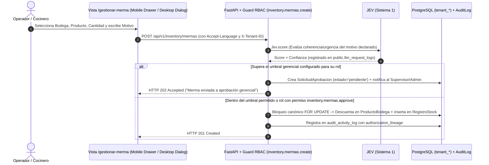
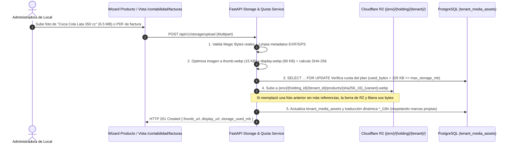
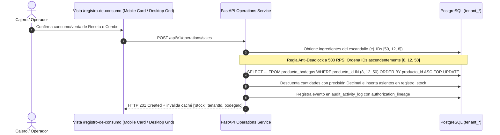
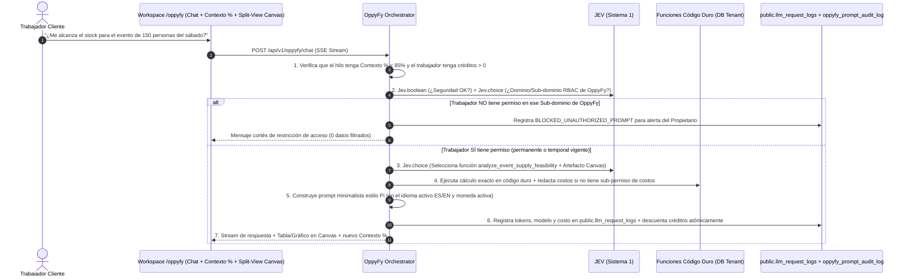

# 03-USER-FLOWS.md — App Flow, Complete Route Tree & State Transitions

> **Documento:** Mapa Completo de Navegación (Cliente + Admin OppyTec), Flujos de Interacción *Mobile-First* y Estados UI  
> **Proyecto:** OppyTec SaaS v2.0  
> **Estado:** Actualizado y Sincronizado con las 16 Estrategias Maestras (`.agent/estrategias/`)  
> **Fecha:** Octubre 2026  

---

## 1. Mapa del Sitio y Árbol Completo de Rutas (Cliente `tenant_*` + Admin Global `public`)

```mermaid
graph TD
    Root["/ (Entrada)"] --> Login["/login (Auth + OAuth + Selector Idioma)"]
    Login --> SelectTenant["/select-tenant (Conmutador de Sucursales del Holding)"]
    Login --> AdminShell["/admin/* (AdminLayout - Trabajadores Globales OppyTec en 'public')"]
    SelectTenant --> ClientShell["AppLayout (Shell Operativo del Cliente en 'tenant_*' + Swipe 29 Vistas)"]

    subgraph ClientRoutes["🏪 RUTAS OPERATIVAS DEL CLIENTE (Gobernadas por Plan + RBAC 3-Niveles)"]
        ClientShell --> Home["/ (HomeDashboard)"]
        ClientShell --> Consumo["/registro-de-consumo & /consumo/manos-libres (Voz VAD)"]
        ClientShell --> Inv["/inventario/stock, /contar-inventario, /recuentos"]
        ClientShell --> Gestion["/gestion?tab=productos|recetas|combos|grupos-opciones|pedidos|proveedores|mermas"]
        ClientShell --> Merma["/gestionar-merma (KPIs, Heatmap 7x24, Aprobaciones)"]
        ClientShell --> Compras["/compras, /proveedores, /contabilidad/facturas"]
        ClientShell --> Eventos["/eventos (Salones, Banquetes y Estaciones de Buffet)"]
        ClientShell --> Reportes["/reportes/resumen-general|resumen-ejecutivo|control-perdidas|eficiencia-operacional|vision-financiera"]
        ClientShell --> ProyHist["/proyeccion, /historial, /notificaciones, /alertas"]
        ClientShell --> Activ["/actividades/notas|tareas|horarios|usuarios (RBAC, Cupos Plan, Soft-Delete, JIT)"]
        ClientShell --> OppyFy["/oppyfy (Workspace OppyFy: Chat, Contexto %, Canvas, RBAC Editable, Créditos y Log de Prompts)"]
        ClientShell --> Config["/configuracion (Bodegas, Áreas, Memoria R2 MB) & /perfil"]
    end

    subgraph GlobalAdminRoutes["🌐 RUTAS DE ADMINISTRACIÓN GLOBAL OPPYTEC (/admin - Esquema 'public')"]
        AdminShell --> AdmTenancy["/admin/holdings-tenants (Holdings, Entidad Legal 1:1, Tenants, Módulos)"]
        AdminShell --> AdmPlans["/admin/plans-and-quotas (Planes: max_active_users, max_storage_mb, Paquetes Créditos)"]
        AdminShell --> AdmStaff["/admin/global-staff-rbac (Usuarios y Roles Globales de OppyTec)"]
        AdminShell --> AdmFinOps["/admin/ai-finops-models & /admin/ai-finops-tenants (2 Vistas FinOps llm_request_logs)"]
        AdminShell --> AdmFX["/admin/fx-currency-console (Tasas BCCh/BCE, Historial y Override Manual)"]
        AdminShell --> AdmBackups["/admin/r2-storage-and-backups (Memoria R2 y Consola de Respaldos 4-Capas + Restore por Tenant)"]
        AdminShell --> AdmObs["/admin/observability-center (13 Sub-Vistas: OTel, Grafana, Sentry y Umami + Filtro por Environment)"]
    end
```

La aplicación SPA en React 19 se divide en dos shells principales protegidos por el motor RBAC de 3 niveles (`<Can perform="modulo.submodulo.funcion">`) y equipados en su barra superior con los selectores globales: **`<LanguageFlagSelector />`** (Bandera SVG `🇺🇸 EN` / `🇪🇸 ES` + idiomas futuros), **`<CurrencySelector />`** (`CLP`, `USD`, `EUR`, `BRL` + insignia de tasa activa), **`<HoldingTenantSwitcher />`** (acceso transversal entre sucursales del mismo Holding), **`<BodegaSelector />`** y el selector de los **3 Temas (`light` / `dark` / `ocean-blue`)**.

---

## 2. Recorridos de Usuario Paso a Paso (User Journeys Críticos)

### 2.1 Flujo 1: Declaración, Evaluación `JEV` y Aprobación de una Merma

---

### 2.2 Flujo 2: Subida de Imagen / Factura en Cloudflare R2 con Validación de Cuota (`max_storage_mb`)

---

### 2.3 Flujo 3: Venta / Consumo de Receta con Ordenamiento Canónico de Locks Anti-Deadlock

---

### 2.4 Flujo 4: Consulta en `OppyFy` con RBAC Propio Editable, `JEV`, Código Duro, `% Contexto` y Créditos

---

## 3. Disparadores Globales, Gestos *Mobile-First* y Consecuencias

| Disparador en la Interfaz | Acción / Comportamiento Técnico | Efecto Visual en UI (*Mobile-First* y Desktop) |
|---|---|---|
| **Cambio de Bandera en `<LanguageFlagSelector />`** (`🇺🇸 EN` $\leftrightarrow$ `🇪🇸 ES`) | Cambia el locale activo en `i18next`, actualiza cabecera `Accept-Language` y preferencia del usuario. | Traduce en `0 ms` todos los menús/botones (11 JSONs) y conmuta los nombres dinámicos (`*_i18n`) de productos, categorías y cargos (manteniendo inmutables marcas y proveedores como `"Pollo King"`). |
| **Cambio de Divisa en `<CurrencySelector />`** (`CLP`, `USD`, `EUR`, `BRL`) | Aplica la tasa oficial vigente del Banco Central (`BCCh` / `BCE`) desde `CurrencyContext`. | Recalcula en pantalla todos los precios, costos y gráficos con `Decimal` y actualiza la insignia visible (`Vista en: USD · 1 USD = $948,50 CLP`) sin alterar la moneda base contable en DB. |
| **Conmutación de Sucursal en `<HoldingTenantSwitcher />`** | Cambia `X-Tenant-ID`, limpia caché de sucursal previa y recarga permisos RBAC del usuario en ese local. | Un administrador que trabaja en el *Hotel* y en el *Restaurante* del mismo Holding cambia de negocio en 1 clic sin cerrar sesión. |
| **Gesto Swipe Horizontal en Móvil / Touchpad (`useSwipeNavigation`)** | Detecta desplazamiento horizontal sobre cabeceras/títulos y navega a la vista anterior/siguiente de `SWIPE_SECTIONS`. | Transición fluida con `framer-motion` y barra inferior de pulgar (`BottomNav`) en pantallas `< 768px`. |
| **Apertura de Formulario o Detalle (`<ResponsiveDialog />`)** | Evalúa `useIsMobile()`. | En celular se despliega como **Bottom Drawer táctil (`vaul`)** con ajuste de teclado `dvh`; en escritorio se abre como **Modal centrado `.glass` (`Radix Dialog`)** con `CLS = 0`. |

---

## 4. Matriz de Manejo Visual de los 4 Estados Canónicos de UI

Toda vista en `oppytec-frontend` debe implementar obligatoriamente los 4 estados del ciclo de vida en los **3 temas (`light`, `dark`, `ocean-blue`)**:

1. **Estado Cargando (`PageSkeleton` / `CardSkeleton`):**
   - Prohibido usar spinners de pantalla completa. Se renderizan esqueletos con la silueta exacta de las tarjetas móviles (`< md`) o filas de tabla (`>= md`).
2. **Estado Vacío (`EmptyState`):**
   - Ícono semántico de `lucide-react`, título y descripción traducidos por `i18n`, y botón CTA con `.animate-perimeter-glow` (visible solo si `<Can>` confirma que el rol tiene permiso para crear el recurso).
3. **Estado Éxito (`Sonner Toast` + Animación Semántica):**
   - Toast flotante traducido en el idioma activo, acompañado de borde `.animate-blink-green` en el registro recién creado o actualizado y opción de *Deshacer (`useUndoRedo`)* cuando aplique.
4. **Estado Fallo (`ErrorBoundary` + `X-Trace-ID`):**
   - Alerta limpia sin exponer stack traces técnicos, botón *"Reintentar"* y visualización discreta del código `X-Trace-ID` para que en el **Centro de Observabilidad de `platform-admin`** se pueda inspeccionar la traza exacta en OpenTelemetry y Sentry.
