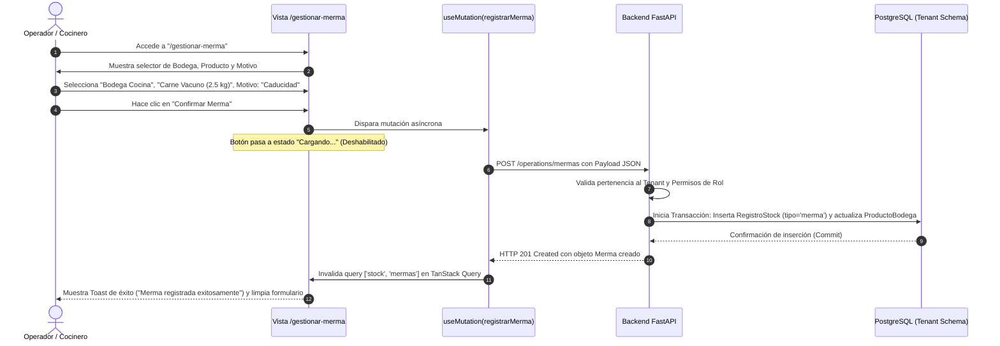
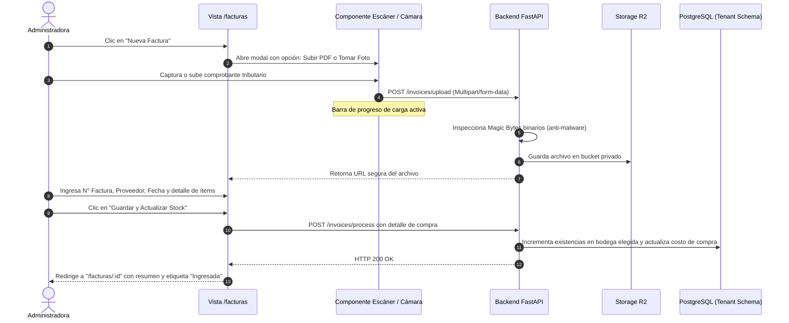
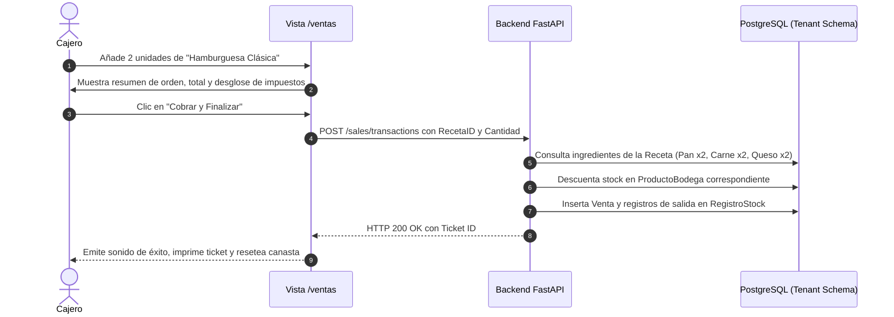
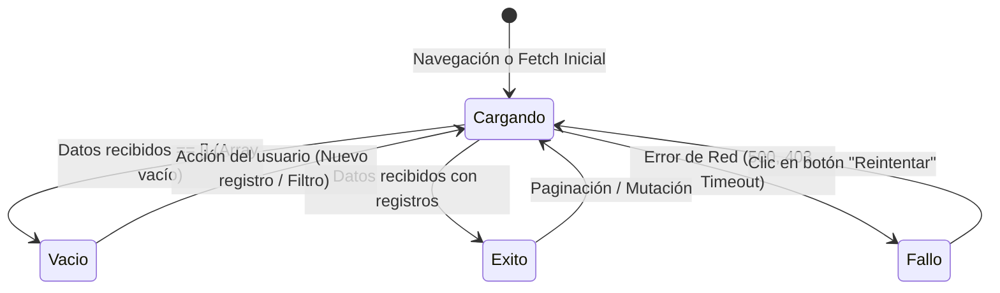

# 03-USER-FLOWS.md — App Flow & State Transitions

> **Documento:** Mapa de Navegación, Flujos de Interacción y Estados UI  
> **Proyecto:** OppyTec SaaS  
> **Versión:** 2.0  
> **Fecha:** Octubre 2026  

---

## 1. Mapa del Sitio y Árbol de Rutas

La aplicación está diseñada como una Single Page Application (SPA) con navegación estructurada según el nivel de privilegio del usuario:

```mermaid
graph TD
    Root["/ (Entrada Pública)"] --> Login["/login (Autenticación)"]
    Root --> Register["/registro (Onboarding)"]
    Root --> Recovery["/recuperar-password"]

    Login --> Shell["AppLayout (Shell Autenticado - PrivateRoute)"]

    subgraph Operaciones
        Shell --> StockHome["/ (StockRegistro - Monitor General)"]
        Shell --> Consumo["/registro-de-consumo"]
        Shell --> Merma["/gestionar-merma"]
        Shell --> Conteo["/contar-inventario"]
        Shell --> Eventos["/eventos"]
    end

    subgraph ComprasLogistica["Compras y Cadena de Suministro"]
        Shell --> Compras["/compras (Órdenes de Compra)"]
        Shell --> Proveedores["/proveedores (Directorio)"]
        Shell --> Facturas["/facturas (Recepción)"]
        Facturas --> FacturaDetalle["/facturas/:id (Detalle de Factura)"]
    end

    subgraph ProduccionVentas["Producción y Ventas"]
        Shell --> Recetas["/recetas (Fichas Técnicas)"]
        Shell --> POS["/ventas (Punto de Venta Simple)"]
    end

    subgraph AnaliticaInteligencia["Inteligencia de Negocios"]
        Shell --> Alertas["/alertas (Stock Crítico / Vencimientos)"]
        Shell --> ResumenGen["/reportes/resumen-general"]
        Shell --> PanelEjecutivo["/reportes/panel-ejecutivo"]
        Shell --> Perdidas["/reportes/control-perdidas"]
        Shell --> Eficiencia["/reportes/eficiencia-operacional"]
        Shell --> Financiera["/reportes/vision-financiera"]
        Shell --> Historial["/historial (Kardex de Movimientos)"]
        Shell --> Proyeccion["/proyeccion"]
    end

    subgraph GestionConfiguracion["Colaboración y Configuración"]
        Shell --> Notas["/actividades/notas"]
        Shell --> Tareas["/actividades/tareas"]
        Shell --> Config["/configuracion (Parámetros y Usuarios)"]
    end
```

---

## 2. Recorridos de Usuario Paso a Paso (User Journeys)

### 2.1 Flujo 1: Declaración y Aprobación de una Merma

---

### 2.2 Flujo 2: Recepción y Cotejo de Factura de Proveedor

---

### 2.3 Flujo 3: Venta en POS y Descuento Automático de Insumos

---

## 3. Disparadores y Consecuencias (Triggers & Side-Effects)

| Disparador UI | Acción del Usuario | Llamada Asíncrona | Estado de Carga (Loading UI) | Consecuencia / Redirección |
|---|---|---|---|---|
| **Botón "Iniciar Sesión"** en `/login` | Submit de formulario con email y contraseña válida. | `POST /auth/login` | Spinner dentro del botón primario; inputs congelados. | Almacena JWT en memoria / Cookie; redirige a `/` con carga de tenants disponibles. |
| **Cambio de Bodega en Navbar** | Selecciona otra bodega en el dropdown superior. | Invalida query cache en cliente (`queryClient.invalidateQueries`). | Skeleton en tablas de stock durante la recarga de datos. | La UI sincroniza todos los listados de productos y alertas a la bodega seleccionada. |
| **Botón "Registrar Consumo"** | Envío de formulario de insumo consumido. | `POST /operations/movements/` con `tipo='consumo'`. | Botón deshabilitado con micro-spinner; modal bloqueado. | Cierra modal, toast verde de notificación y resta en vivo del stock en tabla. |
| **Botón "Aprobar Orden de Compra"** | Clic en estado de orden en `/compras`. | `PATCH /purchases/orders/:id/approve` | Indicador de carga pulsante sobre la fila de la tabla. | Estado cambia a badge azul "Aprobada"; dispara notificación al proveedor. |
| **Botón "Finalizar Conteo Físico"** | Clic al culminar conteo de estantería. | `POST /operations/counts/:id/finalize` | Modal bloqueante con barra de progreso ("Calculando discrepancias..."). | Redirige al informe de diferencias de stock (Sobrantes / Faltantes). |

---

## 4. Matriz de Manejo Visual de Estados UI

Toda vista del sistema debe implementar de forma estandarizada los cuatro estados de ciclo de vida de interfaz:

### 4.1 Estado Cargando (Loading State)
- **Principio:** No utilizar spinners a pantalla completa que bloqueen la visibilidad general.
- **Implementación:** Componentes `Skeleton` con animación de pulso sutil (`animate-pulse`) replicando exactamente la estructura de las tablas, cards o métricas esperadas.

### 4.2 Estado Vacío (Empty State)
- **Principio:** Un estado vacío jamás debe ser una página en blanco. Debe orientar e incitar a la acción.
- **Elementos requeridos:**
  1. Ilustración o icono semántico en color muted (gris suave o primario translúcido).
  2. Título claro (p.ej. *"Aún no tienes proveedores registrados"*).
  3. Texto descriptivo breve explicando el beneficio del módulo.
  4. Botón de Llamado a la Acción (CTA) directo (p.ej. *"Crear Primer Proveedor"*).

### 4.3 Estado Éxito (Success State)
- **Implementación:** Notificaciones tipo Toast mediante la librería `Sonner` ancladas en la esquina inferior derecha (`position="bottom-right"`), con duración de 3.5 segundos, icono de check verde y texto conciso. Si la acción fue destructiva o reversible, debe incluir un botón de "Deshacer" (`action={{ label: 'Deshacer', onClick: () => undo() }}`).

### 4.4 Estado Fallo (Error State)
- **Fallo a Nivel de Componente:** Bloque con fondo de alerta suave (`bg-destructive/10 text-destructive`), mensaje legible sin volcar stack traces técnicos, y botón interactivo "Reintentar solicitud".
- **Fallo Crítico de Aplicación:** `ErrorBoundary` global de React en la raíz, ofreciendo volver a la pantalla principal o refrescar la sesión sin pérdida de datos persistidos.
