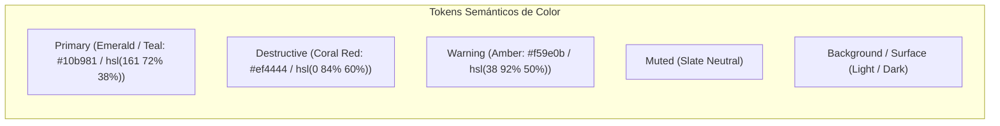
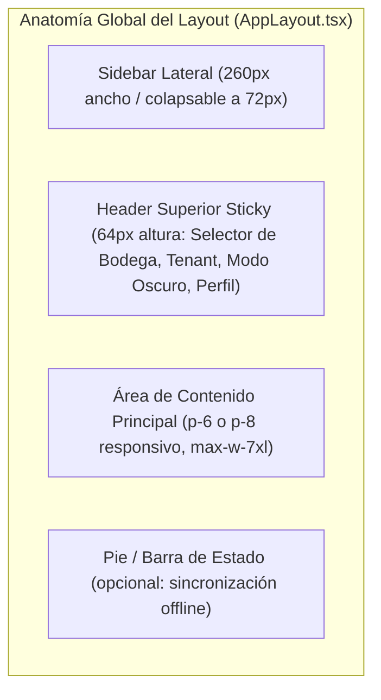

# 04-DESIGN-SYSTEM.md — Design Brief & UI Guidelines

> **Documento:** Sistema de Diseño, Tokens Visuales y Guías de Interfaz  
> **Proyecto:** OppyTec SaaS  
> **Versión:** 2.0  
> **Fecha:** Octubre 2026  

---

## 1. Principios de Diseño Visual

La interfaz de **OppyTec** está concebida bajo el concepto de **"Software de Grado Operacional y Financiero"**:
1. **Claridad sobre Ornamento:** En un entorno ruidoso y de alta velocidad (cocina, barra, recepción), los datos críticos (stock restante, costos, márgenes) deben ser legibles de un solo vistazo.
2. **Densidad de Información Equilibrada:** Evitar el desperdicio excesivo de espacio en blanco sin saturar al usuario; las tablas de inventario deben maximizar las filas visibles manteniendo targets táctiles cómodos ($\ge 44\text{px}$).
3. **Consistencia Cromática Semántica:** El color comunica estado exclusivamente (verde para salud de stock/éxito, ámbar para advertencia de stock mínimo, rojo para merma/quiebre/pérdida).

---

## 2. Paleta de Colores y Tokens Semánticos (HSL)

El sistema de tokens utiliza variables HSL que se adaptan de forma transparente entre **Modo Claro (Light Mode)** y **Modo Oscuro (Dark Mode)**:

### 2.1 Especificación de Tokens en los 3 Temas Oficiales (`light`, `dark`, `ocean-blue`)

| Token CSS | ☀️ Modo Claro (`light`) | 🌙 Modo Oscuro (`dark`) | 🌊 Tema `ocean-blue` (`.ocean-blue`) | Uso Semántico |
|---|---|---|---|---|
| `--background` | `hsl(220 33% 98%)` | `hsl(224 71% 4%)` | `hsl(222 47% 7%)` | Lienzo principal de la aplicación con gradientes radiales. |
| `--foreground` | `hsl(224 71% 4%)` | `hsl(210 20% 98%)` | `hsl(210 100% 92%)` | Color de texto principal de alto contraste. |
| `--card` | `hsl(0 0% 100%)` | `hsl(224 71% 6%)` | `hsl(220 40% 10%)` | Superficies elevadas (Cards, Paneles, Modales). |
| `--card-foreground` | `hsl(224 71% 4%)` | `hsl(210 20% 98%)` | `hsl(210 100% 92%)` | Texto sobre superficies elevadas. |
| `--primary` | `hsl(161 72% 38%)` | `hsl(161 72% 45%)` | `hsl(186 100% 50%)` | Acciones principales, botones primarios, acentos de marca. |
| `--primary-foreground`| `hsl(210 20% 98%)` | `hsl(224 71% 4%)` | `hsl(222 47% 7%)` | Texto sobre elementos de color primario. |
| `--secondary` | `hsl(220 14% 96%)` | `hsl(215 28% 17%)` | `hsl(220 35% 16%)` | Botones secundarios, tags auxiliares. |
| `--muted` | `hsl(220 14% 96%)` | `hsl(215 28% 17%)` | `hsl(220 35% 14%)` | Fondos desactivados o sutiles. |
| `--muted-foreground` | `hsl(220 9% 46%)` | `hsl(215 20% 65%)` | `hsl(213 50% 65%)` | Subtítulos, metadatos, timestamps y placeholders. |
| `--destructive` | `hsl(0 84% 60%)` | `hsl(0 62% 30%)` | `hsl(0 80% 55%)` | Eliminaciones, registro de mermas, alertas de quiebre. |
| `--warning` | `hsl(38 92% 50%)` | `hsl(38 92% 50%)` | `hsl(42 100% 58%)` | Advertencias de stock bajo, vencimiento próximo. |
| `--success` | `hsl(161 72% 38%)` | `hsl(161 72% 38%)` | `hsl(152 80% 50%)` | Confirmación de transacciones, stock saludable. |
| `--border` | `hsl(220 13% 91%)` | `hsl(215 28% 17%)` | `hsl(220 40% 18%)` | Delimitadores de tabla, bordes de inputs y divisores. |
| `--ring` | `hsl(161 72% 38%)` | `hsl(161 72% 45%)` | `hsl(186 100% 50%)` | Indicador de foco accesible (Focus Ring). |

---

## 3. Escala Tipográfica y Fuentes

- **Familia Tipográfica:** `'Outfit', system-ui, -apple-system, sans-serif` (importada desde Google Fonts con pesos 300, 400, 500, 600, 700).

| Rol / Nivel | Clase Tailwind | Tamaño (px / rem) | Peso (Font Weight) | Line Height | Uso |
|---|---|---|---|---|---|
| **Display / Hero** | `text-3xl font-bold` | `30px` / `1.875rem` | 700 (Bold) | `1.2` | Título principal de dashboards o métricas clave. |
| **Encabezado H1** | `text-2xl font-semibold`| `24px` / `1.5rem` | 600 (Semibold) | `1.25`| Título de página/módulo (`Stock General`, `Mermas`). |
| **Encabezado H2** | `text-xl font-semibold` | `20px` / `1.25rem` | 600 (Semibold) | `1.3` | Título de secciones dentro de modales o tabs. |
| **Encabezado H3** | `text-lg font-medium` | `18px` / `1.125rem` | 500 (Medium) | `1.35`| Subtítulos de cards o cabeceras de grupos. |
| **Cuerpo Base** | `text-base font-normal` | `16px` / `1.0rem` | 400 (Regular) | `1.5` | Párrafos generales, descripciones de producto. |
| **Cuerpo Compacto** | `text-sm font-normal` | `14px` / `0.875rem`| 400 (Regular) | `1.4` | Celdas de tablas de datos, inputs y botones estándar. |
| **Caption / Badge** | `text-xs font-medium` | `12px` / `0.75rem` | 500 (Medium) | `1.3` | Etiquetas de estado, timestamps y ayuda de formulario. |

---

## 4. Biblioteca de Componentes UI Base (shadcn/ui + Radix)

Para evitar la improvisación de CSS y garantizar la accesibilidad WCAG 2.1 AA, se emplean exclusivamente los componentes de `src/components/ui/`:

1. **Botones (`Button.tsx`):**
   - Variantes: `default` (Primario Esmeralda), `secondary` (Gris Neutro), `destructive` (Rojo), `outline` (Borde sutil), `ghost` (Transparente para acciones de tabla), `link`.
   - Tamaños: `sm` ($32\text{px}$), `default` ($40\text{px}$), `lg` ($48\text{px}$), `icon` ($40\times 40\text{px}$).
2. **Inputs y Selects (`Input.tsx`, `Select.tsx`):**
   - Altura estándar $40\text{px}$, borde sutil con focus ring color `--primary`.
   - Soporte nativo para inputs numéricos de stock sin las flechas molestas del navegador (`no-spin`).
   - Inputs de fecha con selector centrado (`centered-date-input`).
3. **Diálogos y Modales (`Dialog.tsx`, `Sheet.tsx`):**
   - Primitivas de Radix UI con bloqueo de scroll, overlay desenfocado (`backdrop-blur-sm`) y cierre vía tecla `Escape`.
4. **Tablas de Datos (`Table.tsx`):**
   - Cabeceras adhesivas (`sticky top-0`), filas con hover suave (`hover:bg-muted/50`), bordes divisorios sutiles.
5. **Indicadores de Estado (`Badge.tsx`):**
   - Píldoras redondeadas con padding horizontal compacto (`px-2.5 py-0.5 text-xs`).

---

## 5. Anatomía y Espaciado de Pantallas Tipo

### 5.1 Reglas de Espaciado, Efectos de Firma y Arquitectura *Mobile-First*
*(Ver especificación exhaustiva en [`.agent/estrategias/estrategia_sistema_diseno_ux_ui_y_mobile_first_001.md`](../.agent/estrategias/estrategia_sistema_diseno_ux_ui_y_mobile_first_001.md))*
- **Filosofía *Mobile-First*:** Toda pantalla se diseña primero para móvil (`< 768px`, targets táctiles $\ge 44\times 44\text{px}$, `<AdaptiveDataView />` que muestra tarjetas en móvil y tablas en desktop, `<ResponsiveDialog />` con `vaul` en móvil y `Dialog` en desktop, más `BottomNav` y `useSwipeNavigation`).
- **Efectos de Firma de Legacy Preservados:**
  - `.glass` y `.glass-card` (con override marino luminoso en `.ocean-blue`).
  - Bordes animados semánticos: `.animate-blink-orange` (`2.0s`), `.animate-blink-red` (`2.0s`), `.animate-blink-green` (`2.5s`) y `.animate-perimeter-glow` (`1.8s`).
  - Prevención de saltos de pantalla (`CLS = 0` en modales Radix UI): `scrollbar-gutter: stable !important` y `html > body[data-scroll-locked]` con especificidad `0,1,0,2`.
- **Margen Exterior de Páginas:** `p-4` en pantallas móviles, escalando a `p-6` o `p-8` en escritorio.
- **Separación entre Tarjetas / Secciones:** `gap-4` ($16\text{px}$) o `gap-6` ($24\text{px}$).
- **Radio de Borde (Border Radius):**
  - Botones e Inputs: `rounded-md` ($6\text{px}$).
  - Cards y Paneles: `rounded-lg` ($8\text{px}$) o `rounded-xl` ($12\text{px}$).
  - Badges y Avatares: `rounded-full`.

---

## 6. Paleta Gastronómica de 42 Colores (`PRESET_COLORS`) y 49 Íconos (`CATEGORIZED_ICONS`)

Para mantener la coherencia visual de Bodegas, Áreas Operativas, Categorías y Cargos RBAC heredada de `OppyTec-Legacy`:

1. **Matriz de 42 Colores Predefinidos (Grilla `6 x 7` con navegación por teclado `useColorKeyboardNav`):**
   - **Fila 1 (Rojos y Rosados):** `#EF4444`, `#DC2626`, `#B91C1C`, `#F43F5E`, `#E11D48`, `#EC4899`, `#DB2777`
   - **Fila 2 (Naranjas y Amarillos):** `#F97316`, `#EA580C`, `#D97706`, `#F59E0B`, `#EAB308`, `#FACC15`, `#CA8A04`
   - **Fila 3 (Verdes y Limas):** `#84CC16`, `#65A30D`, `#22C55E`, `#16A34A`, `#15803D`, `#10B981`, `#059669`
   - **Fila 4 (Turquesas, Cians y Azules):** `#14B8A6`, `#06B6D4`, `#0891B2`, `#0EA5E9`, `#0284C7`, `#3B82F6`, `#2563EB`
   - **Fila 5 (Índigos, Púrpuras y Violetas):** `#6366F1`, `#4F46E5`, `#A855F7`, `#9333EA`, `#8B5CF6`, `#7C3AED`, `#C026D3`
   - **Fila 6 (Grises y Neutros):** `#94A3B8`, `#64748B`, `#475569`, `#78716C`, `#57534E`, `#525252`, `#334155`
2. **Las 5 Familias de Íconos (`lucide-react` con navegación `useIconKeyboardNav`):**
   - `🍽️ Alimentos` (21 íconos), `🥤 Bebidas` (8 íconos), `🧼 Operación y limpieza` (8 íconos), `🌱 Especiales` (4 íconos) y `General / UI` (8 íconos).
3. **Selectores Globales en el `Navbar`:**
   - `<LanguageFlagSelector />`: Banderas en **SVG vectorial** (`FlagUS.tsx`, `FlagES.tsx` + futuros idiomas `PT`, `FR`, `IT`, `DE`) para evitar que en Windows se muestren letras en vez de banderas.
   - `<CurrencySelector />`: Selector de divisa (`CLP`, `USD`, `EUR`, `BRL`) independiente del idioma, acompañado siempre de `<MoneyBadge />` que informa la moneda y tasa activa del Banco Central.
