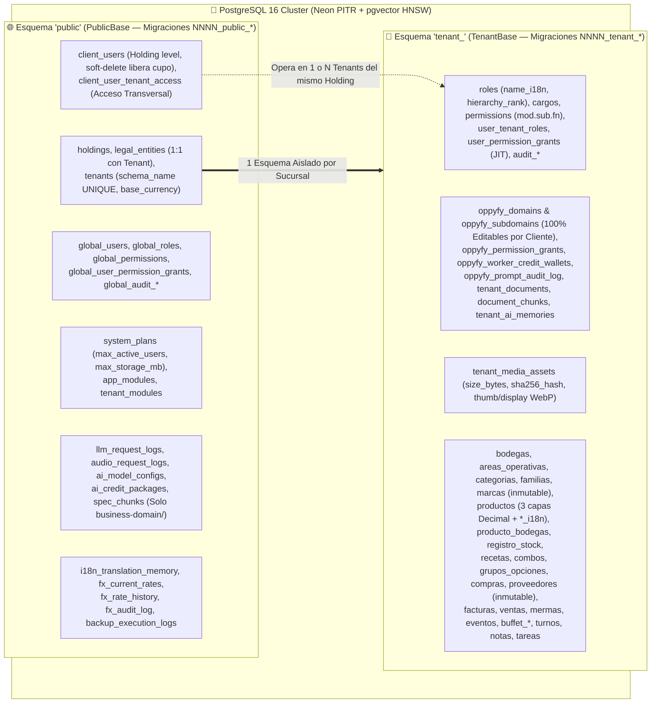

# 05-DATABASE-SCHEMA.md — Backend Multi-Tenant Schema, Dual RBAC, `OppyFy` & Auth Contract

> **Documento:** Modelo Maestro de Persistencia de Datos, Esquemas `public` vs `tenant_*`, RBAC Dual, Telemetría IA y Contratos de Seguridad  
> **Proyecto:** OppyTec SaaS v2.0  
> **Estado:** Actualizado y Sincronizado con las 16 Estrategias Maestras (`.agent/estrategias/`)  
> **Fecha:** Octubre 2026  

---

## 1. Arquitectura de Base de Datos Multi-Tenant y Metadatos Separados

OppyTec v2.0 implementa aislamiento físico por **Esquemas de PostgreSQL 16 (`pgvector`)** utilizando dos clases declarativas independientes en SQLAlchemy 2.0 Async:
1. **`PublicBase` (`schema="public"`):** Plano de Control Global de OppyTec, Trabajadores Globales, Jerarquía Corporativa (`Holding -> Entidad Legal 1:1 -> Tenant`), Planes, Módulos, Telemetría `llm_request_logs`, Memoria Global `i18n`, Tasas Cambiarias `FX` de Bancos Centrales y Control de Backups.
2. **`TenantBase` (Esquema dinámico `tenant_<slug>` vía `SET LOCAL search_path`):** Plano Operativo aislado de cada sucursal cliente, su RBAC de 3 niveles, el RBAC editable de `OppyFy`, su inventario de imágenes en R2 y todas las tablas de operación gastronómica/hotelera.

### 1.1 Mixins Transversales Estandarizados
1. **`AuditTimestampsMixin`:** `created_at` (`TIMESTAMPTZ`, `server_default=now()`), `updated_at` (`TIMESTAMPTZ`, `onupdate=now()`).
2. **`SoftDeleteMixin` (`soft_delete_mixin.py`):** `is_deleted` (`BOOLEAN`, `default=False`), `deleted_at` (`TIMESTAMPTZ NULL`), `deleted_by` (`INTEGER NULL`). *(Excluido en tablas de auditoría y Kardex que son estrictamente Append-Only inmutables).*
3. **`TranslatableI18nMixin`:** En entidades conceptuales editables por el cliente (`productos`, `categorias`, `familias`, `bodegas`, `areas_operativas`, `recetas`, `roles`, `cargos`), añade `i18n_data` (`JSONB`, ej. `{"es": "Cono Helado de Chocolate", "en": "Chocolate Ice Cream Cone"}`) e `i18n_source_hash` (`VARCHAR(64)`). **Regla de Nombres Propios:** Las tablas `proveedores` (`"Pollo King"`), `marcas` (`"Savory"`), `holdings` y `legal_entities` tienen `translatable = False` (inmutables en todos los idiomas).

---

## 2. Tablas del Esquema Global (`public` — `PublicBase`)

### 2.1 Identidad y RBAC Global de Trabajadores de OppyTec (Cupo Ilimitado + Soft-Delete)
- **`public.global_users`:** `id` (PK), `guid` (`UUID UNIQUE`), `email` (`UNIQUE`), `username` (`UNIQUE`), `hashed_password` (Argon2id), `preferred_language` (`default='es'`), `preferred_currency` (`default='CLP'`), `is_superuser_god` (`BOOLEAN`), `is_deleted`, `deleted_at`, `deleted_by`.
  - *Semilla Génesis:* `oppytec.admin@gmail.com` / `oppytec.admin` (leída desde `SUPERUSER_GENESIS_*` con `SecretStr`).
- **`public.global_roles`:** `id` (PK), `slug` (`UNIQUE`), `name`, `name_i18n` (`JSONB`), `hierarchy_rank` (`INTEGER`: `superuser=0`, `admin=10`, `supervisor=20`, `developer=30`, custom `> 30`).
- **`public.global_permissions`:** `id` (PK), `code` (`UNIQUE`, formato estricto `<modulo>.<submodulo>.<funcion>`), `module_slug`, `submodule_slug`, `action_slug`.
- **`public.global_role_permissions`** y **`public.global_user_permission_grants`** (con `effect` `'ALLOW'|'DENY'`, `granted_by_user_id`, `reason`, `expires_at`, `max_uses`).
- **`public.global_audit_rbac_changes`** y **`public.global_audit_activity_log`** (*Append-Only*).

### 2.2 Jerarquía Multi-Tenant, Planes, Cuotas y Acceso Transversal de Clientes
- **`public.system_plans`:**
  - `id` (`UUID` PK), `slug` (`UNIQUE`), `name`, `name_i18n` (`JSONB`).
  - **Cuotas Editables por el SuperUser:** `max_active_users` (`INTEGER` — límite de trabajadores activos), `max_storage_mb` (`INTEGER` — límite de memoria de imágenes en R2), `included_modules` (`JSONB`).
  - **Precios Multi-Moneda (`NUMERIC(14, 2)`):** `anchor_currency`, `price_clp`, `price_usd`, `price_eur`, `price_brl`, `auto_convert_fx` (`BOOLEAN`).
- **`public.holdings`:** `id` (`UUID` PK), `nombre`, `plan_id` (`FK -> system_plans.id`), `custom_max_users_override` (`INTEGER NULL`), `custom_storage_mb_override` (`INTEGER NULL`), `ai_credit_balance` (`NUMERIC(14, 2)` — saldo acumulado sin caducidad de créditos `OppyFy`), `is_active`.
- **`public.legal_entities`:** `id` (`UUID` PK), `holding_id` (`FK -> holdings.id`), `tax_id` (RUT tributario), `legal_name`, `legal_address`, `is_active`.
- **`public.tenants`:**
  - `id` (`UUID` PK), `holding_id` (`FK -> holdings.id`), **`legal_entity_id` (`FK -> legal_entities.id UNIQUE` — relación estricta 1:1 Entidad Legal $\leftrightarrow$ Tenant)**.
  - `schema_name` (`VARCHAR(100) UNIQUE`), `slug` (`UNIQUE`), `nombre_comercial`, `base_currency` (`VARCHAR(10)`, ej. `'CLP'`, `'USD'`, `'EUR'`, `'BRL'`), `custom_max_users_override`, `custom_storage_mb_override`, `is_active`.
- **`public.app_modules`** y **`public.tenant_modules`:** Catálogo jerárquico de módulos (`sales`, `inventory`, `accounting`, etc.) y estado `is_enabled` por Tenant.
- **`public.client_users` (Identidad Única a Nivel Holding):**
  - `id` (`SERIAL` PK), `guid` (`UUID UNIQUE`), `holding_id` (`FK -> holdings.id`), `email`, `username`, `hashed_password`, `preferred_language`, `preferred_currency`, `is_holding_owner` (`BOOLEAN`), `is_deleted`, `deleted_at`, `deleted_by`.
  - *Regla de Cupo:* `SELECT COUNT(*) FROM public.client_users WHERE holding_id = :h AND is_deleted = FALSE` valida el cupo `max_active_users` del plan.
- **`public.client_user_tenant_access` (Acceso Transversal en el Holding):**
  - `user_id` (`FK -> client_users.id`), `holding_id`, `tenant_id` (`FK compuesta (holding_id, tenant_id) -> tenants`), `granted_by_user_id`. Permite que un mismo trabajador opere en múltiples Tenants del mismo Holding (ej. Hotel + Restaurante).

### 2.3 FinOps IA (`llm_request_logs`), Paquetes de Créditos `OppyFy`, `i18n`, `FX` y Backups
- **`public.llm_request_logs` (Registro Estricto y Sin Excepción de Toda Llamada IA):**
  - `id` (`BIGSERIAL` PK), `created_at` (`TIMESTAMPTZ` Indexed), `holding_id` (`UUID` Indexed), `tenant_id` (`UUID` Indexed), `tenant_schema` (`VARCHAR(100)` Indexed), `user_id` (`INTEGER`), `thread_id` (`UUID NULL`).
  - `engine_tier` (`'SYSTEM_1_JEV' | 'SYSTEM_2_LLM' | 'EMBEDDING'`), `caller_feature` (`'oppyfy_chat'`, `'oppyfy_tool_router'`, `'excel_import'`, `'invoice_ocr'`, `'merma_judge'`, `'i18n_auto_translate'`), `model_name`, `input_tokens`, `cached_tokens`, `output_tokens`, `total_tokens`.
  - `provider_cost_usd` (`NUMERIC(14, 6)`), `provider_cost_clp` (`NUMERIC(14, 2)`), `credits_deducted` (`NUMERIC(12, 2)`), `request_duration_ms`, `api_success`, `error_message`.
- **`public.audio_request_logs`**, **`public.ai_model_configs`** y **`public.ai_credit_packages`** (paquetes de créditos comprables en cualquier momento, acumulables `1.000 + 10.000 = 11.000` y con `expires_in_days = NULL` sin caducidad por defecto).
- **`public.spec_sync_metadata`**, **`public.spec_chunks`** (`vector(768)` HNSW — indexa **solo** `specs/business-domain/`) y **`public.ai_semantic_cache`**.
- **`public.i18n_translation_memory`:** `term_hash` (PK), `source_lang`, `source_text`, `translations` (`JSONB` `{"es": ..., "en": ...}`).
- **`public.fx_current_rates`**, **`public.fx_rate_history`** y **`public.fx_audit_log`:** Tasas `NUMERIC(18, 8)` del Banco Central de Chile (`BCCh`) y Banco Central Europeo (`BCE`), banderas `is_manual_override` y trazabilidad de variaciones.
- **`public.backup_execution_logs`:** Registro de respaldos de las 4 Capas (`.sql.zst.age`), tamaño en bytes y checksum `SHA-256`.

---

## 3. Tablas del Esquema de Inquilino (`tenant_*` — `TenantBase`)

### 3.1 RBAC del Cliente, Permisos Temporales (JIT) y Doble Auditoría Forense
- **`roles`:** `id` (PK), `slug` (`UNIQUE`), `name`, `name_i18n` (`JSONB`), `hierarchy_rank` (`INTEGER`: `propietario=0`, `superuser=5`, `admin=10`, `supervisor/contador=20`, `cajero/usuario=30`, custom `> 30`), `is_system_base`, `is_deleted`.
- **`cargos`:** Posiciones operativas del negocio vinculadas a un rol RBAC, con `icono`, `color` (de los 42 `PRESET_COLORS`) y `name_i18n`.
- **`permissions`**, **`role_permissions`** y **`user_tenant_roles`** (qué rol ejerce el `client_user_id` dentro de este Tenant).
- **`user_permission_grants` (Permisos Temporales JIT y Excepciones):**
  - `id` (`UUID` PK), `user_id`, `permission_code` (`<modulo>.<submodulo>.<funcion>`), `effect` (`'ALLOW' | 'DENY'`), `granted_by_user_id`, `reason` (obligatorio), `starts_at`, `expires_at` (`TIMESTAMPTZ NULL`), `max_uses` (`INTEGER NULL`), `used_count`, `is_revoked`.
- **`audit_rbac_changes`** y **`audit_activity_log` (*Append-Only Inmutables*):**
  - Guardan quién dio cada permiso y cada acción operativa con `before_state` (`JSONB`), `after_state` (`JSONB`) y `authorization_lineage` (`JSONB`).

### 3.2 Gobernanza Exclusiva de `OppyFy` (Dominios Editables por Cliente, Créditos y Prompts)
- **`oppyfy_domains`** y **`oppyfy_subdomains` (100% Editables por el Propietario):**
  - Permiten a cada cliente crear y editar sus propios dominios y sub-dominios para `OppyFy`, asociándoles capacidades de funciones en código duro (incluyendo módulos futuros contratados) y documentos privados del local.
- **`oppyfy_permission_grants`:** Permisos por rol o usuario sobre los sub-dominios de `OppyFy`, incluyendo caducidad automática por fecha/hora (`expires_at`), por cantidad de consultas (`max_prompts`) o por tope de créditos (`temp_credit_ceiling`), más banderas de redacción (`can_view_costs`).
- **`oppyfy_worker_credit_wallets`:** Cuota de créditos asignada por el Propietario a cada trabajador e interruptor `is_oppyfy_enabled`.
- **`oppyfy_prompt_audit_log` (*Append-Only*):** Registra cada prompt enviado por cada trabajador, fecha/hora, sub-dominio consultado, créditos consumidos y etiqueta **`BLOCKED_UNAUTHORIZED_PROMPT`** si intentó preguntar algo fuera de sus permisos.
- **`tenant_documents`**, **`document_chunks`** (`vector(768)` HNSW vinculado a `oppyfy_subdomain_id`), **`tenant_ai_memories`** (patrón Mem0 con `agent_affinity`), **`ai_chat_threads`** (con `context_usage_percent`) y **`ai_chat_messages`**.

### 3.3 Gestor de Memoria de Imágenes en Cloudflare R2 (`tenant_media_assets`)
- **`tenant_media_assets`:** `id` (`UUID` PK), `sha256_hash` (`VARCHAR(64)` Indexed para deduplicación intra-tenant), `category`, `thumb_object_key`, `display_object_key` (bajo `{env}/{holding_id}/{tenant_id}/`), `total_size_bytes` (`BIGINT`), `reference_count` (`INTEGER`), `uploaded_by_user_id`, `created_at`.

### 3.4 Tablas Operativas de Módulos (Precisión `NUMERIC` / `Decimal` y `*_i18n`)
- **Catálogo e Inventario:** `bodegas`, `areas_operativas`, `categorias`, `familias_producto`, `marcas` (inmutable), `tipos_envase`, `etiquetas_producto`, `productos` (3 capas de unidades `NUMERIC(12, 4)` + costos `NUMERIC(14, 2)` + `i18n_data`), `producto_bodegas` (`UNIQUE(producto_id, bodega_id)`), `registro_stock` (Kardex `BIGSERIAL` inmutable), `conteos_inventario`, `conteo_items`, `mermas`, `solicitudes_aprobacion`.
- **Recetas, Compras, Facturas y Operaciones:** `recetas`, `receta_ingredientes`, `combos`, `combo_items`, `grupos_opciones`, `grupo_opciones_items`, `proveedores` (inmutable), `producto_proveedores`, `compras`, `compra_items`, `invoices` (facturas), `ventas`, `venta_recetas`, `eventos`, `salones`, `buffet_sessions`, `buffet_stations`, `buffet_templates`, `turnos_horarios`, `notas_personales`, `notas_equipo`, `tareas`.
