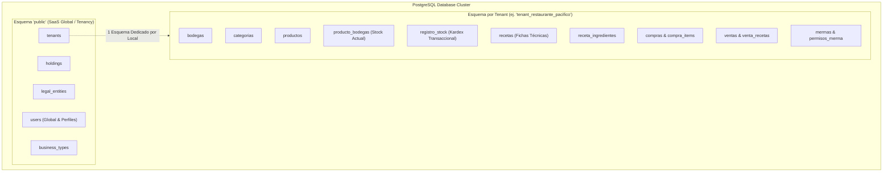
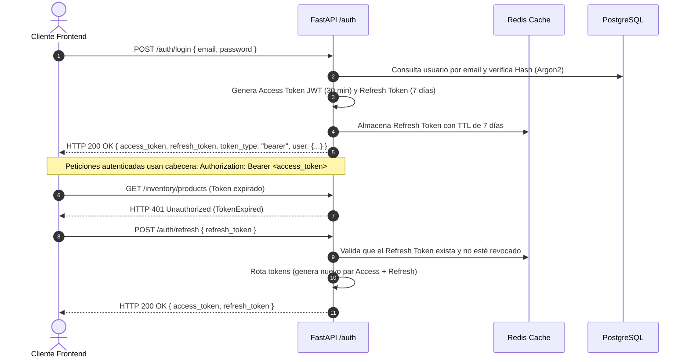

# 05-DATABASE-SCHEMA.md — Backend Schema & Auth Contract

> **Documento:** Modelo de Persistencia de Datos, Contratos de Seguridad y Autenticación  
> **Proyecto:** OppyTec SaaS  
> **Versión:** 2.0  
> **Fecha:** Octubre 2026  

---

## 1. Arquitectura de Base de Datos y Modelo Multi-Tenant

OppyTec implementa un modelo de datos **Multi-Tenant con aislamiento a nivel de Esquemas PostgreSQL**.



### 1.1 Convenciones y Campos Comunes
Todas las tablas heredan de una clase base que provee automáticamente:
- `created_at`: `DateTime(timezone=True)`, server_default = `now()`, NOT NULL.
- `updated_at`: `DateTime(timezone=True)`, onupdate = `now()`, server_default = `now()`, NOT NULL.
- `is_deleted`: `Boolean`, default = `false`, NOT NULL (para borrado lógico; excluido únicamente en tablas de log o registros transaccionales inmutables).

---

## 2. Tablas del Esquema Global (`public`)

### 2.1 `holdings` (Grupos Empresariales)
| Columna | Tipo de Dato | Restricciones / Notas |
|---|---|---|
| `id` | `UUID` | **PK**, default = `uuid_generate_v4()` |
| `nombre` | `VARCHAR(200)` | NOT NULL |
| `billing_contact_id` | `INTEGER` | Nullable |
| `is_active` | `BOOLEAN` | NOT NULL, default = `true` |

### 2.2 `legal_entities` (Razones Sociales / Entidades Legales)
| Columna | Tipo de Dato | Restricciones / Notas |
|---|---|---|
| `id` | `UUID` | **PK**, default = `uuid_generate_v4()` |
| `holding_id` | `UUID` | **FK →** `holdings.id` (ON DELETE CASCADE), NOT NULL |
| `tax_id` | `VARCHAR(50)` | NOT NULL (RUT tributario) |
| `legal_name` | `VARCHAR(200)` | NOT NULL |
| `legal_address` | `VARCHAR(500)` | Nullable |
| `is_active` | `BOOLEAN` | NOT NULL, default = `true` |

### 2.3 `tenants` (Sucursales / Locales Comerciales)
| Columna | Tipo de Dato | Restricciones / Notas |
|---|---|---|
| `id` | `UUID` | **PK**, default = `uuid_generate_v4()` |
| `legal_entity_id` | `UUID` | **FK →** `legal_entities.id` (ON DELETE RESTRICT), NOT NULL |
| `schema_name` | `VARCHAR(100)` | **UNIQUE**, NOT NULL (nombre del esquema PostgreSQL asignado) |
| `nombre` | `VARCHAR(200)` | NOT NULL |
| `direccion` | `VARCHAR(300)` | Nullable |
| `telefono` | `VARCHAR(50)` | Nullable |
| `is_active` | `BOOLEAN` | NOT NULL, default = `true` |

### 2.4 `users` (Usuarios y Cuentas de Acceso)
| Columna | Tipo de Dato | Restricciones / Notas |
|---|---|---|
| `id` | `INTEGER` | **PK**, Serial Autoincrement |
| `guid` | `UUID` | **UNIQUE**, NOT NULL, default = `uuid_generate_v4()` |
| `email` | `VARCHAR(150)` | **UNIQUE**, NOT NULL |
| `hashed_password` | `VARCHAR(255)` | NOT NULL (Argon2 / Bcrypt) |
| `nombre` | `VARCHAR(100)` | NOT NULL |
| `apellido` | `VARCHAR(100)` | Nullable |
| `role` | `VARCHAR(50)` | NOT NULL (`propietario`, `admin`, `supervisor`, `user`) |
| `is_active` | `BOOLEAN` | NOT NULL, default = `true` |
| `is_verified` | `BOOLEAN` | NOT NULL, default = `false` |

---

## 3. Tablas del Esquema de Inquilino (`tenant_*`)

### 3.1 `bodegas` (Lugares Físicos de Almacenamiento)
| Columna | Tipo de Dato | Restricciones / Notas |
|---|---|---|
| `id` | `INTEGER` | **PK**, Serial Autoincrement |
| `nombre` | `VARCHAR(100)` | NOT NULL |
| `icono` | `VARCHAR(50)` | default = `'warehouse'` |
| `descripcion` | `VARCHAR(255)` | Nullable |

### 3.2 `productos` (Catálogo Maestro de Insumos)
| Columna | Tipo de Dato | Restricciones / Notas |
|---|---|---|
| `id` | `INTEGER` | **PK**, Serial Autoincrement |
| `codigo_barra` | `VARCHAR(100)` | Nullable, Indexed |
| `nombre` | `VARCHAR(150)` | NOT NULL |
| `descripcion` | `TEXT` | Nullable |
| `categoria_id` | `INTEGER` | **FK →** `categorias.id` |
| `unidad_medida` | `VARCHAR(30)` | NOT NULL (`kg`, `gr`, `lt`, `ml`, `unidad`) |
| `costo_unitario` | `NUMERIC(12, 2)`| NOT NULL, default = `0.00` |
| `precio_venta` | `NUMERIC(12, 2)`| Nullable |
| `factor_conversion`| `NUMERIC(8, 4)` | default = `1.0000` |

### 3.3 `producto_bodegas` (Existencias Actuales por Bodega)
| Columna | Tipo de Dato | Restricciones / Notas |
|---|---|---|
| `id` | `INTEGER` | **PK**, Serial Autoincrement |
| `producto_id` | `INTEGER` | **FK →** `productos.id` (ON DELETE CASCADE), NOT NULL |
| `bodega_id` | `INTEGER` | **FK →** `bodegas.id` (ON DELETE CASCADE), NOT NULL |
| `stock_actual` | `NUMERIC(12, 3)`| NOT NULL, default = `0.000` |
| `stock_minimo` | `NUMERIC(12, 3)`| NOT NULL, default = `0.000` |
| `stock_ideal` | `NUMERIC(12, 3)`| Nullable |
| `ubicacion` | `VARCHAR(100)` | Nullable (ej. Pasillo A, Estante 2) |
*Restricción UNIQUE compuesta:* `UNIQUE(producto_id, bodega_id)`.

### 3.4 `registro_stock` (Kardex Transaccional Inmutable)
| Columna | Tipo de Dato | Restricciones / Notas |
|---|---|---|
| `id` | `BIGSERIAL` | **PK** |
| `producto_id` | `INTEGER` | **FK →** `productos.id`, NOT NULL |
| `bodega_id` | `INTEGER` | **FK →** `bodegas.id`, NOT NULL |
| `usuario_id` | `INTEGER` | NOT NULL |
| `tipo_movimiento` | `VARCHAR(50)` | NOT NULL (`entrada`, `salida`, `consumo`, `merma`, `ajuste`, `transferencia`) |
| `cantidad` | `NUMERIC(12, 3)`| NOT NULL (valor con signo o cantidad absoluta según tipo) |
| `stock_previo` | `NUMERIC(12, 3)`| NOT NULL |
| `stock_posterior`| `NUMERIC(12, 3)`| NOT NULL |
| `motivo` | `VARCHAR(255)` | Nullable |
| `referencia_id` | `VARCHAR(100)` | Nullable (ID de Factura, Venta o Merma relacionada) |

### 3.5 `recetas` y `receta_ingredientes` (Fichas Técnicas)
- **`recetas`:** `id` (PK), `nombre`, `categoria_id`, `precio_venta`, `costo_calculado`, `margen_estimado`.
- **`receta_ingredientes`:** `id` (PK), `receta_id` (FK), `producto_id` (FK), `cantidad_neta` (NUMERIC), `factor_merma` (NUMERIC, ej. 0.05 para 5% de desperdicio inherente).

---

## 4. Estrategia de Autenticación y Autorización (Auth Contract)

### 4.1 Flujo de Tokens JWT y Sesiones



### 4.2 Matriz de Roles y Permisos (RBAC)

| Recurso / Acción | `propietario` | `admin` (Tenant) | `supervisor` | `user` (Operador) |
|---|:---:|:---:|:---:|:---:|
| Ver métricas consolidadas de Holding | Sí | No | No | No |
| Crear y configurar sucursales (Tenants) | Sí | No | No | No |
| Administrar usuarios y roles de local | Sí | Sí | No | No |
| Crear/Editar Productos y Recetas | Sí | Sí | Sí | Solo lectura |
| Registrar Consumo / Venta POS | Sí | Sí | Sí | Sí |
| Declarar Merma (Cualquier monto) | Sí | Sí | Sí | Requiere aprobación |
| Ejecutar Conteo de Inventario | Sí | Sí | Sí | Sí |

---

## 5. Contratos de Endpoints Iniciales (Payloads JSON)

### 5.1 Endpoint: Login de Usuario
- **Ruta:** `POST /api/v1/auth/login`
- **Request Payload:**
```json
{
  "email": "carlos.admin@oppytec.com",
  "password": "PasswordSegura123!"
}
```
- **Response Payload (HTTP 200 OK):**
```json
{
  "access_token": "eyJhbGciOiJIUzI1NiIsInR5cCI6IkpXVCJ9...",
  "refresh_token": "d7a8f102-4c22-4809-b690-34981a28a31e",
  "token_type": "bearer",
  "expires_in": 1800,
  "user": {
    "guid": "e5b8d29c-5192-4d2a-89aa-55f7c32bf811",
    "email": "carlos.admin@oppytec.com",
    "nombre": "Carlos",
    "apellido": "Valenzuela",
    "role": "admin",
    "tenants": [
      {
        "id": "7fa2a10b-689b-468e-a745-f0bf3364f7b2",
        "schema_name": "tenant_restaurante_pacifico",
        "nombre": "Restaurante Pacífico Centro"
      }
    ]
  }
}
```

### 5.2 Endpoint: Registrar Movimiento de Stock
- **Ruta:** `POST /api/v1/operations/movements/`
- **Cabeceras:** `Authorization: Bearer <token>`, `X-Tenant-ID: <tenant_id>`
- **Request Payload:**
```json
{
  "producto_id": 42,
  "bodega_id": 2,
  "tipo_movimiento": "consumo",
  "cantidad": 3.5,
  "motivo": "Uso en preparación de evento cena anual",
  "referencia_id": "EVT-2026-10-15"
}
```
- **Response Payload (HTTP 201 Created):**
```json
{
  "id": 10452,
  "producto_id": 42,
  "bodega_id": 2,
  "tipo_movimiento": "consumo",
  "cantidad": -3.5,
  "stock_previo": 18.0,
  "stock_posterior": 14.5,
  "created_at": "2026-10-15T15:37:00Z"
}
```
