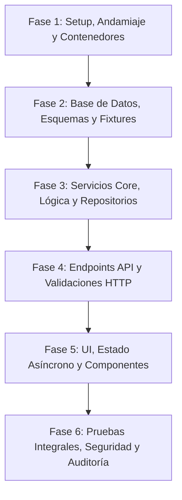

# 06-IMPLEMENTATION-PLAN.md — Step-by-Step Build Order

> **Documento:** Secuencia Cronológica de Refactorización y Plan de Montaje  
> **Proyecto:** OppyTec SaaS  
> **Versión:** 2.0  
> **Fecha:** Octubre 2026  

---

## 1. Visión Metodológica de Refactorización

Para garantizar que el sistema actual no sufra interrupciones y que la evolución del código sea progresiva, predecible y verificable, se establece un **enfoque por fases estrictamente secuenciales**.

> [!CRITICAL]
> **REGLA DE ORO:** Ninguna fase puede iniciarse hasta que todos los ítems de su respectivo **Checklist de Validación** estén verificados empíricamente y aprobados.

---

## 2. Fases Secuenciales de Montaje

### Fase 1: Setup, Entornos, Observabilidad Base y Andamiaje
**Objetivo:** Consolidar el entorno de desarrollo reproducible, los 5 entornos (`estrategia_entornos_y_despliegue_001.md`), la instrumentación base de los 4 pilares de observabilidad (`estrategia_observabilidad_monitoreo_y_analitica_001.md`), el arnés `harness.py` (`estrategia_orquestacion_git_worktrees_y_smart_merge_001.md`) y los linters sin tocar código de `OppyTec-Legacy`.
- [ ] Materializar `.agent/` (`rules/00..19`, `skills/`, `subagents/`, `memory/`), `.graphifyignore`, `AGENTS.md` y `scripts/harness.py`.
- [ ] Validar archivos `.env.example` y `src/core/config.py` (*Fail-Fast* con `SecretStr`, `ENV_NAMESPACE` y `DB_POOL_CLASS`) y `runtime-env.js` en Frontend (`SHA-256` invariante).
- [ ] Asegurar configuración de contenedores Docker (`Dockerfile` y `docker-compose.yml` con `--profile observability` para `grafana/otel-lgtm`, `glitchtip` y `umami`) y servicios principales (`postgres` con `pgvector`, `redis`, `backend`, `frontend`).
- [ ] Configurar los Quality Gates estratificados (*Fast Gate < 15s*, *Main Gate < 3m*, *Deep Gate*) en `Makefile` y `.pre-commit-config.yaml`.

**Checklist de Validación Fase 1:**
- [ ] `docker-compose up -d` levanta todos los servicios en verde sin errores de puerto ni reinicios en bucle.
- [ ] `ruff check .`, `mypy --strict src/` en backend y `pnpm lint`, `pnpm tsc --noEmit`, `pnpm dlx knip` en frontend completan con 0 errores.
- [ ] Se genera el **Mapa 5 del Atlas de Archify (`05-environments-and-agentic-harness.archify.html`)**.

---

### Fase 2: Base de Datos, Migraciones Correlativas, Bootstrap Génesis y Respaldos 4-Capas
**Objetivo:** Garantizar la estructura multi-esquema (`public` vs `tenant_*`), las migraciones correlativas (`estrategia_migraciones_alembic_001.md`), el SuperUser Génesis y el motor de respaldos en 4 capas (`estrategia_respaldos_base_datos_y_recuperacion_001.md`).
- [ ] Implementar `PublicBase` (`schema="public"`) y `TenantBase` (esquemas `tenant_*`) con `soft_delete_mixin.py` y soporte `*_i18n` JSONB.
- [ ] Implementar `alembic/env.py` consciente de `migration_scope` (`public` vs `tenant`), `scripts/db_migration.py` (`new`, `rebase`, `verify`, `impact`) y las migraciones fundacionales `0001_public_...` y `0002_tenant_...`.
- [ ] Implementar `src/core/bootstrap.py` (crea el SuperUser Génesis desde variables de entorno `SUPERUSER_GENESIS_*`, roles base y catálogo de módulos) y `scripts/seed_dev_data.py`.
- [ ] Implementar `src/core/backup/` y `scripts/backup_manager.py` (4 capas: Neon PITR, R2 Vault cifrado `.sql.zst.age` por Tenant, VPS secundario y pull local).

**Checklist de Validación Fase 2:**
- [ ] `alembic upgrade head` y `alembic downgrade -1` pasan limpiamente junto con `test_alembic_integrity.py` y `test_backup_encryption_and_tenant_restore.py`.
- [ ] Se actualiza `Graphify` y se genera el **Mapa 1 del Atlas de Archify (`01-tenancy-and-schemas.archify.html`)**.

---

### Fase 3: Servicios Core, RBAC Dual, `JEV`, `OppyFy`, `i18n`, `FX` y R2 Quotas (Clean Architecture)
**Objetivo:** Aislar la lógica de negocio en servicios puros desacoplados del framework HTTP, aplicando Co-Creación 1:1 de tests (`estrategia_testing_calidad_y_seguridad_001.md`) y sincronización bipartita de OpenSpec (`estrategia_openspec_negocio_vs_codigo_001.md`).
- [ ] Implementar el motor RBAC Dual de 3 niveles (`<modulo>.<submodulo>.<funcion>`), acceso transversal en el Holding, cupos de usuarios con `soft-delete` + Kill-Switch Redis y doble libro de auditoría forense (`estrategia_rbac_y_auditoria_001.md`).
- [ ] Implementar el adaptador global **`JEV (Sistema 1)`** (`jev_adapter.py` evaluando *"¿Lo puede hacer JEV: Sí/No?"* en cada módulo) y el motor de **`OppyFy`** (RAG 3-Capas, RBAC propio con Dominios/Sub-dominios editables por cliente, billetera de créditos acumulables sin caducidad, medidor `% contexto` y `public.llm_request_logs`).
- [ ] Implementar el motor **`i18n` Estático y Dinámico** (con memoria global `i18n_translation_memory`, filtro de nombres propios como `"Pollo King"` y micro-prompt estilo `Pi`), el **Motor Multi-Moneda FX** (`BCCh` + `BCE Frankfurter` + Circuit Breaker `> 8%`) y el **Gestor de Imágenes R2** (`thumb.webp` + `display.webp` + cuota `max_storage_mb`).
- [ ] Implementar los servicios de Catálogo (3 capas de unidades con `Decimal`), Inventario/Kardex (`ORDER BY id ASC FOR UPDATE`), Mermas, Recetas/Escandallos, Compras/Facturas y Operaciones/Buffet.

**Checklist de Validación Fase 3:**
- [ ] Pruebas unitarias y `Hypothesis` ejecutan con cobertura de ramas $\ge 90\%$ en dominio y `0` violaciones en `tests/architecture/`.
- [ ] Se actualizan los pares espejo en `specs/business-domain/` y `specs/engineering-code/`, `Graphify` y los **Mapas 2 y 3 del Atlas de Archify**.

---

### Fase 4: Endpoints y Capas de Aplicación (FastAPI)
**Objetivo:** Exponer la API RESTful con validación estricta y control de acceso.
- [ ] Implementar middleware / dependencia de resolución de Tenant (`get_tenant_db_session`) asegurando `SET LOCAL search_path`.
- [ ] Enrutar endpoints de autenticación: `/auth/login`, `/auth/refresh`, `/auth/google`.
- [ ] Enrutar endpoints de inventario y operaciones: CRUD de productos, movimientos de stock, auditorías físicas y mermas.
- [ ] Enrutar endpoints de ventas y recetas con deducción atómica de ingredientes.
- [ ] Enrutar endpoints de **`OppyFy`** (Chat SSE, RBAC propio editable, compra/distribución de paquetes de créditos), **Multi-Moneda FX**, **Almacenamiento R2 con cuotas** y **Consola de Respaldos 4-Capas**.
- [ ] Integrar validación binaria Magic Bytes en todos los endpoints de subida de archivos/imágenes y cabecera `Accept-Language` (`i18n`).

**Checklist de Validación Fase 4:**
- [ ] `test_rbac_and_audit_coverage.py`, `test_openspec_bipartition_and_sync.py` y la suite `tests/security_redteam/` (`test_01..11`) pasan al 100%.
- [ ] Se actualiza `Graphify` y se genera el **Mapa 4 del Atlas de Archify (`04-critical-runtime-flows-and-resilience.archify.html`)**.

---

### Fase 5: UI React 19, `i18n`, Multi-Moneda, `OppyFy` y Centro de Observabilidad
**Objetivo:** Construir componentes y vistas siguiendo `specs/03-USER-FLOWS.md`, `specs/04-DESIGN-SYSTEM.md`, `estrategia_internacionalizacion_i18n_multilenguaje_001.md` y `estrategia_multimoneda_fx_precios_y_cobros_001.md`.
- [ ] Implementar `httpClient.ts` (con `Authorization`, `X-Tenant-ID`, `Accept-Language`, `traceparent` de OpenTelemetry y silent refresh) y `queryKeys.ts` en TanStack React Query v5.
- [ ] Implementar `<Can perform="mod.sub.fn">`, `<LanguageFlagSelector />` (banderas SVG `US`/`ES` + 11 namespaces JSON), `<CurrencySelector />` (`CLP`/`USD`/`EUR`/`BRL` + insignia de tasa activa) y `<HoldingTenantSwitcher />`.
- [ ] Implementar el Workspace de **`OppyFy`** (con medidor `% contexto`, Canvas de tablas/gráficos, Panel RBAC de Dominios/Sub-dominios editables, billetera de créditos y auditoría de prompts).
- [ ] Implementar `features/platform-admin/` incluyendo las **2 Vistas FinOps de IA (`llm_request_logs`)**, la **Consola FX de Bancos Centrales**, la **Consola de Respaldos 4-Capas** y el **Centro de Observabilidad (13 sub-vistas de OTel, Grafana, Sentry y Umami con filtro por Environment)**.

**Checklist de Validación Fase 5:**
- [ ] `pnpm build`, `pnpm dlx knip` y `test_i18n_keys_parity_and_no_hardcoded_strings.py` completan con 0 errores ni tipos `any`.
- [ ] Ninguna vista muestra saltos bruscos de contenido (Layout Shift - CLS) ni strings sin traducir.

---

### Fase 6: Pruebas Integrales, Deep Gate, Seguridad y Certificación Final
**Objetivo:** Certificar la robustez del sistema refactorizado antes de su promoción a `Staging` y `Production`.
- [ ] Ejecución de suite `tests/e2e/` y `Playwright` para todos los flujos críticos (Compra $\to$ Stock, Merma $\to$ Aprobación, Venta $\to$ Receta, Delegación RBAC, Compra de Créditos `OppyFy` y Restauración Quirúrgica de 1 Tenant).
- [ ] Ejecución del **Deep Gate** completo: `Semgrep` (Backend + Frontend), `pip-audit`, `pnpm audit`, `Trivy FS` y fuzzing autenticado con `Schemathesis`.
- [ ] Simulación de pruebas de carga con `Locust` ($500\text{ RPS}$) verificando en **Grafana + OpenTelemetry** latencias $P_{95} \le 120\text{ ms}$.
- [ ] Certificación final de `Graphify`, de los **5 Mapas Interactivos del Atlas de Archify (`docs/architecture/atlas/`)** y de las **2 Bóvedas de OpenSpec (`business-domain/` y `engineering-code/`)**.

**Checklist de Validación Fase 6:**
- [ ] Reporte de auditoría de seguridad en cero vulnerabilidades críticas o altas y `Restore Drill` de backups aprobado.
- [ ] Documentación, grafos y Atlas visual sincronizados al 100% con el código refactorizado.
