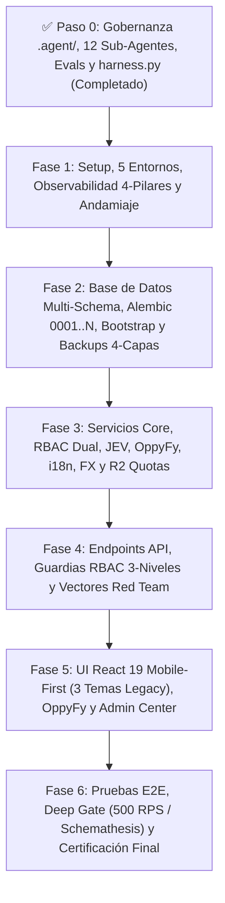

# 06-IMPLEMENTATION-PLAN.md — Step-by-Step Build Order (Vinculado 1:1 con `propuesta_arquitectura_tree_001.md`)

> **Documento:** Secuencia Cronológica de Refactorización y Plan de Montaje Estructural  
> **Proyecto:** OppyTec SaaS v2.0  
> **Plano Arquitectónico Obligatorio:** [`propuesta_arquitectura_tree_001.md`](../propuesta_arquitectura_tree_001.md) (Construido sobre `OppyTec-Legacy` + las 16 Estrategias Maestras en `.agent/estrategias/`)  
> **Versión:** 2.0  
> **Fecha:** Octubre 2026  

---

## 1. Visión Metodológica y Ley de Fidelidad al Árbol (`propuesta_arquitectura_tree_001.md`)

Para garantizar que la evolución desde `OppyTec-Legacy` hacia `OppyTec v2.0` sea 100% predecible, limpia y auditable:
1. **[`propuesta_arquitectura_tree_001.md`](../propuesta_arquitectura_tree_001.md) es el Plano Estructural Inviolable:** Ningún agente de IA ni desarrollador puede inventar carpetas o rutas fuera del árbol canónico definido en `propuesta_arquitectura_tree_001.md`.
2. **Secuencia Estricta por Fases:** Ninguna fase puede iniciarse hasta que todos los archivos asignados a la fase previa estén creados, probados en co-creación 1:1 y aprobados por su **Checklist de Validación** y por el **Agente 10 (Ciberseguridad — Poder de Veto)**.

---

## 2. Desglose de Fases y Archivos Exactos de `propuesta_arquitectura_tree_001.md` a Materializar

### ✅ Paso 0: Gobernanza Agéntica, Escuadrón de 12 Agentes y Arnés RLM (Completado)
**Archivos de `propuesta_arquitectura_tree_001.md` materializados:**
- [x] `AGENTS.md`, `.graphifyignore`, `specs/openspec.config.yaml` y `scripts/harness.py`.
- [x] `.agent/estrategias/estrategia_*_001.md` (Las 16 estrategias maestras).
- [x] `.agent/rules/00..21-*.md` (Las 22 reglas inmutables).
- [x] `.agent/evals/rubric_10_criteria.yaml` y `.agent/evals/eval_hashes.sha256` (Candado anti-trampa `SHA-256`).
- [x] `.agent/subagents/01..12-*/` (Las 12 carpetas de agentes especializados con `prompt.md`, `knowledge.md` y `handovers/latest_handover.md`).
- [x] `.agent/skills/` (Las 15 skills, incluyendo `graphify/graph_navigator.py`) y `.agent/memory/`.

---

### ✅ Fase 1: Setup, 5 Entornos, Observabilidad Base, Quality Gates de Arquitectura y Andamiaje (Completada)
- **Agentes Asignados:** Lidera **Agente 01 (Orquestador PM)** + **Agente 08 (Entornos & Observabilidad)** + **Agente 09 (QA)** + **Agente 10 (Seguridad Veto)** + **Agente 12 (OpenSpec/Archify)**.
- **Estrategias Rectoras:** `estrategia_entornos_y_despliegue_001.md`, `estrategia_observabilidad_monitoreo_y_analitica_001.md`, `estrategia_testing_calidad_y_seguridad_001.md`.

**Archivos y Directorios de `propuesta_arquitectura_tree_001.md` Construidos en Fase 1:**
- [x] **Raíz del Monorepo:**
  - `docker-compose.yml` (`postgres` 16 + `pgvector`, `redis` 7, `backend`, `frontend` + `--profile observability` con `grafana/otel-lgtm`, `glitchtip`, `umami` y `mailpit`).
  - `Makefile` (Targets deterministas: `make fast-gate`, `make main-gate`, `make deep-gate`, `make smart-merge`, `make migration-rebase`).
  - `.pre-commit-config.yaml` (`gitleaks`, `ruff`, `mypy`, `eslint`, `tsc`).
- [x] **Andamiaje `oppytec-backend/`:**
  - `oppytec-backend/Dockerfile`, `pyproject.toml`, `.env.example`.
  - `oppytec-backend/src/main.py` (App Factory con `docs_url` gobernado por `settings.is_openapi_enabled`).
  - `oppytec-backend/src/core/config.py` (Pydantic Settings v2 *Fail-Fast* en el milisegundo `0`, `SecretStr`, `ENV_NAMESPACE`, `DB_POOL_CLASS`).
  - `oppytec-backend/src/core/observability.py` (`OpenTelemetry`, `structlog` JSON, `sentry-sdk`, `X-Trace-ID` y filtro `scrub_telemetry_payload()`).
  - `oppytec-backend/tests/conftest.py`, `tests/smoke/test_system_boot_and_health.py` y la suite de Caja Blanca en `tests/architecture/` (`test_clean_architecture.py`, `test_alembic_integrity.py`, `test_rbac_and_audit_coverage.py`, `test_module_test_parity.py`, `test_harness_and_merge_integrity.py`, `test_openspec_bipartition_and_sync.py`, `test_oppyfy_telemetry_and_isolation.py`, `test_jev_system1_enforcement.py`, `test_i18n_keys_parity_and_no_hardcoded_strings.py`, `test_fx_currency_precision_and_governance.py`, `test_observability_pii_redaction_and_spans.py`, `test_media_storage_isolation_and_quotas.py`, `test_backup_encryption_and_tenant_restore.py`, `test_subagent_strategy_coverage.py`, `test_ui_design_tokens_and_mobile_first.py`).
- [x] **Andamiaje `oppytec-frontend/`:**
  - `oppytec-frontend/Dockerfile`, `docker-entrypoint.sh` (generador de `/runtime-env.js` para invarianza `SHA-256`), `package.json`, `tsconfig.json` (`noImplicitAny: true`), `vite.config.ts`, `tailwind.config.ts`, `eslint.config.js`, `knip.json`, `.dependency-cruiser.cjs`, `.env.example`.
  - `oppytec-frontend/src/main.tsx`, `src/App.tsx`, `src/shared/config/env.ts` (Zod) y `src/shared/telemetry/{otel.ts, sentry.ts, umami.ts}`.
- [x] **Documentación y Atlas:**
  - `docs/adr/ADR-001` al `ADR-021` y **Mapa 5 de Archify (`docs/architecture/atlas/05-environments-and-agentic-harness.archify.html`)**.

**Checklist de Validación Fase 1:**
- [x] `docker-compose.yml` configurado con perfiles aislados y healthchecks deterministas.
- [x] `make fast-gate` (`ruff`, `mypy --strict`, `tests/unit/`, `tests/architecture/` y `tests/smoke/`) ejecuta en `< 15s` (`~2s`) con `Exit Code 0`.

---

### ✅ Fase 2: Base de Datos Multi-Schema, Migraciones Correlativas, Bootstrap Génesis y Respaldos 4-Capas (Completada)
- **Agentes Asignados:** **Agente 02 (Arquitecto DDD)** + **Agente 03 (DB, Alembic & Backups 4-Capas)** + **Agente 09 (QA)** + **Agente 10 (Seguridad Veto)** + **Agente 11 (Merge Arbiter)** + **Agente 12 (OpenSpec/Archify)**.
- **Estrategias Rectoras:** `estrategia_migraciones_alembic_001.md`, `estrategia_respaldos_base_datos_y_recuperacion_001.md`.

**Archivos y Directorios de `propuesta_arquitectura_tree_001.md` Construidos en Fase 2:**
- [x] **Núcleo de Persistencia y Modelos Base (`oppytec-backend/src/`):**
  - `src/core/database.py` (`AsyncEngine`, `get_public_db_session`, `get_tenant_db_session` con `SET LOCAL search_path` + `RESET search_path` en checkin).
  - `src/core/redis.py` (Pool asíncrono con namespace `ENV_NAMESPACE` y Circuit Breaker).
  - `src/shared/models_base.py` (`PublicBase` con `schema="public"` y `TenantBase`), `src/shared/soft_delete_mixin.py`, `src/shared/unit_of_work.py`, `src/shared/pagination.py`.
  - Modelos de infraestructura `infrastructure/models.py` de los 10 módulos en `src/modules/` (con soporte `*_i18n` JSONB e inmutabilidad de nombres propios).
- [x] **Motor de Migraciones Correlativas (`oppytec-backend/alembic/` y `scripts/`):**
  - `alembic.ini`, `alembic/env.py` (consciente de `migration_scope: "public" | "tenant"`), `alembic/script.py.mako`.
  - `alembic/versions/0001_public_genesis_tenancy_modules_and_global_rbac.py`.
  - `alembic/versions/0002_tenant_initial_client_rbac_and_core_modules.py`.
  - `scripts/db_migration.py` (`new`, `rebase`, `verify`, `impact` vía `Graphify`).
- [x] **Bootstrap Génesis, Seeder y Respaldos en 4 Capas:**
  - `src/core/bootstrap.py` (siembra idempotente del SuperUser Génesis desde `SUPERUSER_GENESIS_*`, roles globales base, catálogo de módulos y roles cliente base editables).
  - `src/core/backup/` (`protocol.py`, `neon_pitr_adapter.py`, `r2_vault_adapter.py`, `secondary_vps_adapter.py`, `crypto_stream.py` con `zstd` + `age`).
  - `scripts/backup_manager.py` (`backup-all`, `backup-tenant`, `pre-migration-snapshot`, `restore-tenant`, `verify-drill`, `pull-to-local-office`).
  - `scripts/seed_dev_data.py` y `scripts/anonymize_for_staging.py`.

**Checklist de Validación Fase 2:**
- [x] Cadena correlativa `0001..0002` verificada con `make migration-rebase`, `test_alembic_integrity.py` y `test_backup_encryption_and_tenant_restore.py` (`52 passed` en `make fast-gate`).
- [x] Se actualiza `Graphify` (`docs/architecture/graphify/v2_phase2_schema_graph.json`) y se genera el **Mapa 1 del Atlas de Archify (`01-tenancy-and-schemas.archify.html`)**.

---

### ✅ Fase 3: Servicios Core, RBAC Dual, `JEV`, `OppyFy`, `i18n`, `FX` y R2 Quotas (Clean Architecture — Completada)
- **Agentes Asignados:** **Agente 02 (Arquitecto)** + **Agente 04 (Backend Senior)** + **Agente 06 (IA `OppyFy` & `JEV`)** + **Agente 07 (`i18n` & `FX`)** + **Agente 09 (QA Paridad Legacy con Autoreparación)** + **Agente 10 (Seguridad con Autoparcheo y Veto)** + **Agente 11 (Merge)** + **Agente 12 (OpenSpec/Archify)**.
- **Estrategias Rectoras:** `estrategia_rbac_y_auditoria_001.md`, `estrategia_asistente_ai_oppyfy_rag_y_creditos_001.md`, `estrategia_motor_decisiones_jev_system1_001.md`, `estrategia_internacionalizacion_i18n_multilenguaje_001.md`, `estrategia_multimoneda_fx_precios_y_cobros_001.md`, `estrategia_almacenamiento_imagenes_r2_y_cuotas_001.md`, `estrategia_openspec_negocio_vs_codigo_001.md`.

**Archivos y Directorios de `propuesta_arquitectura_tree_001.md` Construidos en Fase 3:**
- [x] **Las 2 Bóvedas Espejo de OpenSpec (`specs/`):**
  - Los 13 archivos `specs/business-domain/*.business.spec.md` (0% SQL/código) y los 14 archivos `specs/engineering-code/*.code.spec.md` (con `jev_system1_evaluation` completado).
- [x] **Motores Transversales y Adaptadores (`oppytec-backend/src/`):**
  - `src/core/security.py`, `src/core/exceptions.py`.
  - `src/core/i18n/` (`translator.py`, `dynamic_field_sync.py`, `locales/{es,en}/`, memoria global `i18n_translation_memory`, filtro `"Pollo King"` y micro-prompt estilo `Pi`).
  - `src/core/fx/` (`providers.py` BCCh + BCE Frankfurter, `fx_service.py` `Decimal(18, 8)`, `anomaly_guard.py` `> 8%`).
  - `src/core/realtime/` (`manager.py`, `publisher.py`, `schemas.py`, `router.py` — túnel WebSocket `/api/v1/ws/realtime` con Redis Pub/Sub + Streams, filtro RBAC de 3 niveles y catch-up `last_event_id`).
  - `src/adapters/storage/` (`protocol.py`, `image_optimizer.py` `thumb.webp` + `display.webp`, `r2_storage.py`, `local_storage.py`).
  - `src/adapters/ai/` (`protocol.py`, `gemini_adapter.py`, `jev_protocol.py`, `jev_adapter.py` registrados en `public.llm_request_logs`).
  - `src/adapters/email/` (`protocol.py`, `resend_smtp_adapter.py`, `sinkhole_mailpit_adapter.py`).
- [x] **Capas `domain/`, `application/` e `infrastructure/` de los 10 Módulos de Negocio (`oppytec-backend/src/modules/`):**
  1. `modules/identity/` (`rbac_evaluator.py`, `delegation_service.py`, `session_killswitch.py`).
  2. `modules/tenancy/` (`schema_provisioner.py`, `quota_service.py` cupos usuarios + `soft-delete`, `storage_quota_service.py` cuota MB R2).
  3. `modules/audit/` (`audit_service.py` *Append-Only* con `authorization_lineage`).
  4. `modules/catalog/` (3 capas de unidades con `Decimal`, familias, etiquetas e importador Excel IA con `JEV`).
  5. `modules/inventory/` (Bodegas, áreas, Kardex con `ORDER BY id ASC FOR UPDATE`, conteos y mermas con umbral).
  6. `modules/recipes/` (Escandallos recursivos, combos y grupos de opciones).
  7. `modules/procurement/` (Compras, proveedores, recepción, demoras y facturas OCR con `JEV`).
  8. `modules/operations/` (Ventas/consumo, manos libres, buffet, eventos, salones, turnos, notas y tareas).
  9. `modules/analytics/` (Reportes ejecutivos, control de pérdidas, eficiencia, visión financiera y proyecciones).
  10. `modules/oppy_ai/` (Asistente **`OppyFy`** con RAG en 3 Capas, Agente Enrutador `JEV` + funciones en código duro, RBAC propio editable por cliente, paquetes de créditos acumulables sin caducidad, medidor `% contexto` y telemetría `llm_request_logs`).
- [x] **Pruebas en Co-Creación 1:1 (`oppytec-backend/tests/`):**
  - `tests/unit/domain/{test_math_properties.py, test_rbac_evaluator.py, test_plan_seat_quotas.py}` (`Hypothesis`) y `tests/unit/modules/test_*_services.py`.

**Checklist de Validación Fase 3:**
- [x] Cobertura de ramas $\ge 90\%$ en dominio, paridad matemática 100% con `OppyTec-Legacy` certificada por el **Agente 09** y `0` violaciones en `tests/architecture/`.
- [x] Se actualizan `Graphify` y los **Mapas 2 y 3 del Atlas de Archify (`02-rbac-quotas-and-audit.archify.html` y `03-clean-architecture-and-domain.archify.html`)**.

---

### ✅ Fase 4: Endpoints API, Guardias RBAC de 3 Niveles y Suite Red Team (FastAPI — Completada)
- **Agentes Asignados:** **Agente 04 (Backend Senior)** + **Agente 06 (`OppyFy` & `JEV`)** + **Agente 07 (`i18n` & `FX`)** + **Agente 09 (QA)** + **Agente 10 (Seguridad Red Team Veto)** + **Agente 11 (Merge)** + **Agente 12 (OpenSpec/Archify)**.

**Archivos y Directorios de `propuesta_arquitectura_tree_001.md` Construidos en Fase 4:**
- [x] **Guardias de Seguridad (`oppytec-backend/src/core/guards/`):**
  - `rbac_dependencies.py` (`RequireGlobalPermission` y `RequireTenantPermission` con 3 niveles `<modulo>.<submodulo>.<funcion>`).
  - `file_magic_guard.py`, `xss_sanitizer.py`, `rate_limiter.py`.
- [x] **Capas `presentation/` (`router.py` y `schemas.py` con `extra="forbid"`) de los 10 Módulos (`src/modules/*/`).**
- [x] **Suite de Integración y Red Team (`oppytec-backend/tests/`):**
  - `tests/integration/` (`test_multi_tenant_schema_isolation.py`, `test_soft_delete_and_redis_killswitch.py`, `test_cross_tenant_holding_access.py`, `modules/`).
  - `tests/security_redteam/test_01..11_*.py` (los 11 vectores ofensivos Kali Linux + Resiliencia/Caos).
  - `tests/contracts/test_openapi_schemathesis.py`.

**Checklist de Validación Fase 4:**
- [x] `test_rbac_and_audit_coverage.py`, `test_openspec_bipartition_and_sync.py`, `tests/integration/` y `tests/security_redteam/` (`test_01..11`) pasan al 100% con el sello `SECURITY_APPROVED` del **Agente 10**.
- [x] Se actualiza `Graphify` y se genera el **Mapa 4 del Atlas de Archify (`04-critical-runtime-flows-and-resilience.archify.html`)**.

---

### ✅ Fase 5: UI React 19 *Mobile-First* (ADN Visual Legacy 3 Temas), `i18n`, `FX`, `OppyFy` y Centro de Observabilidad (Completada)
- **Agentes Asignados:** **Agente 05 (Frontend Senior UI/UX & *Mobile-First*)** + **Agente 07 (`i18n` & `FX`)** + **Agente 08 (Observabilidad)** + **Agente 09 (QA)** + **Agente 10 (Seguridad Frontend)** + **Agente 11 (Merge)** + **Agente 12 (OpenSpec/Archify)**.
- **Estrategias Rectoras:** `estrategia_sistema_diseno_ux_ui_y_mobile_first_001.md`, `estrategia_internacionalizacion_i18n_multilenguaje_001.md`, `estrategia_multimoneda_fx_precios_y_cobros_001.md`.

**Archivos y Directorios de `propuesta_arquitectura_tree_001.md` Construidos en Fase 5:**
- [x] **Núcleo y Sistema de Diseño (`oppytec-frontend/src/`):**
  - `src/index.css` (los 3 temas `light`, `dark`, `ocean-blue`, fuente `'Outfit'`, `.glass`, `.animate-blink-*`, `.animate-perimeter-glow`, fix `CLS=0`, `.oppy-driver-popover`).
  - `src/app/{router.tsx, providers.tsx}`.
  - `src/shared/i18n/` (`config.ts`, `i18next.d.ts`, `flags/FlagUS.tsx`, `FlagES.tsx`... y los 11 archivos JSON en `locales/es/*.json` y `locales/en/*.json`).
  - `src/shared/currency/` (`CurrencyContext.tsx`, `CurrencySelector.tsx`, `MoneyBadge.tsx`, `useCurrencyFormatter.ts`).
  - `src/shared/api/{httpClient.ts, queryKeys.ts}`, `src/shared/realtime/{RealtimeProvider.tsx, useRealtimeSync.ts}` (sincronización WebSocket en vivo con TanStack Query v5, cero polling) y `src/shared/auth/{Can.tsx, usePermissions.ts}`.
  - `src/shared/components/ui/` (Primitivas Radix + `<ResponsiveDialog />` con `vaul`, `<AdaptiveDataView />`, `<NumericInput inputMode="decimal" />`, `PRESET_COLORS` de 42 colores y 49 íconos gastronómicos).
  - `src/shared/components/feedback/` (`PageSkeleton.tsx`, `EmptyState.tsx`, `ErrorBoundary.tsx`, `Sonner`).
  - `src/shared/components/layout/` (`AppLayout.tsx`, `Sidebar.tsx`, `Navbar.tsx`, `BottomNav.tsx`, `LanguageFlagSelector.tsx`, `HoldingTenantSwitcher.tsx`, `BodegaSelector.tsx`).
  - `src/shared/hooks/` (`useSwipeNavigation.ts`, `useTheme.ts`, `useIsMobile.ts`, `useBarcodeScanner.ts`, `useWebSocket.ts`).
- [x] **Las 10 Carpetas Funcionales en `oppytec-frontend/src/features/` (cubriendo las 22 páginas de Legacy):**
  1. `features/auth/` (`Login`, `SelectTenant`, `ImpersonationBanner`).
  2. `features/rbac-and-audit/` (Roles, Matriz 3-Niveles, Permisos Temporales JIT, Cupos del Plan y Visor de Auditoría Forense).
  3. `features/catalog/` (Productos Wizard 4 pasos, Familias, Categorías, Unidades 3-Capas, Importador Excel IA de 5 etapas y Gestor de Memoria R2 MB).
  4. `features/inventory/` (`StockRegistro`, `ContarInventario`, `RecuentoInventario`, `GestionarMerma` con Heatmap 7x24 y Aprobaciones).
  5. `features/recipes/` (Escandallos, Simulador de Precios/Márgenes, Combos y Grupos de Opciones).
  6. `features/procurement/` (`Compras`, `Proveedores` y `Facturas` IA).
  7. `features/operations/` (`Consumo`, *Manos Libres* por voz, `Eventos`, `Buffet`, `Actividades` [Notas, Tareas, Turnos], `Alertas`, `Notificaciones`, `Historial`).
  8. `features/analytics/` (`HomeDashboard`, `Proyeccion`, `Informes` y los 5 paneles de `Reportes`).
  9. `features/oppyfy/` (Workspace de **`OppyFy`**, medidor `% contexto`, Split-View Canvas de tablas/gráficos, **Panel RBAC de Dominios y Sub-dominios editables por cliente**, Billetera de Créditos y Auditoría de Prompts).
  10. `features/platform-admin/` (Panel SuperUser OppyTec: Holdings, Entidades Legales, Tenants, Planes, Staff Global, **2 Vistas FinOps `llm_request_logs`**, **Consola FX de Bancos Centrales**, **Consola de Respaldos 4-Capas** y **Centro de Observabilidad de 13 Sub-Vistas con filtro por `Environment`**).

**Checklist de Validación Fase 5:**
- [x] `pnpm build`, `pnpm dlx knip`, `.dependency-cruiser.cjs`, `test_i18n_keys_parity_and_no_hardcoded_strings.py` y `test_ui_design_tokens_and_mobile_first.py` completan con 0 errores ni tipos `any`.

---

### Fase 6: Pruebas Integrales E2E, Deep Gate, Seguridad y Certificación Final
- **Agentes Asignados:** **Escuadrón Completo (`Agentes 01 al 12`)** liderado por **Agente 09 (QA)**, **Agente 10 (Ciberseguridad Veto Final)** y **Agente 12 (Certificación OpenSpec/Graphify/Archify)**.

**Archivos y Directorios de `propuesta_arquitectura_tree_001.md` a Construir y Certificar en Fase 6:**
- [ ] `oppytec-backend/tests/e2e/test_e2e_01..05_*.py`, `tests/uat/test_uat_business_scenarios.py` y `tests/load/locustfile.py`.
- [ ] Ejecución del **Deep Gate** completo: `Semgrep` (Backend + Frontend), `pip-audit`, `pnpm audit`, `Trivy FS`, `Schemathesis` y `Locust` ($500\text{ RPS}$, $P_{95} \le 120\text{ ms}$ verificado en Grafana + OpenTelemetry).
- [ ] Consolidación final de `docs/architecture/graphify/` y de los **5 Mapas Interactivos del Atlas de Archify (`docs/architecture/atlas/01..05-*.archify.html`)**.

**Checklist de Validación Fase 6:**
- [ ] 0 vulnerabilidades críticas o altas, `Restore Drill` de las 4 capas de backups aprobado y los 10 criterios de `.agent/evals/rubric_10_criteria.yaml` en `10/10`.
