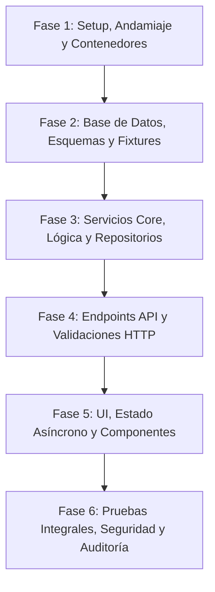

# 06-IMPLEMENTATION-PLAN.md — Step-by-Step Build Order

> **Documento:** Secuencia Cronológica de Refactorización y Plan de Montaje  
> **Proyecto:** OppyTec SaaS  
> **Versión:** 2.0  
> **Fecha:** Octubre 2026  

---

## 1. Visión Metodológica de Refactorización

Para garantizar que el sistema actual no sufra interrupciones y que la evolución del código sea progresiva, predecible y verificable, se establece un **enfoque por fases estrictamente secuenciales**.

> [!CRITICAL]
> **REGLA DE ORO:** Ninguna fase puede iniciarse hasta que todos los ítems de su respectivo **Checklist de Validación** estén verificados empíricamente y aprobados.

---

## 2. Fases Secuenciales de Montaje

### Fase 1: Setup y Andamiaje
**Objetivo:** Consolidar el entorno de desarrollo reproducible, configuraciones de variables de entorno y linters sin tocar código de lógica existente.
- [ ] Validar archivos `.env.example` en Backend y Frontend con todas las variables documentadas en [02-TRD.md](file:///home/jcampillay/WorkArea/OppyTec/OppyTec-Code/specs/02-TRD.md).
- [ ] Asegurar configuración de contenedores Docker (`Dockerfile` y `docker-compose.yml`) con servicios: `postgres` (con soporte para `pgvector`), `redis`, `backend` y `frontend`.
- [ ] Configurar linters y formateadores automáticos: `ruff` / `black` para Python y `eslint` + `prettier` para TypeScript.
- [ ] Configurar pre-commit hooks para evitar commits con secretos o fallos sintácticos.

**Checklist de Validación Fase 1:**
- [ ] `docker-compose up -d` levanta todos los servicios en verde sin errores de puerto ni reinicios en bucle.
- [ ] `ruff check .` en backend y `pnpm lint` en frontend completan con 0 errores de tipado o estilo.

---

### Fase 2: Base de Datos y Modelos
**Objetivo:** Garantizar la estructura multi-esquema y la consistencia de modelos ORM según [05-DATABASE-SCHEMA.md](file:///home/jcampillay/WorkArea/OppyTec/OppyTec-Code/specs/05-DATABASE-SCHEMA.md).
- [ ] Revisar la herencia base (`GlobalBase` para esquema `public`, `BaseModel` para esquemas de inquilinos).
- [ ] Verificar migraciones con Alembic: script de inicialización de esquemas (`oppy`, inquilinos demo) y propagación automática de DDL.
- [ ] Crear fixtures y seeds de prueba deterministas (`seed_dev_data.py`) con: 1 Holding, 1 Razón Social, 1 Tenant demo, 3 Bodegas, 20 Insumos y 5 Recetas.
- [ ] Validar índices en columnas críticas (`codigo_barra`, `producto_id`, `bodega_id`, `created_at`).

**Checklist de Validación Fase 2:**
- [ ] Las migraciones de Alembic se aplican de forma limpia hacia adelante (`alembic upgrade head`) y permiten reversión (`alembic downgrade -1`).
- [ ] Los esquemas creados contienen todas las restricciones `NOT NULL`, `UNIQUE` y llaves foráneas definidas.

---

### Fase 3: Servicios Core y Adaptadores (Clean Architecture)
**Objetivo:** Aislar la lógica de negocio en servicios puros desacoplados del framework HTTP.
- [ ] Implementar repositorio y servicio de Inventario: cálculo atómico de stock, prevención de saldos inconsistentes.
- [ ] Implementar servicio de Mermas: lógica de aprobación según umbral y registro inmutable en Kardex.
- [ ] Implementar servicio de Recetas / Escandallos: cálculo dinámico de costo unitario ponderado y margen.
- [ ] Implementar adaptadores externos con interfaces/protocolos: Adaptador de Storage (`R2StorageService`, `LocalStorageService`) y Adaptador de IA (`GeminiAIService`).

**Checklist de Validación Fase 3:**
- [ ] Pruebas unitarias de servicios con mocks ejecutan en menos de 5 segundos con cobertura $\ge 80\%$.
- [ ] Ningún servicio de dominio importa objetos de FastAPI (`Request`, `Response`, `HTTPException`).

---

### Fase 4: Endpoints y Capas de Aplicación (FastAPI)
**Objetivo:** Exponer la API RESTful con validación estricta y control de acceso.
- [ ] Implementar middleware / dependencia de resolución de Tenant (`get_tenant_db_session`) asegurando `SET LOCAL search_path`.
- [ ] Enrutar endpoints de autenticación: `/auth/login`, `/auth/refresh`, `/auth/google`.
- [ ] Enrutar endpoints de inventario y operaciones: CRUD de productos, movimientos de stock, auditorías físicas y mermas.
- [ ] Enrutar endpoints de ventas y recetas con deducción atómica de ingredientes.
- [ ] Integrar validación binaria Magic Bytes en endpoint de subida de archivos `/invoices/upload`.

**Checklist de Validación Fase 4:**
- [ ] La documentación interactiva de Swagger UI (`/docs`) refleja esquemas Pydantic v2 exactos con descripciones y ejemplos.
- [ ] Peticiones con payloads inválidos retornan código `422 Unprocessable Entity` con detalle estructurado.
- [ ] Peticiones sin token o con token de otro tenant son rechazadas con `401` o `403`.

---

### Fase 5: UI y Consumo de API (React 19 + TanStack Query)
**Objetivo:** Refactorizar componentes y vistas siguiendo [03-USER-FLOWS.md](file:///home/jcampillay/WorkArea/OppyTec/OppyTec-Code/specs/03-USER-FLOWS.md) y [04-DESIGN-SYSTEM.md](file:///home/jcampillay/WorkArea/OppyTec/OppyTec-Code/specs/04-DESIGN-SYSTEM.md).
- [ ] Homogeneizar el cliente HTTP Axios con interceptor automático para renovación silenciosa de token expirado (`refresh_token`).
- [ ] Refactorizar hooks de datos con TanStack React Query v5 (claves de caché estandarizadas: `['stock', bodegaId]`, `['recetas']`).
- [ ] Implementar estados visuales canónicos en todas las vistas: `Skeleton` para carga, `EmptyState` guiado, y notificaciones `Sonner`.
- [ ] Sincronizar selectores globales (`BodegaSelector`, `TenantSelector`) con el estado de contexto React.
- [ ] Validar compatibilidad total de contraste en Modo Claro y Modo Oscuro.

**Checklist de Validación Fase 5:**
- [ ] Compilación en limpio con Vite (`pnpm build`) sin advertencias ni tipos `any`.
- [ ] Ninguna vista muestra saltos bruscos de contenido (Layout Shift - CLS) durante la carga de datos.

---

### Fase 6: Pruebas Integrales, Seguridad y Auditoría Final
**Objetivo:** Certificar la robustez del sistema refactorizado antes de su paso a producción.
- [ ] Ejecución de suite de pruebas end-to-end (E2E) para los tres flujos críticos: Compra $\to$ Recepción $\to$ Stock, Merma $\to$ Aprobación, y Venta $\to$ Descuento de Receta.
- [ ] Escaneo de vulnerabilidades con `semgrep`, `bandit` y `trivy` para imágenes Docker y dependencias de código.
- [ ] Simulación de pruebas de carga con `locust` verificando latencias $P_{95} \le 120\text{ ms}$.
- [ ] Actualización final de diagramas y grafo de conocimiento del proyecto (`graphify update .`).

**Checklist de Validación Fase 6:**
- [ ] Reporte de auditoría de seguridad en cero vulnerabilidades críticas o altas.
- [ ] Documentación sincronizada al 100% con el código refactorizado.
