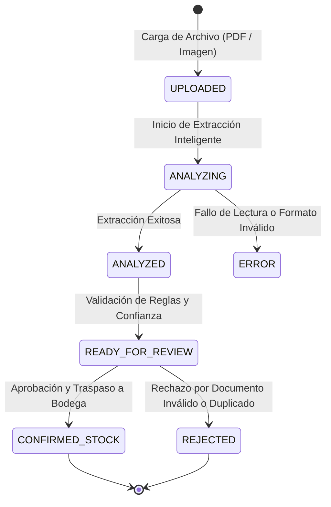

# Módulo de Facturas, Ingesta Inteligente DTE, Alias de Proveedores y Conciliación Contable

> Audiencia: Dueños de restaurantes, gerentes de operaciones gastronómicas, administradores contables, jefes de cocina, auditores tributarios y asistente inteligente OppyFy (Capa 3A). Documento conceptual y de negocio sin detalles técnicos de persistencia relacional ni código fuente interno.

---

## 1. Resumen Ejecutivo y Visión de Negocio

En el rubro gastronómico y de hospitalidad, la gestión de compras y facturación tradicionalmente adolece de un descalce estructural entre la **compra mayorista** y el **consumo culinario**:
1. **La Disparidad de Empaque (El dolor del bulto cerrado vs el gramo de receta):** Un proveedor mayorista comercializa insumos en bultos (por ejemplo, cajas de 18 kilogramos, bidones de 5 litros o mallas de 10 unidades). Sin embargo, la cocina produce y costea platos en unidades de medida base (gramos, mililitros o unidades individuales). Si la factura se ingresa tal cual la emite el proveedor, el stock en bodega y los costos de las recetas se distorsionan de inmediato.
2. **La Heterogeneidad de Nombres (La pesadilla de los alias):** Cada proveedor nombra los insumos con descripciones crípticas en sus facturas electrónicas (por ejemplo, *"PECH DESH S/P CHILEN 18KG"*, *"LOM. VET. CAT V AL VACIO"*, *"QUESO GAUD. BARRA ~3.5K"*). La administración invierte cientos de horas mensuales buscando manualmente a qué insumo del catálogo gastronómico corresponde cada línea.
3. **La Inflación Oculta y Fuga de Margen (Price Drift):** Los proveedores incrementan paulatinamente los precios unitarios de los insumos sin previo aviso. Cuando el restaurante se percata a fin de mes, el margen del plato ya se encuentra comprometido.
4. **La Conciliación y Rigor Tributario del SII (Chile):** El cumplimiento de la normativa de Documentos Tributarios Electrónicos (DTE) exige cuadres matemáticos exactos entre montos netos, IVA (19%) y totales brutos, evitando multas o discrepancias con el Servicio de Impuestos Internos.

El **Módulo de Facturas y Contabilidad de OppyTec v2.0** unifica y resuelve este ciclo completo mediante un flujo guiado e inteligente:
- **Carga Multimodal de Facturas:** Recepción de documentos en formato digital (PDF o imagen escaneada).
- **Extracción Estructurada por Inteligencia Artificial:** Lectura automática de cabeceras, proveedores, folios, impuestos y desglose línea por línea.
- **Desacoplamiento de Empaque Mayorista a Stock de Cocina:** Conversión instantánea de bultos comerciales a unidades base de inventario mediante factores multiplicadores.
- **Memoria Continua de Alias de Proveedor:** Aprendizaje automático de la correspondencia entre descripciones de facturas y productos del catálogo maestro.
- **Radar de Variación de Costos (Price Drift):** Monitoreo preventivo de variaciones de costo unitario frente al último precio histórico registrado.
- **Ingreso Atómico a Inventario y Asiento en Kardex:** Alimentación de stock físico en bodegas con método de valoración y trazabilidad por lote.
- **Cumplimiento Tributario y Exportación Oficial:** Cuadre de impuestos y generación de registros oficiales para el SII y sistemas de contabilidad general.

---

## 2. Tipos de Documentos Tributarios Electrónicos (DTE - Normativa SII Chile)

El sistema procesa y categoriza los documentos conforme a la tipología oficial regulada por el Servicio de Impuestos Internos de Chile:

| Código DTE | Denominación Oficial | Tratamiento Tributario y Operacional en OppyTec |
| :---: | :--- | :--- |
| **DTE 33** | **Factura Electrónica** | Documento gravado con Impuesto al Valor Agregado (IVA 19%). Genera crédito fiscal para el restaurante y constituye el comprobante principal de ingreso de mercadería a las bodegas. |
| **DTE 34** | **Factura No Afecta o Exenta Electrónica** | Aplica a insumos, servicios o productos no gravados con IVA (tasa 0%). Su monto neto equivale al total bruto del documento. |
| **DTE 52** | **Guía de Despacho Electrónica** | Acredita el traslado físico de mercaderías e insumos desde las bodegas del proveedor hasta el restaurante previo a la facturación formal. Permite recepcionar el stock físico manteniendo la factura en estado pendiente de cobro. |
| **DTE 56** | **Nota de Débito Electrónica** | Documento complementario que ajusta al alza el valor de una factura previa debido a diferencias de cobro, intereses o cargos adicionales. |
| **DTE 61** | **Nota de Crédito Electrónica** | Documento que rebaja o anula total o parcialmente una factura emitida previamente, originado por devolución de insumos en mal estado, mermas de recepción o descuentos posteriores a la entrega. Rebaja el crédito fiscal y ajusta el inventario. |

---

## 3. Reglas de Negocio Fundamentales

### Regla 1: Cuadre Tributario Inviolable y Tolerancia de Redondeo
- Toda factura procesada debe satisfacer la ecuación contable básica:
  $$\text{Total Bruto} = \text{Total Neto} + \text{Total IVA} + \text{Impuestos Adicionales} - \text{Retenciones}$$
- **Tasa General de IVA:** En Chile corresponde al 19% aplicado sobre el monto neto imponible:
  $$\text{IVA Esperado} = \text{redondear}(\text{Monto Neto} \times 0.19)$$
- **Tolerancia Máxima:** Debido a diferencias de redondeo céntimo a céntimo en líneas de detalle, se admite una discrepancia máxima de hasta 1 peso chileno entre el IVA calculado y el IVA informado.
- **Alerta de Inconsistencia:** Si la discrepancia supera 1 peso chileno, el documento se etiqueta con la bandera de auditoría `TAX_MISMATCH` y requiere validación del usuario antes de autorizar el ingreso al inventario.

### Regla 2: Desacoplamiento de Empaque Mayorista a Stock Gastronómico
- **Factor de Empaque:** Todo insumo adquirido al por mayor posee un multiplicador de contenido que transforma el bulto comercial en unidades de uso de cocina:
  $$\text{Stock Real de Cocina} = \text{Cantidad Facturada} \times \text{Factor de Empaque}$$
- *Ejemplo práctico:*
  - Factura indica: $2\text{ Cajas}$ de "Pechuga de Pollo Fileteada".
  - Empaque detectado: $18\text{ kg por caja}$.
  - Stock físico real que ingresa a Bodega Central: $2 \times 18 = 36\text{ kg}$.
- **Costo Unitario Real de Receta:**
  $$\text{Costo Unitario por Unidad Base} = \frac{\text{Total Neto de la Línea}}{\text{Stock Real de Cocina}}$$
  - Si el total neto de la línea es de \$108.000 CLP:
  - El costo real para costeo de platos es de \$3.000 CLP por kilogramo (\$3 por gramo), y no \$54.000 CLP por caja.

### Regla 3: Memoria Continua y Aprendizaje de Alias de Proveedores
- Los proveedores utilizan códigos de artículo o nombres de fantasía heterogéneos.
- El sistema implementa un motor de resolución por capas:
  1. **Coincidencia Exacta de Alias Memorizado:** Si el proveedor ya facturó ese texto en el pasado y el usuario lo asoció al producto maestro (por ejemplo, "LOMO VET CHIL" $\rightarrow$ "Lomo Vetado Vacuno Nacional"), el sistema realiza el match automático con 100% de confianza.
  2. **Coincidencia de Catálogo por Código o Nombre:** Búsqueda directa en la base maestra de productos del establecimiento.
  3. **Sugerencia Semántica por Similitud de Texto:** Sugerencia inteligente de productos similares del catálogo cuando la redacción difiere ligeramente.
  4. **Creación Ágil de Producto:** Si el insumo es nuevo, permite crearlo directamente desde la grilla de revisión asignándole categoría, unidad de inventario y bodega de destino.
- **Aprendizaje Idempotente:** Al marcar la casilla "Recordar Alias", el sistema guarda la equivalencia para que futuras facturas del mismo proveedor se emparejen automáticamente sin intervención manual.

### Regla 4: Radar de Variación de Costos (Price Drift)
- Cada vez que se procesa una factura, el sistema compara el nuevo costo unitario neto frente al último costo registrado para ese insumo:
  $$\text{Variación Porcentual } (\Delta\%) = \frac{\text{Costo Unitario Nuevo} - \text{Último Costo}}{\text{Último Costo}} \times 100$$
- **Niveles de Alerta del Radar:**
  - 🟢 **Variación Normal ($|\Delta\%| < 10\%$):** Cambio dentro de rangos habituales de mercado. Se actualiza el costo promedio ponderado.
  - 🟡 **Variación Preventiva ($10\% \le \Delta\% < 25\%$):** Se emite una alerta preventiva `WARNING` para conocimiento de compras.
  - 🔴 **Variación Crítica ($\Delta\% \ge 25\%$):** Se emite una alerta crítica `CRITICAL`, advirtiendo al administrador que el margen de contribución de los platos que utilizan este ingrediente se verá degradado si no se renegocia o ajusta el precio de venta al público.

### Regla 5: Asiento Transaccional en Bodega y Kardex
- La confirmación de una factura ejecuta de manera indivisible:
  1. Incremento de existencias en la bodega seleccionada para cada producto.
  2. Generación de un asiento en el Kardex con tipo `INGRESO_FACTURA`, referenciando el folio, emisor y fecha.
  3. Creación del lote de almacenamiento con fecha de recepción para consumo preferente.
  4. Actualización del estado de la factura a `CONFIRMED_STOCK`, impidiendo su re-ingreso o duplicación.

---

## 4. Ciclo de Vida de una Factura en OppyTec

1. **Carga (`UPLOADED`):** El usuario arrastra o selecciona facturas en formato digital. El sistema verifica la integridad del archivo y comprueba que no haya sido subido con anterioridad (control de duplicados).
2. **Análisis (`ANALYZING`):** La inteligencia artificial lee el documento, extrayendo emisor, cliente, montos, impuestos y líneas de detalle con empaques.
3. **Analizado (`ANALYZED` / `READY_FOR_REVIEW`):** El documento está listo para ser revisado en el Inspector Dual. Cada línea muestra su factor de conversión propuesto, estado de coincidencia de alias y costo unitario resultante.
4. **Confirmación a Inventario (`CONFIRMED_STOCK`):** El usuario verifica las cantidades reales recibidas, asigna las bodegas correspondientes y aprueba la ingesta. El stock ingresa formalmente al Kardex y se actualizan los costos maestros.
5. **Rechazo (`REJECTED`):** Si la factura fue emitida a otra razón social o presenta un error de cobro no subsanable, se descarta del ciclo operativo.

---

## 5. Experiencia de Usuario: El Inspector Dual en Pantalla Dividida

Para eliminar la fricción entre el documento físico y el sistema de gestión, la interfaz de revisión presenta una arquitectura visual en pantalla dividida:
- **Panel Izquierdo (Visor Original):** Muestra el archivo original (PDF o imagen escaneada) con controles completos de ampliación (zoom), rotación en 90 grados, navegación entre páginas y visualización a pantalla completa.
- **Panel Derecho (Grilla de Revisión de 13 Columnas):**
  1. Número de línea correlativa.
  2. Descripción original de la factura con pill de empaque detectado.
  3. Estado de coincidencia (Alias exacto memorizado, Sugerido, o Sin coincidencia).
  4. Producto de catálogo asociado (con toggle para crear producto nuevo).
  5. Categoría gastronómica del producto.
  6. Bodega física de destino (permite recepcionar distintos insumos en Bodega Central, Cocina Fría o Barra).
  7. Cantidad facturada en bultos.
  8. Precio unitario neto facturado.
  9. Total neto de la línea.
  10. Stock real de cocina calculado mediante el factor de empaque.
  11. Unidad de medida base culinaria (kg, g, L, ml, unidad).
  12. Costo unitario real de inventario con badge de variación porcentual.
  13. Casilla para memorizar el alias del proveedor para futuras compras.
