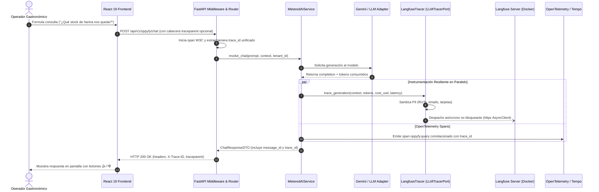
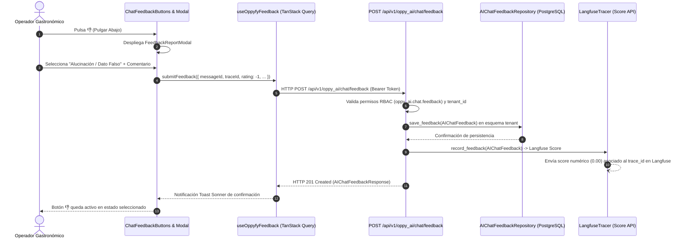

# Evaluación Sistemática y Observabilidad LLM con Langfuse — Especificación de Ingeniería

## 1. Contrato Técnico y Arquitectura de Dominio DDD

El subsistema de evaluación y observabilidad de inteligencia artificial se estructura bajo los principios de **Clean Architecture y DDD (Domain-Driven Design)** dentro del módulo `oppy_ai`:

```
oppytec-backend/src/modules/oppy_ai/
├── domain/
│   ├── evals.py               # Value Objects, Entidades y Excepciones de Dominio Evals
│   ├── ports.py               # Protocolos tipados (LLMTracerPort, LLMEvalSuitePort, etc.)
│   └── ...
├── application/
│   ├── metered_ai_service.py  # Orquestador con inyección de tracer y generación de trace_id
│   └── ...
├── infrastructure/
│   ├── models.py              # Modelos SQLAlchemy 2.0 Async (AIChatFeedbackModel, etc.)
│   └── repositories.py        # Adaptadores de persistencia (SqlAlchemy & InMemory)
└── presentation/
    ├── router.py              # Endpoints REST FastAPI (/api/v1/oppy_ai/chat/feedback)
    └── schemas.py             # DTOs y validadores Pydantic V2 con Decimal exacto
```

### 1.1 Entidades y Value Objects de Dominio (`src/modules/oppy_ai/domain/evals.py`)

- **`EvalScore` (Value Object Inmutable):**
  - Representa un puntaje normalizado en el intervalo cerrado `[Decimal("0.00"), Decimal("1.00")]`.
  - **Prohibición de Floats:** Valida estrictamente en `__post_init__` que el tipo suministrado no sea `float`. Si se detecta un `float`, lanza `AIEvalDomainError`.
  - Soporta operadores de comparación (`<`, `<=`, `>`, `>=`, `==`) contra otros `EvalScore` o instancias de `Decimal`.

- **`EvalMetricThresholds` (Value Object):**
  - Define los umbrales mínimos requeridos para superar los Quality Gates de CI/CD:
    * `min_faithfulness`: `Decimal("0.85")`
    * `min_relevance`: `Decimal("0.85")`
    * `min_context_precision`: `Decimal("0.80")`
    * `max_hallucination_rate`: `Decimal("0.05")`
    * `max_critical_hallucination_rate`: `Decimal("0.00")` (Tolerancia Cero en recetas, alérgenos, inventario y costos).

- **`TraceContext` (Value Object):**
  - Encapsula las coordenadas de trazabilidad: `trace_id`, `span_id`, `tenant_id`, `user_id`, `session_id`, `holding_id` y `tags`.
  - Proporciona el método fábrica `create_new(tenant_id, ...)` garantizando correlación con el encabezado W3C `traceparent`.

- **`AIChatFeedback` (Entidad / Agregado):**
  - Representa el voto humano otorgado a una interacción:
    * `feedback_id`: `UUID` (PK).
    * `tenant_id`: `UUID` (aislamiento multi-tenant).
    * `message_id`: `str` identificador del mensaje en el chat.
    * `trace_id`: `str` identificador correlacionado en Langfuse y Tempo.
    * `feedback_type`: `"positive"` | `"negative"`.
    * `failure_category`: Opcional ante voto negativo (`"hallucination"` | `"incomplete"` | `"math_error"` | `"bad_formatting"` | `"other"`).
    * `user_comment` y `suggested_correction`: Textos libres para curaduría continua del Golden Dataset.
    * `created_at`: Marca temporal en UTC.

- **`AIEvalCaseResult` y `AIEvalBenchmark` (Entidades de Evaluación):**
  - Modelan la ejecución de un caso individual y el benchmark agregado de una suite de evaluación (Faithfulness global, Answer Relevance, tiempo de ejecución y estado de aprobación de Quality Gate).

---

### 1.2 Puertos de Dominio (`src/modules/oppy_ai/domain/ports.py`)

- **`LLMTracerPort` (`@runtime_checkable Protocol`):**
  - `trace_generation(context, model, prompt, completion, prompt_tokens, completion_tokens, cost_usd, latency_ms, tags, metadata) -> str`: Instrumenta una generación LLM.
  - `trace_tool_call(context, tool_name, tool_input, tool_output, latency_ms, error) -> str`: Instrumenta una llamada de herramienta operativa.
  - `record_feedback(feedback) -> bool`: Envía una calificación numérica/humana al colector de trazas.
  - `flush() -> None`: Vacía de manera asíncrona los búferes de telemetría.

- **`LLMEvalSuitePort` (`@runtime_checkable Protocol`):**
  - `run_suite(suite_name, model_name, dataset_path_or_cases, thresholds) -> AIEvalBenchmark`.
  - `evaluate_case(case_id, prompt, expected_output, actual_output, retrieved_context, category) -> AIEvalCaseResult`.

- **`AIChatFeedbackRepositoryPort` (`@runtime_checkable Protocol`):**
  - `save_feedback(feedback: AIChatFeedback) -> AIChatFeedback`.
  - `list_feedback(tenant_id: UUID, message_id: str | None, limit: int, offset: int) -> list[AIChatFeedback]`.
  - `get_by_trace_id(tenant_id: UUID, trace_id: str) -> list[AIChatFeedback]`.

---

## 2. Diagramas de Secuencia y Flujos de Información

### 2.1 Flujo de Invocación con Trazabilidad Asíncrona Resiliente



### 2.2 Flujo de Captura y Procesamiento de Feedback Humano



---

## 3. Infraestructura y Despliegue de Langfuse v2 Self-Hosted

### 3.1 Contenedor Docker Compose (`docker-compose.yml`)
- **Servicio `langfuse-server`:**
  - Imagen oficial: `ghcr.io/langfuse/langfuse:2`.
  - Integrado en el perfil opcional `profiles: [observability]`.
  - Base de datos: Reutiliza el clúster de PostgreSQL de OppyTec en esquema aislado `?schema=langfuse`.
  - Inicialización: `docker/postgres/init-langfuse.sql` crea de forma idempotente el esquema relacional con permisos específicos.
  - Redis: Reutiliza la instancia interna en la base de datos `DB 2` (`redis://redis:6379/2`) para aislamiento estricto respecto a sesiones y cachés de aplicación.

### 3.2 Censura y Enmascaramiento Estricto de PII en Origen
- Toda información que ingresa a `LangfuseTracer` pasa por `scrub_telemetry_payload()` y `scrub_pii_text()`.
- Filtros Regex aplicados:
  * Formato RUT / DNI chileno: `\b\d{1,2}\.?\d{3}\.?\d{3}-?[\dkK]\b` $\to$ `[RUT_REDACTED]`.
  * Correos electrónicos: `\b[A-Za-z0-9._%+-]+@[A-Za-z0-9.-]+\.[A-Z|a-z]{2,}\b` $\to$ `[EMAIL_REDACTED]`.
  * Números de tarjeta de crédito (Luhn): `\b(?:\d{4}[ -]?){3}\d{4}\b` $\to$ `[CARD_REDACTED]`.
  * Teléfonos internacionales y nacionales: $\to$ `[PHONE_REDACTED]`.
- **Invarianza "Pollo King":** Los algoritmos de sanitización omiten y protegen las marcas comerciales registradas ("Pollo King", "Cevichería Central"), garantizando que nunca sean censuradas ni catalogadas erróneamente como PII.

---

## 4. Batería de Pruebas y Golden Dataset Gastronómico

### 4.1 Golden Dataset de 50 Casos Críticos
Ubicado en `oppytec-backend/tests/ai_evals/datasets/gastronomic_golden_dataset.json` (y su contraparte bilingüe `gastronomic_golden_dataset_en.json`), cubre 5 dominios neurálgicos:
1. **Banquetes y Escalabilidad de Porciones (`EVAL-GASTRO-001` .. `010`):** Multiplicación de recetas, mermas de cocción, factores de conversión comensales.
2. **Mermas, Costeo y Rendimiento (`EVAL-GASTRO-011` .. `020`):** Detección de mermas anómalas, costeo teórico de preparaciones emblemáticas ("Pollo King Especial"), márgenes de contribución.
3. **Stock y Política FEFO (`EVAL-GASTRO-021` .. `030`):** Alertas de caducidad < 48h, resolución de quiebres de insumos, cálculo de órdenes de compra según Lead Time.
4. **Facturas y Proveedores (`EVAL-GASTRO-031` .. `040`):** Conciliación factura vs orden de compra, variación de precios, cálculo de Costo Promedio Ponderado (CPP).
5. **Muro de Fuego y Anti-Fuga de Código (`EVAL-GASTRO-041` .. `050`):** Consultas legítimas a especificaciones funcionales vs denegación tajante de código interno (`eval()`, `import`, SQL injections, cruce de datos multi-tenant).

### 4.2 Evaluadores Personalizados Zero-Floats (`custom_evaluators.py`)
- `FaithfulnessEvaluator`: Deductibilidad lógica estricta de las afirmaciones frente al contexto de referencia (SLA $\ge 0.85$).
- `AnswerRelevanceEvaluator`: Cumplimiento del requerimiento y presencia de entidades requeridas (SLA $\ge 0.85$).
- `ContextPrecisionEvaluator`: Pertinencia de las herramientas operativas invocadas frente a las esperadas (SLA $\ge 0.80$).
- `HallucinationEvaluator`: Tasa global $\le 0.05$ y tasa crítica $\le 0.00$ en recetas y costos.
- **Invarianza Decimal:** Todo cálculo aritmético emplea `Decimal` y método de redondeo `ROUND_HALF_UP`.

---

## 5. Calidad y Certificación CI/CD (Quality Gates)

La ejecución de la suite de evaluación se integra en el arnés de verificación:
- **Ejecución Local y CI:** `pytest oppytec-backend/tests/ai_evals/` (75 tests automatizados).
- **Política Fail-Closed:** Si cualquier caso crítico falla, si la fidelidad cae por debajo de `0.85`, o si se detecta cualquier alucinación en recetas o inventario, el pipeline retorna código de salida `1` y bloquea inmediatamente el *Merge Train*.
- **Tests de Arquitectura AST:** Los tests en `oppytec-backend/tests/architecture/` validan que no existan tipos `float` en las estructuras de evaluación ni dependencias circulares entre el dominio y los colectores de observabilidad.
