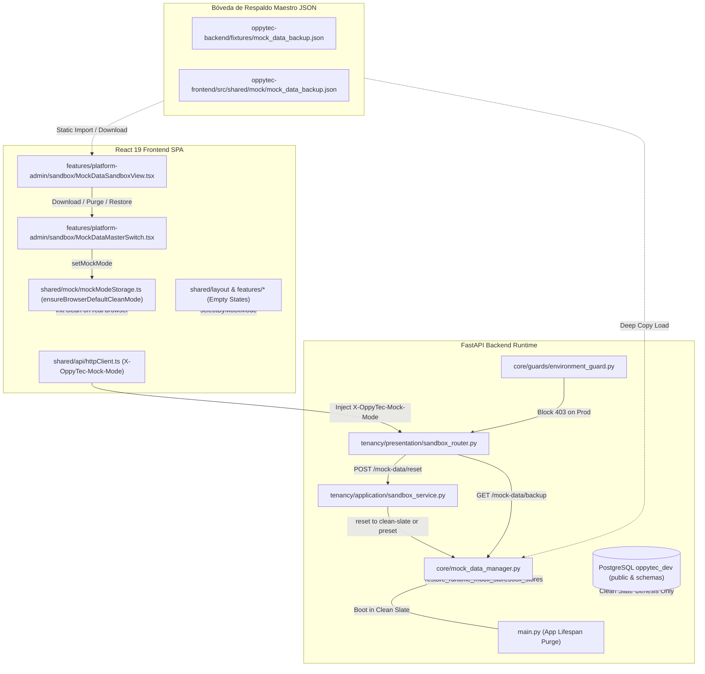

# Clean Slate 100%, Desacoplamiento Total de Mock Data y Bóveda JSON de Respaldo — Especificación Técnica de Ingeniería

## 1. Visión General de la Arquitectura (ADR-022)

Esta especificación formaliza la arquitectura técnica definida en el [`ADR-022`](file:///home/jcampillay/WorkArea/OppyTec/OppyTec-Code2/docs/adr/ADR-022-clean-slate-and-mock-data-backup-architecture.md) para el desacoplamiento total de datos sintéticos, la instauración del estado virgen por defecto (**Clean Slate**) y la gobernanza de la **Bóveda Canónica de Respaldo Maestro JSON (`mock_data_backup.json`)**.

El objetivo primario es garantizar que la base de datos PostgreSQL (`oppytec_dev`), la memoria de runtime del backend FastAPI y todas las capas de presentación React 19 inicien en un estado 100% libre de datos de demostración, manteniendo exclusivamente el estado Génesis del Plano de Control (`public`), al tiempo que se preserva el 100% de los datos sintéticos históricos y presets gastronómicos en una bóveda documental controlada por el Sandbox de Administración (`/admin/sandbox/mock-data`).



---

## 2. Bóveda Canónica de Respaldo Maestro JSON (`mock_data_backup.json`)

La totalidad de los datos sintéticos retirados de las vistas y de la base de datos se conserva en copias idénticas en dos rutas del monorepo:
1. `oppytec-backend/fixtures/mock_data_backup.json`
2. `oppytec-frontend/src/shared/mock/mock_data_backup.json`

### 2.1. Estructura de la Bóveda (`MockDataBackupVault`)
El archivo JSON estructura tres bloques fundamentales:
1. `metadata`:
   - `version`: `"2.0.0"`
   - `exported_at`: Marca temporal ISO 8601.
   - `description`: Declaración formal del propósito de la bóveda.
2. `postgresql_pre_clean_snapshot`:
   - `holdings`: Instantánea completa de empresas matrices antes de la purga.
   - `legal_entities`: Instantánea de razones sociales y RUTs.
   - `tenants`: Instantánea de sucursales con slug, plan asignado y configuración.
3. `backend_modules` & `frontend_modules`:
   - 22 dominios completos: `holdings`, `legal_entities`, `tenants`, `client_users`, `catalog` (insumos, categorías, proveedores), `inventory` (stock, lotes, conteos físicos), `fefo_batches`, `kardex`, `counts`, `mermas`, `alerts`, `recipes`, `combos`, `option_groups`, `procurement` (órdenes de compra), `invoices`, `events`, `consumo`, `activities` (turnos, notas, tareas), `projection`, `oppyfy` (hilos, prompts, gobernanza) y `finops_logs`.
   - 4 Presets Gastronómicos Canónicos:
     * `RESTAURANT_FINE_DINING`
     * `HOTEL_BUFFET`
     * `DARK_KITCHEN`
     * `FAST_CASUAL_CHAIN`

---

## 3. Gestor Central de Mock Data Backend (`mock_data_manager.py`)

Ubicado en `oppytec-backend/src/core/mock_data_manager.py`, este módulo provee las primitivas de ciclo de vida en memoria y persistencia controlada:

### 3.1. Primitivas Principales
- `load_mock_data_backup() -> dict[str, Any]`:
  Lee `oppytec-backend/fixtures/mock_data_backup.json`, valida la existencia de claves estructurales y retorna una copia profunda aislada (`copy.deepcopy`) para evitar mutaciones accidentales.
- `purge_all_runtime_mock_stores() -> dict[str, int]`:
  Vacía en memoria todas las estructuras de datos de prueba en los enrutadores y servicios:
  - `tenancy/presentation/router.py`: Limpia `_holdings_store`, `_legal_entities_store`, `_tenants_store`; conserva `_plans_store` con los 3 planes de `DEFAULT_SYSTEM_PLANS`.
  - `identity/presentation/router.py`: Limpia `_CLIENT_USERS_STORE`; asegura en `_GLOBAL_USERS_STORE` únicamente al SuperUser Génesis (`id=1`, `OppyTec.Admin@gmail.com`, `oppytec.admin`, password hash Argon2id de `oppytec2026`) y los roles base.
  - `catalog/presentation/router.py`: Limpia productos, categorías, marcas y tipos de envase, reseteando las secuencias a `0`.
  - `oppy_ai/presentation/router.py`: Limpia wallets de agentes y grants de permisos.
  - `operations/presentation/router_actividades.py`: Limpia el servicio de actividades.
  - `inventory/presentation/router.py`: Limpia servicios de inventario, mermas y recuentos físicos.
  - `events/presentation/router.py`: Limpia salones y eventos.
  - `tenancy/presentation/platform_admin_router.py`: Limpia registros de logs de tokens y decisiones JEV.
- `restore_runtime_mock_stores(preset_id: str | None = None) -> dict[str, int]`:
  Hidrata bajo demanda en memoria las estructuras del backend a partir de `mock_data_backup.json`.
- `reset_default_demo_stores() -> dict[str, int]`:
  Restaura el estado demostrativo predeterminado para el aislamiento de pruebas automatizadas en `pytest`.

### 3.2. Ciclo de Vida en `main.py`
En `oppytec-backend/src/main.py`, la función de ciclo de vida de la aplicación FastAPI (`_app_lifespan`) detecta si la ejecución corresponde a una suite de pruebas o a una ejecución en vivo:
```python
if "PYTEST_CURRENT_TEST" not in os.environ and os.environ.get("OPPYTEC_DEMO_MODE") != "1":
    purge_all_runtime_mock_stores()
```
De este modo, cualquier arranque del servidor backend inicia inmediatamente en estado Clean Slate sin intervención manual.

### 3.3. Detección de la Cabecera `X-OppyTec-Mock-Mode`
Los enrutadores de administración (`tenancy/presentation/router.py` y `platform_admin_router.py`) examinan la cabecera HTTP inyectada por el cliente:
- Si `X-OppyTec-Mock-Mode == "clean"`, las consultas sobre entidades no persistidas en base de datos retornan colecciones vacías (`[]`) y totales en `0`.

---

## 4. Script Idempotente de Limpieza y Bootstrap Génesis (`clean_and_seed_genesis_db.py`)

Ubicado en `oppytec-backend/scripts/clean_and_seed_genesis_db.py`, este script ejecuta contra PostgreSQL (`oppytec-postgres`):

1. **Eliminación Quirúrgica de Esquemas Inquilino:**
   Ejecuta `DROP SCHEMA IF EXISTS ... CASCADE` sobre cualquier esquema que coincida con el patrón `tenant_*`.
2. **Purga Total Transaccional de Tablas Contaminadas:**
   Ejecuta `TRUNCATE TABLE ... RESTART IDENTITY CASCADE` sobre las 21 tablas transaccionales de `public`.
3. **Siembra Canónica Génesis:**
   - `public.global_users`: SuperUser Génesis único con `email='OppyTec.Admin@gmail.com'`, `username='oppytec.admin'`, contraseña Argon2id para `oppytec2026`, `is_superuser_god=True`.
   - `public.app_modules`: Los 7 módulos base (`catalog`, `inventory`, `recipes`, `procurement`, `operations`, `analytics`, `oppy_ai`).
   - `public.global_roles`: Los 4 roles base (`superuser`, `admin`, `supervisor`, `developer`).
   - `public.global_permissions`: Permiso comodín `*.*.*`.
   - `public.system_plans`: Los 3 planes SaaS canónicos (`basic`, `starter`, `enterprise`).
   - `public.ai_model_configs` y `public.saas_ai_policy_config`: Los 6 modelos de IA y la política de créditos (`id=1`).

---

## 5. Desacoplamiento Reactivo en Frontend (`mockModeStorage.ts` y `httpClient.ts`)

### 5.1. Inicialización en Navegador Real (`mockModeStorage.ts`)
Para equilibrar el comportamiento entre un usuario interactivo y el entorno de pruebas `Vitest`:
- `ensureBrowserDefaultCleanMode()`: Detecta si la ejecución ocurre en navegador real (`!process.env?.VITEST` y `import.meta.env?.MODE !== "test"`). Si la clave `oppytec_clean_slate_v2_ready` no está presente, fija `oppytec_mock_data_mode = "clean"` y limpia datasets personalizados.
- En `vitest`, mantiene `"demo"` por defecto si `localStorage` no ha sido configurado, garantizando que los tests existentes sigan pasando sin modificaciones masivas.
- Selectores funcionales exportados:
  ```typescript
  export function selectByMockMode<T>(demoData: T, cleanData: T): T;
  export function useMockAwareData<T>(demoData: T, cleanData: T): T;
  ```

### 5.2. Intercepción en `httpClient.ts`
Cuando el modo es `clean` (`X-OppyTec-Mock-Mode: clean`) y una solicitud HTTP finaliza en error o requiere datos de reserva (*fallback*):
- Si `fallbackData` es un arreglo, retorna `[]`.
- Si `fallbackData` es un objeto paginado (`items`), retorna `{ ...fallbackData, items: [], total: 0 }`.
- Se prohíbe terminantemente sustituir respuestas vacías por constantes sintéticas hardcodeadas (`MOCK_*`).

### 5.3. Interfaz de Control en `/admin/sandbox/mock-data`
La vista `MockDataSandboxView.tsx` incluye la tarjeta **Bóveda de Respaldo Maestro JSON (`mock_data_backup.json`)** (`data-testid="mock-data-backup-vault-card"`) con tres operaciones:
1. `btn-download-mock-backup-json`: Descarga directa del archivo JSON de respaldo.
2. `btn-purge-all-clean-slate`: Conmuta a modo `clean`, purga `localStorage` e invoca el reset a `clean-slate`.
3. `btn-restore-mock-backup`: Conmuta a modo `demo` y restaura los almacenes demostrativos.

---

## 6. Guardrails de Entorno y Telemetría OpenTelemetry

### 6.1. Aislamiento por Entorno (`EnvironmentIsolationGuard`)
- En entorno `production`: Cualquier mutación destructiva del sandbox (como `POST /api/v1/platform-admin/sandbox/mock-data/reset` con `dry_run=False`) es rechazada con código `HTTP 403 Forbidden`.
- En entorno `staging`: Se exige confirmación forzada (`force_staging_mutation=true`).
- Esquemas protegidos: Las mutaciones se confinan estrictamente a `tenant_qa_*` o `tenant_sandbox_*`.

### 6.2. Instrumentación OpenTelemetry
Todos los endpoints relacionados con la gestión de mock data y respaldos emiten trazas distribuidas con propagación W3C TraceContext:
- `GET /api/v1/platform-admin/sandbox/mock-data/backup`: Emite el span `platform_admin_sandbox.mock_data.backup` registrando atributos `environment` y `mock_mode`.
- `POST /api/v1/platform-admin/sandbox/mock-data/reset`: Emite el span `platform_admin_sandbox.mock_data.reset` propagando `X-Trace-ID`, `traceparent` y `presetRestored`.

---

## 7. Criterios de Calidad y Verificación Automatizada

1. **OpenSpec Bipartition Gate:** `pytest oppytec-backend/tests/architecture/test_openspec_bipartition_and_sync.py` debe pasar al 100%, validando que la especificación de negocio no contenga patrones técnicos y cuente con su par técnico 1:1.
2. **Backend Unit Suites:** `pytest oppytec-backend/tests/unit/test_mock_data_manager.py` y `test_clean_and_seed_genesis_db.py` deben certificar la carga inmutable del JSON, el vaciado a Clean Slate y la preservación exclusiva del SuperUser Génesis.
3. **Frontend Vitest Suites:** `pnpm --dir oppytec-frontend test` debe mantener 100% de tests en verde sin regresiones en selectores ni en componentes de sandbox.
4. **TypeScript Strict Typecheck:** `pnpm --dir oppytec-frontend run typecheck` debe retornar 0 errores.
5. **Graphify AST Sync:** `python3 scripts/harness.py sync-graph` debe indexar los nuevos contratos y especificaciones en `docs/architecture/graphify/graph.json`.
