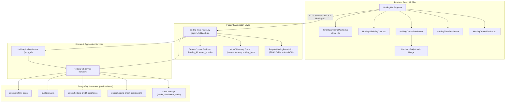

# Holding Hub Enterprise — Arquitectura Técnica de Referencia

## 1. Visión General de la Arquitectura

El **Holding Hub Enterprise** articula una arquitectura multi-tenant de tres capas (Dominio DDD, Aplicación/Orquestación e Infraestructura/Presentación) sobre FastAPI asíncrono y React 19 SPA, respaldada por persistencia relacional PostgreSQL multi-schema con SQLAlchemy 2.0 Async, telemetría distribuida OpenTelemetry y control de acceso RBAC de 3 niveles con aislamiento anti-IDOR estricto.



---

## 2. Persistencia Relacional y Modelos SQLAlchemy 2.0 Async

### 2.1 Migración Alembic Correlativa Lineal
- **Archivo:** `oppytec-backend/alembic/versions/0018_public_holding_hub_credit_distribution_and_purchases.py`
- **Revisión:** `0018_public_holding_hub_credit_distribution_and_purchases`
- **Down Revision:** `0017_public_ai_benchmarks_and_tenant_feedback`
- **Operaciones DDL:**
  1. `op.add_column("holdings", sa.Column("credit_distribution_mode", sa.String(20), server_default="shared", nullable=False), schema="public")`
  2. `op.create_table("holding_credit_distributions", ..., schema="public")` con restricción `UniqueConstraint("holding_id", "tenant_id", name="uq_holding_tenant_credit_distribution")`.
  3. `op.create_table("holding_credit_purchases", ..., schema="public")` con FKs hacia `public.holdings.id` y `public.global_users.id`.
  4. Función `downgrade()` estrictamente LIFO idempotente.

### 2.2 Modelos ORM (`oppytec-backend/src/modules/tenancy/infrastructure/models.py`)

```python
class Holding(PublicBase):
    __tablename__ = "holdings"
    __table_args__ = {"schema": "public"}

    id: Mapped[uuid.UUID] = mapped_column(UUID(as_uuid=True), primary_key=True, default=uuid.uuid4)
    name: Mapped[str] = mapped_column(String(128), nullable=False)
    credit_distribution_mode: Mapped[str] = mapped_column(String(20), default="shared", nullable=False)
    ai_credit_balance: Mapped[int] = mapped_column(Integer, default=0, nullable=False)
    # ... otras columnas corporativas


class HoldingCreditDistribution(PublicBase, AuditTimestampsMixin):
    __tablename__ = "holding_credit_distributions"
    __table_args__ = (
        UniqueConstraint("holding_id", "tenant_id", name="uq_holding_tenant_credit_distribution"),
        {"schema": "public"},
    )
    translatable: ClassVar[bool] = False  # Regla Pollo King

    id: Mapped[uuid.UUID] = mapped_column(UUID(as_uuid=True), primary_key=True, default=uuid.uuid4)
    holding_id: Mapped[uuid.UUID] = mapped_column(
        UUID(as_uuid=True), ForeignKey("public.holdings.id", ondelete="CASCADE"), nullable=False, index=True
    )
    tenant_id: Mapped[uuid.UUID] = mapped_column(
        UUID(as_uuid=True), ForeignKey("public.tenants.id", ondelete="CASCADE"), nullable=False, index=True
    )
    monthly_ai_credits: Mapped[int] = mapped_column(Integer, default=2000, nullable=False)


class HoldingCreditPurchase(PublicBase):
    __tablename__ = "holding_credit_purchases"
    __table_args__ = {"schema": "public"}
    translatable: ClassVar[bool] = False  # Regla Pollo King

    id: Mapped[uuid.UUID] = mapped_column(UUID(as_uuid=True), primary_key=True, default=uuid.uuid4)
    holding_id: Mapped[uuid.UUID] = mapped_column(
        UUID(as_uuid=True), ForeignKey("public.holdings.id", ondelete="CASCADE"), nullable=False, index=True
    )
    credits_amount: Mapped[int] = mapped_column(Integer, nullable=False)
    price_clp: Mapped[Decimal] = mapped_column(Numeric(14, 2), nullable=False)
    price_usd: Mapped[Decimal] = mapped_column(Numeric(14, 4), nullable=False)
    status: Mapped[str] = mapped_column(String(32), default="COMPLETED", nullable=False)
    purchased_by_user_id: Mapped[int | None] = mapped_column(
        Integer, ForeignKey("public.global_users.id", ondelete="SET NULL"), nullable=True
    )
    created_at: Mapped[datetime] = mapped_column(DateTime(timezone=True), default=lambda: datetime.now(timezone.utc))
```

---

## 3. Endpoints REST y Seguridad RBAC 3-Niveles

### 3.1 Guardia de Seguridad (`RequireHoldingPermission`)
- Implementada en `oppytec-backend/src/core/guards/rbac_dependencies.py`.
- **Jerarquía:**
  - Nivel 1: Superadmin de plataforma (`is_superadmin=True`).
  - Nivel 2: Asignaciones de permisos a nivel global (`GlobalUserPermissionGrant`).
  - Nivel 3: Permisos de cliente / holding asignados en roles de holding o local.
- **Aislamiento Anti-IDOR Estricto:** Valida que el `holding_id` de la petición coincida con el holding autorizado del usuario. Retorna `HTTP 403 Forbidden` inmediato ante intentos de manipulación cruzada.

### 3.2 Matriz de Endpoints (`/api/v1/holding-hub`)

| Método | Endpoint | Permiso Requerido | Descripción Operativa |
| :--- | :--- | :--- | :--- |
| `GET` | `/api/v1/holding-hub/summary` | `holding.hub.view` | KPIs consolidados (ventas, stock, merma, balance IA, tasa de uso). |
| `GET` | `/api/v1/holding-hub/tenants` | `holding.hub.view` | Métricas operacionales y cuotas de IA desagregadas por sucursal. |
| `GET` | `/api/v1/holding-hub/daily-credit-usage` | `holding.hub.view` | Series temporales continuas para Recharts (7, 14, 30 días). |
| `PUT` | `/api/v1/holding-hub/credit-distribution` | `holding.credits.distribute` | Modos `shared` / `allocated` con validación estricta de cupos totales. |
| `POST` | `/api/v1/holding-hub/purchase-credits` | `holding.credits.distribute` | Recarga de bolsa prepagada con auditoría y cálculo 100% `Decimal`. |
| `POST` | `/api/v1/holding-hub/change-plan` | `holding.plans.manage` | Upgrade/cambio de plan comercial con recarga de balance de IA. |
| `GET` | `/api/v1/holding-hub/benchmarking` | `holding.hub.view` | Ranking y comparativas cross-tenant por ventas, rotación y merma. |
| `GET` | `/api/v1/holding-hub/ai-briefing` | `holding.hub.view` | Briefing ejecutivo IA (2 párrafos) y semáforo predictivo de Safety Cap. |

---

## 4. Contratos Pydantic v2 (Esquemas de Entrada y Salida)

Todos los esquemas residen en `oppytec-backend/src/modules/tenancy/presentation/schemas_holding_hub.py` y se configuran con `extra = "forbid"` y precisión `Decimal` / `int` (cero `float`):

```python
class SafetyCapPredictiveStatus(BaseModel):
    model_config = ConfigDict(extra="forbid")
    status: Literal["NORMAL", "WARNING", "CRITICAL"]
    burn_rate_daily: Decimal
    estimated_days_remaining: int
    recommendation: str

class HoldingBriefingResponse(BaseModel):
    model_config = ConfigDict(extra="forbid")
    holding_id: uuid.UUID
    generated_at: datetime
    summary_paragraphs: list[str] = Field(..., min_length=2, max_length=2)
    key_achievements: list[str]
    cost_alerts: list[str]
    safety_cap_prediction: SafetyCapPredictiveStatus
    tokens_used: int
    credits_deducted: int
    model_name: str

class HoldingHubSummaryResponse(BaseModel):
    model_config = ConfigDict(extra="forbid")
    holding_id: uuid.UUID
    holding_name: str
    plan_slug: str
    credit_distribution_mode: Literal["shared", "allocated"]
    metrics: HoldingConsolidatedMetrics
    active_tenants_count: int
    total_tenants_count: int
    ai_briefing: HoldingBriefingResponse | None = None
```

---

## 5. Instrumentación OpenTelemetry y Observabilidad 4-Capas

1. **Tracer Dedicado:** `oppytec.tenancy.holding_hub` instrumenta cada método de `HoldingHubService` y endpoint FastAPI:
   - Spans: `holding_hub.get_summary`, `holding_hub.get_tenants`, `holding_hub.daily_credit_usage`, `holding_hub.update_distribution`, `holding_hub.purchase_credits`, `holding_hub.change_plan`, `holding_hub.benchmarking`, `holding_hub.ai_briefing`.
   - Atributos estándar: `holding.id`, `tenants.count`, `credits.total`, `credits.used`, `plan.tier`.
2. **Contexto Sentry / GlitchTip:** Inyección obligatoria de tags en cada evento y trace:
   - `holding_id`: UUID del consorcio.
   - `tenant_id`: UUID del local en contexto.
   - `user_role`: Rol normalizado (`holding_owner`, `superuser`, etc.).
   - Scrubbing determinista de PII con regex para RUT, credenciales y números de tarjeta.
3. **Métricas en Memoria y SLA de Rendimiento:**
   - Buffer rotativo `HoldingHubOperationMetric` con capacidad de 1.000 eventos.
   - **SLA de Latencia:** Percentil 95 ($p95 < 200\text{ ms}$) certificado en pruebas de estrés de 60 ciclos continuos.

---

## 6. Frontend: React 19, Recharts y Experiencia de Usuario

- **Estructura Modular (`oppytec-frontend/src/features/holding-hub/`):**
  - `HoldingHubPage.tsx`: Vista principal montada en la ruta `/holding-hub`.
  - `HoldingHubLayout.tsx`: Shell corporativo con Navbar de 80px y Sidebar colapsable con 3 temas: `ocean-blue`, `dark`, `light`.
  - `HoldingCentralSection.tsx`: Métricas consolidadas, vista dual tabla/cuadrícula y modal de inspección.
  - `HoldingPlansSection.tsx`: Tarjetas de suscripción, badges de estado y modal de upgrade.
  - `HoldingCreditsSection.tsx`: Gráfico Recharts de series temporales, sliders de cuotas y compra de paquetes.
  - `HoldingAiBriefingCard.tsx`: Tarjeta con ADN visual glassmorphism, 2 párrafos de IA y semáforo predictivo.
  - `TenantCommandPalette.tsx`: Buscador interactivo activado con `Cmd+K` / `Ctrl+K`.
- **Integración Multi-Moneda FX y i18n:**
  - Conversión reactiva con `useCurrencyFormatter().convertAndFormat(val, "CLP", cur)` soportando CLP, USD, EUR y BRL.
  - Catálogos bilingües espejo (`locales/es/holding_hub.json` y `locales/en/holding_hub.json`) con 174 claves cada uno y 100% de paridad.
  - Cero textos crudos (raw strings) en el código JSX.
