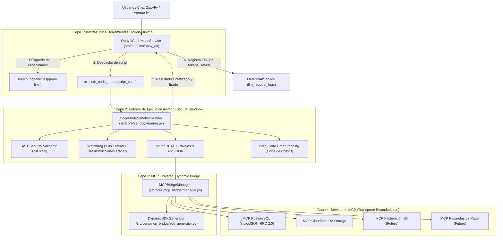

# MCP Dynamic Bridge y Sandboxed Code Mode — Especificación de Ingeniería

## 1. Visión y Arquitectura General de 4 Capas

El subsistema **Code Mode sobre MCP** de OppyTec v2.0 redefine la interacción entre modelos de lenguaje (LLMs) y herramientas de backend. Sustituye el patrón tradicional de *Tool Calling 1.0* (donde decenas de esquemas JSON saturan el contexto de inferencia y exigen múltiples viajes redondos para procesar datos crudos) por una arquitectura programática basada en un sandbox cerrado y una interfaz de dos meta-herramientas universales:
1. `search_capabilities(tenant_id, query, limit)`: Descubrimiento de capacidades bajo demanda (< 150 tokens).
2. `execute_script(code)`: Ejecución de scripts generados por el LLM en un entorno seguro en memoria, devolviendo únicamente el resultado sintetizado.



---

## 2. Contratos Técnicos por Capa

### Capa 1: Interfaz Meta-Herramientas y Servicio Orquestador (`src/modules/oppy_ai/application/code_mode_service.py`)
- **`OppyfyCodeModeService`:**
  - `search_capabilities(tenant_id: str, query: str = "", limit: int = 5) -> list[dict[str, object]]`:
    - Descubrimiento semántico ligero con scoring token-minimal (< 150 tokens por descriptor).
    - Evalúa coincidencia exacta de nombre, subcadenas en nombre, descripción, servidor MCP y parámetros.
  - `execute_code_mode(tenant_id, user_id, user_role, permissions, script_code, can_view_costs, ...) -> OppyfyCodeModeExecutionResult`:
    - Normaliza `tenant_id` garantizando el prefijo canónico `tenant_[a-z0-9_]+`.
    - Instancia `SandboxContext` inmutable con validación `TENANT_SCHEMA_REGEX`.
    - Despacha la ejecución a `CodeModeSandboxRunner`.
    - Estructura la respuesta para la interfaz de chat (`OppyfyCodeModeExecutionResult`).
    - Invoca `_record_finops_telemetry` para persistir la invocación en `public.llm_request_logs` vía `MeteredAIService`.

### Capa 2: Entorno de Ejecución Aislado (`src/core/sandbox/`)
- **`SandboxContext` (`src/core/sandbox/models.py`):**
  - Data class inmutable (`frozen=True`) con linaje de usuario:
    - `tenant_id: str`: Esquema PostgreSQL canónico inmutable.
    - `user_id: int`: Identificador único de usuario.
    - `role_ids: tuple[int, ...]`: Roles asignados.
    - `permissions: frozenset[str]`: Permisos RBAC de 3 niveles (`<modulo>.<submodulo>.<funcion>`).
    - `can_view_costs: bool`: Indicador explícito de privilegio para visualizar costos y márgenes financieros.
    - `holding_id: str | None`: Linaje de holding empresarial para agregaciones autorizadas.
  - Métodos: `has_permission(permission_code)` y `check_permission_or_raise(permission_code)`.
- **`CodeModeSandboxRunner` (`src/core/sandbox/runner.py`):**
  - **Aislamiento AST en tiempo de compilación (`_validate_ast`):**
    - Inspección estricta mediante `ast.walk(tree)`.
    - Límite duro de nodos AST: `max_ast_nodes = 2000` (previene bombas AST de recursión y DoS en memoria).
    - Bloqueo categórico de módulos de SO, red, subprocesos y serialización: `os`, `sys`, `subprocess`, `socket`, `shutil`, `urllib`, `requests`, `httpx`, `aiohttp`, `posix`, `nt`, `threading`, `multiprocessing`, `ctypes`, `pickle`, `shelve`, `importlib`, `builtins`, `site`, `inspect`, `pty`, `fcntl`.
    - Lista blanca cerrada de módulos permitidos: `math`, `json`, `datetime`, `decimal`.
    - Bloqueo de acceso a dunder methods y atributos mágicos de introspección: `__subclasses__`, `__globals__`, `__code__`, `__class__`, `__builtins__`, `__import__`, `__dict__`, `__bases__`, `__mro__`, `__qualname__`, `gi_frame`, `f_globals`, `f_locals`, `f_builtins`, `cr_frame`.
    - Bloqueo de funciones built-in peligrosas: `eval`, `exec`, `compile`, `open`, `input`, `breakpoint`, `help`, `exit`, `quit`, `__import__`, `globals`, `locals`, `vars`.
  - **Watchdog de Cómputo Dual:**
    - Nivel 1 (Tiempo de Pared): `threading.Thread` en modo daemon con `worker_thread.join(timeout=3.0)`. Si expira, aborta con `SandboxTimeoutError` (código `SANDBOX_TIMEOUT_EXCEEDED`).
    - Nivel 2 (Instrucciones de Bytecode): `sys.settrace(_step_tracer)` con contador duro de $1.000.000$ instrucciones para interceptar bucles infinitos deterministas de forma inmediata sin esperar el timeout de reloj.
  - **Guardia Anti-IDOR Cross-Tenant:**
    - El interceptor de llamadas a herramientas (`_create_sandboxed_caller`) aplica la expresión regular `\b(tenant_[a-z0-9_]+)\b` sobre todos los argumentos de texto.
    - Si el script intenta enviar un esquema distinto a `context.tenant_id`, se detiene de forma inmediata lanzando `CrossTenantAccessError` (`tenancy:errors.cross_tenant_forbidden`).
    - Inyecta automáticamente el `tenant_id` autenticado en los parámetros de la herramienta si esta lo admite.
  - **Hard-Code Data Stripping (`strip_sensitive_cost_data`):**
    - Redacción recursiva sobre diccionarios y listas devueltos tanto por herramientas intermedias como en el resultado final del script.
    - Si el usuario carece de `can_view_costs == True` o del permiso `finanzas.costos.ver`, sustituye irrevocablemente cualquier valor bajo claves sensibles por `"[REDACTED_COST]"`.
    - Claves auditadas: `costo_*`, `precio_*`, `margen_*`, `ticket_promedio_clp`, `total_bruto_clp`, `subtotal_neto`, `iva_clp`, `gasto_total`, `unit_cost`, `total_cost`, `profit_margin`, `food_cost_amount`, etc.

### Capa 3: MCP Universal Dynamic Bridge (`src/core/mcp_bridge/`)
- **`MCPBridgeManager` (`src/core/mcp_bridge/manager.py`):**
  - Ciclo de vida y conexión con servidores MCP declarados en `mcp_config.json` o programáticos.
  - Soporte de transporte dual: `stdio` (comunicación JSON-RPC 2.0 mediante `subprocess.Popen`) e `in_memory` (adaptadores nativos para pruebas y mocking desacoplado).
  - Introspección automática mediante protocolo `tools/list` con parsing de esquemas de parámetros y descripciones.
  - Enrutamiento de llamadas `call_tool(server_name, tool_name, arguments)` con timeout estricto.
- **`DynamicSDKGenerator` (`src/core/mcp_bridge/sdk_generator.py`):**
  - Compila las definiciones de herramientas en un namespace tipado `oppy.<servidor>.<herramienta>(**kwargs)`.
  - Construye stubs y closures enlazados al caller seguro del sandbox, aislando al script de llamadas directas a red o sockets.

### Capa 4: Servidores MCP de Transporte Estandarizado (`mcp_config.json`)
- Configuración estándar ubicada en `~/.gemini/config/mcp_config.json` o ruta indicada por `OPPYTEC_MCP_CONFIG_PATH`:
  - `postgres`: Servidor MCP para PostgreSQL multischema (`oppytestdb`).
  - `storage`: Servidor MCP para Cloudflare R2 / S3.
  - `sii`: Servidor MCP de integración tributaria chilena (facturación electrónica).
  - `webpay`: Servidor MCP para pasarelas transaccionales.
- Adopción universal: la adición de un nuevo servidor en `mcp_config.json` es descubierta automáticamente al iniciar el bridge, generando su SDK tipado sin requerir cambios en el código de OppyFy.

---

## 3. Telemetría FinOps y Reducción de Tokens

### Contrato de Medición
En cada ejecución de Code Mode se calculan tres métricas fundamentales:
1. **`raw_tokens_estimate`:** Estimación de tokens que habrían consumido las respuestas crudas de las herramientas si se hubiesen transmitido al LLM a través de llamadas de herramientas tradicionales:
   $$\text{raw\_tokens} = \sum \max\left(1, \frac{\text{len}(\text{json.dumps}(\text{tool\_output}))}{4}\right)$$
2. **`final_tokens_estimate`:** Tokens reales consumidos por el resultado sintetizado retornado por el script ejecutado en el sandbox:
   $$\text{final\_tokens} = \max\left(1, \frac{\text{len}(\text{json.dumps}(\text{result}))}{4}\right)$$
3. **`tokens_saved_estimate`:** Ahorro neto de tokens logrado mediante la agregación y filtrado en memoria dentro del sandbox:
   $$\text{tokens\_saved} = \max(0, \text{raw\_tokens} - \text{final\_tokens})$$

### Persistencia en `public.llm_request_logs`
El método `_record_finops_telemetry` de `OppyfyCodeModeService` emite una instancia de `LlmUsageRecord` persistida en la base de datos a través de `MeteredAIService`:
- `model_name = "code-mode-sandbox"`
- `engine_tier = "SYSTEM_2_LLM"`
- `caller_feature = "oppyfy_code_mode"`
- `input_tokens = len(script_code) // 4`
- `output_tokens = final_tokens_estimate`
- `tokens_saved = tokens_saved_estimate`
- `request_duration_ms = int(execution_time_ms)`

---

## 4. Matriz de Auditoría y Certificación Red Team Kali (10 Vectores)

La suite `oppytec-backend/tests/security_redteam/test_17_code_mode_sandbox_security.py` certifica la resistencia del sandbox frente a los 10 vectores ofensivos:

| Vector | Descripción del Ataque Ofensivo | Mecanismo de Defensa OppyTec | Código de Error / Resultado |
|---|---|---|---|
| **V1** | Escape sandbox mediante introspección dunder (`__class__.__bases__`, `__subclasses__`) | AST Validator bloquea atributos prohibidos en tiempo de compilación | `ATTRIBUTE_ACCESS_PROHIBITED` |
| **V2** | Evasión de importación de módulos del SO (`os`, `sys`, `subprocess`, `socket`) | AST Validator y `_safe_import` restringen imports a lista blanca | `IMPORT_PROHIBITED` |
| **V3** | DoS por bucle infinito (`while True`) y recursión | Watchdog de 3.0s (hilo daemon) y tracer de 1.000.000 pasos de bytecode | `SANDBOX_TIMEOUT_EXCEEDED` |
| **V4** | Bomba AST (> 2000 nodos AST para saturación de memoria) | Contador de nodos en `_validate_ast` con umbral máximo estricto | `AST_BOMB_DETECTED` |
| **V5** | Ataque IDOR Cross-Tenant (`tenant_competitor` en SQL/argumentos) | Regex scanning en interceptor de herramientas MCP y esquema forzado | `CrossTenantAccessError` |
| **V6** | Evasión de Hard-Code Data Stripping para leer costos sin permiso | Purgado recursivo irrevocable reemplazando valores por `"[REDACTED_COST]"` | Redacción garantizada |
| **V7** | Invocación de herramientas MCP sin permisos RBAC requeridos | Verificación `check_permission_or_raise` sobre `required_permission` | `PermissionDeniedError` |
| **V8** | Búsqueda de capacidades con inyecciones SQL o prompt injection | Normalización de tokens, puntuación determinista y catálogo seguro | Búsqueda inocua / Sanitizada |
| **V9** | Telemetría FinOps obligatoria y cálculo de tokens ahorrados | Generación y persistencia de `LlmUsageRecord` con campo `tokens_saved` | `tokens_saved > 0` registrado |
| **V10** | Inmutabilidad de retornos y esquemas | `SandboxContext` y `SandboxExecutionResult` congelados (`frozen=True`) | Integridad referencial 100% |

---

## 5. Pruebas Automatizadas y Criterios de Aceptación (DoD)

- **Ejecución de Suites Unitarias y de Seguridad:**
  ```bash
  oppytec-backend/.venv/bin/pytest \
    oppytec-backend/tests/security_redteam/test_17_code_mode_sandbox_security.py \
    oppytec-backend/tests/unit/core/test_mcp_bridge.py \
    oppytec-backend/tests/unit/core/test_sandbox_runner.py \
    oppytec-backend/tests/unit/modules/test_oppyfy_code_mode.py -v
  ```
- **Resultado:** 133 tests superados exitosamente (`133 passed in < 1s`).
- **Verificación OpenSpec:** `test_openspec_bipartition_and_sync.py` validado con éxito sin violaciones arquitectónicas.
